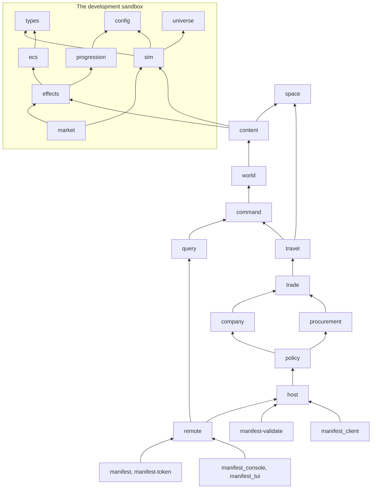

# Architecture

Manifest is a persistent, networked trading and development game. This document is the overview:
what Manifest builds on, how the repository is laid out, how its modules depend on each other, the
two worlds it runs, the order of a simulation step, its threads and its server. Each feature has
its own document, listed [at the end](#feature-documents); the [glossary](glossary.md) defines the
terms.

## Manifest on Jettison

Manifest is a game built on [Jettison](../../jettison/docs/README.md), a C++20 engine for several
kinds of game. The engine provides neutral capabilities: the simulation world and its scheduler,
physics, docks, transit, networking, durable writes, the virtual file system, reflection and
archives, the host session and the developer console. Manifest owns everything that makes it this
game: its rules, its content, its balance, its space setting and its server. Which side a piece of
work belongs to, and how a missing engine capability is provisioned, is
[Jettison's game integration](../../jettison/docs/game-integration.md).

The engine is fetched at a pinned revision (`source/external/CMakeLists.txt`,
`MANIFEST_JETTISON_REVISION`), with its tests and installation off. Jettison owns every shared
dependency's version: Manifest links the engine's `EnTT::EnTT`, `yaml-cpp::yaml-cpp` and
`doctest::doctest` and declares none of its own, except FTXUI 7.0.3 for the development terminal
UI, which ships in no game module.

## Repository layout

| Path | Holds |
| --- | --- |
| `source/game/<module>/` | The game's modules, one directory each, like Jettison's `source/engine/`: a `CMakeLists.txt`, public headers in `include/manifest/<module>/`, `src/` and the module's unit suite in `tests/` |
| `source/apps/manifest/` | The programs: `manifest` (start-up check, `--serve`, `--restore`), `manifest-validate` and `manifest-token` ([the host](host.md)) |
| `source/apps/distribution/` | The glibc floor check the standalone bundle is built against ([the host](host.md#the-distribution)) |
| `source/tools/console/` | `manifest_console`, the development console's commands on Jettison's console, and its suite ([the console](console.md)) |
| `source/tools/tui/` | `manifest_tui`, the FTXUI terminal over that console |
| `source/apps/client/` | `manifest_client`, the graphical client on Jettison's shell ([the graphical client](client.md)) |
| `source/test/` | Cross-module suites (data, mod, effects integration, fixtures), the test overlays and the SDK import check |
| `source/external/` | The pinned engine and FTXUI |
| `data/` | The authored content: items, skill tree, ships, docks, offers, star systems, scenarios, game modes and `tuning/balance.yaml`. `data/build.sh` turns it into one definition file per record in `data/definitions/` ([content](content.md)) |
| `mods/manifest/` | `mod.yaml`, the package's description; the build stages it with the definitions as the mod directory and packs it as `manifest.pack` |
| `cmake/` | `ManifestModule.cmake` (the module helper, after Jettison's), `Distribution.cmake` and `Revision.cmake` |
| `scripts/` | The gate (`ci.sh`), tidy, format check, the bundle's staging and smoke tests ([build and gates](build-and-gates.md)) |

`source/{components,effect-catalogue,civilisation-effects,ship-effect-engine,tui,yaml-field-readers}/`
hold only empty directories, left from an earlier layout; nothing builds from them.

## Modules

Each module is a static library made by `manifest_add_module` (`cmake/ManifestModule.cmake`):
public headers, private warnings, and a doctest suite named after the module. A dependency on a
module not yet added fails configuration, so `source/game/CMakeLists.txt` adds them lowest tier
first. `Manifest::Game` gathers every module below the host, as `Jettison::Engine` does;
`Manifest::Core` is an older alias of it. The code's namespaces are `Manifest::<Module>`, except
in `types`, `config`, `universe` and the sandbox's modules, which keep `Manifest::Core`.

This graph shows the game modules and the programs. Each arrow is a direct dependency from the
CMake files; an arrow another path already implies is left out.

| Module | Owns | Document |
| --- | --- | --- |
| `types` | `Decimal` prices; effect domains, stats, modifiers and operators | [Prices](pricing.md), [sandbox](sandbox.md) |
| `config`, `universe` | Configuration records (ages, categories, items, skills) and name pools | [Content](content.md) |
| `progression`, `sim`, `ecs`, `effects`, `market` | The development sandbox: the skill tree, `Core::Simulation`, `EntityStore`, the effect systems and the sandbox market | [Sandbox](sandbox.md) |
| `space` | Star systems and the galaxy, a system as a physics frame, cruising, lanes, gates and routes, on Jettison's transit | [Space](space.md) |
| `content` | Reflected definitions in Jettison's registry, the content set, its validation, the content manifest and fingerprint | [Content](content.md) |
| `world` | The hosted state on Jettison's `SimWorld`: identities, principals, companies, organisations, regions, accounts, ships, stock and the saved ID counters | [The hosted world](world.md) |
| `command` | The one way in: admission, ordering, retries, bounds and each actor's saved request ledger | [The hosted world](world.md) |
| `query` | What an actor may see, as a value snapshot at a completed step | [The hosted world](world.md#queries) |
| `travel` | Stations and pads in the hosted world, Jettison's physics and docks and the space module attached, a ship's journey and its fuel | [Travel](travel.md) |
| `trade` | Orders, matching and settlement, expiry, brokers, market observation, and the regional economy | [Trading](trading.md), [economy](economy.md) |
| `company` | Provisioning, cargo, upgrades, life support, station fees and their pricing | [Companies](companies.md), [stations](stations.md) |
| `procurement` | Regions' public projects, their tenders, bids, contracts and the recipes they unlock | [Governance](governance.md) |
| `policy` | Standing policies and NPC traders, and seizure for arrears | [Policies](policies.md), [stations](stations.md#arrears-and-seizure) |
| `host` | Manifest on `Jettison::Host`: options, mounts and start-up, default places, the build's identity, the world directory and the journal | [The host](host.md), [saves](persistence.md) |
| `remote` | The protocol on Jettison's `net`: the server, the client and the token file | [The server](server.md) |

`host` sits outside `Manifest::Game`, so no game module depends on the host that drives it.

## The hosted world and the sandbox

Manifest runs two worlds that share no state.

The [hosted world](glossary.md#hosted-world) is the game. It is one Jettison `SimWorld` in a
`Jettison::Host::Session`, started by `Manifest::Host::Start` from the mounted content and its
scenario. Its state is components on that world, registered by the hosted modules. A player changes
it only by a [request](glossary.md#request) through `Command::Requests`, and sees it only through
`Query::Observe`; its own systems change it as it steps. It is saved, journalled and served. The
server, the console's hosted commands and every hosted suite run this world.

The [sandbox](glossary.md#sandbox) is the earlier development model: `Core::Simulation`,
`EntityStore`, the effect systems and the sandbox market. Only the console's development commands
and the sandbox's own suites use it. It is local to one console session, and nothing in it is saved
or shared. The hosted game reuses two things from it: the price formulas
(`Core::Simulation::BasePrice` and `MarketPrice`, in `trade`), and the skill tree and effect
catalogue that content validation checks. Its future is in [the sandbox](sandbox.md).

## The step, in order

The hosted world advances in fixed [steps](glossary.md#step) of 1/60 simulation second
(`kFixedStep`, `source/game/host/src/Start.cpp`), the step Jettison's physics and docks are tested
at ([D-086](decision-ledger.md#d-086)). Longer rhythms are counted in steps from the world's saved
clock, so no second counter is saved:

- An [economic turn](glossary.md#economic-turn) is `economy.intervalSeconds` (60) divided by the
  step, 3,600 steps, checked at start-up to be a whole number. Its work runs on a turn's last step,
  when `(step + 1) % 3600 == 0`. The content fingerprint includes `balance.yaml`, so a save made
  under another cadence is refused as other content.
- A simulation hour and day are counted the same way; a day's last step is also an hour's.
- Nothing reads the wall clock, the frame count or rounded elapsed seconds.

`SimWorld::Step` first applies the queued commands, then runs the simulation phase's systems in the
scheduler's order. Every edge is declared, `after` or `before`; none is left to registration
order. The `travel` suite pins the order and checks that the scheduler finds no ambiguous pair
(`source/game/travel/tests/TravelTests.cpp`, "The hosted step runs the market, then the engine's
movement, then travel"). This table is the canonical order; a change that needs another place in
the step changes it first.

| # | System | Module | Declared order | Does its work | Writes |
| --- | --- | --- | --- | --- | --- |
| 0 | the command phase | `command` | before every system | each step with a queued request | what each request's handler writes |
| 1 | `manifest.expiry` | `trade` | before `spatial` | each step an order lapses | expired orders, their refunds |
| 2 | `manifest.tenders` | `procurement` | after expiry, before economy | the world's first step, a bid or delivery close, a tender's end, each turn's last step | tenders, their accounts and bids, the AI issuers' tenders |
| 3 | `manifest.projects` | `procurement` | after tenders, before economy | each step a project works | a project's inputs and work, its region's recipes |
| 4 | `manifest.economy` | `trade` | after expiry, before `spatial` | production each step; the turn on its last step; the AI governors' wage tax on each day's last step | production, payroll, households, condition, an AI-run region's wage-tax rate |
| 5 | `manifest.brokers` | `trade` | after expiry and economy, before `spatial` | each turn's last step | each broker's orders and fills |
| 6 | `manifest.policy` | `policy` | after brokers, before `spatial` | each step a job acts | each ship's job, through its owner's commands |
| 7 | `spatial`, `steering`, `flight`, `physics` | Jettison | Jettison's own | each step | transforms, velocities |
| 8 | `dock` | Jettison | after `physics` | each step | pads, docking, transfers |
| 9 | `lanes` | `space` | after `physics`, and after `dock` when it is registered | a step a jump arrives | lane state, arrivals |
| 10 | `cruise` | `space` | after `lanes` | each step a ship cruises | cruise state, arrivals |
| 11 | `manifest.travel` | `travel` | after `dock` and `cruise` | each step a journey moves on | journeys, `Ship::dockedAt` |
| 12 | `manifest.lifeSupport` | `company` | after travel | each step | connections, onboard oxygen and cartridges, a job's draw |
| 13 | `manifest.pricing` | `company` | after life support | each day's last step | an AI-run venue's pricing level and fees |
| 14 | `manifest.berths` | `company` | after pricing | each hour's last step, while a ship is docked | berth fees, arrears, a job's charges |
| 15 | `manifest.seizure` | `policy` | after berths, before observe | each day's last step, while a ship owes arrears | a held ship's cargo sold, arrears, a job's lot |
| 16 | `manifest.observe` | `trade` | after travel | each step that runs | players' market reports |

What the order guarantees:

- **Commands see the previous step.** A cargo command sees `Ship::dockedAt` as the last step's
  travel left it, so a ship that docks during the systems can trade from the next step. A
  travel command creates its journey and writes no engine state.
- **The market moves before the ships.** Brokers requote after the turn's economy, so their
  quotes see its stock and funds ([D-084](decision-ledger.md#d-084)); a policy's buy meets those
  quotes, and a journey it starts is flown in the same step.
- **Travel reads what movement left.** It advances each journey one transition and sends the next
  engine command through `SimWorld::Apply`, which the engine acts on from the next step. Those
  commands follow from the state and are not recorded, so a replay sends them again, not twice.
- **Station charges follow docking.** Life support, pricing, berth fees and seizure run once travel
  has settled who is docked where ([stations](stations.md#where-it-runs-in-the-step)).
- **Observation comes last**, so a report shows the completed step.

The hosted world attaches neither Jettison's `behaviour` system (a ship's job is
`manifest.policy`'s) nor the space module's `gates`: the scenario is one star system. How a
failure part-way through a step is avoided is in
[transaction boundaries](world.md#transaction-boundaries).

Every system also tells the scheduler the next step it has work in (a `Sim::Quiet`), so a run of
steps with nothing to do is passed over exactly, as if each were stepped. The server does this as it
catches up with the clock, and the console's `step` does it for long runs
([quiet steps and fast-forward](../../jettison/docs/simulation.md#quiet-steps-and-fast-forward)).

## Threads

One thread steps the world and does everything that touches it. In the server it is the main
thread: it polls the network (Jettison's `net` starts no thread, and each poll waits at most
10 ms), runs the steps the wall clock has made due, writes the journal and snapshots when they are
due, and publishes replies and snapshots ([the server's loop](server.md#the-servers-loop)). Physics
runs on Jolt's single-threaded job system
([Jettison's threads](../../jettison/docs/architecture.md#threading)).

Writing a save holds that thread: a flush takes about 11 ms and a snapshot about 60 ms against a
16.7 ms step (measured 2026-11-25). Moving the saves off the step's thread is decided
([D-115](decision-ledger.md#d-115)) and queued as [L40](delivery-order.md#l40).

The terminal UI runs FTXUI's loop on its main thread, with the console and any hosted world, and one
more thread that only asks the screen to redraw every 250 ms (`source/tools/tui/ManifestTui.cpp`).

## The server and the journal

`manifest --serve` is the dedicated server: it holds a world's directory, recovers the world from
its newest snapshot and the [journal](glossary.md#journal) after it, then steps it unattended at its
fixed step, with or without clients. It admits the clients its token file names over Jettison's
`net`, writes what has run to the journal every 30 s and a snapshot every hour, with a backup of
each in a separate backups directory, and stops cleanly on SIGINT or SIGTERM, losing nothing. A crash
loses at most the last 30 s ([D-113](decision-ledger.md#d-113)). The details are in
[the server](server.md) and [saves, the journal and backups](persistence.md).

## Space

Star systems, lanes, gates and cruising are the `space` module's: [space](space.md).

## Feature documents

| Document | Covers |
| --- | --- |
| [Content, scenarios and validation](content.md) | The data, its definitions, layering, validation and identity |
| [The host, the command line and the distribution](host.md) | Start-up, the programs and their options, the bundle |
| [The hosted world: state, commands and queries](world.md) | The state, admission and retries, snapshots for actors |
| [Companies, ships and cargo](companies.md) | Provisioning, holdings, loading, upgrades, hulls |
| [Orders, brokers and market observations](trading.md) | The order book, settlement, expiry, brokers, reports |
| [Prices](pricing.md) | `Decimal`, base and native prices, the broker's curve and ladder |
| [The regional economy](economy.md) | Production, payroll, households, needs and condition |
| [Regions, governors and public projects](governance.md) | Regions, organisations, founding, tenders and projects |
| [Space: star systems, lanes, gates and cruising](space.md) | The space setting |
| [Travel and fuel](travel.md) | Journeys between venues and the fuel they burn |
| [Stations: berths, life support and charges](stations.md) | Life support, fees, pricing level, arrears, seizure |
| [Standing policies and NPC traders](policies.md) | Automated jobs for players and NPCs |
| [Saves, the journal and backups](persistence.md) | The world directory, journal, snapshots, backups, recovery |
| [The dedicated server and remote clients](server.md) | The protocol, sessions, tokens, the server's loop |
| [The console and the terminal UI](console.md) | The development console and `manifest_tui` |
| [The graphical client](client.md) | `manifest_client` on Jettison's shell |
| [The development sandbox](sandbox.md) | The earlier model and the skill tree |

Plans for open work are listed in the [index](README.md); what is in and out of the game is
[scope](scope.md).
