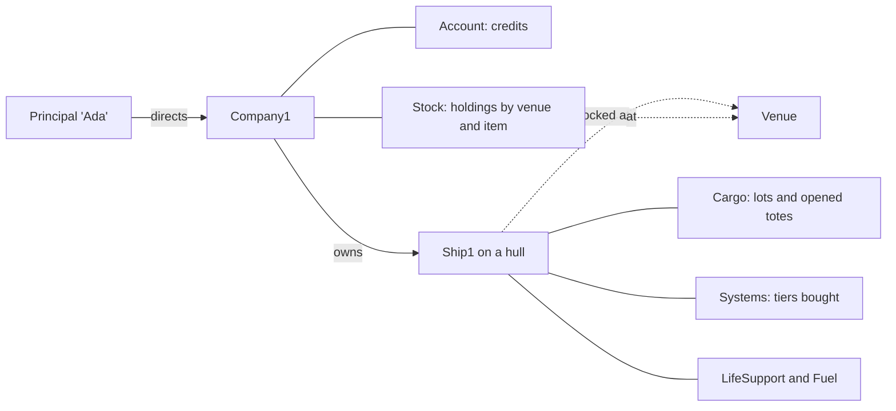
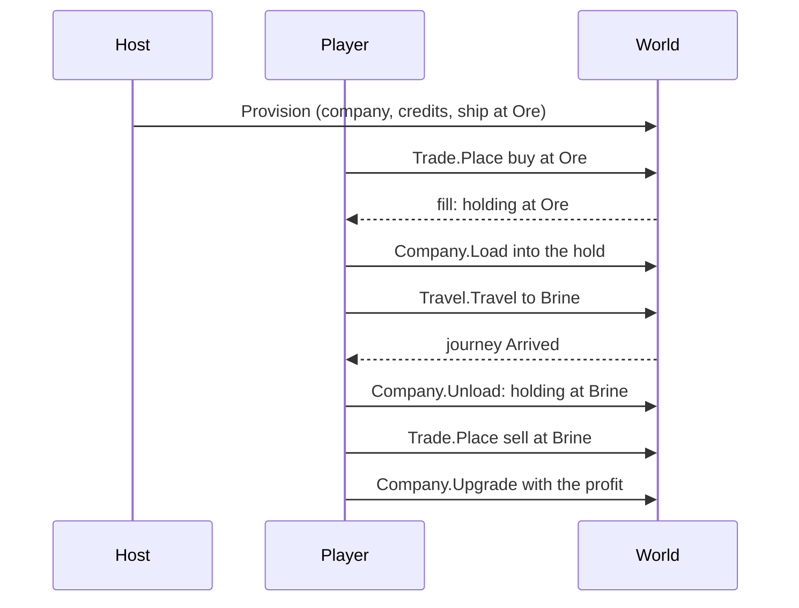

# Companies, ships and cargo

A player trades through a company. The company holds the credits, owns goods at the venues where
it trades and owns the ship that carries them between. This document covers how a player gets a
company and a ship, how goods move between a venue's warehouse and a ship's hold, and how a company
buys its ship bigger holds or tanks. It is for a C++ developer new to Manifest; the rules here are
the `company` module's, `source/game/company`, and the ship data in `data/ships` and `data/offers`.

Buying and selling goods is the order book's work ([trading](trading.md)). Life support, berth fees
and station charges, which the same module runs, are in [stations](stations.md). Flying and fuel are
in [travel](travel.md). Founding a homeworld, a command of this module, is in
[governance](governance.md).

## Concepts

| Term | What it is |
| --- | --- |
| [Principal](glossary.md#principal) | A player's control identity in the world, by an ID the host chooses. Commands are sent as one. |
| [Company](glossary.md#company) | A player's trading company: `World::Company`, its ID `Company<n>` issued by the world, naming the principal that directs it. |
| [Account](glossary.md#account) | A company's money, `World::Account`, in whole [credits](glossary.md#credit), on its own entity of kind `CompanyAccount`. |
| Holding | The company's goods of one item at one venue's warehouse, in [totes](glossary.md#tote): `available` and `reserved` (backing a sell order). All of a company's holdings are its `World::Stock`. |
| Ship | `World::Ship`, its ID `Ship<n>`: its company, its hull and the venue it is docked at, empty while it is away. |
| Hull | What a ship is built on, a record in `data/ships/hulls.yaml` (`Core::ShipClassSpec`): its base stats, slots, occupants, oxygen tanks, cartridges, pellet magazine and mass. |
| Hold | How many totes a ship carries: its hull's `CargoVolume` with its systems' effects. |
| Lot | The totes of one item in a ship's hold, `World::Lot`. A ship's lots, with the totes opened for its life support, are its `World::Cargo`. |
| System | A tier of a ship [skill node](glossary.md#skill-node) the company bought for the ship, a `World::Fitting` in the ship's `World::Systems`. |
| Offer | A record in `data/offers` (`Content::OfferDefinition`) that sells the tiers of one ship system for credits. |
| [Starter venue](glossary.md#starter-venue) | The neutral public station a [scenario](glossary.md#scenario) starts every player at, its `starterVenue`, with its `starterHull`. |

Goods are always counted in whole totes, a 0.125 m³ container, eight to the
[IBC](glossary.md#ibc) ([D-087](decision-ledger.md#d-087)). A hold, a warehouse and an order all
count totes, whatever the good, so an expensive good is bought in small amounts.

The diagram shows what a provisioned player owns and where each piece lives in the registry.



## How it works

Every change below is a command on the world's one admission path: a [request](glossary.md#request)
is admitted, queued and run at the start of the next [step](glossary.md#step), and its result is
kept in the [request ledger](glossary.md#request-ledger), so a retried request runs once
([the hosted world](world.md)). Each command checks everything before it writes anything: a refused
command changes nothing.

### The commands

| Command | Payload | Sent by | Covered in |
| --- | --- | --- | --- |
| `Manifest.Company.Provision` | `Provision` | the Administrator | [Provisioning](#provisioning-a-player) |
| `Manifest.Company.Load`, `Unload` | `Move` | the ship's owner | [Loading and unloading](#loading-and-unloading) |
| `Manifest.Company.Upgrade` | `Upgrade` | the ship's owner | [Upgrades](#upgrades) |
| `Manifest.Company.Refill`, `Replace` | `Service` | the ship's owner | [stations](stations.md) |
| `Manifest.Company.SetRefuel` | `SetRefuel` | the ship's owner | [travel](travel.md) |
| `Manifest.Company.SetFees` | `SetFees` | the venue operator's principal | [stations](stations.md) |
| `Manifest.Company.Found` | `Found` | the company's principal | [governance](governance.md) |

A command on a ship is the owner's alone: the sender must be the principal its company names, or
it is refused `NotAuthorised`. An unknown ship, item or offer is `UnknownTarget`.

### Provisioning a player

A player starts with a company, credits and one ship parked at the scenario's starter venue,
trading at once; no region or [polity](glossary.md#polity) is made for them
([D-089](decision-ledger.md#d-089)). `Provision` is the host's command, sent as the Administrator,
and names the new principal's ID, display name and company name. It makes, in one step:

- the principal, with its starting market [reports](glossary.md#report-market) (`Trade::Seed`;
  see [trading](trading.md));
- the company, with an empty stock and an account of `company.startingCredits` from
  `data/tuning/balance.yaml` ([D-077](decision-ledger.md#d-077));
- a ship of the scenario's `starterHull`, its hold empty, every oxygen tank full, every scrubber
  cartridge fresh, its reaction mass tanks and pellet magazine full, connected to the venue's
  [life support](glossary.md#life-support), and parked on a free pad of the starter venue that its
  hull fits (`Travel::Fleet::Park`).

It is refused `MalformedPayload` for an empty principal ID or one longer than admission allows,
`AlreadyProvisioned` for a principal the world has, `NoPadFree` when no pad at the venue fits the
starter, and `NoServiceFree` when every life-support connection there is taken. A refusal issues
no ID. One principal has one company, and no command yet buys a second ship.

Content checks the starter venue when it loads ([content](content.md)): it must be one of the
scenario's venues, public and operational, with more life-support connections and more pads the
starter fits (display pads aside) than the scenario has [NPC traders](glossary.md#npc-trader), so a
player always has one left. The starter hull must have a `mass` to fly with. Both scenarios start
players in `HullLoneTraderStarter`, at Ore Highport (`trading`) and Forge Highport (`governance`).

### Holdings and the hold

A company's goods are in one of two places. At a venue they are a holding in the company's stock,
owned there whether or not a ship is docked. Aboard a ship they are a lot in its cargo, the
company's still, at no venue. Trading only ever touches holdings: a fill adds to or takes from the
holding at the order's venue ([trading](trading.md)). The ship is how a holding at one venue becomes
a holding at another.

A ship's hold is computed, never stored. It is its hull's `CargoVolume` stat with each fitted
system's effect at its tier, as the effects engine computes a hull's stats
(`Core::ShipEffectEngine::Stats`), and must be a whole number of totes up to `kMaxHoldTotes`. The
loader, the commands, the save check and the query all read it through `World::Identities::Hold`,
which `RegisterCommands` installs. In the hosted world only the systems a company bought count;
the technology of a civilisation is the [sandbox](sandbox.md)'s.

The bounds, in `source/game/config/include/manifest/config/SimulationConfig.h`:

| Constant | Value | What it bounds |
| --- | --- | --- |
| `kTotesPerIbc` | 8 | Totes to the cubic metre. |
| `kMaxHoldTotes` | 11,520,000 IBCs in totes | A ship's hold: the largest hull class's envelope. |
| `kMaxWarehouseTotes` | 100 holds | One owner's holding of one item at one venue. |

### Loading and unloading

`Load` moves totes of an item from the company's holding at a venue into the ship's hold; `Unload`
moves them back. Neither changes the goods' owner or their total. The payload names the ship, the
venue the sender believes it is at, the item and a count. The checks, in order:

1. The ship exists and the sender's company owns it.
2. It is docked (`NotDocked`) at that venue (`WrongVenue`).
3. The item is one of the scenario's, and the count is above 0 (`InvalidQuantity`).
4. Enough is there to move (`InsufficientStock`). Loading counts only available totes: totes
   reserved by a sell order stay in the warehouse.
5. There is room (`CapacityExceeded`). Loading needs free hold: the hold less every lot and one tote
   for each tote opened for life support. Unloading needs room in the warehouse:
   `kMaxWarehouseTotes` less what the holding has and what the company's resting buy orders for the item there may still
   fill.

An emptied holding or lot is removed, so nothing is kept as a record of zero.

The sequence shows a player's first run with these commands and the order book's.



### Upgrades

A company spends its credits on its ship's systems: a bigger hold, bigger reaction mass tanks
([D-096](decision-ledger.md#d-096)). An offer sells the tiers of one ship skill node at a cost a
tier. `Upgrade` names the ship, the offer and the tier bought, which must be one above the ship's,
so a request repeated for a tier the ship has is refused `AlreadyFitted` and pays nothing. The
ship must be docked, at any venue. The checks, in order:

1. The ship and its owner; the offer, of a skill of the [game mode](glossary.md#game-mode)
   (`UnknownTarget`).
2. Docked (`NotDocked`); a tier above 0 (`InvalidQuantity`); not fitted already (`AlreadyFitted`).
3. The next tier, at most the offer's `maxTier`, and the systems with it fit the hull
   (`NotFittable`).
4. The hold it would give is a whole number of totes up to the largest and still holds what is
   aboard (`CapacityExceeded`).
5. The cost is in the company's account (`InsufficientFunds`).

It then pays the cost, which is paid to no one and leaves the economy, and fits the tier.

What a ship may carry is one rule, `Fits` in `Company.cpp`, which the purchase and the save check
share. Each system must be a Skill node of the game mode that targets a ship
[effect](glossary.md#effect), at a tier up to its `maxTiers`. No two systems may share an effect or
an exclusive group. The hull must list the effect in its `fitableEffects`, and every prerequisite
must be fitted at its tier.

Two offers exist, both of tier 1:

| Offer | Skill | Effect a tier | Cost |
| --- | --- | --- | --- |
| `OfferCargoHolds` | `SkillShipCargoHolds` | `CargoVolume` +2,400 totes | 27,000 |
| `OfferFuelBunkers` | `SkillShipFuelBunkers` | `FuelCapacity` +18 t of reaction mass | 30,000 |

The cargo-hold price is above a new company's starting credits and within what one good run
leaves, so the first upgrade is earned by trading. The starter's 160-tote hold becomes 2,560 with
it. The effects' amounts are in `source/game/effects/src/EffectCatalogue.cpp`; the skills are in
`data/skill-tree/spaceship.yaml`.

### Hulls

`data/ships/hulls.yaml` authors each hull as built, before any system. A value the design has not
chosen is left out, not guessed.

| Field | Meaning |
| --- | --- |
| `baseStats` | Stats by `EffectStat` name. `CargoVolume` is the hold in totes; `FuelCapacity` the reaction mass tanks in tonnes. |
| `fitableEffects` | The effects it has a slot for; none means no upgrade. |
| `occupants` | The people aboard on a long journey; life support and berth fees scale with them. |
| `oxygenTanks` | Each installed [oxygen tank](glossary.md#oxygen-tank)'s capacity in kilograms, outside the hold. |
| `scrubberCartridges` | The [cartridges](glossary.md#cartridge) its scrubber holds. |
| `pelletMagazine` | The [fusion pellets](glossary.md#fusion-pellets) its torch's magazine holds, in kilograms, outside the hold. |
| `mass` | Kilograms, felt only in collisions. Required of a scenario's starter hull. |

| Hull | Hold | Notes |
| --- | --- | --- |
| `HullLoneTraderStarter` | 160 totes | The starter: one occupant, three 10 kg tanks, one cartridge, 4 t of tanks, a 12.5 kg magazine, 20 t; slots for cargo holds and fuel bunkers. |
| `HullCompactSingle` | 32 totes | One occupant in a truck-cab cabin ([D-044](decision-ledger.md#d-044)); its life support, fittings and purpose are open. |
| `HullTraderLongHaul` | 7,200 totes | The hull the full ship skill tree is balanced against; no scenario starts a player in it or sells its tiers. |

A hull's size and the berth class it docks at are a separate record of the engine's, a
`Dock.VehicleDefinition` in `data/docks/hulls/` (the starter is a skiff), and its drive is in
`data/docks/drives/`. Which berth a hull fits is Jettison's rule
([docks](../../jettison/docs/docks.md#which-berth-a-vehicle-fits)); the drives are in
[travel](travel.md).

### Saves

A company's components (`Company`, `Account`, `Stock`, `Ship`, `Cargo`, `Systems`) are world state
and saved with it ([persistence](persistence.md)). A save that breaks a rule above does not load:
a ship carrying more than its hold, systems that do not fit, out of order or below tier 1, a
holding past `kMaxWarehouseTotes`.

## Using it

### From the console

The development console sends these commands on a hosted world
([the console](console.md)). As the host, without a connection, a player's command names the
principal first:

```text
host trading
provision Ada "Ada Co"
step
observe Ada
trade buy Ada VenueOreHighport ItemFurs 2 <ask>
step
cargo load Ada Ship1 VenueOreHighport ItemFurs 2
step
fit Ada Ship1 OfferCargoHolds 1
step
```

`observe Ada` shows the company (`Company1 'Ada Co': 25000 credits`), its holdings by venue, and
each ship with its dock, cargo and `hold of 160 totes`. On a new company the `fit` line steps to
`Manifest.Company.Upgrade: InsufficientFunds`. These lines are from
`source/tools/console/tests/ManifestConsoleTests.cpp`.

### From C++

A test or a tool admits the payload as a request and steps the world; the receipt's outcome is the
`Result`. From `source/game/company/tests/CompanyTests.cpp`, where `Run` admits as the actor's next
request and steps once:

```cpp
REQUIRE(hosted.Provision("Ada") == Result::Succeeded);
const Upgrade holds{"Ship1", "OfferCargoHolds", 1};
CHECK(hosted.Run(kAda, kUpgrade, holds) == Result::InsufficientFunds);

Credits(hosted, "Company1").balance = 29590;
CHECK(hosted.Run(kAda, kUpgrade, holds) == Result::Succeeded);
CHECK(hosted.Seen(kAda).ships[0].hold == 2560);
```

A player reads their company through their [snapshot](glossary.md#snapshot-query): `Query::Observe`
returns a `CompanyView` (credits, holdings, ships, orders, bids), each ship a `ShipView` with its
cargo, hold, systems, life support and fuel ([the hosted world](world.md)).

### Authoring an offer

An offer is a versioned record under `data/offers/`, `data/offers/offer-cargo-holds.yaml`:

```yaml
version: 1
offerId: OfferCargoHolds
skillId: SkillShipCargoHolds
target: Ship
cost: 27000
maxTier: 1
```

Content refuses an offer with no ID or target, a cost below one credit, a skill that is not a ship
system, or a `maxTier` outside 1 to the skill's `maxTiers`. `Ship` is the only target. To let a
hull take it, list the skill's effect in the hull's `fitableEffects`.

## Limits and open work

- One company and one ship a player; no command buys, sells or transfers a ship.
- No command refits or removes a system, and a system adds no mass.
- Only tier 1 of two systems is on sale; the long-haul trader's tiers are not offered.
- The compact ship's purpose, price and life support are open ([ships plan](ships-plan.md)).
- Drives past the torch and the larger hulls that fly them: [W22](delivery-order.md#w22).
- Modular oxygen banks on other hulls: [L07](delivery-order.md#l07).

## Decisions

The decisions for this feature are in
[the decision ledger](decision-ledger.md#companies-ships-and-cargo). The key ones:
[D-077](decision-ledger.md#d-077) (starting credits), [D-087](decision-ledger.md#d-087) (totes),
[D-089](decision-ledger.md#d-089) (a company and a ship at a neutral spaceport),
[D-096](decision-ledger.md#d-096) (upgrades), [D-044](decision-ledger.md#d-044) and
[D-045](decision-ledger.md#d-045) (the compact ship and the starter's life-support space). How they
were built is in [history](history/stage-4-trading-plan.md#delivered-w16-2026-11-20) (onboarding)
and [history](history/stage-4-trading-plan.md#delivered-w08-2026-11-20) (upgrades).

## Source

| Where | What |
| --- | --- |
| `source/game/company/include/manifest/company/Company.h` | The payloads, command names, system names and `RegisterCommands`. |
| `source/game/company/src/Company.cpp` | The commands, `Fits`, the hold and fuel-tank rules, and the stations' systems. |
| `source/game/world/include/manifest/world/State.h` | `Company`, `Account`, `Ship`, `Holding`, `Stock`, `Lot`, `Cargo`, `Fitting`, `Systems`. |
| `source/game/content/include/manifest/content/Definitions.h` | `OfferDefinition`, `CompanyTuning`, the scenario's `starterHull` and `starterVenue`. |
| `data/ships/hulls.yaml`, `data/offers/`, `data/tuning/balance.yaml` (`company`) | The hulls, the offers, the starting credits and founding price. |
| ctest `company` (`source/game/company/tests/CompanyTests.cpp`) | Provisioning, moves, upgrades, saves; also `content`, `data`, `query` and `console`. |

The module depends on `content`, `world`, `command`, `trade` and `travel`
([architecture](architecture.md)).
