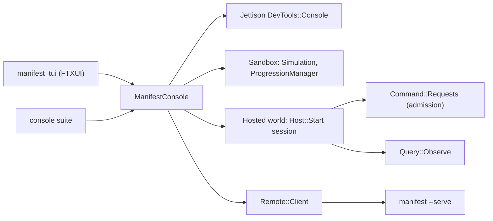
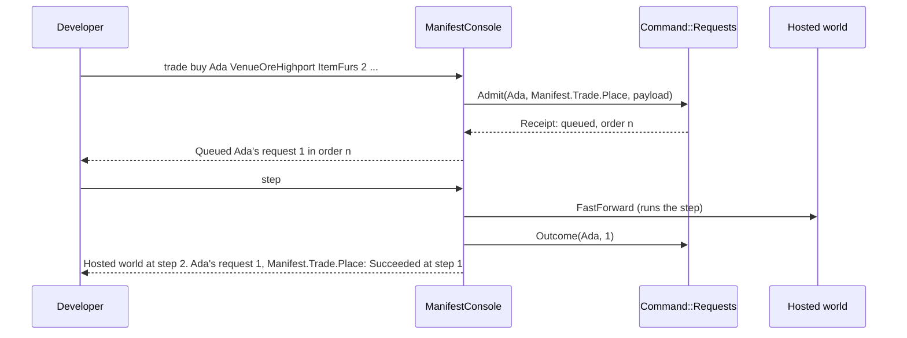
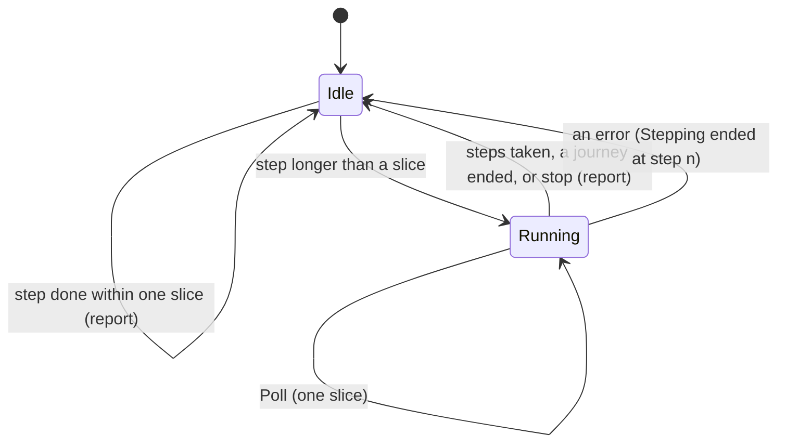

# The console and the terminal UI

The development console is how a developer or an administrator drives Manifest without a graphical
client. The terminal UI is mainly for administration, but it can also play the first loop: a
player's commands all run from it, while most
players play in the [graphical client](roadmap.md#the-graphical-client). The console types
commands at a [hosted world](glossary.md#hosted-world), the same world a server runs, and reads
back what a player would see. It also drives the older [sandbox](glossary.md#sandbox) simulation,
and it can connect to a dedicated server as a player. The terminal UI, `manifest_tui`, puts the
console on screen in a terminal; it ships in the [bundle](glossary.md#bundle) as a plain remote
client. The commands live in a library apart from the terminal, so the
tests drive them as text with no screen at all.

## Concepts

| Term | What it is |
| --- | --- |
| The console | `Manifest::Tools::ManifestConsole`, a library of commands (`manifest_console`). It registers them with the engine's [console](../../jettison/docs/glossary.md#console) and draws nothing. |
| The terminal UI | `manifest_tui`, an [FTXUI](https://github.com/ArthurSonzogni/FTXUI) program that shows the console, its scrollback and a status pane, and keeps a transcript. |
| Sandbox commands | `generate`, `list`, `show`, `prices`, `plan`, `tick`, `skills`, `upgrade`. They play a local development simulation that no player shares ([the sandbox](sandbox.md)). |
| Hosted commands | `host`, `observe`, `provision`, `cargo`, `trade`, `cancel`, `travel`, `service`, `fit`, `policy`, `refuel`, `fees`, `found`, `tender`, `project`, `development`, `book`, `step`, `stop`. They drive one hosted world through its [admission](glossary.md#admission) and queries, as a player's client would. |
| Connected | After `connect`, the players' commands and `observe` go to a server instead, as the [token](glossary.md#token)'s [actor](glossary.md#actor). |
| A run | A `step` too long to finish at once. It goes on a slice at a time, beside the console, until it ends or `stop`. |
| The transcript | The TUI's record of every command and every line it printed, appended to a file. |

The sandbox and the hosted world never meet. Each has its own clock: `tick` moves the sandbox
and `step` the hosted world. There is at most one hosted world, the one `host` last started.

## How it works

The diagram shows who owns what. The TUI holds one console. The console holds the sandbox, at
most one hosted session and at most one connection to a server.



### What the engine's console gives

The engine's `DevTools::Console` tokenises a line (double quotes keep spaces), dispatches it,
keeps the history, completes the first word on Tab and holds a bounded scrollback with the
captured log. It registers `help`, `clear` and `vars` itself
([Jettison: the console](../../jettison/docs/ui.md#the-console)). Manifest binds no console
variables.

`ManifestConsole` adds its commands through one wrapper. It checks the argument count against
each command's limits and throws the command's own usage line otherwise. A command that throws
prints an error line, and the session stays usable. Numbers are checked against bounds: a
malformed or out-of-range count is an error, never a silent default.

### Content

The console is made on a content source, a package directory or a pack. `load [source]` reads
it through `Content::LoadContent` ([content](content.md)) and builds the sandbox's skill tree. A
failed load keeps the session as it was. A successful one replaces all configuration together and
discards the sandbox's universe. The source last loaded is also the one `host` starts the hosted
world from. The sandbox commands need `load` first; `host` does not, since `Host::Start` reads
the content itself.

### The hosted world

`host <scenario>` starts a world from the content and the [scenario](glossary.md#scenario)
through `Host::Start` ([the host](host.md)). A failed start keeps the world there was. A
successful one replaces it, and the old world's queued requests go with it.

Each player's command builds the same payload a remote client sends and gives it to
`Command::Requests::Admit` ([the hosted world](world.md)). It names the
[principal](glossary.md#principal) it acts for, since the console is a trusted harness; `provision`
acts as the administrator. Admission answers at once: refused, with its result, or queued. A queued
[request](glossary.md#request) runs at the world's next [step](glossary.md#step), and the next
`step`'s report prints its outcome.



| Console command | Request it admits |
| --- | --- |
| `provision` | `Manifest.Company.Provision`, as the administrator |
| `cargo load`, `cargo unload` | `Manifest.Company.Load`, `Manifest.Company.Unload` |
| `trade buy`, `trade sell` | `Manifest.Trade.Place`, a limit [order](glossary.md#order) |
| `cancel` | `Manifest.Trade.Cancel` |
| `travel` | `Manifest.Travel.Travel` |
| `service refill`, `service replace` | `Manifest.Company.Refill`, `Manifest.Company.Replace` |
| `fit` | `Manifest.Company.Upgrade` |
| `policy` | `Manifest.Policy.Set` |
| `refuel` | `Manifest.Company.SetRefuel` |
| `fees` | `Manifest.Company.SetFees` |
| `found` | `Manifest.Company.Found` |
| `tender publish`, `cancel`, `bid`, `withdraw`, `deliver`, `abandon` | `Manifest.Procurement.Publish`, `Cancel`, `Bid`, `Withdraw`, `Deliver`, `Abandon` |
| `project queue`, `project cancel` | `Manifest.Procurement.Queue`, `CancelProject` |
| `development` | `Manifest.Procurement.SetDevelopment` |

The commands' rules belong to their modules: [companies](companies.md), [trading](trading.md),
[travel](travel.md), [stations](stations.md), [policies](policies.md) and
[governance](governance.md).

`observe [principal]` prints `Query::Observe`'s [snapshot](glossary.md#snapshot-query) for that
principal, or for the administrator with none. It shows the company's credits and holdings, each
ship (dock, journey, hold, systems, fuel, policy, job, cargo, opened totes, life support), resting
orders and sealed bids, then the player's [market reports](glossary.md#report-market), live or stale
with their age, every tender, and every region with its governor, condition and, to its governor and
the host, its treasury, development policy and project queue. `book <venue>
[item]` is the host's development view instead: every resting order at the venue, by item, asks
then bids, best price first, with its owner ([D-095](decision-ledger.md#d-095)).

### A run of steps

`step [count|time]` takes a number of steps or a span of simulation time such as `90s`, `30m`,
`6h` or `4d`, at most 60 days. A step is 1/60 s of simulation time, so `4d` is 20,736,000 steps.
Stepping that many one at a time would hold the console for minutes, so a step goes on beside the
console:

- The world is advanced with `SimWorld::FastForward`, which passes over
  [quiet steps](glossary.md#quiet-step) to the same state stepping would leave
  ([fast-forward](glossary.md#fast-forward)).
- It works for at most a 50 ms slice at a time (`kSlice`). A step that ends within one slice
  reports at once. A longer one answers with where it goes, and the frontend's `Poll` carries it
  on, a slice a call.
- Between slices the console reads commands. `observe` works mid-run, and a request queued then
  runs in the next slice.
- The run ends when it has taken its steps, when a ship's journey that was under way during the run
  ends, or on `stop`. Each prints the same report: the step reached, the journey that ended, and
  the outcome of every request admitted here that has run.



While a run is under way, `step`, `host` and `connect` are refused.

### Connected to a server

`connect <host:port> <token>` plays on a dedicated server ([the server](server.md)) as the
token's actor, pinning the server's key from the
[server list](server.md#connections-are-sealed); an endpoint the list does not name is refused,
and a server that does not hold the pinned key ends in `Disconnected from ...: key mismatch.`. A
failed connect keeps the connection there was; a new one replaces it. While connected:

- The players' commands drop the principal argument, since the actor is the token's.
  `provision` needs an administrator's token.
- Each is sent to the server (`Sent request 1 to the server.`). `Poll` prints the server's
  replies: the welcome, each request's receipt and outcome, and why the connection closed.
- `observe` takes no argument and prints the latest snapshot the server sent.
- `step` and `book` are refused: the server steps its own world, and the book is the host's view.

`disconnect` leaves the server; the world goes on without the player. The local hosted world, if
any, is untouched by all of this.

### The terminal UI

`manifest_tui` makes a full-screen FTXUI loop around one console. On start it prints a greeting
and runs `load`. The left pane is the console's scrollback, coloured by kind and log severity,
over the input line; its prompt shows ✔ or ✘ for the last command. The right pane shows the
session's age, the content source, the sandbox's tick and worlds, the hosted step and a run's
progress, the server connection, and every command name.

A refresh thread posts an event every 250 ms. On that event the TUI calls the console's `Poll`
and prints what it returns. While a run is under way it posts the next event at once, so the run
goes on a slice an event, with keystrokes read in between.

| Key | Does |
| --- | --- |
| Return | Runs the line |
| Tab | Completes the command name, or lists the candidates |
| Up, Down | Walk the history |
| PageUp, PageDown | Scroll the scrollback five entries |
| End | Follows the output again |
| Ctrl-D | `quit` |

The transcript is appended to `$XDG_STATE_HOME/manifest/tui-session.log`
(`Host::DefaultTranscript`; `~/.local/state/manifest/` by default), its directory made private to
the user when the TUI makes it. Each command is written as `> command`, followed by the lines it
printed. It outlives `clear` and the scrollback's bound.

## Using it

### Running the TUI

```bash
cmake --build --preset clang-debug
build/clang-debug/bin/manifest_tui                       # the pack beside it: share/manifest/manifest.pack
build/clang-debug/bin/manifest_tui --content mods/manifest   # a package directory instead
```

With no `--content`, it reads the pack at `<bin>/../share/manifest/manifest.pack`
(`Host::DefaultContent`), so a build tree and the [bundle](glossary.md#bundle) find their own. A
content or transcript that cannot be found exits 1, a bad command line 2. It needs only a terminal:
no display, GPU or Vulkan loader ([the host and the distribution](host.md)).

### The commands

| Command | Does |
| --- | --- |
| `help [command]`, `clear`, `vars` | The engine's: usage, an empty scrollback, the variables |
| `version` | The frontend's version |
| `status` | The content and its counts, the sandbox, the hosted step and the connection |
| `load [source]` | Loads a package directory or pack (default: the current source) |
| `generate [count] [seed]` | Sandbox: generates worlds (8 and seed 1 by default, at most 500) |
| `list`, `show <id or name>` | Sandbox: the civilisations, or one described |
| `prices [count]`, `plan [count]` | Sandbox: the most overpriced goods, the best trade routes |
| `tick [count]` | Sandbox: advances its simulation (at most 1000 a command) |
| `skills`, `upgrade <skillId>` | Sandbox: the skill tree, one tier bought |
| `host <scenario>` | Starts the hosted world, replacing the last |
| `observe [principal]` | A player's snapshot (the host's with none) |
| `provision <principal> <company name>` | Queues a player's start, as the host |
| `cargo load\|unload [principal] <ship> <venue> <item> <totes>` | Queues a move between a holding and a hold |
| `trade buy\|sell [principal] <venue> <item> <totes> <price>` | Queues a limit order, the price per the item's unit |
| `cancel [principal] <order>` | Queues an order's cancel |
| `travel [principal] <ship> <venue> [thrust%] [g]` | Queues a journey: the share of the cruise the engines thrust (100 by default) and the acceleration in tenths of g (1 by default) |
| `service refill\|replace [principal] <ship>` | Queues an oxygen refill or a cartridge replacement from the hold |
| `fit [principal] <ship> <offer> <tier>` | Queues the purchase of an offer's tier for a docked ship |
| `policy [principal] <ship> on\|off <target> <allowance> [thrust%] [on\|off]` | Queues a ship's standing policy: the credits a trade must make above its cost, the credits a sale may lose, the thrust of every leg (0, the default, for the job to choose) and whether it bids on tenders (off by default) |
| `refuel [principal] <ship> on\|off` | Queues whether a journey first refuels the ship |
| `fees [principal] <venue> <occupant fee> <arrears bps> <class> <docking> <berth> ...` | Queues a venue operator's whole fees: the occupant's hourly fee, the arrears rate, then a class, its docking fee and its hourly berth fee for each of the venue's pad classes in name order, all whole credits |
| `found [principal] <region> <company> <name>` | Queues the company's founding of a region no one governs |
| `tender publish [principal] <region> <project> <item> <venue> <totes> <budget> <bid days> <delivery days>` | Queues a governor's tender for a project's input |
| `tender cancel\|abandon [principal] <tender>` | Queues a governor's cancel of an open tender, or a company's abandoning of its contract |
| `tender bid [principal] <tender> <company> <total> [revision]` | Queues a sealed bid: revision 0, the default, for a new one, the bid's current revision to replace it |
| `tender withdraw [principal] <tender> <company>` | Queues the withdrawal of a bid |
| `tender deliver [principal] <tender> <ship>` | Queues a delivery to the company's contract from a docked ship |
| `project queue\|cancel [principal] <region> <project>` | Queues a project onto a governed region's queue, or out of it |
| `development [principal] <region> on\|off <limit>` | Queues the region's standing development policy: whether the AI issuer tenders its head project's inputs, within a limit in credits of live budgets |
| `book <venue> [item]` | The host's view of a venue's resting orders |
| `step [count\|time]`, `stop` | Advances the hosted world; ends a run |
| `connect <host:port> <token>`, `disconnect` | Plays on a server; leaves it |
| `quit`, `exit` | Ends the session |

The principal argument is given only when not connected. A tender's ID, such as `RegionForgeEast:ProjectBronzeMetallurgy:ItemCopper:1`, is read off `observe`; each
command's refusals are the world's, reported at the next step.

### A session on the trading scenario

This is the vertical slice the `console` suite plays
(`source/tools/console/tests/ManifestConsoleTests.cpp`), as the transcript records it. The lines
shown are the ones the suite checks; `...` marks lines left out.

```text
> host trading
Hosting trading from ..., at step 0.
> provision Ada "Ada Co"
Queued Host's request 1 in order ...: it runs at the next step.
> step
Hosted world at step 1.
  Host's request 1, Manifest.Company.Provision: Succeeded at step 0
> observe Ada
step 1, as Ada
Company1 'Ada Co': 25000 credits
  Ship1 HullLoneTraderStarter, docked at VenueOreHighport
...
markets (any other is unknown):
  VenueOreHighport: live, ...
  VenueBrineHighport: stale starting report, observed 0.0 simulation minutes ago, ...
> book VenueOreHighport ItemFurs
...
```

From there the suite buys two totes of furs at the ask Ada's live report shows, loads them and
flies to Brine:

```text
> trade buy Ada VenueOreHighport ItemFurs 2 <the ask observe showed>
> step
> cargo load Ada Ship1 VenueOreHighport ItemFurs 2
> step
> travel Ada Ship1 VenueBrineHighport
> step 1d
...
  Ship1's journey to VenueBrineHighport: Arrived at step ..., after ... days
> cargo unload Ada Ship1 VenueBrineHighport ItemFurs 2
> step
```

A request the world refuses at admission queues nothing: in the suite, `cargo load Bea ...` for
a principal the world does not have prints `Refused: NotAuthorised.`. A request admitted but
failing its rules reports its result at the step, such as
`Manifest.Company.Load: InsufficientStock`.

### Playing on a server

```text
> connect 127.0.0.1:7777 <token>
Connecting to 127.0.0.1:7777.
Connected to 127.0.0.1:7777 as Ada; your next request is 1.
> cargo load Ship1 VenueOreHighport ItemCopper 1
Sent request 1 to the server.
Request 1 queued in order ...: it runs at the server's next step.
Request 1: InsufficientStock at step 1.
> disconnect
Disconnected from 127.0.0.1:7777.
```

A server and its tokens are made as [the server](server.md) describes; the port here is an
example. A token the server does not know ends in `Disconnected from ...: bad credential.`.

### Driving the console from a test

A test makes a console on the staged content and executes lines; a run of steps is carried to
its end by polling, as a frontend would (`ManifestConsoleTests.cpp`):

```cpp
ConsoleLine Execute(ManifestConsole &session, std::string_view command)
{
	session.GetConsole().Execute(command);
	while (session.Stepping())
		for (std::string &line : session.Poll())
			session.GetConsole().Print(std::move(line));
	return session.GetConsole().Lines().back();
}
```

## Limits and open work

- The TUI retries nothing: a player whose request was lost in a dropped connection sends it again
  by hand ([L41](delivery-order.md#l41)).
- The snapshot holds neither a venue's fees nor a ship's refuelling switch ([L47](delivery-order.md#l47)
  adds the fees), so `observe` shows neither: `fees` needs the venue's pad classes from its content,
  and `refuel` is read back only from a journey's cost.
- A server's time cannot be paused or scaled from a client: no message carries it.
- The graphical client plays the first loop on a local world ([the graphical client](client.md)); its
  server play is open work ([roadmap](roadmap.md#the-graphical-client)).

## Decisions

The console's decisions are in the
[decision ledger](decision-ledger.md#the-console-and-the-terminal-ui). The key ones:
[D-012](decision-ledger.md#d-012) (the TUI as a remote client, with `connect` and
`disconnect`), [D-013](decision-ledger.md#d-013) (manual trading through the TUI a stretch goal),
[D-095](decision-ledger.md#d-095) (`book` stays the host's view),
[D-107](decision-ledger.md#d-107) (the TUI's burn controls may be plainer than the graphical
client's) and [D-114](decision-ledger.md#d-114) (the TUI in the bundle). How the console came to
be is in the records: [A06](history/stage-3.md#a06-the-console-apart-from-ftxui--2026-11-19),
[N02](history/stage-4.md#n02-the-dedicated-server-and-remote-tui--2026-11-20),
[W15](history/stage-4.md#w15-the-vertical-slice-through-the-console--2026-11-20) and
[L26](history/stage-4.md#l26-the-consoles-long-step--2026-11-20).

## Source

| Part | Where |
| --- | --- |
| The console | `source/tools/console/ManifestConsole.h`, `ManifestConsole.cpp`; target `manifest_console` |
| The TUI | `source/tools/tui/main.cpp`, `ManifestTui.h`, `ManifestTui.cpp`; target `manifest_tui` |
| Default paths | `source/game/host/include/manifest/host/Locations.h` (`DefaultContent`, `DefaultTranscript`) |
| Tests | `source/tools/console/tests/ManifestConsoleTests.cpp`: ctest `console` (20 cases) and `step-budget` |

The console is built whenever the Jettison SDK has its developer console (`Jettison::Devtools`,
which comes with presentation), whether or not the TUI is. The TUI is built with
`MANIFEST_BUILD_TUI`, on by default when Manifest is the top-level project. The `clang-notui`
preset turns off both the TUI and the engine's presentation, so it builds neither
([build and gates](build-and-gates.md)).

`step-budget` runs the suite's skipped timing case alone (`RUN_SERIAL`). It times Ore to Brine
on the manned profile through `step 5d`, the best of three, and fails above half as much again
as the time measured on Lythir (3.50 s, 2026-11-23). It times only an optimised build without
sanitisers, and not on CI, whose machines are not Lythir.
