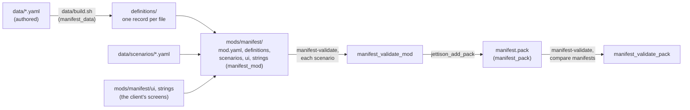
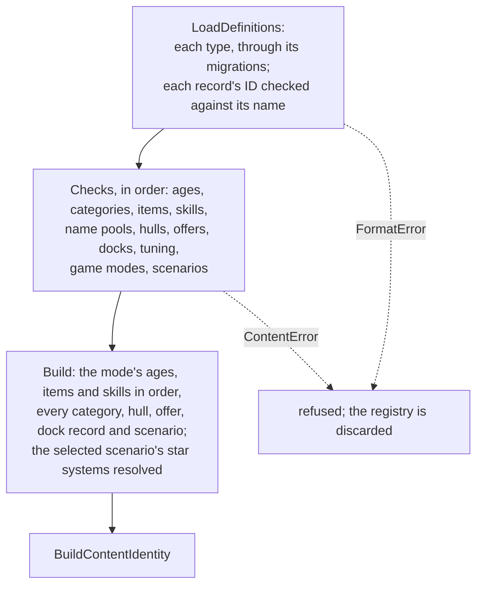

# Content, scenarios and validation

Everything Manifest plays with is data: the goods, the skill tree, the ships, the stations, the
balance numbers and the worlds a game starts from. This document is for anyone who edits that data
or reads it from C++: a designer, a modder or a developer. It says how the authored YAML in
`data/` becomes the engine's definition records, how one validated
[content set](glossary.md#content-set) is loaded from them, what every record and field means, and how a [mod](glossary.md#mod) changes
the content without copying it.

The engine owns the mechanisms: the virtual file system, [packs](glossary.md#pack), packages,
layering and the definition registry
([files, packs and mods](../../jettison/docs/files-and-mods.md)).
Manifest owns the record types, their rules and the data.

## Concepts

| Term | Meaning |
| --- | --- |
| [Definition](glossary.md#definition) | One versioned YAML record the engine's [definition registry](../../jettison/docs/glossary.md#definition-registry) loads, such as an item or a hull. |
| [Content set](glossary.md#content-set) | Every definition loaded and checked as one whole, resolved for one game mode (`Content::ContentSet`). A game runs on nothing else. |
| [Game mode](glossary.md#game-mode) | The goods, skill nodes, hulls and drives a kind of game plays with, in order, and its cruise model: `manifest` (long, everything) and `astralis` (short, 30 goods). |
| [Scenario](glossary.md#scenario) | The world a game starts from: its systems, planets, regions, venues and starter. It names its game mode. |
| [Pack](glossary.md#pack) | The content as one compressed file, `manifest.pack`, read exactly as the directory would be. |
| [Mod](glossary.md#mod), [overlay](glossary.md#overlay) | A package mounted over the Manifest package, adding records or patching them. |
| [Mount](glossary.md#mount) | One source in the file system's ordered list; a later mount wins. |
| [Content identity](glossary.md#content-identity) | The canonical bytes of a content set, which a save must match. |
| [Fingerprint](glossary.md#fingerprint) | A 64-bit hash of those bytes, short enough to print. |
| [Tote](glossary.md#tote), [IBC](glossary.md#ibc) | The units goods are counted in: an IBC is one cubic metre of a good, a tote an eighth of it. |

## How it works

The data travels from the authored files to a running world in five steps, each a CMake target.
Content that would not start never reaches the pack, and a pack that reads differently from its
directory fails the build.



The diagram shows the build graph in `CMakeLists.txt`. Everything lands under `build/<preset>/`:
the records in `data/definitions/`, the staged package in `mods/manifest/` (the
[graphical client's](client.md#screens) screens under `ui/` and their words under `strings/` among
it, which the content identity does not hash), the pack in
`share/manifest/manifest.pack` and the validated manifests in `validated/`. The suites that read
the content depend on these targets, so they always test what ships.

### Processing the YAML

The authored YAML is split into many files that refer to each other by ID: an item names its
`categoryId` and `ageId`, a game mode names its goods by `itemId` and its nodes by `skillId`.
The split keeps the files small and each idea in one place. `data/build.sh` turns them into the
engine's records, one file per definition, and the content loader resolves and checks the
references.

```bash
# From data/: write the records to data/definitions/ (neither output is committed).
./build.sh
# Or let the build do it, into build/<preset>/data/definitions/.
cmake --build --preset clang-debug --target manifest_data
```

You only run `build.sh` by hand to look at the records without a build. A manual run's
`data/definitions/` is not refreshed by the build, so it can be stale.

Every input is a complete YAML document that `yq` (mikefarah v4) loads on its own. Lists of
definitions sit under a base key repeated in each file of a family: `item-base` for goods,
`skill-base` for skill nodes, `hull-base` for hulls, and `ages` and `categories` for those two.
Nothing crosses a file boundary as a YAML anchor, so any `yq` v4 builds the data; the development
shell pins v4.54.1, the version CMake warns about if it finds another.

`build.sh` does four things:

1. **Writes one record per entry**, named by its ID in kebab case, with `version: 1` added, nulls
   in optional fields dropped and comments stripped. The name rule is `Content::RegistryName`:
   lower case, with a hyphen before a capital that follows a lower-case letter or digit, and before
   the last capital of a run followed by a lower-case letter (`ItemCopper` is `item-copper`,
   `ItemLPG` is `item-lpg`). A `basePrice` is written double-quoted, so no reader takes it for a
   float.
2. **Refuses two faults** that would otherwise pass silently: a null in a required field, and two
   IDs that give one record name (the `packaging` suite damages a copy to prove both).
3. **Copies the records authored as records**: the dock records, drives, star systems and offers,
   as they are, without comments.
4. **Writes each game mode** from its file, taking the age order from `base/ages.yaml`, since the
   registry lists records sorted by name, and the tuning record from `tuning/balance.yaml`.

It builds into a temporary directory and replaces the output whole, so a failed run leaves the
previous records and a deleted source leaves no record behind. The scenarios are not processed:
`manifest_mod` stages `data/scenarios/` as it is.

| Source | Record type | Directory under `manifest/` | Count |
| --- | --- | --- | --- |
| `base/ages.yaml` | `Manifest.Age` | `definitions/ages` | 14 |
| `trade-items/categories.yaml` | `Manifest.Category` | `definitions/categories` | 43 |
| `trade-items/*.yaml` (`item-base`) | `Manifest.Item` | `definitions/items` | 161 |
| `skill-tree/*.yaml` (`skill-base`) | `Manifest.Skill` | `definitions/skills` | 85 |
| `ships/hulls.yaml` (`hull-base`) | `Manifest.Hull` | `definitions/hulls` | 4 |
| `ships/drives.yaml` (`drive-base`) | `Manifest.Drive` | `definitions/drive-classes` | 2 |
| `offers/*.yaml` | `Manifest.Offer` | `definitions/offers` | 2 |
| `docks/pads/*.yaml` | `Dock.BerthClassDefinition` | `definitions/pads` | 5 |
| `docks/hulls/*.yaml` | `Dock.VehicleDefinition` | `definitions/dock-hulls` | 4 |
| `docks/stations/*.yaml` | `Dock.PlatformLayout` | `definitions/stations` | 1 |
| `docks/drives/*.yaml` | `Space.CruiseDrive` | `definitions/drives` | 4 |
| `systems/*.yaml` | `Space.StarSystem` | `definitions/systems` | 2 |
| `universe/solar-system-names.yaml` | `Manifest.NamePool` | `definitions/name-pools` | 2 |
| `game-mode/*.yaml` | `Manifest.GameMode` | `definitions/game-modes` | 2 |
| `tuning/balance.yaml` | `Manifest.Tuning` | `definitions/tuning` | 1 |
| `scenarios/*.yaml` (staged as is) | `Manifest.Scenario` | `scenarios` | 2 |

The table is `Content::DefinitionTypes()` in order, which is also the order the
[content identity](#content-identity) lists the types in. The `Dock` types are Jettison's
([docks](../../jettison/docs/docks.md)); Manifest authors its own records of them
([D-062](decision-ledger.md#d-062)). A dock hull and a drive are named by the `Manifest.Hull`
they belong to, a star system by its scenario ID. `universe/station-names.yaml` (the `norse`
pool) is not written yet: nothing generates stations.

The goods are filed by family, one file each in `data/trade-items/`:

| File | Goods | Units |
| --- | --- | --- |
| `metals.yaml` | 20: base, minor and alloy metals, copper wire | tonne; minor metals by the kilogram |
| `precious-metals.yaml` | 6: gold to ruthenium | troy ounce |
| `chemicals.yaml` | 10 | tonne; graphene by the square metre, gunpowder by the kilogram |
| `minerals.yaml`, `fertilisers.yaml` | 8 and 3 | tonne |
| `seeds.yaml`, `grains.yaml`, `legumes.yaml` | 10, 4 and 4 | tonne |
| `food-and-drink.yaml` | 12: water, flour, bread, drinks, preserved foods | kilolitre (water), tonne, kilogram, litre |
| `fuels.yaml` | 12, the torch's reaction mass and fusion pellets among them | tonne, kilogram, barrel, MMBtu, piece |
| `life-support.yaml` | Oxygen and the scrubber cartridge | kilogram; piece |
| `medical.yaml` | 6 | kilogram; vaccines by the dose (piece) |
| `crafts.yaml`, `valuables.yaml` | 4 and 5 | piece, kilogram, carat |
| `writing-and-knowledge.yaml` | 9 | sheet, litre, piece, tonne |
| `equipment.yaml`, `technology.yaml`, `household-goods.yaml`, `arms.yaml` | 13, 6, 6 and 2 | piece |
| `construction.yaml` | 5 | cubic metre (timber), tonne, piece |
| `animal-products.yaml`, `textiles.yaml`, `polymers.yaml` | 3, 3 and 2 | tonne, piece, kilogram, square metre |
| `humans.yaml` | Slaves, passengers, prisoners, tourists | piece (a person) |
| `drugs.yaml` | Tobacco | kilogram |

#### IDs

Every ID starts with the kind of thing it names: `Age`, `Category`, `Item`, `Skill`, `Hull`,
`Offer`, `System`, `Planet`, `Region`, `Venue` and so on. A reference therefore says which
table it points into, and one word can name two things without a clash: `SkillPharmaceuticals` is
the craft, `CategoryPharmaceuticals` the shelf its goods land on. The one name shared by design is
an age's gate in the skill tree, whose `skillId` is the `ageId` of the age it opens. The `data`
suite asserts the prefixes and that no other name is shared.

#### Adding or renaming a good

1. Add the item to the family's file under `trade-items/`, with every field of
   [Units and storage](#units-and-storage) and the mass identity checked.
2. Add `- itemId: <ID>` to `game-mode/manifest.yaml`, which selects every good, and to
   `game-mode/astralis.yaml` if it belongs in the short game.
3. Build. The loader refuses a selection that names nothing, an ID selected twice, and a broken
   `categoryId` or `ageId`, naming the mode, the list and the ID.

Skill nodes work the same way: the definitions are in `skill-tree/*`, the selections in both
game modes, and every node is in both. What the tree means is in the
[development sandbox](sandbox.md).

#### Name pools

`universe/solar-system-names.yaml` holds the name pools for generated worlds: every top-level key
is a pool, today `latin` (2,695 names) and `greek` (3,571). Each becomes a `Manifest.NamePool`
record whose `pool` must equal its record name; the loader refuses no pool at all, a pool with no
name and an empty name. `Core::UniverseNamePools` keeps them in a map sorted by pool name, so a
seeded draw over them gives the same names on every platform. Only the sandbox's generator reads
them ([sandbox](sandbox.md)).

### Units and storage

Every item carries five numeric fields that describe it as a physical good. They say what a unit
is, what a unit is worth, and how many units and kilograms fill a cubic metre of cargo space.

| Field | Meaning |
| --- | --- |
| `unitType` | The unit the good's real market trades it in, which `basePrice` and `unitsPerCubicMetre` count ([D-064](decision-ledger.md#d-064)). |
| `basePrice` | Its value per `unitType`, in credits at one credit to one US dollar, as exact decimal text ([prices](pricing.md#base-prices)). |
| `unitsPerCubicMetre` | Units in one packed cubic metre: one IBC of the good as it travels. |
| `density` | Specific gravity against water, so `1.0` is 1,000 kg/m³; the solid value at 20 °C. |
| `packFactor` | The share of a cube the product fills, counting packaging and the voids between pieces: `0.85` for stacked copper ingots, `0.05` for hollow glassware. |

The loader refuses an item with no `unitType`, a number that is not finite and above 0, a
`packFactor` above 1, a price that is not a valid base price
(`Core::Simulation::IsValidBasePrice`), or a good counted by mass or volume whose
`unitsPerCubicMetre` is not the packed figure below, within 0.1%.

**Totes.** Goods are held, moved and traded in whole totes, an eighth of an IBC: a full container
500 mm a side ([D-087](decision-ledger.md#d-087), `Core::kTotesPerIbc`). A tote of any good is
`unitsPerCubicMetre / 8` of its units, which is what an order's price multiplies
(`source/game/trade/src/Trade.cpp`). A hull's `CargoVolume` and a venue's market `stock` are
authored in totes. A hold carries at most `Core::kMaxHoldTotes` (11,520,000 IBCs, the largest
hull class's envelope) and a warehouse 100 of those of one item for one owner
(`Core::kMaxWarehouseTotes`).

**Mass.** A ship's cargo weighs `density x packFactor x 1000 / 8` kilograms a tote
(`source/game/travel/src/Travel.cpp`), which its fuel burn depends on
([travel and fuel](travel.md)).

A tote is priced as it weighs: for a good counted by mass or volume, `unitsPerCubicMetre` is what a
packed cube holds, so the unit sets it from the density and `packFactor`:

| `unitType` | `unitsPerCubicMetre` | Example |
| --- | --- | --- |
| `Carat` | `density x packFactor x 5000000` | A carat is a fifth of a gram: `ItemGems` at 3.5, packed at 0.65, is 11,375,000. |
| `TroyOunce` | `density x packFactor x 1000 / 0.0311034768` | `ItemGold` at 19.32, packed at 0.8, is 496,922. |
| `Kilogram` | `density x packFactor x 1000` | Lithium at 0.534, packed at 0.55, is 293.7. |
| `Tonne` | `density x packFactor` | Copper at 8.96, packed at 0.85, is 7.616. |
| `Litre` | `packFactor x 1000` | Beer packed at 0.75 is 750 litres to the cube. |
| `Kilolitre` | `packFactor` | Water, the one good a utility meters by volume: 0.75. |
| `CubicMetre` | `packFactor` | Timber, measured as solid volume: 0.75 of a stacked cube. |
| `Barrel` | `packFactor / 0.158987294928` | Crude oil's 42-gallon barrel, packed at 0.9, 5.66 to the cube. |
| `MMBtu` | MMBtu in a cubic metre | Natural gas by its energy: 23 in a cubic metre of LNG. |
| `Unit` | tight-nested piece count | 2,000 `ItemBooks`, 40,000 pieces of `ItemJewellery`. |
| `Sheet` | stacked sheet count | 50,000 sheets of `ItemPapyrus`, 20,000 of `ItemParchment`. |
| `SquareMetre` | `1 / thickness` | `ItemGraphene` film at 10 µm is 100,000 m² to the cube. |

For goods counted by the piece, sheet or square metre the count is a packed count too, so it fixes
the mass of a piece. The fields must then agree through the **mass identity**, the check to apply
when adding such a good, which the loader cannot make:

```text
density x 1000 x packFactor  ==  kilograms in a cube  ==  unitsPerCubicMetre x piece mass
```

A 15 g piece of jewellery, of metal at specific gravity 12, takes 1.25 cm³ of metal in a 25 cm³
fitted tray. That is 40,000 pieces to the cube, a `packFactor` of 0.05 and 600 kg in the cube on
both sides of the identity: `ItemJewellery`.

Wheat seed shows the packing: a kernel's density is 1.27 and its test weight 78 kg a hectolitre, so
`packFactor` is 0.61 and a full cube holds 775 kg, 0.7747 t.

Prices are for the traded form of a good, not a purer one: uranium is `U3O8` concentrate, the
medicines are bulk active ingredient, the alloys the value of the metal in them. A quote in another
unit is converted: the pound to the kilogram, the bushel and hundredweight to the tonne, and the
yuan and Australian dollar at the week's rate (6.68 and 0.678).

#### Where the base prices come from

The quotes of 2026-11-19, the latest each source had published:

| Goods | Price | Source |
| --- | --- | --- |
| Copper, tin, aluminium, zinc, nickel, lead | 13226, 46650, 3061, 3776, 15790, 1840 a tonne | LME cash settlement, 17 November |
| Brass, bronze | 9918, 16568 a tonne | LME value of 65:35 copper and zinc, and of 9:1 copper and tin |
| Iron | 458 a tonne | Brazilian pig iron FOB, November |
| Cobalt | 33525 a tonne | indicative, 13 November |
| Antimony | 17600 a tonne | Fastmarkets, Rotterdam, 4 November |
| Lithium, neodymium | 90, 138 a kilogram | Chinese metal benchmarks, October and 4 November |
| Molybdenum, vanadium | 76.5, 26.6 a kilogram | LME Molybdenum (Platts) 34.69 a pound; ferrovanadium 80%, Europe, 7 October |
| Uranium | 198.7 a kilogram | U3O8 spot, 90.12 a pound, 18 November |
| Gold, silver, platinum, palladium | 3725, 45.03, 1371, 949 an ounce | spot, 18 November |
| Rhodium, ruthenium | 8550, 1900 an ounce | dealer bids, 17 and 18 November |
| Wheat, oats | 209, 229 a tonne | CBOT, 5.70 and 3.33 a bushel, 18 and 5 November |
| Barley | 244 a tonne | Australian feed barley FOB, A$360, 11 November |
| Rice | 494 a tonne | Thai 5% broken, 18 November |
| Cocoa seeds | 5145 a tonne | ICE cocoa, 18 November |
| LPG | 720 a tonne | Saudi Aramco propane contract price, November |
| Oxygen | 0.26 a kilogram | US bulk liquid oxygen, 263 a tonne, mid-2026 |
| Ammonia, sulfur | 585, 733 a tonne | CFR Far East and CFR China, 12 November |
| Potash | 365 a tonne | granular MOP CFR Brazil, 10 November |
| Caustic soda | 840 a tonne | 98% flakes FOB Mersin, 1 November |
| Sulfuric acid | 170 a tonne | Q3 2026 assessments |
| Ethylene | 1100 a tonne | CFR Northeast Asia |
| Yellow phosphorus, natron | 4261, 151 a tonne | Chinese spot, 16 and 5 November (natron as dense soda ash) |
| Graphite | 323 a tonne | Chinese flake, -194 mesh, 4 September |
| Crude oil | 92.18 a barrel | ICE Brent, 18 November |
| Coal, coke | 145, 334 a tonne | Newcastle thermal, 17 November; Chinese metallurgical coke FOB, October |
| Steel | 845 a tonne | Western European hot-rolled band, SteelBenchmarker, 11 November |
| Titanium | 6.1 a kilogram | Chinese sponge, 13 October |
| Copper, tin and iron ores | 3446, 25190, 90.7 a tonne | iron ore 62% Fe, 18 November; the concentrates at the payable LME value of their 27% copper and 60% tin |
| Timber | 224 a cubic metre | CME lumber, 527.50 per thousand board feet, 17 November |
| Livestock | 4845 a tonne | CME live cattle, 219.77 a hundredweight, 18 November |
| Cotton | 1653 a tonne | ICE cotton, 74.97 cents a pound, 18 November |
| Rubber | 2492 a tonne | SGX TSR20, 249.2 cents a kilogram, 17 November |
| Plastics | 1269 a tonne | HDPE CFR Southeast Asia, October |
| Urea, diammonium phosphate | 535, 803 a tonne | Egyptian granular FOB, November; DAP FOB US Gulf, October |
| Natural gas | 27.88 an MMBtu | JKM, the North Asian LNG cargo price, 18 November |
| Sugar, coffee | 398, 6086 a tonne | ICE raw sugar No. 11, 18.04 cents a pound; ICE arabica, 276.05 cents a pound, 18 November |
| Spices | 7350 a tonne | Vietnamese black pepper export quote, November |
| Tea | 3.0 a kilogram | Mombasa auction, November |
| Wool | 11.68 a kilogram | AWEX Eastern Market Indicator, A$17.22 clean, 11 November |
| Preserved meat and fish | 7114 a tonne | Argentine frozen beef export average, August |
| Copper wire | 14500 a tonne | LME copper with a rod and fabrication premium |
| Batteries, solar panels | 108, 148 each | BNEF pack average of 108 a kilowatt-hour; modules at 0.37 a watt |

Goods with no market quote carry estimates of their wholesale value
([D-066](decision-ledger.md#d-066), [D-068](decision-ledger.md#d-068)): bricks 0.6, cloth 8 a
square metre, tools 15, machinery 30,000, lenses 150, gunpowder 25 a kilogram, paper 950 a tonne,
radios 400, silicon wafers 120, AI accelerators 25,000, small arms 600, medicinal herbs 12 a
kilogram, liquid hydrogen 6 a kilogram, helium-3 18.6 million a kilogram, a habitat module 50
million, diesel 900 a tonne, tobacco 5 a kilogram, clay 150 a tonne, vaccines 10 a dose, mining
drills and robots 50,000, satellites 5 million, reactor fuel assemblies 1.5 million, water ice
1,000 a tonne, heavy weapons 250,000, media 20, and passengers, prisoners and tourists 1,000,
2,000 and 3,000 a person. Drinking water is 8 a kilolitre, 0.75 credits a tote of 0.09375 kL
([D-093](decision-ledger.md#d-093)). Goods added later (the legumes, the torch's fuels) give their
reasoning in their file's header. Every other good keeps its first-draft price converted to its
unit.

### Game modes

A game-mode record is named by its file and holds ordered selections, each a mapping so that a
patch can merge into it by ID (`!merge=itemId`):

| Field | Meaning |
| --- | --- |
| `ages` | Written by `build.sh` from `base/ages.yaml`: every age, in order. |
| `items`, `skills` | The goods and skill nodes it plays with, in the order the game uses. |
| `hulls`, `drives` | The hulls and drive classes a game of it shows a player, in the order shown; one left out is never listed. Resolved as `Core::GameModeNode::hullIds` and `driveIds`, the filter a UI lists from. |
| `cruise` | Optional. A `manned` and an `unmanned` Jettison motion profile; a hull with 0 occupants flies the unmanned one. Left out, each hull keeps its drive's time-compressed power law. |

`manifest` selects all 160 goods and 85 nodes and cruises by acceleration
([D-090](decision-ledger.md#d-090)). `astralis` selects the 30 goods an industrial-age world
trades most ([D-067](decision-ledger.md#d-067)), the whole tree, and no cruise model
([D-061](decision-ledger.md#d-061)). `manifest` shows every hull and both drives; `astralis` the
torch and the hulls that fly it. Every selection must name existing definitions, once; a selected
hull's drive must be selected, and a scenario's starter hull must be one of its mode's hulls; and
the tree a mode selects must build as a graph with no cycle and every prerequisite inside it.

### Scenarios

A scenario is one `Manifest.Scenario` record in `data/scenarios/`, named by its file. Every list
in it is keyed by its own ID field, unique within the list and stable, since a save records it;
so a patch merges with `!merge=<id field>`. Positions are the star system record's; rates are per
simulation day in the item's unit ([D-022](decision-ledger.md#d-022)); stock is in totes; funds
are whole credits.

| List | Fields | Rules |
| --- | --- | --- |
| (root) | `gameMode`, `starterHull`, `starterVenue`, `items: [{itemId}]` | The mode resolves. The items are the mode's, once each. The starter hull exists and has a `mass`. |
| `systems` | `systemId`, `displayName`, `connections: [{systemId}]` | A `Space.StarSystem` record of its name that resolves ([space](space.md)). No two share a frame ID. A connection is another of the scenario's systems, once, and runs both ways ([D-095](decision-ledger.md#d-095)). |
| `planets` | `planetId`, `systemId`, `displayName` | A planet or moon of that name in its system's record. No population or account of its own. |
| `civilisations` | `civilisationId`, `displayName`, `ageId` | Cultural and technology identity; the age resolves. |
| `organisations` | `organisationId`, `kind` (`Polity` or `Corporation`), `displayName` | `kind` is required. |
| `regions` | `regionId`, `planetId`, `civilisationId`, `governorId`, `population`, `householdFunds`, `publicFunds`, `employerFunds`, `health`, `happiness`, `skills`, `facilities`, `projects` | The one owner of a population ([governance](governance.md)). The governor is an organisation, or empty for none. Population finite and not negative; funds 0 to 2^62; health and happiness 0 to 100. Skills resolve. A facility has a `kind` (`Workshop`). |
| `venues` | `venueId`, `systemId`, `planetId`, `operatorId`, `public`, `operational`, `layout`, `lifeSupportCapacity`, `regions: [{regionId}]`, `market` | A station body of that name in its system's record, orbiting the venue's planet if it names one. The operator is an organisation; the layout a `Dock.PlatformLayout`. Its regions are on its planet, so a venue in open space serves none. |
| `market` (of a venue) | `itemId`, `regionId`, `production`, `demand`, `stock` | A scenario item, once. Rates finite and not negative. `regionId` is a region the venue serves: the employer that makes the row, the households that want it. Production needs a region. Stock at most a warehouse. |
| `traders` | `principalId`, `displayName`, `companyName` | NPC traders started at the starter venue ([policies](policies.md), [D-097](decision-ledger.md#d-097)). |

Beyond the per-list rules, a scenario is held to what the game needs to run:

- Every venue that serves a region trades every item of every household need
  ([the regional economy](economy.md)).
- A region's project names a tuning project, its region knows the project's prerequisites and has
  an operational workshop, and some venue produces each input of the project and its recipe.
- The starter venue is public and operational, and has more life-support connections and more
  non-display berths the starter hull fits than the scenario has traders, so a player can always
  start there ([D-089](decision-ledger.md#d-089), [stations](stations.md)).

Two scenarios ship, each a test fixture whose numbers are initial test values, not balance results
(each file's header says what it holds):

- `trading`: system Anvil, planets Ore and Brine, ten regions, five on each, each served by its
  own station; 24 goods. A new player starts at Ore's highport, `VenueOreHighport`, whose region
  is ungoverned.
- `governance`: system Crucible, four regions on Forge served by one public highport, and
  Cassiter's region selling tin and industrial goods from a corporation's dock; Forge East works
  the Bronze project. 19 goods.

### Tuning

The balance numbers are one required record, `Manifest.Tuning`, named `balance`, authored in
`data/tuning/balance.yaml`. Each block belongs to the feature that reads it, and its document
explains it; the loader holds each value to its range and its references.

| Block | Read by |
| --- | --- |
| `economy`, `needs`, `optionalGoods`, `condition`, `production` | [The regional economy](economy.md) |
| `market`, `brokers` | [Orders, brokers and market observations](trading.md), [prices](pricing.md) |
| `lifeSupport`, `charges` | [Stations](stations.md) |
| `fuel` | [Travel and fuel](travel.md) |
| `company` | [Companies, ships and cargo](companies.md) |
| `procurement`, `projects`, `recipes` | [Regions, governors and public projects](governance.md) |
| `concessions` | Nothing yet ([planetary development](planetary-development-plan.md)) |

A need, project or recipe patches by its ID (`!merge=needId`). A need's items must be traded in
the need's unit, since they meet it one for one.

### Loading and validation

`Content::LoadScenario` is what the host and the validator run; `Content::LoadContent` does the
same for a game mode with no scenario (`source/game/content/include/manifest/content/Content.h`).
Both load every type through the registry, check the whole set, then build an immutable
`ContentSet` that holds no reference to its files or registry.



The diagram shows `LoadChecked` and `Build` in `source/game/content/src/Content.cpp`. Every
scenario is checked against its own game mode, whichever mode the set is for, so one bad scenario
fails every load. The whole skill graph is checked as well as each mode's tree, so a cycle among
nodes no mode selects is still refused.

Two kinds of failure stop a load, each naming where to look:

- A record that does not read (a bad version, an unknown field, a whole file's null, an orphan
  patch) is the registry's `Jettison::Serialise::FormatError`, naming its file and mount.
- A broken rule is a `Content::ContentError`, naming the record's path, type and ID, the field,
  and the layers the registry read for it: the topmost whole file's mount, then each patch above.

```text
manifest/definitions/ages/age-stone.yaml: Manifest.Age 'AgeStone': displayName is required (from manifest, BlankAge (patch))
```

The overload of `LoadContent` over a span of mounts builds its own file system and registry and
discards both, so a failure anywhere leaves the caller's content set as it was. The rules are
reused, not copied: a base price is `Simulation::IsValidBasePrice`, a skill graph
`ProgressionManager::Build`, an effect `EffectCatalogue::Default()`, and a dock record or star
system the engine's own `Dock::Check*` and `Space::Resolve`.

The dock records tie to the hulls one to one: every `Manifest.Hull` has a `Dock.VehicleDefinition`
and a `Space.CruiseDrive` of its record name, and each of those belongs to a hull. A hull's mass
must keep its box's inertia within what the physics engine holds in floats. Hull fields are in
[companies, ships and cargo](companies.md#hulls).

The host adds one check before loading: the first mount must be the Manifest package, a
`mod.yaml` named `Manifest` giving a release and an engine requirement
([the host](host.md#start-up-phase-by-phase)).

### Mods and overlays

The Manifest package mounts as `manifest`. Each overlay mounts over it, in the order given, under
the name its `mod.yaml` gives; a later overlay's `requires` names earlier mounts. An overlay with
no `mod.yaml`, no name, or a name already mounted fails start-up in the mount phase.

```yaml
# source/game/host/tests/overlays/copper/mod.yaml
version: 1
name: Copper
release: 0.0.1
requires: [manifest]
```

An overlay holds records at the same virtual paths as the package. A whole file replaces a record,
a `<name>.patch.yaml` beside it changes only what it names, and a file at a new path adds a
record. The merge rules (`!append`, `!merge=<field>`, null removing a field) are Jettison's
([layering definitions](../../jettison/docs/files-and-mods.md#layering-definitions)); Manifest
never reproduces them.

```yaml
# source/game/host/tests/overlays/copper/manifest/definitions/items/item-copper.patch.yaml
version: 1
basePrice: "10.5"
```

Every record and patch carries its `version`, and each type loads through a migration chain
(`DefinitionType::migrations`); none has a step yet. Until player testing, formats change in
place: a change rewrites every file of the format, in both repositories, with no new version
([D-109](decision-ledger.md#d-109)). The migration wiring is still tested, with a two-version test
format in the `content` suite.

### Content identity

A save must be played by the content that made it, so the content set carries its identity
(`source/game/content/include/manifest/content/ContentIdentity.h`):

- **The manifest** (`Manifest.ContentManifest`, version 1) is the canonical bytes of the set: for
  each type of `DefinitionTypes()`, in order, its name, format version and record count, then
  each record in name order as its name and its binary archive bytes, then the selected scenario's
  name. Every loaded definition is in it, used by the scenario or not. Host paths, mounts, pack
  compression and times are not, so a directory and its pack give the same bytes.
- **The fingerprint** is a 64-bit FNV-1a of the manifest: a compatibility aid a list can show, not
  an authenticity check. Comparison is always on the whole manifest.

A change to a price, a selection's order, an added definition or the scenario changes the
manifest. `Content::FirstDifference` names the first definition two manifests hold differently,
such as `Manifest.Item item-copper`, which is what a refused save reports. A world's `identity`
file holds its manifest, and the journal refuses to recover a world of other content
([saves, the journal and backups](persistence.md), [D-111](decision-ledger.md#d-111)).

## Using it

**Validate content.** `manifest-validate` takes the host's options
([the options](host.md#the-options)), loads the content as the host would, with no world, and
prints the mounts, the scenario, its mode and the fingerprint:

```bash
manifest-validate --content build/clang-debug/mods/manifest --scenario trading \
    --overlay source/game/host/tests/overlays/copper
# mount 1: manifest, from build/clang-debug/mods/manifest
# mount 2: Copper, from source/game/host/tests/overlays/copper
# valid: scenario trading, game mode manifest, content <16 hex digits>
```

It exits 0 for valid content, 1 for content that would not start (with the host's report) or a
manifest it cannot write, and 2 for a bad command line. `--manifest <file>` writes the content
manifest's bytes, which the build uses to compare a pack with its directory. With no `--content`
it validates the pack beside the executable.

**Patch content in a test.** The `content` suite writes overlays on the fly
(`source/game/content/tests/ContentTests.cpp`): a whole age, a price patch, and an item appended
to a mode's list.

```cpp
overlay.Write("manifest/definitions/items/item-copper.patch.yaml", "version: 1\nbasePrice: \"12.25\"\n");
overlay.Write(
    "manifest/definitions/game-modes/astralis.patch.yaml",
    "version: 1\nitems: !append [{itemId: ItemSilver}]\n");
```

**Add a trader to a scenario.** The fixture suite's overlay `source/test/overlays/one-trader`
patches the trading scenario:

```yaml
# manifest/scenarios/trading.patch.yaml
version: 1
traders:
  - {principalId: Nia, displayName: Nia, companyName: Nia Co}
```

## Limits and open work

- Trading blocs have no schema; one is added when a rule or fixture needs it.
- `universe/station-names.yaml` is not loaded until something generates stations.
- No content is migrated yet: formats change in place until player testing
  ([D-109](decision-ledger.md#d-109)).
- The git-ignored `data/core-config/` is a leftover the build and the `packaging` suite exclude.

## Decisions

The decisions are in [the ledger](decision-ledger.md#content-scenarios-and-validation). The main
ones: [D-061](decision-ledger.md#d-061) (two game modes), [D-062](decision-ledger.md#d-062)
(Manifest authors Jettison's dock records), [D-064](decision-ledger.md#d-064) (each good in its
market's unit), [D-067](decision-ledger.md#d-067) (Astralis's 30 goods),
[D-070](decision-ledger.md#d-070) (one option contract for host and validator; its "nothing
defaults" is narrowed by [D-114](decision-ledger.md#d-114)'s pack beside the executable),
[D-087](decision-ledger.md#d-087) (totes), [D-109](decision-ledger.md#d-109) (formats in place)
and [D-111](decision-ledger.md#d-111) (a save only of its own content). The goods' categories,
ages and lists were settled in [D-058](decision-ledger.md#d-058) to
[D-069](decision-ledger.md#d-069). How the content was built is in
[history: Stage 2](history/stage-2.md).

## Source

| Part | Where |
| --- | --- |
| The record types, their registration, `RegistryName`, `LoadDefinitions` | `source/game/content/include/manifest/content/Definitions.h`, `src/Definitions.cpp` |
| The checks and the content set | `source/game/content/include/manifest/content/Content.h`, `src/Content.cpp` |
| The content identity | `source/game/content/include/manifest/content/ContentIdentity.h`, `src/ContentIdentity.cpp` |
| Ages, categories, items, skills, totes | `source/game/config/include/manifest/config/SimulationConfig.h` |
| Name pools | `source/game/universe/include/manifest/universe/Universe.h` |
| The authored data and its build | `data/`, `data/build.sh`, `mods/manifest/mod.yaml`, the targets in `CMakeLists.txt` |
| The validator | `source/apps/manifest/validate.cpp` |
| Suites | `content` (`ContentTests.cpp`), `data` (`source/test/DataTests.cpp`, the shipped data's scale and IDs), `packaging` (`source/test/packaging-refusals.sh`), `mod` (directory and pack alike), `universe`, and the `validate_*` and `cli_broken_overlay` tests in `source/apps/manifest/CMakeLists.txt` |
