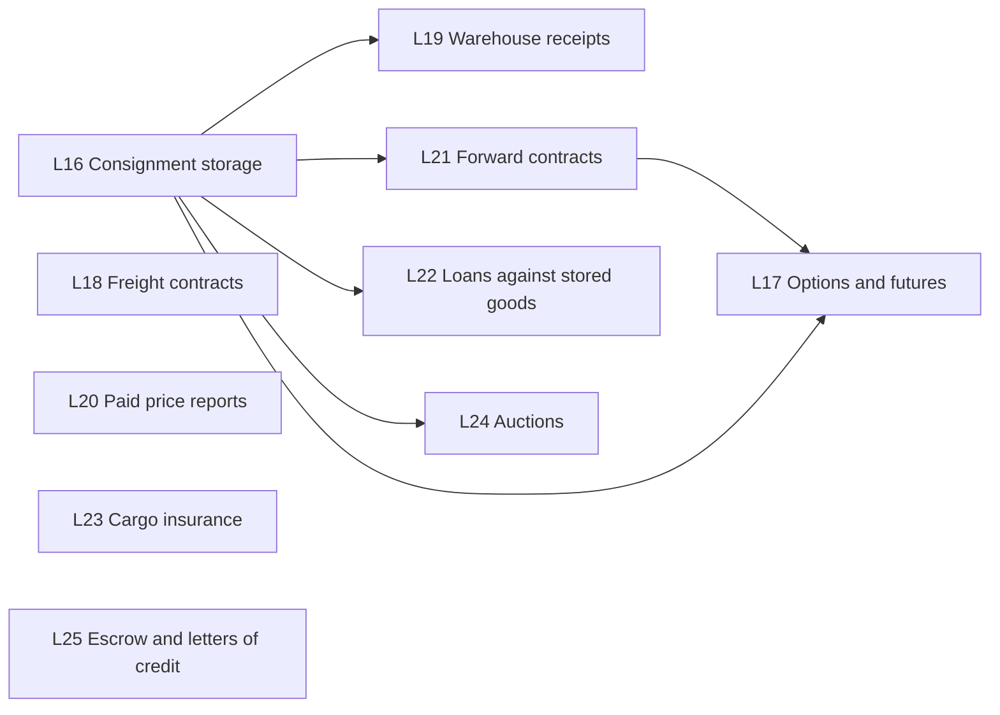
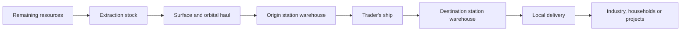

# The economy: open plans

This document holds the economy's open work: what the user has selected but nobody has built, and
what is still to be chosen. It is written for developers, designers and modders planning the next
economic features.

What is built is documented elsewhere, and this plan only links to it:

| Built | Where |
| --- | --- |
| Households, needs, production batches, payroll, wage tax, health and happiness | [The regional economy](economy.md) |
| Orders, brokers, matching, expiry and market observations | [Orders, brokers and market observations](trading.md) |
| Decimal prices, the native price, the broker's curve and its ladder | [Prices](pricing.md) |
| Regions, governors, public projects, tenders and the Bronze project | [Regions, governors and public projects](governance.md) |
| Docking and berth fees, arrears and seizure | [Stations](stations.md) |
| A company's holdings at a venue's warehouse and its ship's hold | [Companies, ships and cargo](companies.md) |
| Standing policies, a job's route estimate and NPC traders | [Standing policies and NPC traders](policies.md) |

Planetary development is planned in its own document,
[planetary development, corporate power and the frontier](planetary-development-plan.md): the core
and the frontier, resource exploitation and its real-time concession
([L06](planetary-development-plan.md#l06-resource-exploitation-concessions-and-colonies);
the 72-hour term is
[selected there](planetary-development-plan.md#selected-the-exploitation-concession)),
ports, corruption, acquisition and influence.

Each section below is one piece of open work, headed with its [task ID](glossary.md#task-id), whose
row in the [delivery order](delivery-order.md) gives its place in the queue and what it waits for.
Each section says what the work is for, then what is **Selected** (decided by the user, to be built
as written) and what is **Open** (to settle before or while it is built). Every number is a starting
value for tuning, not a balance result ([scope](scope.md)).

The market services build on one another, and consignment storage is their foundation. The
diagram shows which task each one needs first, as the delivery order records it.

## L49 The physical chain

Goods in Manifest are physical: they exist somewhere, and moving them takes a ship, time and
capacity. Credits are not: an authorised payment settles at once, at any distance
([D-020](decision-ledger.md#d-020)). The chain from a planet's ground to its consumers is only
partly built. Today an employer's finished batch appears in its holding at its venue's warehouse,
households buy their goods at that venue, and companies carry their own goods between venues
([the regional economy](economy.md), [companies](companies.md)). There is no extraction, no
surface or orbital haul, and no charge for handling goods in a warehouse. Queue:
[L49](delivery-order.md#l49).

The diagram shows the whole selected chain. The middle three steps (warehouse, ship, warehouse)
are built; the ends are not.

**Selected**

- Every arrow is an operation that checks capacity, time and ownership, and saves its progress.
  Surface vehicles and shuttles may be abstracted into transport [jobs](glossary.md#job), but each
  job's source debit, goods in transit, receipt, timing and capacity stay explicit.
- Extracted output starts in the operation's local store. Only stock delivered to a station's
  warehouse can be offered there by a [broker](glossary.md#broker). Industry consumes inputs where
  it is and puts its output there; transport never creates or duplicates goods.
- Delivery to an orbital warehouse does not meet a surface factory's input until the surface
  delivery has happened.
- A deposit has remaining reserves apart from its extraction rate. High abundance is not unlimited
  extraction, and industrial capacity does not create missing raw inputs. Production capacity
  limits new output per period; it does not cap sales of stock made earlier.
- [Title and custody](glossary.md#title-and-custody) stay separate: a warehouse can hold many
  owners' goods, and buying from a broker transfers title to goods where they lie. The buyer must
  still load them onto a docked ship.
- Merchant income is the broker's spread plus separate warehouse handling charges at both ends of a
  journey ([D-021](decision-ledger.md#d-021)). The proposed trader charge points are origin load-out
  and destination receipt. Each charge goes to the operator that provides the service, once. A
  change of owner inside one warehouse is not a load-out and a load-in.
- Where the owner, broker, warehouse operator and governor are one company, a charge between them
  moves no credits; an internal charge cannot mint wealth.
- The same goods cannot back two commitments (a broker's offer, a public project and a ship's load).
  Stock and capacity are reserved when the commitment is made.

**Open**

- The extraction rules: rates, depletion and renewal. They come with resource exploitation,
  [L06](delivery-order.md#l06).
- The surface and orbital transport jobs' capacity, timing and cost, and who runs them.
- Each handling charge's rate, basis and payer for every leg, including a producer's inbound
  handling and the final local collection. Charges are set by their owner
  ([D-098](decision-ledger.md#d-098)).
- Whether a public supply contract's price includes handling, and which delivery point passes
  ownership to the region and triggers payment.
- Third-party custody: one company's goods carried in another's ship (freight,
  [L18](#l18-freight-contracts)).

## L50 Recipe production

A [recipe](glossary.md#recipe) turns inputs into outputs at a [facility](glossary.md#facility).
The Bronze project already unlocks `RecipeBronze` in one region's [knowledge](glossary.md#knowledge)
([governance](governance.md)), but no batch yet consumes inputs: an employer's batches make goods
from nothing ([the regional economy](economy.md)). This work makes an unlocked recipe produce.
Queue: [L50](delivery-order.md#l50).

**Selected**

- `RecipeBronze` takes 9 [totes](glossary.md#tote) of `ItemCopper` and 1 of `ItemTin` and makes
  10 totes of `ItemBronze` (`recipes` in `data/tuning/balance.yaml`;
  [D-029](decision-ledger.md#d-029), [D-101](decision-ledger.md#d-101)).
- Every batch needs fresh inputs, physically present, and an operational workshop. Knowledge
  survives the workshop's loss; production does not.
- A recipe's gross wage bill is authored, shown before a batch starts and fixed for that batch, and
  reserved with its inputs, as today's batches are.
- Cancelling a batch pays the wages earned so far, rounded up once to whole credits and capped at
  the reservation, less what was already paid, and releases the rest.
- The content check must find dependency cycles across recipes, facilities, resources and
  transport: a region must never need a material only its own locked technology makes, unless an
  external supplier it can reach has it.

**Open**

- Who owns a batch's inputs and outputs, and which facilities a producer may use.
- Batch timing, and what interrupts or cancels a batch. Nothing in the game stops a workshop yet.
- The Bronze recipe's wage bill (left out of `balance.yaml`), and the workshop's construction and
  operating costs.

## L16 Consignment storage

A ship owner unloads goods into a market's warehouse and lists them for sale there, keeping title.
The ship goes on trading while the goods wait for a better bid. Queue:
[L16](delivery-order.md#l16); decided in [D-072](decision-ledger.md#d-072).

**Selected**

- The market is the goods' custodian; a buyer's [fill](glossary.md#fill) transfers title.
- A consignment listing is a resting sell [order](glossary.md#order) backed by the warehoused goods,
  not the hold. No order life expires it: it rests until it fills or its owner withdraws it.
  Unsold goods are collected onto one of the owner's docked ships.
- Each market caps the warehouse space it gives to consignment, and each ship the space it may
  take. A deposit past either cap is refused whole.
- The market charges a modest storage fee by the space the goods take, while they are stored. It is
  the market owner's income, apart from a fill's listing fee and the broker's spread
  ([D-021](decision-ledger.md#d-021)). The warehouse's owner sets it
  ([D-098](decision-ledger.md#d-098)).
- Goods are held in whole totes ([D-087](decision-ledger.md#d-087)), so space is counted in totes.

**Open**

- The fee's rate and cadence, and when it is paid: on deposit, from the proceeds, on collection or
  accrued against the owner's account. Whether unpaid fees become [arrears](glossary.md#arrears)
  as berth fees do ([stations](stations.md)).
- What becomes of goods whose fees go unpaid (auction is [L24](#l24-auctions)).
- Whether the ship cap is per ship or per company, and per market or across markets.
- Whether a listing can be repriced in place, and whether withdrawal or collection has a handling
  charge.
- Where the caps are authored (venue, hull), and whether consignment shares warehouse space with
  brokers' and facilities' stock.
- Any reusable storage or custody seam it needs is provisioned in Jettison first; the rules, fees
  and caps are Manifest's.

## L18 to L25 Further market services

Real commodity markets offer services beyond buying and selling. The user selected eight on
2026-11-19 ([D-074](decision-ledger.md#d-074)). Each has its rules settled, and its fit with the
game checked, before its row begins. Considered and set aside: quality grades and assays (goods
have no quality), swaps and other financial products (complexity with nothing for a ship to do),
and a central clearing house (needed only if futures go ahead).

### L18 Freight contracts

A trader posts cargo to be carried between venues, and ship owners bid to carry it for a fee. A
ship gets work without the capital to buy cargo. Queue: [L18](delivery-order.md#l18).

- **Selected:** the cargo keeps its owner while a carrier has custody of it; the carrier sets its
  own rates ([D-098](decision-ledger.md#d-098)).
- **Open:** posting, bidding, delivery deadlines and what happens when a delivery fails.

### L19 Warehouse receipts

Consigned goods carry a tradable title, so they are sold where they lie and the buyer collects
them later. Queue: [L19](delivery-order.md#l19).

- **Selected:** it builds on consignment ([L16](#l16-consignment-storage)).
- **Open:** how a receipt is traded, and who pays storage after a sale.

### L20 Paid price reports

Fresher market information, sold over the delayed [observations](glossary.md#observation) players
already have ([trading](trading.md)). The report is also the reference price contracts settle
against. Queue: [L20](delivery-order.md#l20).

- **Open:** who sells reports, their price and how fresh they are.

### L21 Forward contracts

A promise between two parties to deliver a quantity at a venue by a given time at a set price:
futures without an exchange or daily settlement, and a step towards
[options and futures](#l17-options-and-futures). Queue: [L21](delivery-order.md#l21).

- **Open:** collateral and default.

### L22 Loans against stored goods

Credits lent against warehoused goods at interest, the lender keeping the goods on default. Queue:
[L22](delivery-order.md#l22).

- **Selected:** interest is capped by the game's usury limit, `charges.maxArrearsRateBps` in
  `balance.yaml` ([D-098](decision-ledger.md#d-098)).
- **Open:** who lends, the interest, the limits and default.

### L23 Cargo insurance

A policy a trader buys that pays claims on cargo lost. Queue: [L23](delivery-order.md#l23).

- **Open:** premiums, cover and claims. The hosted world loses no cargo yet: insurance needs a
  cargo-loss mechanic, such as piracy, first. (The insurance and piracy effects in the
  [sandbox](sandbox.md) are not the hosted world's.)

### L24 Auctions

Sales of goods left with unpaid storage fees, seized cargo and salvage. Queue:
[L24](delivery-order.md#l24).

- **Open:** the auction's form and what is sold. Arrears' seizure today sells cargo into the
  broker's bids ([stations](stations.md)); an auction would be an alternative.

### L25 Escrow and letters of credit

Trust between players who trade with each other directly, once play is multiplayer. Queue:
[L25](delivery-order.md#l25).

- **Open:** the terms; it waits for direct player trading.

## L17 Options and futures

A stretch goal ([D-073](decision-ledger.md#d-073)): derivative contracts on a market's goods. A
future is an obligation to deliver or take a quantity at the venue at a set time and price. An
option is a right, bought for a premium, to buy (a call) or sell (a put) at a strike price by its
expiry. Queue: [L17](delivery-order.md#l17).

**Selected**

- It comes after consignment ([L16](#l16-consignment-storage)), through whose warehouse physical
  delivery would settle, and after forward contracts ([L21](#l21-forward-contracts)), the same
  promise without an exchange.

**Open**

- Physical or cash settlement, and the reference price at settlement.
- Margin and collateral, so that a promise made far ahead never fails for want of what it trades,
  as a fill never does today.
- Default and liquidation; who writes contracts (players, brokers, NPCs) and whether the venue
  clears them.
- How saves, replay and market observations treat open contracts.

## L29 Tax rates set by a region's governor

Today every region withholds the same share of wages for its treasury, `economy.wageTaxRate` (0.1)
in `balance.yaml` ([wage tax](economy.md#payroll-and-wage-tax)). This work lets each region's
[governor](glossary.md#governor) set its own. Queue: [L29](delivery-order.md#l29).

**Selected** ([D-098](decision-ledger.md#d-098))

- Each region's wage-tax rate is saved on the region, in place of the one tuning value.
- The principal directing the region's governing organisation sets it by command. The rate is
  posted to those who pay it and applies from the next payroll, never to one already paid.
- An AI governor sets its rate by rule. The graphical client shows and edits a player's
  ([L15b](delivery-order.md#l15b)).

**Selected** ([D-120](decision-ledger.md#d-120), the user's, 2026-11-27)

- Wages are the only base for now; a sales or property tax would be a row of its own.
- A rate is held between bounds in `balance.yaml`, 0 to 0.5 to start, a best guess to tune in play.
- An AI governor steers its rate towards its budget once a day: up when its treasury falls short of
  its commitments, down on a surplus, by a bounded step, within the bounds. The step and the
  thresholds are tuning, chosen when it is built.

## L30 Regional debt and the merchant and banking classes

A region whose funds fall short can still feed its people by buying on credit, and whoever holds
that debt gains power over the region. Queue: [L30](delivery-order.md#l30).

**Selected** ([D-099](decision-ledger.md#d-099))

- A region's households and treasury may buy their essentials beyond their funds, at their venue's
  market. The unpaid part is a debt to the seller or a lender.
- The creditor charges interest daily at its own rate, up to the usury limit
  (`charges.maxArrearsRateBps`, [D-098](decision-ledger.md#d-098)). A government can carry its
  people through bad times, and can also spiral into debt it cannot pay.
- A merchant class of trading companies, players' and NPCs', sells to regions on credit; a banking
  class lends to regions and companies. Both control regions indirectly through debt.

**Open**

- What debt gives its holder: priority of repayment, collateral, concessions, influence over the
  governor.
- What default does.
- The evidence: a region fed through a shortage on credit, and one spiralling into debt it cannot
  pay.

## L31 The power grid, compute and the AI economy

The later ages run on power and compute. A region's industry grows only as far as its power plants
and data centres let it, which keeps a high-tech region buying fuel and chips. Queue:
[L31](delivery-order.md#l31); decided in [D-103](decision-ledger.md#d-103).

**Selected** (all ten proposals, the user's, 2026-11-21)

1. **Power is a regional balance, not cargo.** A region's operational plants give it generating
   capacity; its facilities and population draw on it. Each
   [economic turn](glossary.md#economic-turn) compares them. In a shortfall households are served
   first, then factories, then data centres, the rest slowing in proportion and happiness
   falling. Plants burn fuel bought at the market, so growing industry raises fuel demand and
   price.
2. **Compute is a regional quantity too.** Server farms turn power, servers and cooling into
   compute; AI labs turn compute into the region's AI capability, which speeds its research and
   automation. Building in the AI Age needs that capability.
3. **New capacity is a public project.** As demand nears capacity, the governor tenders a power
   plant at a budget priced by need, as any [project](glossary.md#project)
   ([governance](governance.md)).
4. **Power goods:** turbine sets (Industrial); transformers and switchgear, high-voltage cable and
   reactor components (Post-industrial); wind turbines, power electronics, inverters and rectifiers
   (Information); superconductor tape (AI); fusion reactor cores (Space Colonisation).
5. **Chip and AI goods:** high-purity quartz (Stone); polysilicon and rare-earth ore
   (Post-industrial); gallium, photoresist and specialty gases, circuit boards, logic chips, rack
   servers, data-centre cooling, optical fibre and lithography tools (Information); high-bandwidth
   memory and AI server racks (AI).
6. **Production skills:** power generation, electrical engineering, nuclear engineering, chip
   fabrication, electronics assembly, data-centre operation, robotics, and fusion engineering.
7. **Technologies:** electrification and nuclear fission (Post-industrial); integrated circuits
   (Information); advanced lithography, machine learning at scale and superconductors (AI); fusion
   power (Space Colonisation).
8. **Power plants:** coal (Industrial); gas and nuclear (Post-industrial); solar farm, wind farm and
   grid battery storage (Information); fusion (Space Colonisation).
9. **Industry:** smelter, steel mill, chemical plant, refinery, polysilicon plant, chip fab,
   electronics factory, battery factory, turbine works and robot factory.
10. **Compute facilities:** server farm and AI lab.

It also uses goods that already exist: silicon wafers, AI accelerators (`ItemProcessors`),
batteries, solar panels, robots, reactor fuel, uranium, natural gas, coal, helium-3, copper wire,
neodymium, lithium, cobalt and graphite. Prices follow supply and demand
([D-102](decision-ledger.md#d-102), [prices](pricing.md)).

**Open**

- Each new good's price from real-world quotes, as the existing goods' are, its unit and density.
- Each facility's inputs, outputs, power draw, workforce and construction recipe; each plant's
  capacity and fuel use; households' draw per person.
- The shortfall's effect sizes; compute's and AI capability's units and what capability unlocks.
- The governance fixture's power scenario. The evidence: a region growing into a shortfall,
  tendering a plant and recovering, and an AI-Age region's growth held back by compute.

## L32 Cases for high-value goods

A tote, an eighth of a cubic metre ([D-087](decision-ledger.md#d-087)), is too coarse for the
densest value. A tote of gold is 77,644 troy ounces, some 289 million credits at its base price, so
no broker, maker or company in the opening scenarios can fund one and gold never trades. Queue:
[L32](delivery-order.md#l32); decided in [D-104](decision-ledger.md#d-104).

**Selected**

- A smaller container, the **case**, about a litre (a hundred and twenty-fifth of a tote), carries
  gold, the other precious metals, gems and luxury goods (gold watches, jewellery, fine art).
- Each item names its container, tote or case, and is held, moved, ordered, quoted and laddered in
  it; its price stays per unit. A case of gold is about 620 ounces, some 2.3 million credits.
- A hold's and a warehouse's capacity counts cases against totes by volume.
- Some goods stay out of a new player's reach on purpose: gold even by the case, and tin, a tote of
  which costs more than a new company's `company.startingCredits` (25,000), until a few runs have
  paid for it.
- The evidence: a case of gold bought, carried and sold, and a tote good unchanged.

**Open**

- The case's exact size, and whether it needs a secure hold fitting.
- Its handling and insurance ([L23](#l23-cargo-insurance)).
- How brokers [ladder](glossary.md#ladder) a case good.

## L33 Regions by kind of world

Where a region's staples come from depends on what kind of world it is, and the shortfalls between
regions are the trade. Queue: [L33](delivery-order.md#l33); decided in
[D-105](decision-ledger.md#d-105).

**Selected**

| Kind of world | Its staples |
| --- | --- |
| Developed, governed | Nearly self-sufficient: a surplus of a complementary grain and legume (together a complete protein), deficits in the others, the total near its need (about 100% to 110%). |
| Undeveloped | Short, perhaps half to four fifths of its need, growing into sufficiency as its infrastructure and technology advance (irrigation, ploughs, fertilisers). |
| Ruined, advanced | Short for good through pollution, soil erosion and depleted soil, until remediation projects win some back. |
| Resource (mining and other colonies) | Little or no food of its own: it imports its food, and some its water, wholly or in part. |

The scenarios already follow these kinds. In `data/scenarios/trading.yaml` Ore Highlands grows rice
and lentils and Brine Coast wheat and chickpeas; Ore Deeps and Brine Saltworks are mining colonies
growing none. In `data/scenarios/governance.yaml` Forge's regions grow their staples and Cassiter
sells tin. L33 applies the kinds to regions generated as they are spawned.

**Open**

- Each kind's ranges. The trading fixture's developed regions grow half again their need (its
  header comment), above the 100% to 110% selected.
- The remediation projects of ruined worlds, and the projects that grow an undeveloped world into
  sufficiency. It waits for L06 and [L31](#l31-the-power-grid-compute-and-the-ai-economy).
- The evidence: each kind's staple balance, and an undeveloped world growing into it.

## Long-run circulation (no task yet)

Manifest's money is fixed: only declared starting balances and each new company's starting credits
enter the world, and wages, taxes, purchases and fees move existing credits
([the regional economy](economy.md)). Merchant income lets the rich buy more infrastructure, which
is the accumulation the game is about ([scope](scope.md)), but large cuts can also drain producers,
public budgets and traders until nothing trades.

**Selected**

- No periodic issuance, bailout or hidden refill of any account in the first scenarios. A public
  budget may pause when it is exhausted.
- Every purchase has a funded buyer and every charge one beneficiary. Missing demand is never
  hidden with teleported trades or minted broker accounts.
- There is no win condition and no automatic reset.

**Open**

- Measure circulation over long zero-client runs (turnover, concentration, depleted reserves,
  stranded stock, broker liquidity, project bottlenecks, payroll shortfalls), past the fixture's
  eight days, before promising days or months of idle play.
- Any continuing currency source for later scenarios, and what funds players joining or systems
  being added. Each needs its own decision, informed by that evidence.

## Decisions

The decisions behind these plans are in the
[decision ledger](decision-ledger.md#the-regional-economy):
[D-020](decision-ledger.md#d-020), [D-021](decision-ledger.md#d-021),
[D-029](decision-ledger.md#d-029), [D-072](decision-ledger.md#d-072) to
[D-074](decision-ledger.md#d-074), [D-098](decision-ledger.md#d-098),
[D-099](decision-ledger.md#d-099), [D-103](decision-ledger.md#d-103) to
[D-105](decision-ledger.md#d-105). How the economy's design was reached is history:
[planning, 2026-11-15](history/planning-2026-11-15.md) and [Stage 4](history/stage-4.md).
