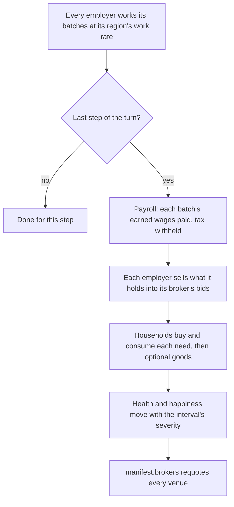
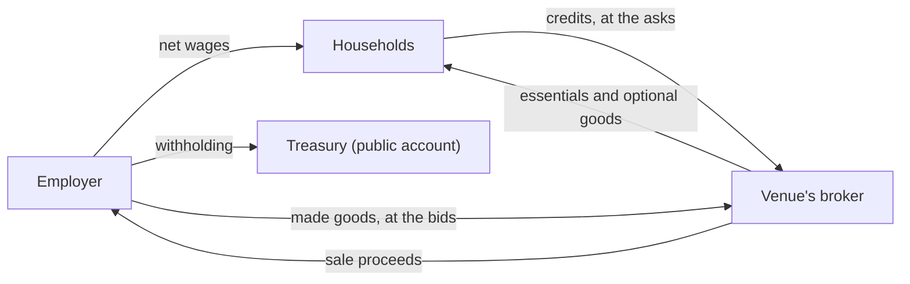

# The regional economy

Every inhabited region of a [scenario](glossary.md#scenario) runs a small closed economy. Its
employer makes goods and pays wages; its households spend those wages on what they need to live;
the region's [health](glossary.md#health) and [happiness](glossary.md#happiness) follow how well
they are supplied, and in turn set how fast the employer works. All of it trades through the same
venue markets players trade in, so a shortage or a glut the economy makes is a price a player can
act on. This document covers that loop: households, needs, production, payroll and wage tax.

It is built and tested. What it leaves open is under [Limits and open work](#limits-and-open-work).

## Concepts

| Term | Meaning |
| --- | --- |
| [Region](glossary.md#region) | The one owner of a population (`World::Region`): its planet, its governor, its population, its health and happiness. Its money is in two [accounts](glossary.md#account): the public account (the treasury) and the household account. |
| <a id="employer"></a>Employer | A region's one native producer (`Kind::Employer`), with its own account (`EmployerAccount`), its goods and its `World::Production`. It makes every market row that names its region. |
| <a id="batch"></a>Batch | A run of the employer's production (`World::Batch`): whole [totes](glossary.md#tote) of one good at one venue, its duration of work, its progress, and its gross wage bill, reserved as it starts. At most one batch a row is under way. |
| [Household](glossary.md#household) | The region's population as one aggregate buyer and consumer (`Kind::Household`): its goods, its pantry, and the region's household account. No citizen or family is simulated. |
| <a id="pantry"></a>Pantry | The households' state beyond whole totes (`World::Pantry`): what is left in opened totes, each need's unmet total and pressure, the last interval's severity and the count of short intervals. |
| [Need](glossary.md#need) | An essential, from `needs` in `data/tuning/balance.yaml`: a weight, a rate per 1,000 people per simulation day in one unit, and the items that meet it, any of them 1:1 in that unit. |
| [Optional good](glossary.md#optional-good) | A good no need names, wanted by a market row that names the region. Households buy optional goods only in an interval in which every need was met. |
| <a id="severity"></a>Severity | The weighted share of the interval's needs that went unmet, 0 to 1 (`Trade::Severity`). |
| [Condition](glossary.md#condition) | A region's health and happiness, each 0 to 100. A shortage lowers both; a fully supplied interval lets both recover. |
| [Work rate](glossary.md#work-rate) | The share of its full rate the employer works at, from the condition (`Trade::WorkRate`). |
| [Payroll](glossary.md#payroll) | Paying, each turn, the wages a batch's work has earned so far. |
| [Withholding](glossary.md#withholding), [wage tax](glossary.md#wage-tax) | The share of each wage payment credited to the region's treasury instead of its households. |
| [Pressure](glossary.md#pressure) | A need's unmet share smoothed over an hour, 0 to 1. It raises what households bid for the need's goods, and past a quarter it calls a [relief](glossary.md#relief) tender. |
| [Economic turn](glossary.md#economic-turn) | The economy's [cadence](glossary.md#cadence), `economy.intervalSeconds`: 60 simulation seconds, 3,600 fixed steps of 1/60 s. Payroll, sales, household buying and the condition update run on each turn's last step. |

## How it works

The economy is the system `manifest.economy` (`Trade::kEconomy`), registered by `Trade::Register`.
It runs every step, after order expiry and before the brokers requote; its place among the other
systems is in [the step, in order](architecture.md#the-step-in-order).

The diagram shows one step of it, then the brokers' system that follows on a turn's last step.



Regions run one after another in the scenario's order, and needs in the tuning's order, so a run is
deterministic. No region's rules touch another's state: a shortage in one region lowers only its
own condition, though trade can carry the consequences elsewhere.

### Where the goods and money flow

Every exchange goes through a venue's book on the same terms as a player's
[order](glossary.md#order) ([orders and brokers](trading.md)), fees included, and every credit moves
between existing accounts. The economy creates no credits and refills no account.



The diagram shows credits and goods between a region's three parties and the
[broker](glossary.md#broker) of its venue. Households consume what they buy, so those goods leave
the world; a `Trade::Consumed` event reports the totes opened.

### Which rows a region makes and wants

A scenario venue's market rows (`market:` under a venue; see [content](content.md)) tie goods to
regions:

- A row with `production` above 0 must name a `regionId` the venue serves. That region's employer
  makes it at that venue, `production` units a day at the full rate.
- A row naming a region, with `demand` above 0, for a good no need names, is one of that region's
  optional goods.
- A need's good's `demand` only sets its price; households buy it at the need's rate.
- The households keep their goods and buy at the first venue in the scenario that serves the region.
  Content validation refuses a venue serving a region that does not trade every need's items.

### Production

Each step, for each row it makes, the employer adds `fixedStep × work rate` seconds of work to the
row's batch (`Produce` in `source/game/trade/src/Trade.cpp`).

- **Starting a batch.** A batch is about `production.batchSeconds` (86,400 s, a day) of the row's
  rate, rounded to whole totes and at least one; its duration is what that many totes take at the
  full rate. Its gross wage bill is `production.wageShare` of the output's value at its base price,
  in whole credits. The bill is reserved from the employer's account as the batch starts. An
  employer that cannot fund it starts none until sales refill its account.
- **Finishing.** A finished batch's totes go into the employer's holding at its venue, the rest of
  its wages are paid, and the next batch starts with the work left over, in the same step. A
  finished batch whose totes would overfill the warehouse waits, finished, for room.
- **The work rate** comes from the condition the last turn left. Each condition's factor runs from
  `condition.workRateFloor` at 0 to 1 at 100, and the two multiply. At the shipped floor of 0.5
  the rate is `(0.5 + health / 200) × (0.5 + happiness / 200)`, from 25% to 100%. A slower rate
  makes the same goods for the same wages, only later.

### Payroll and wage tax

On the turn's last step each batch pays the wages its progress has earned, less what it has paid
already (`Trade::Earned`): its whole bill times progress over duration, rounded down to whole
credits. Its completion pays the rest. Paid wages never exceed the bill reserved.

Each payment is split by `Trade::Withhold`: one credit to the region's treasury for each whole
`1 / economy.wageTaxRate` credits of gross (10 at the shipped rate of 0.1), the rest to its
households. The remainder is carried in `Production::taxCarry`, shared by the employer's batches,
so ten payments of one credit withhold exactly what one payment of ten does. For this reason,
content validation holds the rate to one credit in a whole number of credits.

### The employer's sales

After payroll, each employer cancels its resting orders, offers every tote it holds into its
broker's bids, and cancels what did not fill at once. Its floor is its wages per unit, the base
price times `wageShare`. It never sells below what the goods cost it in wages, and keeps unsold
goods to offer again next turn. A glut fills the broker and lowers its bids, so the maker sells
less, later ([prices](pricing.md)).

### Households

Then each region's households take each need in turn (`Households` in `Trade.cpp`):

1. **The requirement** is fresh each interval: `perThousandPerDay × population / 1,000 × interval
   / 86,400`, in the need's unit, fractions kept. A missed interval adds no catch-up.
2. **Buying.** If what they hold of the need's goods, opened and whole, is short of the requirement,
   they buy whole totes enough for the shortfall, the cheapest ask among the need's goods first,
   within their funds and their warehouse's room. Their limit is `a × (1 + 3p)`: `a` is the ask the
   broker posts at its [target stock](glossary.md#target-stock), `p` the need's pressure. A fed
   region pays the going ask, a starving one up to four times it. What does not fill at once is
   cancelled, so no household bid rests.
3. **Consuming.** They consume exactly the requirement, from opened totes first and then by opening
   whole ones, in the need's item order. What is left of an opened tote stays in the pantry.
4. **Recording.** A shortfall adds to the need's unmet total, and the pressure moves a sixtieth of
   the way toward the interval's unmet share (an hour of 60 s turns). A need's entry appears at its
   first short interval and is updated every interval after, so its pressure falls once it is met.

If every need was met, they then buy and consume each optional good: its row's demand times its
bucket's `demandShare`, at up to its bucket's `premium` over `a`. The buckets group item categories
(`optionalGoods`); a category in no bucket is bought at `a`, all of its demand.

### Condition

The interval's [severity](#severity) is each need's unmet share, capped at fully met so that a
surplus of one need cannot make up for another, weighted by `weight` and averaged. The weights set
importance, not quantities or prices. The shipped weights sum to 4.5, so one weight-1 need missing
entirely is a severity of 1/4.5.

`Trade::Updated` then moves health and happiness, each held to [0, 100]. With a severity above 0,
each loses its `condition.*LossPerHour` times the severity for each hour of interval. With every
need met, each gains its `condition.*RecoveryPerHour`. At the shipped rates happiness moves twice as
fast as health. The new condition sets the work rate from the next step.

A need's pressure past `Trade::kReliefPressure` (a quarter) makes `Trade::Reliefs` call a relief
tender for a day's shortfall, which the AI issuer publishes ([governance](governance.md)).

### Fast-forward

Between turns the economy only adds the same work to each batch every step, so it declares those
steps [quiet](glossary.md#quiet-step) to the engine; see
[Jettison: quiet steps and fast-forward](../../jettison/docs/simulation.md#quiet-steps-and-fast-forward).
Its `next` names the first step it must run: the turn's last, or sooner a batch finishing, a batch
that can start, or a finished batch with room. Its `skip` adds the passed steps' work with
`Trade::Added`, which gives to the bit what adding it a step at a time gives. So a
[fast-forwarded](glossary.md#fast-forward) world saves the same bytes as a stepped one.

### State and saves

The economy's state is saved world state: `Region` (population, health, happiness), the employer's
`Production` and `Stock`, the household's `Pantry` and `Stock`, and the three accounts. All are
made from the scenario's regions as the world is created (`source/game/world/src/World.cpp`). A
world is refused for a batch past its duration or paid past its wages, batches out of order, a tax
carry of a whole withheld credit or more, or a pantry value out of range (`World::Broken`;
[saves](persistence.md)).

Players see every region's population, health and happiness in their snapshot
(`Query::RegionView`), and the treasury only of a region they govern. The pantry and its shortages
are not in the snapshot.

## Using it

### Tuning

The needs, the optional-goods buckets, the condition and the production rules are in
`data/tuning/balance.yaml` (an excerpt):

```yaml
economy:
  intervalSeconds: 60
  wageTaxRate: 0.1

needs:
  - needId: NeedStapleFood
    weight: 1
    perThousandPerDay: 0.5
    unit: Tonne
    items:
      - {itemId: ItemRice}
      - {itemId: ItemWheat}
      # ... oats, barley, beans, lentils, chickpeas and peas
  - needId: NeedHygiene
    weight: 0.5
    perThousandPerDay: 30
    unit: Unit
    items: [{itemId: ItemSoap}]

optionalGoods:
  - bucketId: BucketLuxury
    premium: 0.05
    demandShare: 0.5
    categories:
      - {categoryId: CategoryLuxuryGoods}

condition:
  healthLossPerHour: 6
  happinessLossPerHour: 12
  healthRecoveryPerHour: 3
  happinessRecoveryPerHour: 6
  workRateFloor: 0.5

production:
  batchSeconds: 86400
  wageShare: 0.45
```

The five shipped needs, each per 1,000 people a day, are staple food (0.5 t), drinking water
(3 kL), basic medical supplies (5 kg), salt (0.05 t) and soap (30 units). A region of 25,000 people
needs 12.5 t of staples a day, about 8.7 kg each 60 s turn, met by any mix of the eight staples.

Content validation (`source/game/content/src/Content.cpp`) refuses: no needs, or one twice; a
weight or rate not above 0; a need's item that names nothing, appears twice or is not traded in the
need's unit; a category in two buckets; a `demandShare` outside (0, 1]; and a `wageShare` or
`wageTaxRate` outside [0, 1).

### A region in a scenario

A region gives its population, its three accounts' starting credits and its starting condition;
its venue's market rows say what it makes and wants. From `data/scenarios/trading.yaml`:

```yaml
regions:
  - regionId: RegionOreHighlands
    planetId: PlanetOre
    civilisationId: CivilisationOre
    governorId: ""
    population: 25000
    householdFunds: 5000000
    publicFunds: 1000000
    employerFunds: 1000000
    health: 100
    happiness: 100

# under the venue serving RegionOreHighlands:
    market:
      - {itemId: ItemRice, regionId: RegionOreHighlands, production: 10, demand: 1.5625, stock: 552}
      - {itemId: ItemGlassware, regionId: RegionOreHighlands, production: 0, demand: 120, stock: 40}
      - {itemId: ItemBasicMedicalSupplies, production: 0, demand: 125, stock: 10}
```

Ore Highlands' employer grows rice there, and glassware is one of its households' optional goods.
The medical supplies are a need's good: households buy them at the need's rate, and the row only
prices them.

### The rules in code

The pure rules are in `manifest/trade/Economy.h` and are tested directly. From
`source/game/trade/tests/EconomyTests.cpp`:

```cpp
CHECK(WorkRate(50.0, 50.0, 0.5) == doctest::Approx(0.5625));
CHECK(WorkRate(0.0, 0.0, 0.5) == doctest::Approx(0.25));

// Food and water met, no medical supplies: a third; a surplus of food makes up for none of it.
const NeedMet surplus[]{{1.0, 8.68, 100.0}, {1.0, 52.08, 52.08}, {1.0, 0.087, 0.0}};
CHECK(Severity(surplus) == doctest::Approx(1.0 / 3.0));

const Withholding hundred = Withhold(100, 0, 10);
CHECK(hundred.households == 90);
CHECK(hundred.treasury == 10);

CHECK(Earned(100, 243.0, 600.0) == 40);
```

The same file's hosted cases follow one batch of medical supplies at Brine Coast: 469 credits
reserved, 46 paid at the first turn (4 withheld, 6 carried), all 469 paid by 600 s (46 withheld),
and its tote sold to the broker that turn.

## Limits and open work

- Recipe production is not built: a recipe a project unlocks is recorded in the region's
  `Knowledge`, but no employer batch consumes inputs to make outputs ([governance](governance.md);
  [the economy's open plans](economy-and-development-plan.md)).
- A batch is never interrupted or cancelled. The selected settlement for cancellation (earned wages
  rounded up once, the rest of the reservation released) waits for facilities that can stop.
- One employer and one household pool per region; work and residence in different regions have no
  rules yet. Population does not change: no growth, decline or migration.
- `condition.initial` is loaded and validated, but no rule reads it; a region starts at its
  scenario's `health` and `happiness`.
- Money is fixed: only declared starting balances and each new company's `company.startingCredits`
  enter the world. Circulation is shown over the fixture's eight days (`fixture_prices`), not
  over months.
- Households' goods stay at their venue; carrying goods to and from the surface is the physical
  chain's ([the economy's open plans](economy-and-development-plan.md)).
- Players can see a region's condition but not its shortages.
- Tax rates set by a region's governor: [L29](delivery-order.md#l29). Regional debt when funds run
  out: [L30](delivery-order.md#l30). The power grid: [L31](delivery-order.md#l31). Regions by kind
  of world: [L33](delivery-order.md#l33).

## Decisions

The economy's decisions are in [the decision ledger](decision-ledger.md#the-regional-economy). The
key ones: aggregate population, with rates per 1,000 people a day
([D-022](decision-ledger.md#d-022)); condition, severity, the work rate and the turn's order
([D-024](decision-ledger.md#d-024) to [D-027](decision-ledger.md#d-027)); the employer, its batches
and the households' buying ([D-092](decision-ledger.md#d-092)); drinking water at a credit a tote
([D-093](decision-ledger.md#d-093)); and prices by need, pressure and optional goods
([D-102](decision-ledger.md#d-102)). How the economy was built is recorded in
[W04](history/stage-4-trading-plan.md#delivered-w04-2026-11-20) and
[W19](history/stage-4-trading-plan.md#delivered-w19-2026-11-22).

## Source

| What | Where |
| --- | --- |
| The rules: `WorkRate`, `Severity`, `Updated`, `Withhold`, `Earned`, `Added` | `source/game/trade/include/manifest/trade/Economy.h`, `source/game/trade/src/Economy.cpp` |
| The system: production, payroll, sales, households, fast-forward; `Reliefs` | `source/game/trade/src/Trade.cpp` ("The regional economy"), `Trade.h` |
| State: `Region`, `Batch`, `Production`, `Unmet`, `Pantry` | `source/game/world/include/manifest/world/State.h` |
| Tuning records: `EconomyTuning`, `NeedDefinition`, `DemandBucket`, `ConditionTuning`, `ProductionTuning`, `RegionDefinition` | `source/game/content/include/manifest/content/Definitions.h` |
| Data | `data/tuning/balance.yaml`, `data/scenarios/trading.yaml`, `data/scenarios/governance.yaml` |
| Tests | the `trade` suite (`EconomyTests.cpp`, 16 cases); the `content` suite (the refusals); `fixture` (the goods ledger, saves and replays) and `fixture_prices` (`source/test/FixtureTests.cpp`) |
