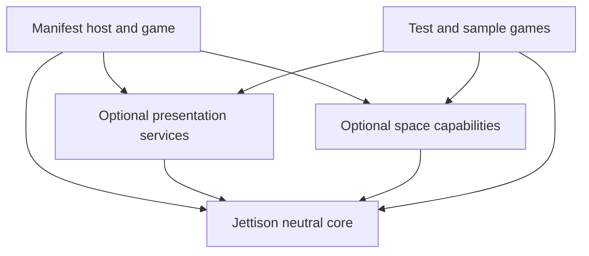

# Jettison and Manifest: responsibility assessment

Assessed 2026-11-15 against Manifest `feature-base` at `2716380` and Jettison
`feature-base` at `826c4bec125b6631a6ba8ee822c90463316c3511`. This is read-only
architectural investigation plus planning documentation. No engine or game implementation,
build configuration, assets or tests were changed; no build/gate was run.

Documentation follow-up: both repositories' scope/architecture/workflow guidance has
since been aligned with this assessment. Jettison's `docs/game-integration.md` now requires
checking Manifest's current mechanics and provisioning reusable API gaps. References below
to the old engine scope describe the inspected baseline.

**Status, 2026-11-18:** the extraction is done in Jettison and is in Manifest's SDK pin
`fafa758`. The H02–H05, A01 and W01 rows of
[Jettison's history](../../jettison/docs/history.md#neutral-sdk-and-manifest-integration) record
it, along with the enforcement checks below that now exist in Jettison: the dependency checks,
the consumer matrix and the neutral-startup registration check. The evidence table below is the
2026-11-15 baseline, and the lines it cites no longer exist. Manifest's side of these checks
arrives with H06 and later stages.

## User's required boundary

Manifest owns its production game code and content. Jettison supplies reusable engine
capabilities for multiple game types without assuming a particular genre. Jettison may
retain enough gameplay code and data for automated tests, and optional demonstrators,
provided those do not become engine requirements or Manifest's production rule source.

This direction supersedes the engine's current narrower scope rule, which asks whether
"a different space game would want it unchanged" (`../jettison/docs/scope.md:32`).
An optional celestial capability is compatible with a neutral engine; requiring a galaxy
to use ordinary simulation, physics or scene services is not the desired boundary.

## Verdict

**Separation exists at the repository/dependency level, but is incomplete at the runtime,
module, content and product-policy levels.** Jettison has a useful reusable foundation.
It is currently a space-oriented engine with a sample game embedded in its app module,
rather than a genre-neutral SDK whose applications supply all game composition.

The sampled engine implementation/build files contain no Manifest include or target
dependency. Manifest already owns its economy, Decimal prices, progression and effects,
and consumes pinned engine dependencies. That is good directional separation, but it
does not prove independence: engine-owned sample gameplay explicitly derives from the
Manifest plan, and core-facing APIs carry assumptions about star systems and ships.

The first five implementation plans improve hosting and gameplay ownership, but by
themselves would not remove those assumptions. Apply the amendments below alongside them.

## Evidence and required changes

Paths beginning `../jettison/` refer to the sibling engine checkout.

| Area | Evidence | Assessment and required change |
| --- | --- | --- |
| Product scope | `../jettison/docs/scope.md:8` describes an engine for a 3D space-trading simulation; its feature verdicts exclude capabilities because that game has no humanoids or walkable terrain. | Rewrite scope around supported engine capabilities and current limits. Lack of navmesh/character animation may remain a deliberate resource limitation, but must not be an assumption built into generic APIs. Genre neutrality does not require implementing every genre feature now. |
| Core simulation/data | `sim/SimWorld.h`, `DefinitionRegistry.h`, `serialise/Archive.h`, `vfs/FileSystem.h`, `script/ScriptHost.h`. | Substantial reusable machinery exists. Keep schema mechanics, fixed steps, deterministic execution, serialisation and sandboxing here. Game types, IDs, capabilities and policies are supplied by consumers. |
| Default application | `app/src/Application.cpp:700` registers trading; `:1189` loads trade definitions; `:1201` registers fleet purchasing; `:1228` creates trader behaviour. | A consumer app cannot select a neutral default composition today. Extract generic lifecycle/platform/presentation services; move these registrations into an explicitly selected test/sample game target. |
| Duplicate game rules | `app/src/Trading.h` implements goods, stock, scarcity, crate prices, ownership, trading and tolls; `Fleet.h` adds ship purchasing; `Traders.*` implements economic AI. | Legitimate test gameplay, incorrectly housed in the engine app library. Keep a small test economy for exercising APIs; production Manifest rules remain solely in Manifest. Do not migrate the sample's whole-credit crate economy over Manifest's Decimal/unit model. |
| AI module | `engine/ai/CMakeLists.txt` combines generic utility AI, behaviour trees and graph search with cruise, gates, jump lanes and celestial route planning. | Split targets: generic decision/tree/graph algorithms must be usable without celestial/physics transit dependencies. Space transit is optional; trader decisions and economic scoring belong to a game or fixture. |
| Physics/scene | `physics/CMakeLists.txt` depends on celestial; `PhysicsWorld.h` defines star systems and celestial frames. `scene/CMakeLists.txt` combines generic scene services with `SystemScene` and `JumpTransition`. | Extract ordinary rigid-body spaces, frame transforms and scene composition from celestial adapters. A simple room with gravity and colliding boxes must not need a fake star-system definition. Space scenes and jump presentation become explicit extensions or game composition. |
| Shared state schemas | `sim/Snapshot.h` makes `InSystem`/star-system IDs part of transform snapshots; `sim/SaveGame.h` includes `galaxy` and viewed `system`. | Generalise spatial partition/frame identity where actually required, or move space-only state to extension components/snapshot data and game save sections. Maintain old saves through migrations; changing names alone is not sufficient. |
| Docking and travel | `dock/Docks.h` has pad queues plus ship approach, clamping and integer crate transfers; `ai/Cruise.h` includes a tuned travel-time curve, station exclusion reach and arrival stand-off rules. | Separate reusable geometry, queuing, constraints and deterministic motion from game choices. Retain an opt-in space-docking capability only where its mechanics are reusable. Manifest owns travel pacing, access, cargo accounting, loading policy and destinations. Do not turn integer crates into a universal engine cargo model. |
| Assets | `assets/CMakeLists.txt` copies and packs shaders together with goods, markets, shipyards, galaxies, trade UI/audio and sample scenes; `jettison_use_shared_assets` selects that combined tree. | Separate engine renderer resources from test/sample content. Manifest supplies its production definitions, scenes, UI, scripts, music and sound selections. A renderer may require its shader pack; it must not require a sample economy pack. |
| Build composition | `source/CMakeLists.txt:10–15` returns before defining the engine when `PLUGIN_IMGUI` is off; it unconditionally adds assets, tools and samples. Top-level/external CMake requires Vulkan/glslc. `Jettison::Engine` aggregates all registered modules, including app. | Make presentation, editor/devtools, samples and tests genuinely optional. A CPU-only consumer must configure without ImGui/Vulkan/sample assets. Prefer a neutral aggregate and explicit extension/sample targets; ensure excluded samples are absent from the dependency closure, not merely unbuilt executables. |
| SDK consumer proof | `source/test/consumer` links the aggregate and tests animation/queue calls; its fetch fallback follows `main`. | Keep it, but add small consumers proving independent capabilities and pinned consumption. Current checks cannot establish genre independence or absence of sample resources. |
| Existing tests | Celestial/dock/scene tests read shared sample assets through `JETTISON_ASSET_SOURCE_DIR`. | Test gameplay is allowed. Give fixtures explicit test/sample ownership and dependencies. Unit suites should not need the entire production-like sample pack to test one rule; end-to-end suites may deliberately mount it. |
| Manifest duplication | `config/SimulationConfig.cpp`, `YamlFieldReaders.h`, `universe/Universe.cpp` implement bespoke YAML reading; `EcsWorld` owns a second registry. | The reverse boundary also matters: use Jettison YAML mechanisms as directed, and bind hosted state to its simulation. Manifest should add game validation and ownership, not a competing VFS/archive/scheduler. |

Public module composition and selected headers were inspected; this is not a complete
line-by-line audit of renderer internals or every engine algorithm. Establish additional
concrete coupling before scheduling a subsystem rewrite.

## Ownership rules for future changes

| Responsibility | Owner |
| --- | --- |
| ECS scheduling, deterministic RNG, clocks, generic commands/events, snapshots | Jettison |
| YAML/binary codecs, reflection, VFS/pack layering, migrations, durable file primitives | Jettison |
| Rendering, audio, input, UI binding, generic scenes, animation, physics integration | Jettison, selected explicitly by the consumer |
| Utility scoring, behaviour-tree execution, graph search and reusable spatial queries | Jettison; tasks, candidates and policies supplied by the game |
| Reusable celestial maths, large-world coordinate frames, optional space mechanics | Optional Jettison extensions if policy-free; no dependency from neutral core back to them |
| Companies, civilisations, goods, prices, units, production, settlement, progression | Manifest |
| Travel rules/pacing, docking permissions, cargo capacity/accounting, upgrade prices | Manifest, calling engine mechanics |
| Scenario identities, hull/station choices, presentation content and script permissions | Manifest |
| Game command validation, request identity semantics, durable acknowledgements and content compatibility | Manifest host; generic queue/archive/I/O facilities remain Jettison |
| Small fake markets, toy combat, test actors, fixture scenes and scripted test behaviour | Jettison tests/optional samples; never a production dependency |

A feature qualifies for the engine when its contract describes a reusable capability,
its policy comes from data/callbacks or an explicit extension, and an independent consumer
can exercise it without the Manifest model. Parameters alone do not make a game rule
generic: a configurable pricing formula is still a pricing rule.

Avoid speculative abstractions. Extract the smallest demonstrated seam and prove it with
a second consumer. For example, keep A* generic and build space routing over it; do not
design every possible vehicle-routing API before removing today's dependency leak.

## Intended dependency structure

There is no edge from neutral core to Manifest, a sample game or optional space services.
Presentation must also work without space extensions. Tests may depend on any capability
they exercise, but engine production targets cannot depend on test gameplay to link or start.

## Treatment of existing sample gameplay

Keep an engine-local test/sample game rather than moving every test market into Manifest.
Extract it from `source/engine/app` into an explicit sample/support target with its own
definitions and assets. Name it as test/sample gameplay and preserve the automated
render, script, save and movement regressions it enables.

It must use public APIs like an external game. Remove privileged access to private app
headers once the composition seam exists; any missing extension point is evidence for
a small engine API. Generic Flotsam/editor startup must not activate sample trading;
opening a sample project is an explicit selection. Jetsam can explicitly select the
sample composition and sample pack.

Do not keep sample and Manifest gameplay in lockstep. Their purpose differs: the sample
is a compact engine exercise, while Manifest owns the actual product. If test fixtures
use similar item names or trading rules, record that they are fixtures rather than a
shared production source. Preserve fixture provenance/licences when moving files.

## Amendments to the five-stage plan

1. **Before and during stage 1:** update the engine boundary policy, extract sample
   composition/assets from generic host targets and repair consumer build options.
   Add a neutral CPU consumer and a separate explicit sample consumer. CPU-only configure
   without presentation dependencies is now a separation acceptance criterion, not merely
   a future dedicated-server convenience. Do not widen the public host into a generic
   name for the current space-specific Application class.
2. **Stage 2:** retain Jettison YAML/registry mechanisms. Manifest owns schemas, semantic
   checks, generated game definitions and the initial scenario. The engine's default
   content must not contain mandatory Manifest goods, hulls or skill trees.
3. **Before stage 3 binds durable hosted state:** resolve generic frame/partition identity
   and save metadata boundaries. Preserve compatible fixtures through migrations.
   Keep company membership, account ownership and request/retry policy in Manifest.
4. **Before stage 4 integrates movement:** split generic AI/physics/scene targets from
   space transit adapters, and move/configure travel pacing and cargo policy at the game
   boundary. Reuse proven engine mechanics, but do not treat their current packaging
   or sample defaults as the desired long-term API. Keep this a bounded refactor with
   existing movement regressions, not a simultaneous engine replacement.
5. **Stage 5:** Manifest owns its compatibility/recovery protocol and distribution manifest.
   Engine durability mechanisms stay reusable. Ship only selected engine resources and
   Manifest game content; prove no sample-content or build-tree dependency survives.

These are additional separation deliverables. The original five plans did not budget
the full module extraction; split it into reviewable engine commits and update Manifest's
immutable SDK pin only after the new public contracts pass. Avoid a giant rename that
hides behaviour changes or needlessly invalidates saves and authored IDs.

## Enforcement to implement later

- **Dependency checks:** define allowed module layers and inspect the CMake target closure.
  Reject core-to-sample/core-to-game edges and accidental celestial dependencies in
  neutral physics/AI/scene targets. Check public-header dependencies too; static library
  dead stripping is not proof that the boundary is sound.
- **Consumer matrix:** configure/build/run a CPU-only toy board-game simulation with no
  transforms, galaxy or renderer; a simple non-space 3D physics scene without celestial
  definitions; and the explicit space sample. Keep fixtures tiny—these are API probes,
  not three products. Exercise real world stepping, definitions and save/load.
- **Options matrix:** samples/tests/editor off, presentation off, ImGui off, and explicit
  extensions on/off must give coherent documented targets. Run the CPU configure in an
  environment without Vulkan/glslc to expose hidden dependency discovery.
- **Content checks:** build a minimal engine resource pack and inspect its contents against
  an explicit manifest. Starting a consumer without sample assets must succeed; requesting
  absent mandatory game content must fail clearly rather than fall back to sample content.
- **Registration checks:** default host startup registers only requested capabilities.
  Assert that sample market, trader and fleet components/systems are absent from neutral
  and Manifest worlds unless an explicit test selected them.
- **Authority checks:** game commands cannot obtain a privileged engine controller merely
  by omitting ownership fields. Keep application authorisation in Manifest while making
  engine authority bypasses explicit and documented for trusted internal calls.
- **Review checklist:** for each engine change identify the reusable capability, the game
  policy left outside, dependencies added and independent consumer that exercises it.
  For each Manifest change check whether existing engine mechanisms already provide it.
- **Documentation and ownership:** assign owners to neutral core, extensions, samples and
  production content. Update scope/architecture/SDK docs together with actual extraction;
  folder names alone do not enforce a dependency boundary.

The status note at the top lists which of these checks exist. The implementer runs repository
gates at each machine's concurrency ([D-051](decision-ledger.md#d-051)), preserving engine sample
coverage as well as Manifest checks. OpenAI agents remain planning-only.

## First implementation handoff

Start with stage 1's engine host seam, sample isolation and build matrix. Preserve the
existing space sample as an explicit regression consumer while adding the tiny neutral
consumer. Then inventory the precise physics/frame and AI target splits before binding
Manifest state to them. Acceptance requires both consumers to work; simply moving
`Trading.cpp` into another directory is insufficient.

The target is a neutral engine with optional capabilities and explicit test games,
alongside a Manifest repository that owns its complete production gameplay and content.
