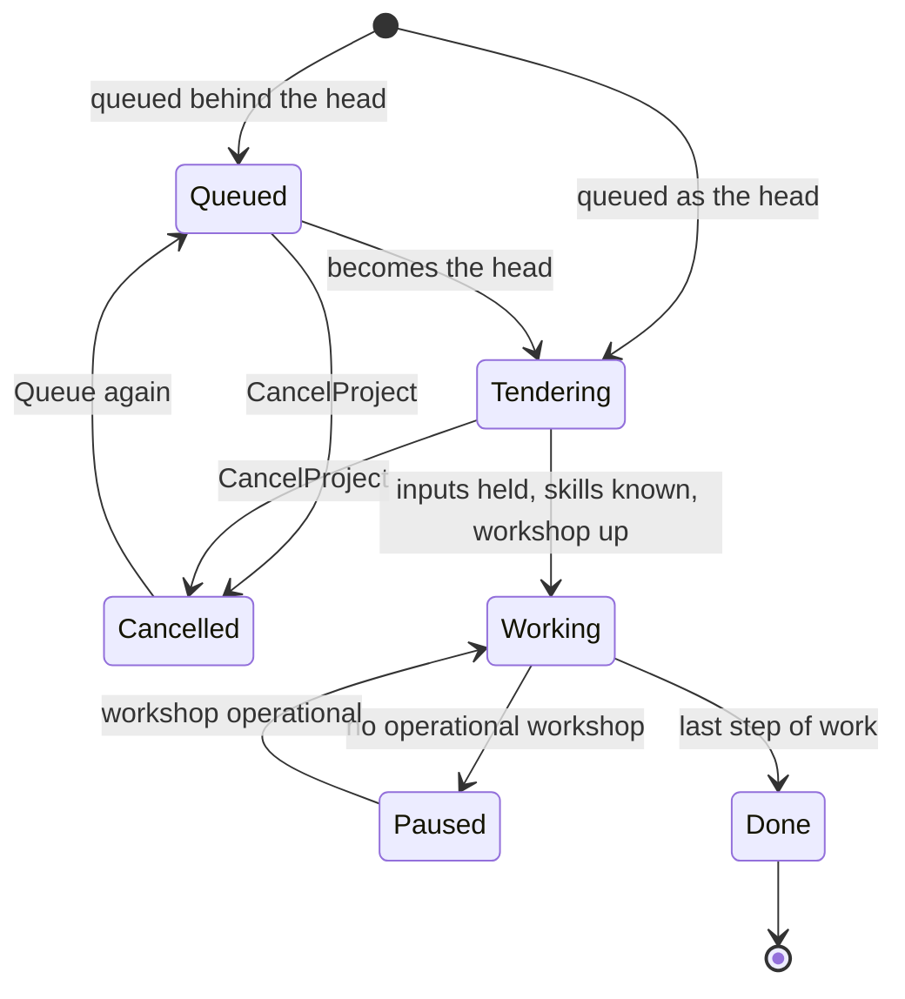
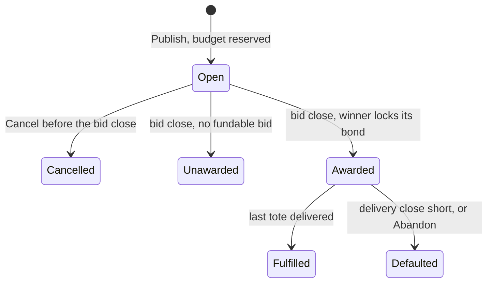
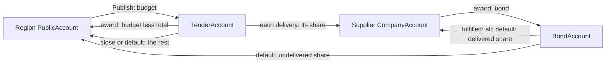

# Regions, governors and public projects

A planet's people live in [regions](glossary.md#region). Each region is its own economy, with its
own households, treasury and knowledge, and some organisation may govern it. This document covers
who governs a region, how a player founds a homeworld, and how a region develops: its public
[projects](glossary.md#project), the [tenders](glossary.md#tender) that buy their inputs from
companies, and the sealed [bids](glossary.md#bid), contracts and bonds behind them. It is for a C++
developer new to Manifest. The rules are the `procurement` module's (`source/game/procurement`),
founding is the `company` module's, and the state is the `world` module's.

What households need, earn and pay is in [the regional economy](economy.md). How a tender's budget
is priced is in [prices](pricing.md#prices-for-tenders). How a ship's standing policy bids on
tenders and works its contracts is in [policies](policies.md#contracts).

## Concepts

| Term | What it is |
| --- | --- |
| [Region](glossary.md#region) | `World::Region`: the one owner of a population. It names its [planet](glossary.md#planet), its civilisation and its governor, and holds its population, health and happiness. Its money is in two accounts of its own, `PublicAccount` (the treasury) and `HouseholdAccount`. |
| [Organisation](glossary.md#organisation) | `World::Organisation`: a body that governs a region or operates a station. Its kind is `Polity` or `Corporation`, and its `principalId` names the player who directs it, empty for one the AI runs. |
| [Governor](glossary.md#governor) | The organisation a region's `governorId` names. A region with none is open to founding. |
| [Polity](glossary.md#polity) | An organisation of kind `Polity`: a government. Founding creates one. |
| [Founding](glossary.md#founding) | A company paying a region's treasury to make a new polity, directed by its player, the region's governor: the player's homeworld. |
| [Knowledge](glossary.md#knowledge) | `World::Knowledge`: the [skills](glossary.md#skill-node) a region knows and the [recipes](glossary.md#recipe) unlocked there. |
| [Facility](glossary.md#facility) | One of a region's facilities, `World::Facility` in its `World::Facilities`: today only a `Workshop`, operational or not. |
| [Project](glossary.md#project) | `World::Project`: a region's public work, a tuning project by ID. Its delivered inputs are its own `World::Stock`; once it holds them all it works for some days, then unlocks a recipe or teaches a skill in its region. |
| [Development queue](glossary.md#development-queue) | A region's projects in order. Only the head, the first not done, tenders and works. |
| [Tender](glossary.md#tender) | `World::Tender`: a region's public call for a number of [totes](glossary.md#tote) of one item, delivered to one venue, within a budget in whole [credits](glossary.md#credit). Its terms are posted to every player. |
| [Bid](glossary.md#bid) | `World::Bid`: a company's sealed offer to deliver a tender's totes for a total. Only its own company sees it. |
| Contract | A tender once awarded: the winning company owes the totes by the delivery close and is paid as it delivers. |
| [Performance security](glossary.md#performance-security) | The bond the winner locks at award, a share of its total, returned on full delivery and partly forfeit on default. |
| Relief tender | A tender for an essential its households are short of, delivered to the region's households rather than a project ([relief](glossary.md#relief)). |
| Development policy | `World::Development`: a player governor's standing order for the AI issuer to tender its head project's inputs within a spending limit. |

## How it works

### Who governs a region

The [scenario](glossary.md#scenario) seeds every region with its governor, or none. In the
governance scenario (`data/scenarios/governance.yaml`) Forge East, Forge West and the Cassiter
Lowlands are governed by AI-run polities, and Forge North and Forge South have no governor.

A region has three states, by its governor:

| Governor | Who acts for it |
| --- | --- |
| None (`governorId` empty) | No one. It is open to founding. Its economy still runs. |
| An organisation with no `principalId` | The AI: the AI issuer tenders for its projects and its households' relief. |
| An organisation directed by a player | That player, by command. With a development policy set, the AI issuer also tenders for it, within the policy's limit. |

The rights follow from this. A command that acts for a region (publishing and cancelling tenders,
queueing and cancelling projects, setting the policy) is the principal's who directs its governor,
and no one's for an AI-run region. Bidding, delivering and abandoning are a company's, sent by its
principal. The governor's own player bids through their company like anyone else, and the region's
treasury and the company's account stay separate even when one player controls both.

A new player is not given a region: provisioning gives a company and a ship at the scenario's
[starter venue](glossary.md#starter-venue) ([companies](companies.md#provisioning-a-player)).

### Founding a homeworld

`Manifest.Company.Found` (`Company::Found`) names a region, the founder's company and the new
polity's display name. It checks everything before it writes anything, in this order:

| Refusal | When |
| --- | --- |
| `UnknownTarget` | The region or company does not exist. |
| `NotAuthorised` | The sender is not the company's principal. |
| `MalformedPayload` | The display name is empty. |
| `Governed` | The region already has a governor. |
| `AlreadyFounded` | The sender already directs a region's governor: one homeworld each. |
| `InsufficientFunds` | The company's account holds less than `company.foundingPrice`. |
| `CapacityExceeded` | The treasury has no room for the price. |

Accepted, the company pays `company.foundingPrice` (`data/tuning/balance.yaml`, a test value)
into the region's `PublicAccount`. This is a one-way transfer: the treasury stays public money. A
new `Polity` organisation is created, its ID issued as `Organisation<n>`, directed by the sender,
and becomes the region's governor in the same step. The region's population, accounts, condition,
knowledge, facilities and projects carry on as they were.

Two founders of one region in one step race by request order: the first founds it and the second
is refused `Governed`. No command changes a governed region's governor, so a founded region stays
its player's while they are away. When no region is left ungoverned, founding is refused and the
region view lists none open.

### Projects and the queue

A project is defined once, in the tuning's `projects` list (`Content::ProjectDefinition`): its
required skills, its inputs in whole totes, its `workDays`, its `priorityPremium` (how urgently
its tenders are priced) and exactly one of `unlocksRecipe` or `teachesSkill`. A region's
`projects` in the scenario seed its queue, in order.

A project's phase is `World::ProjectPhase`. The diagram shows how it moves.



- **The head.** Each region has at most one project under way (`Tendering`, `Working` or
  `Paused`), the lowest `queued` place. As it is done or cancelled, the next `Queued` one
  becomes the head, `Tendering`.
- **Starting.** `manifest.projects` starts a `Tendering` project the step its `Stock` holds every
  input, its region knows each required skill and the region has an operational workshop. The
  inputs are consumed all at once, and it works from that step.
- **Working.** It works one step at a time while the workshop stays operational and is `Paused`
  while it does not. `workDays` are whole days at the fixed step.
- **Done.** Its last step of work adds its recipe or skill to its region's `Knowledge`, once. The
  loss of a facility later does not take it back. A skill taught can start a project queued behind
  it: in the governance tuning, `ProjectSmeltersGuild` teaches `SkillSmelting`, which
  `ProjectBronzeMetallurgy` requires.

A project's goods are its own: nothing acts for a project, so no order or other project can spend
them.

The governor's director manages the queue with two commands. `Manifest.Procurement.Queue` appends
a tuning project at the back (`AlreadyQueued` if it is queued, under way or done there); a
`Cancelled` one is taken up again at the back, with what it holds.
`Manifest.Procurement.CancelProject` takes out a `Queued` or `Tendering` project (`Closed` once
it is working, paused or done). Its open tenders are cancelled, their budgets returned. Its awarded
contracts run on and deliver into its `Stock`, which it keeps. There is no reordering: cancel and
queue again.

### A tender's life

A tender is an entity of kind `Tender`, its ID made of its region, its project or need, its item
and a count (`Procurement::TenderId`). Its terms freeze when it is published; a change is a
cancellation and a new tender. The diagram shows its states (`World::TenderState`).



**Publishing.** `Manifest.Procurement.Publish` names the region, the project, the item, the venue
(one serving the region), the totes, the budget in whole credits, and the bid and delivery windows
in whole simulation days. The totes must be at most what the head project still needs of the item,
beyond what it holds and what its live tenders already call for. Publishing moves the budget from
the region's `PublicAccount` into the tender's own `TenderAccount`, so the money is spent once and
no one else's while reserved. The bid close is the publishing step plus the bid window.

**Bidding.** `Manifest.Procurement.Bid` places a company's one sealed bid on an open tender: a
total from 1 to the budget, for all the totes by the delivery close. Send revision 0 for a new bid;
a replacement sends the bid's current revision, and a stale one is refused `StaleRevision`.
`Manifest.Procurement.Withdraw` takes it back. Each bid keeps the step and request order it was
last accepted at. No goods or money are reserved for a bid.

**The award.** As the bid close's step runs, after the step's commands, `manifest.tenders` closes
each tender in ID order. The bids are ranked by lowest total, then earliest accepted, then company
ID, and the first whose company can fund the bond wins (`Award::Lowest`, or `PastUnbonded` when
lower bids were passed over). The bond, `procurement.performanceSecurityRate` of the total rounded
up, moves from the winner's account into the tender's `BondAccount`. Because awards run in order,
an earlier award's bond can spend what a later one needed. The budget beyond the total returns to
the treasury, the delivery window starts, and the winner, total, bond and reason are posted. With
no fundable bid the tender closes `Unawarded` (`NoBids` or `Unbonded`) and its budget returns.
Every bid is dropped either way, so losing bids stay their bidders' alone.

**Delivery.** `Manifest.Procurement.Deliver` unloads the tender's item from the winner's ship,
docked at the tender's venue before the delivery close, straight into the project's `Stock` (or,
for a relief tender, the region's households'). It takes at most the totes still owed and the room
the warehouse has; the rest stays aboard. Goods are the supplier's until accepted. Each delivery is
paid what it adds to `World::Owed`: after q of Q totes the supplier has been paid T q / Q in all,
rounded to the nearest credit, a half up, in exact integer arithmetic. The last tote pays the rest
of T, returns the whole bond, and the tender is `Fulfilled`.

**Default.** At the delivery close, before that step's awards, a contract short of its totes is
`Defaulted`; `Manifest.Procurement.Abandon` makes it so at once. Accepted goods and payments
stand. The tender account's rest returns to the treasury. The bond's undelivered share,
bond (Q - q) / Q rounded down, is forfeit to the treasury, and the rest goes back to the supplier.

The money moves only between accounts, never minted or lost. The diagram shows its paths.



A worked example from the bond's rules: a winning total of 10,000 credits locks a 1,000-credit
bond. Seven of ten totes delivered, then a default: the supplier has been paid 7,000, recovers 700
of its bond and forfeits 300 to the treasury.

**Bounds.** `procurement` in `data/tuning/balance.yaml` holds the windows an issuer may set and the
AI's own, and three bounds: a region's live tenders (`maxOpenTenders`, `LimitReached` beyond it),
a tender's bids (`maxBids`) and the closed tenders a region keeps for the record (`keptClosed`, the
oldest closed dropped).

### The AI issuer

The AI issuer runs inside `manifest.tenders`. It runs as the world starts, on each
[economic turn](glossary.md#economic-turn)'s last step, and in any step a tender's bidding closed
or a tender closed or its contract ended (by the system or by a command earlier in that step).

For each region in the scenario's order, it acts if the AI runs the region's governor, or a
player's development policy has `tender` on. It tenders each input of the head project that is
still needed and has no live tender, at the first venue serving the region. The totes are what is
still needed. The budget is `Trade::Budget` of `Trade::TenderPrice` with the project's
`priorityPremium` ([prices for tenders](pricing.md#prices-for-tenders)). The windows are the
tuning's `aiBidDays` and `aiDeliveryDays`. A tender the treasury cannot fund, or that would pass a
bound, is not issued, and it is tried again next time. So what closes unawarded or in default is
tendered again at once.

On a turn's last step it also issues the relief tenders `Trade::Reliefs` calls for, for AI-run
regions with no relief tender open for that need ([the regional economy](economy.md)).

### Unattended development

`Manifest.Procurement.SetDevelopment` sets a player's region's `World::Development`: `tender` and a
`limit` in whole credits. With `tender` on, the AI issuer tenders the head project's inputs as for
an AI-run region, priced the same, while the budgets of the region's live tenders (open and
awarded, the new one included) stay within `limit`. A tender that would pass the limit waits with
reason `SpendingLimit`; one the treasury cannot fund waits with `InsufficientFunds`. The reason is
kept on the region until an input is tendered, and a new `SetDevelopment` clears it. The policy
spends the treasury alone, never company funds, and never founds or queues. Relief tenders stay the
AI's. With it off, the default, the player publishes by command.

Together with a ship's standing policy with `contracts` on
([policies](policies.md#contracts)), this develops a region with no client connected: the issuer
tenders, the job bids, buys, carries and delivers, and the project works.

### Where it runs in the step

Both systems run in the simulation phase, after the step's commands
([the step, in order](architecture.md#the-step-in-order)):

1. `manifest.tenders`, after `manifest.expiry`: defaults at their delivery close first (so a bond
   returned can fund an award in the same step), then awards at their bid close, then the AI
   issuer.
2. `manifest.projects`, after it and before `manifest.economy`: starts, works, pauses and
   completes projects in entity order.

A bid or delivery executed at or after its close step is refused `Closed`, however early it was
sent. Each system tells the world its next step to run
([quiet step](glossary.md#quiet-step)): the tenders' next close or turn end, the projects' next
start, pause, resume or last step of work. So [fast-forward](glossary.md#fast-forward) passes over
the rest and leaves the bytes stepping would.

### The region view

The query's `Snapshot` (`Query::Observe`) carries `regions`, one `Query::RegionView` per region
by ID, and `tenders`, every tender open or kept closed, by ID. Every player sees a region's planet,
its governor's ID and name, whether a player directs it, and its population, health and happiness;
a region with no governor is open to founding. The principal directing its governor, and the
Administrator, also see its treasury, its queue (each project's phase, work and stock, in queue
order, done and cancelled ones included) and its development policy with its reason. A company sees
its own bids in its `CompanyView` and no one else's. Household and employer accounts, and another
governor's queue and policy, are not shown.

### Saves

Regions, organisations, knowledge, facilities, development policies, projects and their stock,
tenders, bids, and the tender and bond accounts are all saved. A load refuses a world whose
procurement state breaks its own rules, for example a tender account that is not its reservation
or a project holding what it does not take ([what a load refuses](world.md#what-a-load-refuses)).

## Using it

The console and the TUI send each command: `found`, `project queue` and `cancel`, `development`,
and `tender publish`, `cancel`, `bid`, `withdraw`, `deliver` and `abandon` ([the console](console.md#the-commands)),
and `observe` prints the tenders and the regions from the snapshot. A client or a test sends them
through `Command::Requests`.

A project and its recipe, from `data/tuning/balance.yaml`:

```yaml
projects:
  - projectId: ProjectBronzeMetallurgy
    requires: [{skillId: SkillSmelting}]
    inputs: [{itemId: ItemCopper, totes: 9}, {itemId: ItemTin, totes: 1}]
    workDays: 7
    priorityPremium: 0.5
    unlocksRecipe: RecipeBronze
  - projectId: ProjectSmeltersGuild
    inputs: [{itemId: ItemCopper, totes: 3}]
    workDays: 3
    priorityPremium: 0.5
    teachesSkill: SkillSmelting
```

An AI-run region seeded with that project, from `data/scenarios/governance.yaml` (shortened).
Content refuses a seeded project whose region lacks its skills or an operational workshop:

```yaml
  - regionId: RegionForgeEast
    planetId: PlanetForge
    civilisationId: CivilisationForge
    governorId: OrganisationForgeEastCouncil
    population: 25000
    publicFunds: 1000000
    skills: [{skillId: SkillSmelting}]
    facilities: [{facilityId: FacilityForgeEastWorkshop, kind: Workshop, operational: true}]
    projects: [{projectId: ProjectBronzeMetallurgy}]
```

Founding a homeworld and leaving it to develop with no client, from `source/test/FixtureTests.cpp`
(the development fixture, shortened). Ada founds Forge North, queues the guild then Bronze, lets the
issuer spend up to 150,000 credits, and turns her ship's contracts on:

```cpp
hosted.Run(kAda, Company::kFound, Company::kVersion,
    Company::Found{std::string{kNorth}, companyId, "Northern Republic"});
for (const std::string_view project : {kGuild, kBronze})
	hosted.Run(kAda, Procurement::kQueue, Procurement::kVersion,
	    Procurement::Queue{std::string{kNorth}, std::string{project}});
hosted.Run(kAda, Procurement::kSetDevelopment, Procurement::kVersion,
    Procurement::SetDevelopment{std::string{kNorth}, true, 150'000});
hosted.Run(kAda, Manifest::Policy::kSet, Manifest::Policy::kVersion,
    Manifest::Policy::Set{"Ship1", true, 0, 0, 0, true});
```

Sealed bids and their revisions, from `source/game/procurement/tests/ProcurementTests.cpp`:

```cpp
CHECK(bid(kBea, "CompanyB", 8'000, 0) == Result::Succeeded);     // a new bid: revision 0
CHECK(bid(kBea, "CompanyB", 7'000, 0) == Result::StaleRevision);
CHECK(bid(kBea, "CompanyB", 7'000, 1) == Result::Succeeded);     // replaced at its revision
CHECK(bid(kBea, "CompanyB", 10'001, 2) == Result::InvalidPrice); // above the budget
CHECK(bid(kAda, "CompanyA", 9'000, 0) == Result::Succeeded);     // the governor's own company
```

## Limits and open work

- No console or TUI commands or views for founding, the queue, the policy, tenders or bids.
- `Found` checks no station, delivery or life-support condition of the region.
- A queue is reordered only by cancelling and queueing again.
- A player's governor cannot publish relief tenders, and a development policy issues none.
- Repeat production on an unlocked recipe is not built: its ownership, facility access and batch
  timing are to be specified first ([D-029](decision-ledger.md#d-029)).
- Nothing in the game takes a workshop out of action; only the suite does.
- Every project is worked at a workshop (a `shortcut:` in `Procurement.cpp` and `Content.cpp`);
  a project names its facility when a second kind is needed.
- Corruption and bribery: [L02](delivery-order.md#l02).
- AI regional acquisition and transfers of control: [L03](delivery-order.md#l03).
- Private-port bookings: [L04](delivery-order.md#l04); corporate port construction:
  [L05](delivery-order.md#l05); exploitation and [concessions](glossary.md#concession):
  [L06](delivery-order.md#l06) (all in the [planetary plan](planetary-development-plan.md)).
- Generating regions as players join ([D-076](decision-ledger.md#d-076)) and abandoned regions are
  unresolved server policy ([roadmap](roadmap.md)).
- Governor tax rates and regional debt: [L29](delivery-order.md#l29),
  [L30](delivery-order.md#l30) ([economy plans](economy-and-development-plan.md)).

## Decisions

The decisions for this feature are under
[Regions, governors and public projects](decision-ledger.md#regions-governors-and-public-projects).
The key ones:

- [D-042](decision-ledger.md#d-042): the supplier-funded performance security.
- [D-101](decision-ledger.md#d-101): the tender lifecycle, windows, rounding and the AI issuer.
- [D-102](decision-ledger.md#d-102): tenders priced by need.
- [D-089](decision-ledger.md#d-089): no region at provisioning; founding later.
- [D-110](decision-ledger.md#d-110): founding, the queue, the development policy and the region
  view.

How it was built is recorded in the stage 4 plan's
[tender contract](history/stage-4-trading-plan.md#tender-contract-w11-2026-11-21) and
[regional governance](history/stage-4-trading-plan.md#regional-governance-w13-2026-11-23)
sections, and the original proposals in
[the procurement plan](history/procurement-and-station-contracts-plan.md).

## Source

| Path | Holds |
| --- | --- |
| `source/game/procurement/include/manifest/procurement/Procurement.h`, `src/Procurement.cpp` | The queue, policy and tender commands, `manifest.tenders` (awards, defaults, the AI issuer) and `manifest.projects`. |
| `source/game/company/include/manifest/company/Company.h`, `src/Company.cpp` | `Found`. |
| `source/game/world/include/manifest/world/State.h` | `Region`, `Organisation`, `Knowledge`, `Facilities`, `Project`, `Tender`, `Bid`, `Development`, `Owed`. |
| `source/game/query/include/manifest/query/Query.h` | `RegionView`, `ProjectView`, `TenderView`, `BidView`. |
| `source/game/content/include/manifest/content/Definitions.h` | `ProjectDefinition`, `RecipeDefinition`, `ProcurementTuning`, `CompanyTuning`, `RegionDefinition`. |
| `data/tuning/balance.yaml` (`company`, `procurement`, `projects`, `recipes`), `data/scenarios/governance.yaml` | The founding price, tender bounds, projects and the governance world. |

| Suite | What it proves |
| --- | --- |
| `procurement` | Projects, queue, tenders, bids, awards, bonds, delivery, default, the AI issuer and the development policy, with saves. |
| `company` | Founding: each refusal, a race of two founders, a save. |
| `query` | The region view for its founder, a rival and the host. |
| `fixture_governance` | Forge East's Bronze project tendered, supplied by a ship, worked and unlocked; saved and replayed. |
| `fixture_development` | A founded homeworld developed with no client beside AI neighbours; a late joiner founds; the rest are refused. |
