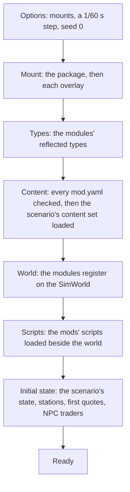
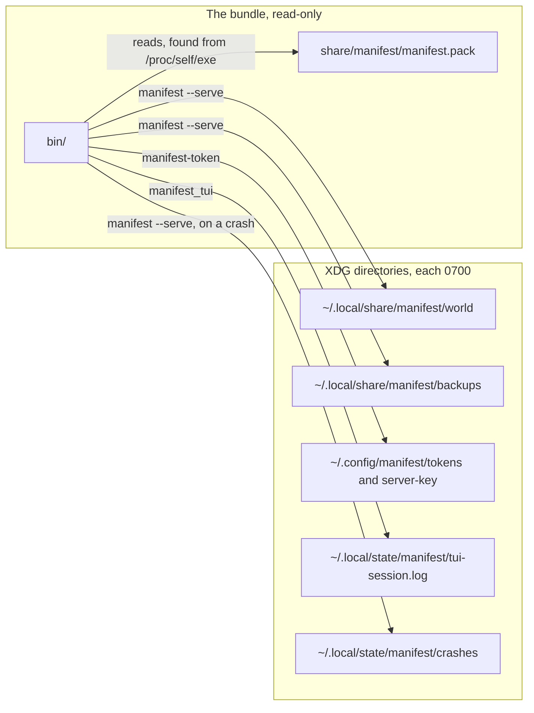
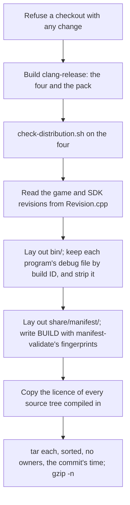

# The host, the command line and the distribution

The host is how Manifest starts: it mounts the content, loads and checks it, and composes Manifest's
modules into one [hosted world](glossary.md#hosted-world) on Jettison's host session. The command
line is the four programs built on it: the server (`manifest`), the content validator
(`manifest-validate`), the token tool (`manifest-token`) and the terminal UI (`manifest_tui`).
The distribution is the tarball those programs ship in, built to run on an ordinary Linux machine
with nothing of the build's toolchain present.

This document covers what is common to every program: the options, start-up, the default places
they read and write, the build's identity and the bundle. What a running server does is in
[the dedicated server](server.md) and [saves, the journal and backups](persistence.md); what the
content is and how it is checked is in [content, scenarios and validation](content.md).

## Concepts

| Term | Meaning |
| --- | --- |
| Host session | Jettison's `Host::Session`: one game's file system, definitions and world, made in start-up phases with no window ([Jettison: the host session](../../jettison/docs/simulation.md#the-host-session)) |
| Manifest's game | The private `Game` class in `source/game/host/src/Start.cpp`: Manifest's hook for each phase of the session |
| Options | `Host::Options`: the content (a directory or a [pack](glossary.md#pack)), the [overlays](glossary.md#overlay) over it in order, and the [scenario](glossary.md#scenario) |
| Default places | Where a program reads and writes when no option names a place: the content beside the executable, the rest under the XDG user directories (`host/Locations.h`) |
| Build identity | The game's and the SDK's source trees, compiled into every build (`cmake/Revision.cmake`), which a world's identity file must match |
| [Bundle](glossary.md#bundle) | The distributed tarball: the four programs, the packed content, a `BUILD` file and the licences |
| [glibc floor](glossary.md#glibc-floor) | The oldest glibc the bundle runs on, 2.39 |

The host never looks in the working directory, discovers user mods or mounts anything writable.
What runs is exactly what the command line names, or the content shipped beside the executable.

## How it works

### Start-up, phase by phase

`Manifest::Host::Start(options)` makes a `Jettison::Host::Session` and hands it Manifest's game.
The session runs one hook a phase, in order. The diagram shows what Manifest does in each.



| Phase | Manifest's hook | What it does |
| --- | --- | --- |
| Mount | `Host::Mounts` | The content as `manifest`, then each overlay as `mod:<identifier>`, its directory's or pack's name, as Jettison's shell mounts a mod |
| Types | `Game::RegisterTypes` | The reflected types of `travel`, `company`, `trade`, `policy` and `procurement` |
| Content | `Game::LoadContent` | The first package must be Manifest's; then `Content::LoadScenario` loads the definitions as one content set |
| World | `Game::RegisterWorld` | Components, services, commands and systems, in the order that is the save's order |
| Scripts | none | The engine's: every mod's script (`defs/scripts/`) loaded into the session's `Script::ScriptHost`, as in a client playing alone |
| Initial state | `Game::CreateInitialState` | `World::CreateInitialState`, `Travel::OpenStations`, `Trade::Quote`, `Policy::ProvisionTraders` |

The engine checks every package's description: its format, its engine requirement and the packages
it requires
([Jettison: packages and `mod.yaml`](../../jettison/docs/files-and-mods.md#packages-and-modyaml)).
Manifest adds its own rule for the first package. Its `mod.yaml` must name `Manifest` and give a
`release` and an `engine` requirement. The name is what counts, not the file name, so a renamed
pack is still Manifest. This is the package's description, `mods/manifest/mod.yaml`:

```yaml
version: 1
name: Manifest
release: 0.0.1
engine: 0.1.0
```

A phase that fails throws `Jettison::Host::StartupError`, naming the phase, the source and the
cause. No later hook runs, and the session releases what it built. A content error names the record,
the field and the mounts it came from, so an overlay's broken patch is traced to the overlay.

Every program's session runs the mods' scripts (`Host::Options::scripts`, at the script host's
default limits; [Jettison: host scripts in a game](../../jettison/docs/scripts.md#host-scripts-in-a-game)).
A script observes and keeps keys: no command of Manifest's is one a script may send
([D-004](decision-ledger.md#d-004)), so a definition that grants one does not load, and the game names
no sender (`Host::Game::ScriptSender`). The server gives them the world's events and saves their keys
([the server's loop](server.md#the-servers-loop)); the console and the tests start them and give them
nothing. The client's shell runs them as it runs any game's.

The world steps at 1/60 s, the step Jettison's docking and physics are tested at
([D-086](decision-ledger.md#d-086)). Its seed is 0, since nothing draws on the world's random
generator yet. What the step runs, in order, is in [the architecture](architecture.md).

A frontend reaches the started world through `Host::HostedServices(session)`. It returns the
world's `Identities`, its `Requests` (the one admission path), the travel `Fleet` and the
[content identity](glossary.md#content-identity). The console, the server (`Remote::Server`) and
the fixtures use it; how requests are admitted is in [the hosted world](world.md).

### The options

Every program that loads content reads the same options, through `Host::ParseOptions`:

```text
[--content <directory-or-pack>] [--overlay <directory-or-pack>]... --scenario <name>
```

- `--scenario` is required. Which world to make is the operator's choice, never a default.
- `--content` defaults to the pack beside the executable (`Host::DefaultContent`, below).
- `--overlay` may be repeated. Overlays mount in the order given, and a later one wins.
- The three may come anywhere on the line. Every other argument is left, in order, for the program.
- `--content` or `--scenario` given twice, or an option with no value, is a bad command line.

The validator runs the same sources, rules and content set with no world (`Host::Validate`), so
content it accepts is content the host starts on, and it fails with the same report.

### The default places

A program writes nothing beside its executable or in the working directory. Each place has a
default, and the option still overrides it.

| What | Default | Option |
| --- | --- | --- |
| Content | `<bin>/../share/manifest/manifest.pack` | `--content` |
| The world | `$XDG_DATA_HOME/manifest/world` | `--world` |
| Backups | `$XDG_DATA_HOME/manifest/backups`, written by default | `--backups` |
| The token file | `$XDG_CONFIG_HOME/manifest/tokens` | `--tokens` |
| The server's secret key, 0600 | `$XDG_CONFIG_HOME/manifest/server-key` | `--key` |
| A client's server list | `$XDG_CONFIG_HOME/manifest/servers.yaml` when it is there, else `<bin>/../share/manifest/servers.yaml` | none |
| The TUI's transcript | `$XDG_STATE_HOME/manifest/tui-session.log` | none |
| The server's crash reports | `$XDG_STATE_HOME/manifest/crashes` | none |
| The server's log | stderr, for the service manager to keep | none |

`DefaultContent` finds the executable from `/proc/self/exe` (`Jettison::Platform::ExecutablePath`).
Every build tree is laid out as the bundle is, its programs in `build/<preset>/bin/` and the pack
in `build/<preset>/share/manifest/`, so a development build finds its content the same way.

The XDG directories default under `HOME`, as the specification has it
([Jettison: user directories](../../jettison/docs/runtime.md#user-directories)). Each is resolved
alone, so a program needs only the variables of the places it writes. With neither the variable nor
an absolute `HOME`, the program fails naming the variable. A default directory is made private
(0700) and durably as it is first made (`Host::MakePrivateDirectories`); one already there is left
as it is. Backups are on by default because a server with none has only its world's directory to
lose.

### The build's identity

A world loads only in the build that made it ([D-111](decision-ledger.md#d-111)): its identity file
holds the game's and the SDK's revisions, and both must equal the running build's. So every build
compiles them in. `cmake/Revision.cmake` runs at every build and writes
`build/<preset>/source/game/host/Revision.cpp` with two values:

| Value | Form | Taken from |
| --- | --- | --- |
| `kGameRevision` | `<version>+<tree>`, the version the top `CMakeLists.txt` gives | Manifest's checkout |
| `kSdkRevision` | `<tree>` | Jettison's checkout, fetched at the pin or given locally |

A tree is git's own hash of the checkout's `source/`, `cmake/`, `CMakeLists.txt` and
`CMakePresets.json` as they are on disk, tracked or not. It is taken in an index and object store of
the build tree's own, so the checkout's index is never touched. Uncommitted code therefore still
gets an identity of its own. The data is not in the tree: the content has its own identity, the
[fingerprint](glossary.md#fingerprint), which a world also records. `Host::RunningIdentity`
(`host/Journal.h`) reads both values; what a load compares is in [persistence](persistence.md).

### The module and the build

`source/game/host` builds `Manifest::Host`, a static library depending on `content`, `world`,
`command`, `travel`, `company`, `trade`, `policy` and `procurement`, and on Jettison's `Core`,
`Host` and `Platform`. It sits outside the `Manifest::Game` aggregate, so the model never depends
on the host that drives it. `remote` builds on it, and the programs link it. The module graph is in
[the architecture](architecture.md).

Every module is declared with `manifest_add_module` (`cmake/ManifestModule.cmake`): a static
library `manifest_<name>` aliased `Manifest::<Name>`, its public headers, `-ffp-contract=off`, and
an optional doctest suite registered as the ctest test `<name>`. A dependency on a module not yet
added fails the configure, so modules are added lowest tier first (`source/game/CMakeLists.txt`).

`source/external/CMakeLists.txt` brings in the SDK: Jettison fetched at its [pin](glossary.md#pin)
(`MANIFEST_JETTISON_REVISION`), or a local checkout given as `JETTISON_SOURCE_DIR`, or the targets
a parent project already provides. Either way it then checks every SDK target Manifest uses, and
`jettison_add_pack`, and fails the configure naming whatever is missing. A partial SDK fails there,
not at whichever target first links it. Presets and pin updates are in
[build and gates](build-and-gates.md).

### The distribution

The distribution is a standalone tarball for x86-64 Linux ([D-114](decision-ledger.md#d-114)). It
is a server's whole install: unpacked anywhere, read-only, run by its operator with nothing else
installed.

```text
manifest-<version>-<game tree's first 12>-linux-x86_64/
  bin/manifest                     the server, --check-startup and --restore
  bin/manifest-validate            the content validator
  bin/manifest-token               the token file's and the server key's tool
  bin/manifest_tui                 the terminal UI
  share/manifest/manifest.pack     the content, packed as the build packs it
  share/manifest/servers.yaml      the servers its clients pin the keys of (none unless a test build adds one)
  share/manifest/BUILD             the version, game and SDK revisions, scenarios' fingerprints
  share/doc/manifest/              Manifest's LICENSE, every linked source tree's licence and the packed font's
```

`BUILD` says which build a bundle is, in the same values a world's identity file records:

```yaml
version: 0.0.1
game: 0.0.1+<game tree, 40 hex digits>
sdk: <SDK tree, 40 hex digits>
content:
  governance: <fingerprint, 16 hex digits>
  trading: <fingerprint, 16 hex digits>
```

The diagram shows where a bundled program reads and writes. The bundle is only read; everything
written goes under the user's XDG directories.



#### What a machine needs

- **x86-64 Linux with glibc 2.39 or newer**, loaded through `/lib64/ld-linux-x86-64.so.2`: Ubuntu
  24.04 and Debian 13 onwards. On NixOS, `programs.nix-ld`, which puts a loader there.
- **`/proc` mounted**, since the content is found from `/proc/self/exe`. Start a program directly,
  never as `ld.so bin/manifest`, which would make the loader the executable.
- **A local file system for the world**, which the [world lock](glossary.md#world-lock) holds with
  `flock`; NFS is not supported.
- **`HOME`, or the XDG variables, as absolute paths.**
- **For the TUI, a terminal.** No program needs a display, a GPU, a Vulkan loader or a window
  system.

Other architectures, musl, older glibc, Windows and macOS are not supported. Only the systems the
bundle's test runs on are tested; nothing promises every Linux with a new enough glibc.

#### How the programs are linked

The release preset, `clang-release`, is the distribution build: it sets `MANIFEST_DISTRIBUTION`.
`manifest_distributed` (`cmake/Distribution.cmake`) puts each of the four programs in
`<build>/bin` in every preset, and with `MANIFEST_DISTRIBUTION` links them to run outside the
toolchain:

- `libstdc++` and `libgcc` linked statically; every other library already is (libsodium, ENet and
  FTXUI among them).
- The interpreter `/lib64/ld-linux-x86-64.so.2`, not the Nix store's.
- No `RUNPATH`. Nix's compiler wrapper adds one that no link option takes back, so `patchelf`
  removes it after the link.
- The glibc floor. The binaries are built against nixpkgs' glibc, which is newer than 2.39. The
  few functions glibc gave new symbol versions after 2.39 are routed by the linker's `--wrap` to
  `source/apps/distribution/GlibcFloor.cpp`, which binds each to the older version. Today these are
  `remainder` and `sqrtf` (bound to `GLIBC_2.2.5`) and `__inet_pton_chk`, which
  `_FORTIFY_SOURCE` calls in place of `inet_pton` (wrapped onto `inet_pton` with the same size
  check). It is linked as objects, so the static `libstdc++`'s calls are wrapped too.

`scripts/check-distribution.sh <executable>...` checks the result. It fails on another
interpreter, any `RPATH` or `RUNPATH`, a needed library that is not glibc's own (`libc`, `libm`,
`libpthread`, `libdl`, `librt` and the loader), or any symbol newer than glibc 2.39. It is the
release preset's `distribution` test, so a nixpkgs update that brings another newer symbol fails
the gate, and the symbol is bound in `GlibcFloor.cpp`. The other presets link as before.

#### Staging and testing the bundle

`scripts/stage-bundle.sh [<directory>]` (`build/bundle` by default) stages the tarball. The
diagram shows its steps.



A clean checkout is required so that the game tree in the bundle's name is a commit's. The licences
come from ninja's own record of the build (`ninja -t inputs`, `-t deps`): every fetched source tree
an object of the four was compiled from or included a header of. A tree with no licence file fails
the staging. MikkTSpace's licence is the leading comment of `mikktspace.h`, so that file is copied.
The pack's Noto Sans JP font is no source tree: its licence (SIL OFL 1.1), fetched with it, is copied as
`notosansjp/LICENSE`. `libstdc++` and `libgcc` are under the GCC Runtime Library Exception, which sets no condition on a
program compiled with them, so their licence is not shipped. The tarball is the same bytes from the
same commit.

The bundle's programs are stripped (`objcopy --strip-all`), and their debug information is kept
apart in a second tarball beside it, `debug-<bundle>.tar.gz`, never shipped with it. Each program
carries a SHA-1 build ID in every preset (`manifest_distributed`), and its debug file is
`debug-<bundle>/.build-id/<first two digits>/<the rest>.debug`, the layout Jettison's
`scripts/symbolise-crash.sh` and gdb find it in by that ID, so no debug link is written. A crash of
`manifest --serve` writes a report (Jettison's
[crash reports](../../jettison/docs/runtime.md#crash-reports)) listing each module's build ID; an
operator's machine with no `addr2line` writes only modules and offsets, which the build's
debug files name later:

```sh
tar -xzf debug-manifest-<version>-<tree>-linux-x86_64.tar.gz
../jettison/scripts/symbolise-crash.sh crash-<time>-<pid>.txt debug-manifest-<version>-<tree>-linux-x86_64
```

`scripts/bundle-smoke.sh <prefix>` runs a bundle, or a build tree, as an operator would: from an
empty directory, in a new `HOME`, every place left to its default. It starts and validates on the
pack beside the programs, issues a token, serves a new world, connects the TUI with the token (where
there is a TUI), stops the server and restores its newest backup at the step it stopped at. It then
checks that the three XDG directories are 0700 and that nothing was written to the working
directory. It is the ctest `bundle_smoke` in every preset.

`scripts/test-bundle.sh <bundle.tar.gz> [host|<docker image>]...` runs `bundle-smoke.sh` on a
staged tarball where it is to run. It unpacks it into a read-only directory outside both checkouts
and runs it under `env -i` with only `HOME` and `PATH`: on this machine (`host`), and in
`ubuntu:24.04` and `debian:13` containers with no network. CI stages the bundle and runs it on its
Ubuntu 24.04 runner with `host` ([D-116](decision-ledger.md#d-116),
[build and gates](build-and-gates.md)).

## Using it

### The programs

| Program | Command line |
| --- | --- |
| `manifest` | `<options> --check-startup`: start, log readiness, shut down |
| | `<options> --serve [--world <dir>] [--tokens <file>] [--address <ipv4>] [--port <n>] [--flush-seconds <n>] [--snapshot-seconds <n>] [--backups <dir>]`: the dedicated server |
| | `<options> --restore <backup> [--world <dir>]`: restore a backup into an empty world directory and recover it to check it |
| `manifest-validate` | `<options> [--manifest <file>]`: load the content with no world; `--manifest` writes the content manifest's bytes |
| `manifest-token` | `[--tokens <file>] issue\|revoke principal\|administrator <id>`: issue a bearer token, printed once, or revoke one |
| `manifest_tui` | `[--content <directory-or-pack>]`: the console in a terminal, which also connects to a server as a remote client |
| `manifest_client` | `[--scenario <name>]` and the engine shell's arguments: the [graphical client](client.md), not yet in the bundle |

`<options>` are [the options](#the-options). The server's defaults are the loopback address
`127.0.0.1`, port 0 (an ephemeral port, which its log line names), a journal flush every 30 s and a
snapshot every hour; each interval must be at least a second. What those intervals mean is in
[persistence](persistence.md), and what the server does with clients and tokens is in
[the dedicated server](server.md). The TUI and its commands are in
[the console and the terminal UI](console.md).

Every program exits with the same statuses:

| Status | Meaning |
| --- | --- |
| 0 | Done |
| 1 | It could not run: a failed start-up, content or a default place not found, a world directory held or unwritable, a token file or address it could not take, a journal write that failed, a backup that does not restore |
| 2 | A bad command line; the usage goes to stderr |

### Running the bundle

These are the steps `scripts/bundle-smoke.sh` takes, from the bundle's directory, with every place
left to its default:

```sh
bin/manifest --scenario trading --check-startup
# manifest: ready, from <bundle>/share/manifest/manifest.pack, scenario trading
bin/manifest-validate --scenario trading
# validate: mount 1: manifest, from <bundle>/share/manifest/manifest.pack
# validate: valid: scenario trading, game mode manifest, content <fingerprint>
token="$(bin/manifest-token issue administrator Operator)"
key="$(bin/manifest-token key)"
bin/manifest --scenario trading --serve &
# manifest: serving on 127.0.0.1:<port> at step 0, world <id> at batch <n>, key <public key>
kill -TERM %1
# manifest: stopping at step <step>, batch <n>, <seconds> s dropped
bin/manifest --scenario trading --restore ~/.local/share/manifest/backups/<backup> \
    --world ~/restored
# manifest: restored world <id> at batch <n>, step <step>, into /home/<user>/restored
```

SIGINT or SIGTERM stops the server cleanly: it admits nothing more, runs what it admitted in one
last step, answers it and writes a snapshot and its backup.

### Content from a checkout, with an overlay

A development run names the content and an overlay. Overlays are mods mounted over the package; the
host suite's `copper` overlay (`source/game/host/tests/overlays/copper/mod.yaml`) gives its name,
its release and the package it patches, and mounts as `mod:copper`, by its directory:

```yaml
version: 1
name: Copper
release: 0.0.1
requires: [manifest]
```

```sh
build/clang-debug/bin/manifest-validate --content build/clang-debug/mods/manifest \
    --overlay source/game/host/tests/overlays/copper --scenario trading
# validate: mount 1: manifest, from build/clang-debug/mods/manifest
# validate: mount 2: mod:copper, from source/game/host/tests/overlays/copper
# validate: valid: scenario trading, game mode manifest, content <fingerprint>
```

A broken overlay fails start-up and validation alike, naming the record, the field and the mount the
patch came from (the `cli_broken_overlay` and `validate_broken_overlay` tests). How patches layer
is in [content](content.md) and
[Jettison: layering definitions](../../jettison/docs/files-and-mods.md#layering-definitions).

### Starting Manifest in C++

A test or a tool starts the same world the server does. From `source/test/FixtureTests.cpp`:

```cpp
std::unique_ptr<Jettison::Host::Session> session =
    Manifest::Host::Start({content, std::move(overlays), "trading"});
Jettison::Sim::SimWorld &world = session->World();
Manifest::Host::Services services = Manifest::Host::HostedServices(*session);
```

`Host::ParseOptions` reads a command line the way the programs do. From
`source/game/host/tests/HostTests.cpp`:

```cpp
std::vector<std::string_view> rest;
const auto options = ParseOptions(
    {"--overlay", "a", "--content", "base", "--check-startup", "--scenario", "trading", "--overlay",
     "b"},
    rest);
CHECK(options->overlays == std::vector<std::filesystem::path>{"a", "b"});
CHECK(rest == std::vector<std::string_view>{"--check-startup"});
```

### Staging a bundle

```sh
./scripts/stage-bundle.sh       # prints build/bundle/manifest-<version>-<tree>-linux-x86_64.tar.gz
./scripts/test-bundle.sh build/bundle/manifest-*.tar.gz        # host, ubuntu:24.04 and debian:13
./scripts/test-bundle.sh build/bundle/manifest-*.tar.gz host   # this machine only, as CI runs it
```

Every machine that runs the release preset needs a loader at `/lib64/ld-linux-x86-64.so.2`
(nix-ld on NixOS), since its tests run the distributed programs.

## Limits and open work

- The world's seed is always 0. A scenario will give its seed once something draws on the world's
  generator (`kSeed`, `host/src/Start.cpp`).
- Only the content and the overlays named are mounted. The host reads no player's mod list.
- `scripts/test-bundle.sh` needs Docker for its containers, so those runs are by hand; CI runs only
  `host` ([L41](delivery-order.md#l41)).
- The floor is kept by binding symbols. If that becomes a hassle, the release is built in an Ubuntu
  24.04 container or with `zig cc` targeting 2.39 instead ([D-114](decision-ledger.md#d-114)).

## Decisions

The decisions are under [the host, the command line and the
distribution](decision-ledger.md#the-host-the-command-line-and-the-distribution) in the ledger. The
main ones:

- [D-070](decision-ledger.md#d-070): the host and the validator take one option contract, the
  package and then the overlays in order, each as `mod:<identifier>` since D-124, and a required scenario.
  The content alone has since gained a default, the pack beside the executable (D-114).
- [D-114](decision-ledger.md#d-114): the standalone bundle, its glibc floor, its linking, and
  writable data under the XDG directories.
- [D-116](decision-ledger.md#d-116): CI stages and runs the bundle; the local gate does the rest.
- [D-111](decision-ledger.md#d-111): a world loads only in its own build, hence the compiled-in
  revisions.
- [D-086](decision-ledger.md#d-086): the 1/60 s step.

How the host was built is recorded in history:
[the Stage 1 host plan](history/stage-1-host-plan.md),
[H06](history/stage-1.md#h06-the-host-adapter-and-the-start-up-check--2026-11-18),
[C06](history/stage-2.md#c06-the-validator-and-the-hosts-options--2026-11-19),
[R06](history/stage-5.md#r06-the-runtime-distribution-contract--2026-11-24) and
[R07](history/stage-5.md#r07-the-distribution--2026-11-24), with the contract and evidence in the
Stage 5 plan
([R06](history/stage-5-recovery-plan.md#the-runtime-distribution-contract-r06-2026-11-24),
[R07](history/stage-5-recovery-plan.md#the-distribution-r07-2026-11-24)).

## Source

| Where | What |
| --- | --- |
| `source/game/host/include/manifest/host/Start.h` | `Options`, `kOptionsUsage`, `ParseOptions`, `Mounts`, `Start`, `Services`, `HostedServices`, `Validate` |
| `source/game/host/include/manifest/host/Locations.h` | `DefaultContent`, `DefaultWorld`, `DefaultBackups`, `DefaultTokens`, `DefaultTranscript`, `MakePrivateDirectories` |
| `source/game/host/src/Revision.cpp.in`, `cmake/Revision.cmake` | The build's identity |
| `source/apps/manifest/` | `main.cpp` (`manifest`), `validate.cpp`, `token.cpp`, and the `cli_*`, `validate_*`, `token_*` and `bundle_smoke` tests in its `CMakeLists.txt` |
| `source/apps/distribution/GlibcFloor.cpp` | The glibc floor's wrappers |
| `cmake/ManifestModule.cmake`, `cmake/Distribution.cmake` | The module helper; the distributed programs' layout and linking |
| `source/external/CMakeLists.txt` | The SDK pin and the import check |
| `scripts/stage-bundle.sh`, `bundle-smoke.sh`, `check-distribution.sh`, `test-bundle.sh` | Staging, smoke-testing, checking and testing the bundle |
| `source/game/host/tests/HostTests.cpp` | The `host` suite: start-up from a directory and a pack, each failure, the options, the overlays, the default places, the world directory |
