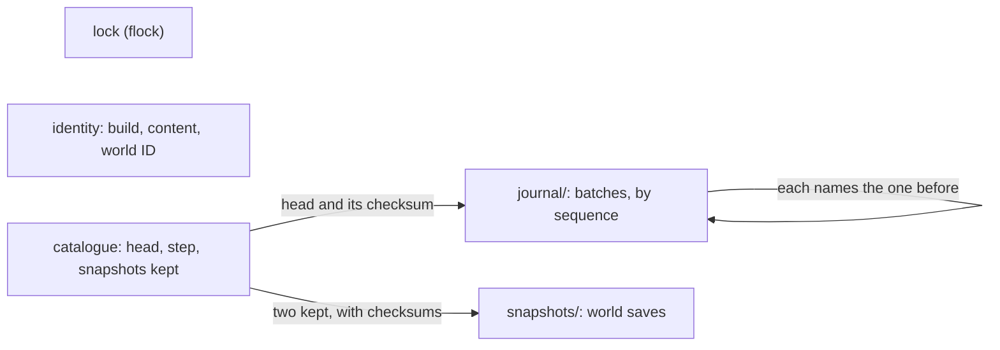
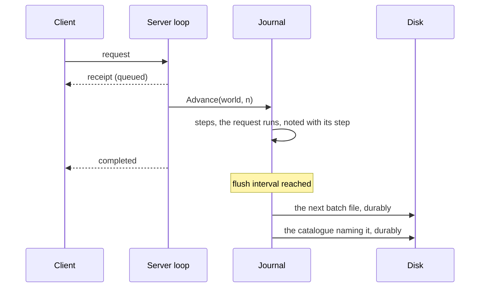
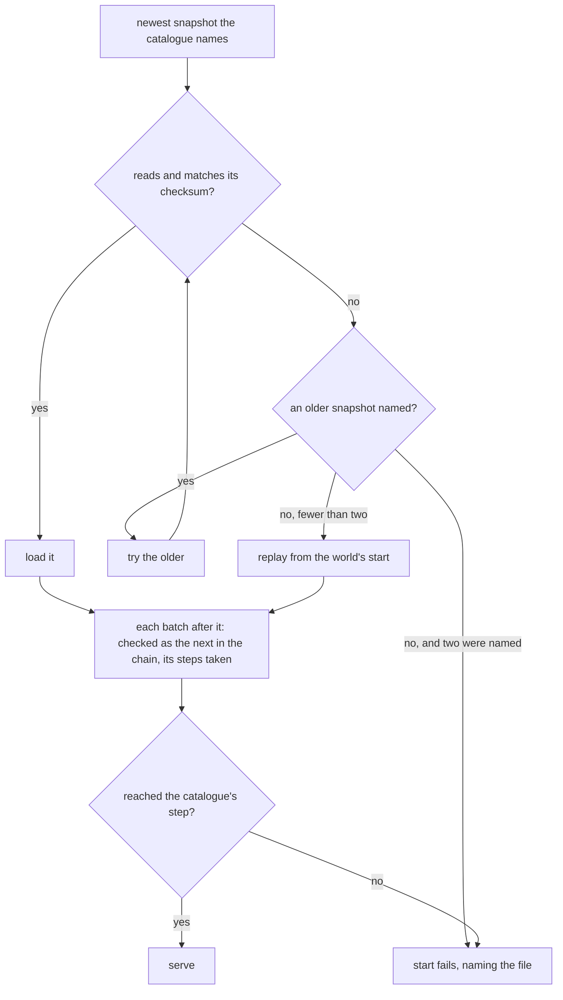

# Saves, the journal and backups

A [hosted world](glossary.md#hosted-world) lives for weeks on a dedicated server, so it must survive
a crash, a power cut and a restart without losing more than a little play or answering a request
twice. This document describes how the server keeps a world on disk: the world's directory and its
lock, the identity that ties a world to the build that made it, the [journal](glossary.md#journal)
of what ran, the [snapshots](glossary.md#snapshot-journal) that bound a replay, and the
[backups](glossary.md#backup) an operator restores from. All of it is
`Manifest::Host::Journal` and its helpers in `source/game/host`.

How a single file is written so that it survives a power cut, how a directory is locked, and what
the engine's world save holds are Jettison's: see its
[persistence](../../jettison/docs/persistence.md) document, in particular
[durable writes](../../jettison/docs/persistence.md#durable-writes) and
[the world's save](../../jettison/docs/persistence.md#the-worlds-save). This document covers only
what Manifest builds on them.

## Concepts

### The world's directory and its lock

A [world directory](glossary.md#world-directory) holds everything one hosted world keeps: its
identity, its journal, its snapshots and its catalogue. Exactly one process writes it. The
[world lock](glossary.md#world-lock) enforces that: `OpenWorldDirectory(root)` makes the directory
(and those above it) durably, private to its owner (0700) when it makes it, and takes the file
`<root>/lock` with Jettison's `Core::FileLock`. A second opener, in the same process or another,
is refused with the directory named. The kernel releases the lock when its holder dies, so a crash
leaves nothing to clear. The lock is for a local file system: a world on NFS is not supported.

### The identity

A world is tied to the build and content that made it. Its `identity` file
(`Manifest::Host::Identity`, written once, as the world is made) holds:

| Field | Holds |
| --- | --- |
| `world` | 128 bits from `std::random_device`, in hex, made with the world. It is no part of the simulation's state or its hash; every batch and catalogue names it. |
| `game` | The project's version and its source tree, as `0.0.1+<tree>`. |
| `sdk` | The Jettison source tree the build was made on. |
| `fixedStep` | The world's step in seconds, which the engine's world save does not hold. |
| `commands` | Every registered command's name and version, in name order (`Command::Requests::Commands`). |
| `content` | The canonical content manifest's bytes (`Content::ContentIdentity::manifest`): see [content identity](glossary.md#content-identity). |

A tree is git's own hash of a checkout's `source`, `cmake`, `CMakeLists.txt` and
`CMakePresets.json` as they are on disk, tracked or not, taken at every build by
`cmake/Revision.cmake`. So uncommitted changes make another build, while Debug, Release and
sanitised builds of one tree are the same build (their replays must agree). How that is compiled in
is the [host's](host.md).

A world opens only when `game`, `sdk`, `fixedStep`, `commands` and `content` each equal the
running build's (`RunningIdentity`), the step compared to the bit
([D-111](decision-ledger.md#d-111)). The reason is that nothing weaker tells two builds apart:
formats change in place until player testing ([D-109](decision-ledger.md#d-109)), so equal version
numbers do not promise equal layouts or rules. A journal replayed under other rules would reach
other outcomes than the ones it answered. Until that ends, a world does not outlive the build that
hosts it.

### The journal and its batches

The world steps and answers [requests](glossary.md#request) at once; it does not wait for the disk.
Every flush interval the server writes what has happened since the last flush as one
[batch](glossary.md#batch-journal) (`journal/<sequence>`, a `Manifest.Host.Batch`):

| Field | Holds |
| --- | --- |
| `world` | The world's identity. |
| `sequence` | The batch's number, from 1. |
| `previous` | The identity of the batch before it, 0 for the first. |
| `step`, `steps` | The [step](glossary.md#step) it begins at, and how many it covers (at least one). |
| `ran` | Each request that ran in those steps with the step it ran at, in the order they ran. |

A batch's identity is its file's checksum, so the chain and the integrity check are one number. A
batch is never changed once written. Replaying a batch means taking its steps again with each
request queued at the step it first ran at: the simulation is deterministic, so this reaches the
same state, and `Command::Requests` rebuilds its [request ledger](glossary.md#request-ledger) as
the requests run.

### Snapshots and the catalogue

A snapshot (`snapshots/<batch>`) is the engine's save game (`Sim::SaveGame`, the world's
`SimWorld::Save` within it) as the batch of that sequence left the world, with what the mods'
scripts keep by key as its `Script.Store` section (`Script::kStoreSection`) when the journal's
storage names the scripts (`Storage::pScripts`, as the server's does); a recovery gives the scripts
the keys of the snapshot it starts from, none from the world's start. It bounds how much a start replays. It is taken between
steps, so nothing is queued and no request is pending; what the save holds, component by component,
is listed in [the hosted world](world.md).

The [catalogue](glossary.md#catalogue) (`Manifest.Host.Catalogue`) is the one file that changes. It
names the head of the journal and its identity, the step after the head's last, and the snapshots
kept, oldest first, each with its batch, that batch's identity, the snapshot file's checksum and its
step. Whatever the catalogue does not name is not part of the world, which is what makes a write
cut off harmless.

### Backups

A backup is a copy of one snapshot that a restore can turn back into a world, kept in a directory
outside the world's (on another disk, ideally). It is a directory `<world>.<batch>` holding the
world's `identity`, the snapshot, and a catalogue naming that snapshot alone.

## How it works

The diagram shows a world's directory and which file names which.



### Every file

Each file is written whole with Jettison's `Core::WriteFileDurably` and ends with its 64-bit
FNV-1a, low byte first. A file name in `journal/` and `snapshots/` is its sequence in twenty
digits, so names sort as the batches run. A file that is missing, cut short, longer than any of its
kind, or whose checksum does not match is refused by name. Records are written in Jettison's binary
archive, all at format 1.

### Opening a world

`Journal`'s constructor opens the world in a held `WorldDirectory`.

- **A new world.** A directory with no `identity`, `catalogue` or `journal` is new: the
  identity is made and written, then a catalogue with no head. The identity goes first, so a world
  cut off between the two has no catalogue and is refused rather than made again.
- **An existing world** reads its identity and refuses a build or content other than its own. The
  refusal names the first field that differs and both values: for `commands` the first command
  that differs, for `content` the two manifests' [fingerprints](glossary.md#fingerprint) and the
  first definition that differs (`Content::FirstDifference`).
- **The catalogue** must be this world's. A missing or damaged one is refused.

### Stepping and flushing

`Journal::Advance(world, steps)` takes the world's steps for the server, noting each request
queued at the step it runs at the start of. It stops at every flush and snapshot due on the way, so
one long advance writes what many short ones would.

- **A flush** is due when the steps since the last reach the flush interval
  (`Cadence::flushSteps`, 30 s by default), or when 4,096 requests have run since it, so a flood
  cannot grow one batch without bound. The batch is written, then the catalogue naming it as the
  head. `Flush` with nothing new writes nothing.
- **A snapshot** is due every snapshot interval (`Cadence::snapshotSteps`, an hour by default): a
  flush, then the world's save, then the catalogue naming it, then the backup.
- **Two snapshots are kept**, with every batch since the older. Once the catalogue names two, older
  snapshots and batches are removed, a cut-off write's leavings among them. Until then every batch
  from the first is kept, so a start can always replay from the world's beginning.

Only requests may be queued on a journalled world: anything else would run now and not in a
replay. The journal refuses (`std::logic_error`) a world stepped anywhere but through it since it
was recovered.

The sequence shows one flush: the steps run first and are written after.



### What a crash loses

A crash or a power cut loses what ran since the last flush: at most the flush interval of steps,
and the requests answered in them ([D-113](decision-ledger.md#d-113)). Everyone's world goes back
to the same step, so nothing is duplicated; a client holds no authoritative state. A
[receipt](glossary.md#receipt) means a request was queued or ran, not that it is on disk. A lost
request's sequence is free again, and a retry of one that was kept is answered from the ledger, not
run twice. How a reconnecting client learns which sequence to send next is the
[server's](server.md).

This is a deliberate trade. Writing a batch before every step, as first designed, wrote about 16 GB
a day to an idle server's disk (measured 2026-11-24, recorded in
[write volume and wear](history/stage-5-recovery-plan.md#write-volume-and-wear)). A game does not
need a bank's durability.

### Recovering at a start

`Journal::Recover(world)` brings a world as `Host::Start` left it to the journal's last flushed
step, before any client can reach the server. The flowchart shows the order.



A snapshot that does not read is logged as a warning and the one before it tried. A batch that is
missing, damaged, another world's, not the next in the chain, or whose requests fall outside its
steps fails the start by name: nothing is skipped. The world is then part-way and is discarded.

### A clean stop

On SIGINT or SIGTERM the server admits nothing more and calls `Journal::Stop`. Any request admitted
since the last step runs in one more step, so none is left with a receipt and no answer. Then a
snapshot (and its backup) is written, unless the newest is already of this step, so the next start
loads it and replays nothing. A clean stop loses nothing; a second stop writes nothing.

### Writing a backup

When the server is given a backups directory, every snapshot also writes a backup: hourly, and at a
stop. The identity, the snapshot and the backup's own catalogue are written in that order, from the
same bytes the world's snapshot was written from, so the backup is consistent by construction and
no changing directory is copied.

- **One cut off** before its catalogue is not a backup, and is removed by the next.
- **A backup that fails** is logged as an error and costs nothing else: the world's own files are
  already whole, and the server goes on.
- **The newest 24** of this world's backups are kept (`Storage::kept`), a day of hourly ones and
  every stop's. Another world's backups in the same directory are left alone.
- **The backups directory must be apart from the world's**: neither may be within the other, as
  they are on disk, symlinks resolved. It is checked before the world is made and again after the
  backups directory is created.

A backup's recovery point is its snapshot's step, up to an hour behind the world's head.

### Restoring

`Host::Restore(backup, directory, running, world)` turns a backup, or a stopped world's own
directory, into a world:

1. The target directory must hold nothing but its lock: a restore never writes over a world.
2. The backup's identity must match the running build (as at an opening), and its catalogue must be
   this world's. Nothing is written before both hold.
3. Every file the catalogue needs (the identity, each snapshot named, every batch after the oldest
   snapshot) is read and checked against its checksum.
4. Each is copied durably, read and checked again, the catalogue last.
5. The world is recovered as a start does, and the `Journal` returned serves on from there.

If anything fails, what was written is removed, the catalogue first. The backup is only read. A
restore cut off by a crash leaves an identity with no catalogue, which a server refuses rather than
make a new world over it: clear the directory and restore again.

### When a write fails

A failed write is uncertain, not rolled back: the writer may have left the new file in place, and
the catalogue may already name it. The exception leaves the server's loop and the process exits 1;
a `Journal` that is kept refuses every later call (`std::logic_error`). The next start reads the
catalogue to find out which it was. A batch or snapshot written but never named is ignored and
written over by the next of that sequence.

### What a world stores

| What | Bound |
| --- | --- |
| `identity` | One; read up to 64 MiB. |
| `snapshots/` | Two. A save larger than `Storage::snapshotBytes` (`kMaxSnapshotBytes`, 4 GiB) is refused as it is written, since a start would refuse it as it is read: the server exits 1 and the world keeps its last recovery point. |
| `journal/` | The batches since the older snapshot: two hours, 240 at the default 30 s, more when requests flush one early. Each read up to 32 MiB, a bound a `static_assert` checks against the request limits. |
| `catalogue` | One; read up to 4 KiB. |
| Backups | The newest 24, each an identity, a snapshot and a catalogue. |

### Where the files go

With no option naming a place, Manifest writes under the XDG base directories for `manifest`
(`source/game/host/include/manifest/host/Locations.h`), never beside the executable
([D-114](decision-ledger.md#d-114)):

| Function | Default path |
| --- | --- |
| `DefaultWorld` | `$XDG_DATA_HOME/manifest/world` (`~/.local/share/manifest/world`) |
| `DefaultBackups` | `$XDG_DATA_HOME/manifest/backups` |
| `DefaultTokens` | `$XDG_CONFIG_HOME/manifest/tokens` |
| `DefaultTranscript` | `$XDG_STATE_HOME/manifest/tui-session.log` |

Each is resolved alone, touching nothing on disk, so a program needs only the variables of the
places it writes; with neither the variable nor an absolute `HOME`, it fails naming the variable.
`MakePrivateDirectories` makes each missing directory durably and 0700 from the moment it is made,
leaving one already there as it was. The distribution's other places are the [host's](host.md).

## Using it

### From the command line

From `source/apps/manifest/serve-smoke.sh` (the `cli_serve` test), which serves a world, kills
it, serves it again, stops it, and restores its backup:

```bash
manifest --content "$content" --scenario trading --serve --world "$work/world" \
  --tokens "$work/tokens.yaml" --port 0 --flush-seconds 1 --snapshot-seconds 2 \
  --backups "$work/backups"
# serving on 127.0.0.1:<port> at step 0, world <32 hex digits> at batch 0, key <64 hex digits>

manifest --content "$content" --scenario trading --restore "$backup" --world "$work/restored"
# restored world <32 hex digits> at batch <n>, step <s>, into .../restored
```

| Option | Meaning |
| --- | --- |
| `--world <directory>` | The world's directory; `DefaultWorld` when absent. |
| `--flush-seconds <n>` | The flush interval, a positive whole number of seconds; 30 by default. |
| `--snapshot-seconds <n>` | The snapshot interval; 3,600 by default. |
| `--backups <directory>` | Where backups go; `DefaultBackups` when absent. |
| `--restore <backup>` | Restores the backup into `--world`, which must be empty, and recovers it to check it. |

Seconds become steps at the world's fixed step, rounded and at least one. The other `--serve`
options are the [server's](server.md); the command line as a whole is the [host's](host.md).

### From C++

Abridged from `source/game/host/tests/JournalTests.cpp`: a world flushed every hundred steps,
with no snapshot, then recovered in a fresh session.

```cpp
const Host::Cadence cadence{100, 1'000'000};
{
	Hosted hosted;
	const Host::WorldDirectory directory = Host::OpenWorldDirectory(scratch.Root());
	Host::Journal journal{directory, hosted.Identity(), cadence};
	REQUIRE(hosted.Provision("Ada").status == Receipt::Status::Queued);
	journal.Advance(hosted.world, 601);
	journal.Flush();
}

Hosted again;
const Host::WorldDirectory directory = Host::OpenWorldDirectory(scratch.Root());
Host::Journal journal{directory, again.Identity(), cadence};
journal.Recover(again.world);
```

`Hosted::Identity()` is `Host::RunningIdentity(session)`. A server gives a `Storage` as the fifth
argument to write backups (`Host::Journal journal{directory, identity, cadence, {}, {backups}}`);
the fourth replaces the writer, which the tests use to fail where a disk would.

## Limits and open work

- **Saves hold the step's thread.** A flush holds the server's loop about 11 ms and a snapshot
  about 60 against a 16.7 ms step (measured 2026-11-25); they move off it in
  [L40](delivery-order.md#l40) ([D-115](decision-ledger.md#d-115)).
- **No migrations.** A world does not outlive its build until player testing
  ([D-109](decision-ledger.md#d-109)); from then a build names the earlier builds whose worlds a
  migration brings up.
- **Scripts' keys are the snapshot's.** A crash loses what the mods' scripts kept since the newest
  snapshot, up to an hour, while the world runs on to the last flush. Batches carry no keys while a
  script cannot change the world ([D-004](decision-ledger.md#d-004)).
- **The 4 GiB snapshot limit** is exercised only at a test's 1 KiB: no scenario makes a world that
  large.
- **Durability** is proved at the writer's seam and with a process killed outright; no power cut has
  been tested, and no backup is read back from the disk as it is written.
- **No refusing write.** A world's first file is checked for, then written; a write that refuses to
  replace a file is [J32](../../jettison/docs/roadmap.md#j32), and fault injection under the system
  calls [J33](../../jettison/docs/roadmap.md#j33).
- **The TUI retries nothing** after a server goes back past a request: see
  [L41](delivery-order.md#l41).

## Decisions

The decisions are under
[Saves, the journal and backups](decision-ledger.md#saves-the-journal-and-backups) in the ledger.
The key ones: [D-111](decision-ledger.md#d-111) (a world opens only for its own build and content),
[D-113](decision-ledger.md#d-113) (a crash may lose up to 30 s; batches after
the steps; superseding [D-112](decision-ledger.md#d-112)), [D-114](decision-ledger.md#d-114) (where
writable data goes) and [D-115](decision-ledger.md#d-115) (saves off the step's thread, open). How
the design came to be is in
[Stage 5's plan](history/stage-5-recovery-plan.md#the-journal-and-its-snapshots-r03-r04-2026-11-24).

## Source

| Item | Where |
| --- | --- |
| Journal, identity, catalogue, restore | `source/game/host/include/manifest/host/Journal.h`, `source/game/host/src/Journal.cpp` |
| The world's directory and lock | `source/game/host/include/manifest/host/WorldDirectory.h` |
| Default places | `source/game/host/include/manifest/host/Locations.h` |
| The build's trees | `cmake/Revision.cmake`, `source/game/host/src/Revision.cpp.in` |
| The server's loop, `--serve`, `--restore` | `source/apps/manifest/main.cpp` |

| Suite | Holds |
| --- | --- |
| `host` | `JournalTests.cpp`: identity refusals, flush and recovery, snapshot fallback, every write failure at the writer's seam, a clean stop, backups, restore, the size limit, backups apart from the world, and a mod's script's key (the `keeper` overlay's Rust script) through a stop and a start. `HostTests.cpp`: the directory's lock and permissions, and the saved state inventory. |
| `remote` | Several clients across a crash: what was kept is answered, what was lost retried in order. |
| `fixture`, `fixture_development` | The trading loop backed up in flight and restored; the development loop through its journal across a stop and a crash, reaching the uninterrupted world's state hash. |
| `cli_serve`, `cli_serve_no_home`, `cli_serve_missing_tokens` | The server killed, recovered, stopped and its backup restored (`serve-smoke.sh`); no XDG place to write; no token file. |
