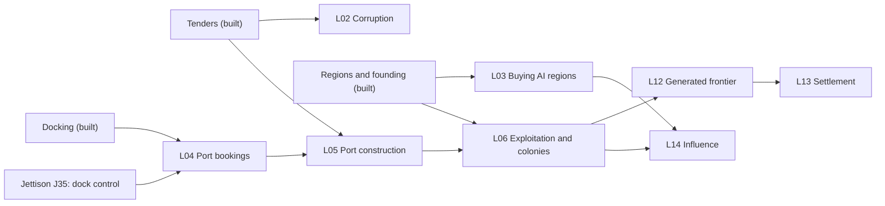
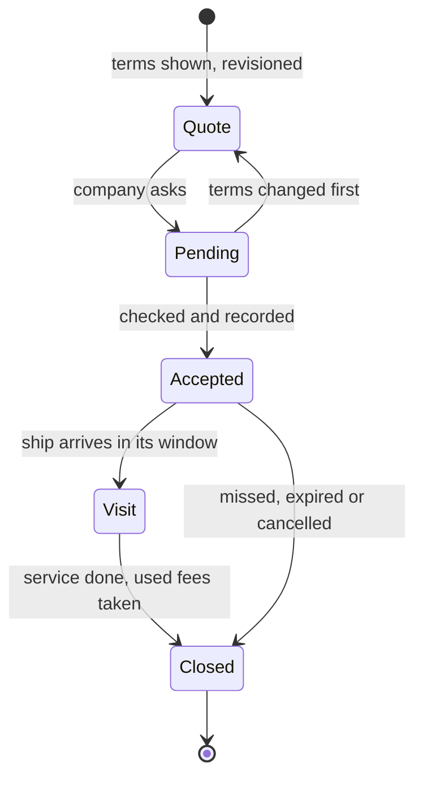
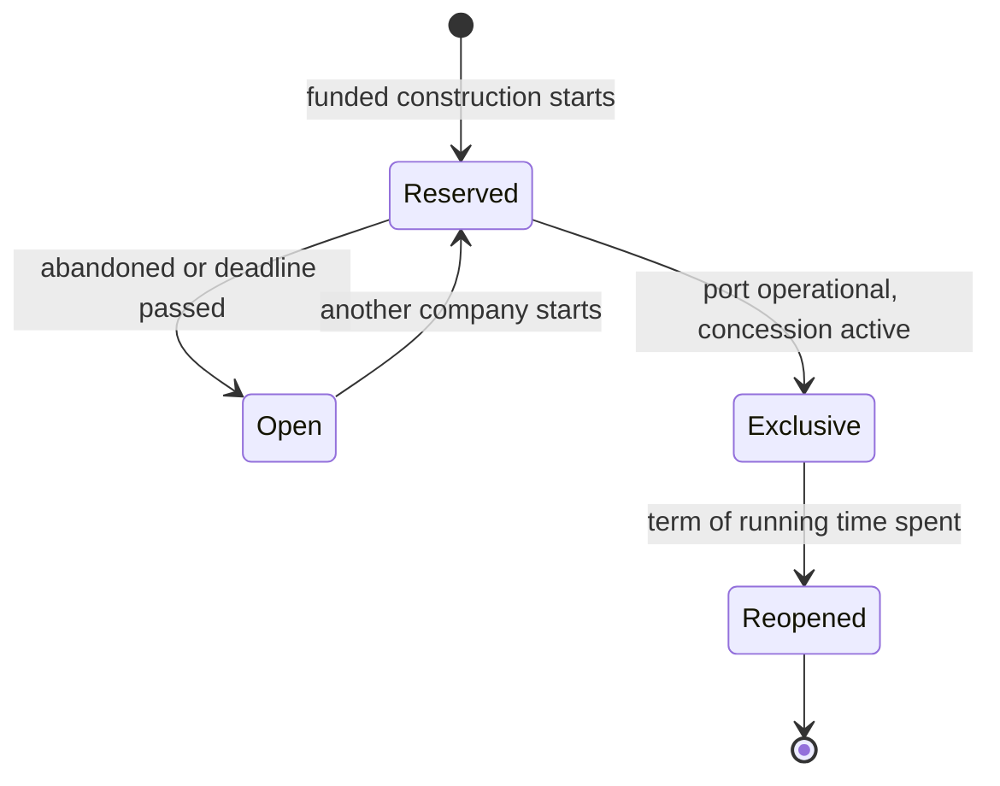

# Planetary development, corporate power and the frontier

This plan holds the open work by which a trading company turns wealth into power over places:
bribing a government, buying an AI-run region, running a private port on its own terms, building a
port, exploiting a frontier world's resources, settling new worlds and, at the far end, influence
over governments and media. It is for a developer or designer picking up one of these tasks. Each
task has a **Selected** part (what the user has chosen, which the implementation must keep) and an
**Open** part (what must still be designed before or while it is built).

Manifest has no win condition ([scope](scope.md)). These mechanics are how a company builds the
stranglehold on trade, economies and governments that the game is about, and why a dominant
company still has decisions to make.

## What is built already

The tasks below build on the hosted world's regions, governors, tenders and venues. The contracts
live in their feature documents; this table says only what each task can rely on.

| Foundation | What exists | Where it is documented |
| --- | --- | --- |
| [Regions](glossary.md#region) on a [planet](glossary.md#planet) | Several regions share one planet, each the one owner of its population, with its own public and household accounts, health and happiness (`World::Region`). Its [governor](glossary.md#governor) is an [organisation](glossary.md#organisation), empty for a region no one governs. | [Regions, governors and public projects](governance.md) |
| Organisations | A [polity](glossary.md#polity) or a corporation, directed by a player or, with no player, by the AI. | [Regions, governors and public projects](governance.md) |
| [Founding](glossary.md#founding) | A player's company pays `company.foundingPrice` into an ungoverned region's public account, and a new polity the player directs governs it. One homeworld a player; no command takes a governor away. | [Regions, governors and public projects](governance.md), [D-110](decision-ledger.md#d-110) |
| [Tenders](glossary.md#tender) | A region's [project](glossary.md#project) buys its inputs by sealed [bids](glossary.md#bid). The lowest total wins, the earlier of two equal totals first, and the winner locks a [performance security](glossary.md#performance-security). Deliveries are paid as they arrive. | [Regions, governors and public projects](governance.md), [D-101](decision-ledger.md#d-101) |
| [Venues](glossary.md#venue) | A station or port has an operator (an organisation), a `public` flag, the regions it delivers to, and fees its operator sets (`Manifest.Company.SetFees`). | [Stations: berths, life support and charges](stations.md) |
| Docking | Every arrival asks Jettison's docks for a berth (`Dock::RequestBerth`, in `source/game/travel/src/Travel.cpp`); only a new player's starter ship is parked directly (`Docks::Park`, from `source/game/company/src/Company.cpp`). | [Travel and fuel](travel.md), [Jettison docks](../../jettison/docs/docks.md) |
| The concession term | `concessions.termHours` (72) is loaded and validated (`source/game/content/src/Content.cpp`, `DataTests.cpp`). Nothing uses it yet. | [L06](#l06-resource-exploitation-concessions-and-colonies) below |

Two gaps matter to every task here. The `public` flag is only checked when the scenario names its
[starter venue](glossary.md#starter-venue): a private venue admits every ship today. And the server
keeps no running clock of its own: `source/apps/manifest/main.cpp` reads the monotonic clock only
to pace its [steps](glossary.md#step).

## Rules every task keeps

These are selected and cut across the tasks. Each is decided once, in the ledger.

- **Public and company money stay apart.** A player may direct a region and a company, but a
  public account is never a company wallet. Money moves between them only by an explicit
  transaction with its own rules.
- **Public contracts are competitive.** A governor's own company bids in the same tender as every
  other company; a puppet government's control link does not skip it
  ([D-040](decision-ledger.md#d-040)).
- **A player's region is protected.** No one buys or seizes a player-governed region through the
  AI-acquisition mechanic, and no one builds a port in it uninvited
  ([D-015](decision-ledger.md#d-015), [D-016](decision-ledger.md#d-016)). Protection covers
  control, not economic pressure: a rival may still refuse that player's ships new bookings.
- **Accepted bookings are honoured.** An owner's new fees, priorities or exclusions apply to
  future requests only ([D-041](decision-ledger.md#d-041)).
- **Basic access survives.** Basic docking, trading and regional delivery at a public station stay
  open to everyone, at normal charges and within finite capacity
  ([D-048](decision-ledger.md#d-048)).
- **Goods are physical.** Income comes from goods extracted, moved and sold, never from a credit
  bonus with no goods or buyer behind it ([D-020](decision-ledger.md#d-020)).
- **NPCs play by the same rules.** AI companies and governors use the same commands, checks and
  information as players, and a disconnected player's standing policies cannot spend on anything
  they did not explicitly allow.
- **No caps by fiat.** No empire cap or automatic redistribution is chosen. Measure concentration
  and entrants' chances in long runs before choosing upkeep or other balance rules.

The tasks depend on each other in this order. The arrows read "is needed before".



## L02: corruption and abstract bribery

<a id="l02"></a>Queue: [L02](delivery-order.md#l02). A government that can be bribed connects
commercial wealth to public decisions and makes governments differ.

### Selected

- Each government carries one authoritative corruption trait. It is not a player slider; its
  initial value and any change come from authored or server-side rules
  ([D-040](decision-ledger.md#d-040)).
- A company may pay an abstract influence expense on a tender. With a non-zero trait, it can lift
  a more expensive qualified bid above a cheaper one. With a zero trait it changes nothing, and
  the award is the clean tender's.
- The award is a deterministic score over qualified bids: no officials, no random political
  outcome. Normal bid quality still counts.
- Bribery changes preference only. It cannot make a late or invalid bid eligible, create delivery
  capacity, lift the tender's budget or touch another player's protected region.
- The company pays from its own account, never from the public budget, and the expense goes to a
  recorded destination or sink.
- A standing bid policy needs an explicit influence allowance: disconnecting is not permission to
  bribe.

### Open

- The cost, the bounds of influence, whether it is disclosed, and whether a losing bribe is
  refunded.
- The score's terms and weights, versioned so a replay scores the same.
- How the bribed bid is saved, so a retry or recovery cannot award twice or charge twice.
- Tests: zero and non-zero corruption, influence on an invalid bid, equal totals, the bid-close
  step, and recovery on either side of an award.

Patronage, investigations and scandals are later possibilities under
[L14](#l14-influence-over-governments-and-media), not part of this slice.

## L03: buying AI regional control

<a id="l03"></a>Queue: [L03](delivery-order.md#l03). Founding gives a player one homeworld; buying
AI-governed regions is how a company grows a portfolio of governments.

### Selected

- Any AI-governed region is eligible, even one sharing a planet with a player's region; a
  neighbouring governor has no veto. Player-governed regions, founded or bought, are never
  eligible ([D-015](decision-ledger.md#d-015)).
- A purchase transfers the region's public decision rights, nothing else. Its treasury stays
  public money; companies, ships and stations in it keep their owners; its population, condition,
  knowledge, facilities and projects carry on.
- A bought region keeps its identity, parent planet and history. Sibling regions stay
  independent, and nothing the buyer's company knows is copied onto it.
- After the transfer the region's AI no longer buys anything on its own account; it runs only the
  new governor's standing policies.

### Open

- The price and who receives it.
- The offer: a revisioned offer naming the region, checked for eligibility and funds when it
  executes, with the debit and the transfer in one step. Two racing buyers cannot both pay; a
  changed offer is a structured refusal with nothing transferred.
- How existing obligations continue: open tenders, awarded contracts, the development queue.
- Per-region portfolio policies, and administration costs as a balance candidate.
- Voluntary transfers between players are a separate mechanic, not selected.

## L04: private-port bookings and owner policy

<a id="l04"></a>Queue: [L04](delivery-order.md#l04). A station's owner may set fees and shipping
priority and refuse rivals. That is the first lever of corporate power over shipping.

### Selected

- Owners set fees and priorities and may deny rivals access. Favouring the owner's own ships is
  allowed: equal priority is not a rule.
- Accepted bookings keep their agreed access, price and priority when the owner changes policy
  ([D-041](decision-ledger.md#d-041)). A quote or a pending request is not yet a booking.
- At a station that offers life support, connected life support is part of the berth fee.
  Oxygen refills and replacement cartridges stay separate purchases ([stations](stations.md)).
- Basic public access stays ([D-048](decision-ledger.md#d-048)): a public station cannot turn a
  player away from basic docking, trading or regional delivery.
- One port may serve several regions on its planet. Each delivery names its destination region
  and travels physically; regions' inventories, households and budgets are never pooled, and
  serving a neighbour gives no rights there. Shared service reveals no other station's live
  market data.
- A ban does not seize anything. A docked ship can always leave through the normal release, and
  its cargo, orders and escrow keep their owners.

### Open

A booking moves through these states. The proposal reserves admission, a price and a priority
class, not a particular berth or time.



- What an accepted booking saves: the company, ship and station, the services, a fee cap, the
  priority class and its windows (arrival, queue wait, service). The maximum charge is reserved on
  acceptance; only completed service is taken, and the rest is released at close.
- A stale quote returns the new terms rather than accepting a higher price silently.
- Distinct outcomes for a technical refusal, a missed arrival, a queue timeout and a station that
  cannot serve; refunds and reported breach for the last.
- Tie-breaks by accepted order, then stable ship identity.
- How automation reacts to a refusal: reroute or report a blocked job with its reason, never wait
  forever.
- Storage, if a station offers it, needs collection terms that a later ban cannot remove.
- Station services beyond docking (storage, refuelling, repairs) are candidates, not a list.

The scenario already has both kinds of venue, but the private one admits every ship. From
`data/scenarios/governance.yaml`:

```yaml
  # A private dock, on its owner's terms.
  - venueId: VenueCassiterDock
    systemId: SystemCrucible
    planetId: PlanetCassiter
    operatorId: OrganisationCassiterMining
    public: false
    operational: true
    layout: highport
    lifeSupportCapacity: 4
```

**Engine dependency.** Jettison's docks refuse a request only for control, frame or fit, and serve
the queue first come, first served
([Jettison docks](../../jettison/docs/docks.md#asking-for-a-berth-and-giving-it-up)). There is no
seam for a game to admit or refuse a vehicle, or to rank the queue: that is Jettison's
[J35](../../jettison/docs/roadmap.md#j35), a game-agnostic interface that supplies the core
functions and leaves every rule of admission, refusal and rank to the game. L04 needs it, proved
by a consumer that is not Manifest, before Manifest's policy goes on it. Every ordinary arrival, player or NPC, must pass it; `Docks::Park`
stays the trusted path for the world's initial state.

## L05: port construction and corporate leverage

<a id="l05"></a>Queue: [L05](delivery-order.md#l05). A wealthy company can build an orbital
spaceport and use it, and the supplies it controls, as leverage.

### Selected

- There is one initial construction opportunity per eligible region: the company's own, an
  AI-governed one or an ungoverned one ([D-016](decision-ledger.md#d-016)). A neighbour's port
  does not use it up. No government permit is needed; another player's region is protected.
- Buying the region first is not required: acquisition and port building are separate routes to
  growth.
- The first site race:
  - The first company to start a funded project secures the site.
  - Starting costs a meaningful non-refundable mobilisation charge and reserves construction
    funds. A request without them holds nothing.
  - The reservation has a fixed completion deadline that token deliveries cannot extend.
  - Abandonment or expiry reopens the site. Unspent funds and unused goods stay the company's.
  - The reservation gives construction priority only, not resources or government.
- The project is physical: funds and supplied goods, saved work, and a port created once however
  often completion is replayed.
- Leverage starts with infrastructure, essential supplies and access contracts; government
  financing and media come later ([L14](#l14-influence-over-governments-and-media)).
- Public money that builds a public asset does not make a company its owner. Operating or supply
  rights come from a separate agreement, won by tender.

### Open

- The mobilisation amount and who receives it, the reserved funds, the recipe, the deadline's
  length and clock, and salvage of completed work.
- Where unused goods go when a site reopens.
- What happens if a region's governor changes during construction.
- A first leverage pilot: a public port-capacity project, supplied by tender, with one company
  holding an operating or supply contract. Name the parties, owner, term, payment and failure.
- Measures before choosing balance rules: delivered throughput, alternative suppliers and routes,
  and the effect on public and company budgets.
- Station looks and corporate branding are presentation, under the graphical client
  ([L15](delivery-order.md#l15), [roadmap](roadmap.md#the-graphical-client)).

## L06: resource exploitation, concessions and colonies

<a id="l06"></a>Queue: [L06](delivery-order.md#l06). A port is an investment in access to a
planet's resources. The frontier's riches start a gold rush: a race for rights and for the costly
infrastructure that makes them pay.

### The core and the frontier

The map has an established core of higher-technology worlds whose resources were exploited long
ago, and a less developed outer frontier with rich remaining deposits
([D-018](decision-ledger.md#d-018)). The core needs frontier imports. Distance from a declared
centre guides the distributions; this is not a star's habitable zone. Production capacity and
remaining deposits are separate values, and past exploitation is authored as depleted reserves,
not simulated. Today's scenarios are authored by hand; the hosted world has no generator.

### Selected: the exploitation concession

A [concession](glossary.md#concession) is a time-limited exclusive right to exploit one region's
eligible resources ([D-030](decision-ledger.md#d-030)). This is the canonical statement of its
rules.

- **Scope.** It names one frontier region and covers its eligible resources. Neighbouring regions
  keep their own eligibility and their own timers.
- **Start.** It starts when the first eligible spaceport there becomes operational and its
  concession activates. A construction reservation alone starts nothing.
- **Term.** `concessions.termHours`, 72 hours as a first balance-testing value, published before
  construction starts.
- **Clock.** Real server-running time, not simulation steps: shutdown pauses it; idle facilities
  and disconnected owners do not.
- **No renewal.** Ownership transfers, rebuilding and government changes cannot restart or extend
  it. Expiry is final for that grant.
- **Expiry.** Rivals may then exploit and build their own ports, even under the incumbent's
  puppet government. The incumbent keeps its infrastructure and may refuse new bookings at its
  own port. Deposits are not replenished for rivals.
- **Separate records.** Resource rights, station ownership, government control and title to the
  planet are distinct; the concession grants none but the first. Home regions keep their own
  protection, and a frontier region's classification is stored, so a rename or new governor
  cannot relabel it a home.



The diagram shows one region's site and right. `Exclusive` is the only state in which rivals are
kept out of the region's resources.

### Selected: exploitation and colonies

- Extraction runs through the physical economy: sites, extraction projects, local stock,
  surface-to-orbit haul, the port's warehouse, ships and buyers. The haul may be abstracted, but
  what leaves the surface, what is in transit and what the port receives are explicit.
- Returns come from goods sold, not a guaranteed yield.
- A colony needs supplied equipment, a source of people and suitable life support. Its puppet
  government has an explicit company-control link and its own public budget and policies; its
  public money is not company money.

### Open: the running clock

The term needs a clock the simulation can trust without reading the wall clock. The proposal:

- One saved, cumulative server-running clock per world, advanced by the host from its monotonic
  clock while the world runs. A UTC expiry date cannot work, since downtime does not count; UTC is
  kept only for display estimates.
- The host records time observations and due expiries as ordered inputs before they change
  access; systems read only saved rights and recorded events. Replay consumes the recorded inputs
  and never reads the replaying machine's clock.
- Each time observation is committed with the extraction it paid for, in the same
  [journal](glossary.md#journal) batch, so a crash cannot keep the goods and lose the time. A crash
  can lose time since the last commit; state how much at most, and never count downtime instead.
- The running clock never goes back, and an expired concession never closes again. Startup,
  recovery and stopping do not count as running.
- Tests use an injected host clock: fast stepping alone never expires a real-time right.
- A grant saves its ID, planet, region, company, scope, original term, the running-clock value at
  grant, remaining entitlement and a revision.

### Open: the rest

- Extraction rates, depletion, labour, equipment and upkeep.
- Who receives an ownership transfer's existing right.
- Boundaries between regions and attributing a deposit that crosses one.
- A new colony against governing an existing population: what a port gives on an inhabited AI
  world, and whether influence or acquisition can extend control across a planet.
- Whether a company's extraction rate in 72 hours of running time makes the investment pay, at
  the server's chosen pacing.

The first slice is a static, authored planet: one port, one extraction project and one
company-directed colony. A generated frontier waits for it ([L12](delivery-order.md#l12), in the
[space plan](space-plan.md)).

## L13: settlement and terraforming

<a id="l13"></a>Queue: [L13](delivery-order.md#l13). Once the frontier grows during play
([L12](delivery-order.md#l12)), its uninhabited worlds can be settled.

### Selected

- Frontier systems are usually less developed than the core, with exceptions possible, and are
  reached only through a funded stargate ([D-017](decision-ledger.md#d-017),
  [space plan](space-plan.md)). A gate grants no planetary control or concession.
- An uninhabited world has no population, demand or market: it is not a Stone Age civilisation
  of zero people.
- Settlement is physical: equipment, materials, funds, transport and a recorded source of
  settlers. No colony makes cargo, labour or demand from nothing.

### Open

- The environmental and settlement contract. Survey, claim, habitability, life support,
  settlement and opening a market are distinct steps; sealed habitats might allow settlement
  before terraforming, so no order is assumed.
- How the existing habitat and terraform skills (`data/skill-tree/habitats.yaml`) become
  prerequisites: today they are sandbox [definitions](glossary.md#definition), not a mechanic.
- Saved claim races, environment progress and waiting states.

## L14: influence over governments and media

<a id="l14"></a>Queue: [L14](delivery-order.md#l14). The long-term aim is a corporation with power
over governments and media on the scale of Earth's largest ([D-010](decision-ledger.md#d-010)).

### Selected

- Influence must have effects beyond a score. Each channel is an explicit asset or agreement
  with a cost, term, target, measurable effect and rules for resistance or replacement.
- Media influence is neither a production multiplier nor automatic obedience.
- Monopolies and coercive economic power are wanted: withholding supply, exclusive contracts,
  pressure on governments. Combat, conquest and piracy are not required by this goal.
- Influence cannot bypass the protection of a player's region.

### Open

- The channels: candidates are procurement and public financing, infrastructure concessions,
  dominant supply contracts, control of transport, and owning or financing media. Regional debt is
  planned separately ([L30](delivery-order.md#l30), [economy plan](economy-and-development-plan.md)).
- Choose one bounded mechanic only after L03 to L06 have shown real leverage.

## Room for players who join later

A server must have room for every player who joins over its life, not only those connected at
once. Founding replaced the old home-region allocation: a player starts with a company and a
starter ship at a neutral public spaceport and later founds a homeworld in an ungoverned region
([D-089](decision-ledger.md#d-089), [D-110](decision-ledger.md#d-110)). The server keeps a share of
regions open to founding by generating more ([D-076](decision-ledger.md#d-076),
[roadmap](roadmap.md#region-supply)).

Open:

- The counts: regions open to founding, a reserve for late joiners, a protected AI economy and a
  pool for acquisition are separate allocations, and none is chosen.
- `Found` checks only that the region is ungoverned and the company can pay. Whether founding
  should also need a reachable public station, as the starter venue does, is open.
- Late joiners enter an evolved economy. Any catch-up help needs an authored source and limits;
  earlier players' development is never undone to even the map.
- Long simulated runs, for short and long server lives, measuring concentration, entrants'
  chances, save growth and recovery time ([L01](delivery-order.md#l01)).

## Open engine dependencies

| Need | Task | Jettison today |
| --- | --- | --- |
| Admission and refusal of a vehicle by game policy, and ranking of a platform's queue | [L04](#l04-private-port-bookings-and-owner-policy) | Not provided: Jettison's [J35](../../jettison/docs/roadmap.md#j35) |

Everything else here is Manifest's: tenders, bribery, offers, concessions and colonies use the
engine's commands, saved world and journal as they are.

## Decisions

The settled choices are in the ledger under
[Planetary development, corporate power and the frontier](planetary-development-plan.md#planetary-development-corporate-power-and-the-frontier).
The key ones are [D-010](decision-ledger.md#d-010) (no win condition),
[D-015](decision-ledger.md#d-015) (acquisition and protection), [D-016](decision-ledger.md#d-016)
(port construction), [D-018](decision-ledger.md#d-018) (core and frontier),
[D-030](decision-ledger.md#d-030) (the concession's clock), [D-040](decision-ledger.md#d-040)
(competitive bids, then corruption), [D-041](decision-ledger.md#d-041) (protected bookings) and
[D-048](decision-ledger.md#d-048) (basic public access).

## Source

What these tasks extend:

- `source/game/world/include/manifest/world/State.h`: `Region`, `Organisation`, `Tender`,
  `Bid`, `Fees`.
- `source/game/company/include/manifest/company/Company.h`: `Found`, `SetFees`.
- `source/game/procurement`: tenders and awards, where bribery joins.
- `source/game/travel/src/Travel.cpp`: where every arrival asks for a berth.
- `source/game/content/include/manifest/content/Definitions.h`: `VenueDefinition`,
  `ConcessionTuning`.
- `data/scenarios/governance.yaml`, `data/tuning/balance.yaml` (`concessions`).
