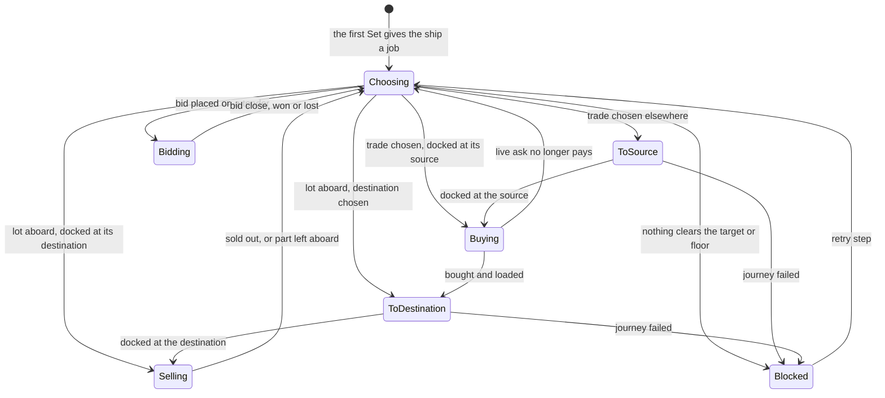

# Standing policies and NPC traders

A standing policy lets a ship trade on its own. Its owner sets a few limits once; from then on the
world runs the ship's job every step, whether the owner is connected or not: it picks a trade from
what the company knows, flies to the source, buys, flies to the destination and sells. The same
executor runs the world's own NPC traders, so a scenario can start with a market that moves
before any player does. Every action the job takes goes through the commands a player would send,
so it meets the same checks, pays the same fees and sees only the same market reports.

## Concepts

| Term | Meaning |
| --- | --- |
| [Standing policy](glossary.md#policy-standing) | `World::Policy` on a ship: whether its job runs, a profit target, a [loss allowance](glossary.md#loss-allowance), a fixed thrust or none, and whether it works [tenders](glossary.md#tender). Set by the ship's owner with `Manifest.Policy.Set`. |
| [Job](glossary.md#job) | `World::Job` beside the policy: the job's phase, the trade it is making (item, source, destination), the [lot](glossary.md#lot) aboard and its accounting, and why it is blocked. Saved with the world. |
| Lot | The totes a job bought and carries, with what they cost (fills and fees, whole credits), the charges attributed to them since, and the allowance already spent on them. |
| Estimate | What a trade is expected to make, in whole credits: the walked bids' proceeds less the walked asks' outlay and the route's charges, all read from the owner's [market reports](glossary.md#report-market). |
| Floor | What a sale must recover: the lot's cost, its charges and the profit target, less what is left of the loss allowance. |
| Contract | A tender the job bid on and won ([D-101](decision-ledger.md#d-101)): it buys what the tender still owes, carries it to the tender's venue and delivers it. |
| [NPC trader](glossary.md#npc-trader) | A [principal](glossary.md#principal) and [company](glossary.md#company) the scenario authors, provisioned like a player and marked the world's own (`World::Principal::npc`); its ship runs a standing policy. |

A job decides from its owner's reports alone, never from a hidden book. A report is live while one
of the owner's ships is docked at its venue and stale otherwise; how reports are made is in
[trading](trading.md). A trade planned on a stale report is a lead, checked again on arrival.

## How it works

### Where it runs in the step

`manifest.policy` is a native system of the [step](glossary.md#step). It runs after
`manifest.brokers` and before Jettison's movement systems (`spatial` onwards), so a journey it
starts is flown that same step and a buy meets the brokers' fresh quotes. The full order is in
[the architecture](architecture.md). Each step it takes every ship whose policy is enabled, in
entity order, and lets its job make up to four decisions (`kMaxDecisions`): choosing can lead at
once to buying where the ship is docked, or a blocked job's retry to choosing.

Each action is a player's command run through `Command::Requests::Act`, as the ship's owner:
`Trade::Place` and `Trade::Cancel` for orders, `Company::Load` and `Company::Unload` for cargo,
`Travel::Travel` for journeys, and `Procurement::Bid` and `Procurement::Deliver` for contracts.
`Act` runs the handler with no admission, sequence or recording: a replay of the step sends the
same commands again, as it does for the brokers. Orders a job places record request 0, the world's
own, which is how it finds and cancels what is left of them ([the hosted world](world.md)).

### The job's phases

The diagram shows a job's phases and what moves it between them. `Bidding` and the contract path
apply only with the policy's contracts on.



| Phase | What the job does |
| --- | --- |
| `Choosing` | Picks a trade, or with a lot aboard a destination for it, or a contract's next leg. |
| `ToSource`, `ToDestination` | Waits for the journey. As the ship docks, charges the life support and fuel used on the way to the lot. |
| `Buying` | Docked at the source: estimates again on the live report and buys. |
| `Selling` | Docked at the destination: sells the lot, or delivers it to its contract's tender. |
| `Bidding` | Waits for its bid's tender to close (`retry` is the bid close). |
| `Blocked` | Keeps its cargo and waits for its retry step; `blockage` says why. |

A command that is refused, such as a journey the company cannot pay for or a load that does not
fit, blocks the job with `Refused`. A journey that fails blocks it with `JourneyFailed`; the ship
stays where it is with its cargo.

### Choosing a trade

The job looks at every pair of the scenario's venues, a source and a destination, and every
scenario item with an ask in the owner's report of the source and a bid in the report of the
destination. A venue with no report gives nothing: an unknown market is skipped, not scouted.

For each candidate it walks the reported price levels of both sides, best first, as fills would
([prices](pricing.md)). It tries the counts of totes at which the answer can change (each level's
edge, the hold's free totes, what the account covers at a level's escrow) and keeps the count that
makes the most, the fewest of equals. The count never exceeds what both sides hold, the free hold
or what the company's account covers after the route's charges. The free hold keeps back the
totes of pellets the magazine's next refuel needs, so that the refuel has room for them.

The estimate is that sale's proceeds net of the listing fee, less the buy's outlay with its fee,
less the route's charges (`Policy::EstimateRoute`):

- the destination's docking fee for the ship's [fee class](glossary.md#fee-class), and the
  source's too when the ship must fly there first, read from each venue's posted `World::Fees`;
- the [life support](glossary.md#life-support) the hull's occupants use on each leg's cruise, at
  the company's last price paid for each supply (`World::Paid`);
- the fuel the [torch](glossary.md#torch) burns on each leg for everything aboard, the lot's
  tonnes included on the leg into the destination, at the reported ask where the ship refuels and
  the venue sells it, else at the last price paid, a unit-traded fuel priced by its unit
  ([travel](travel.md)). A refuel is counted only as far as it fits: the pellets aboard and the
  totes the hold has room for, the totes bought weighing with the rest. Only the fuels a drive burns
  hold it to a margin, so a hull with no reaction mass tanks is not taken as unfuelled.

A route the tanks cannot fly with a gram to spare is not a candidate. A trade is kept only when
its estimate is above the policy's `targetProfit`.

The winner is the trade that makes the most an hour: its estimate over the route's seconds (each
leg's cruise plus `fuel.legAllowanceSeconds`). A policy with `thrustBps` 0 tries each thrust of
`fuel.thrustSharesBps` and, where one of those cannot be flown, the most the tanks can manage, so
a heavy lot may fly slower ([D-107](decision-ledger.md#d-107)). A policy with a thrust of its own
flies every leg at it. Every journey asks 1 g, or the drive's sustained acceleration where that is
less (the hauler's 0.3 g), flying the drive's whole profile. Ties go to a source the ship is docked at, then to the scenario's order of
source, item, destination and thrust, so the choice is deterministic.

With a lot already aboard, the job chooses only a destination: the venue whose reported bids,
walked down to the lot's sell limit with that venue's docking fee added to the floor, net the most
after the route's charges.

### Buying

Docked at the source, the job estimates the trade again on the source's report, which is now
live. If it is no longer above the target, the job drops it and chooses again from its reports
(the live market is never consulted directly). Otherwise it places a buy for the chosen totes at
the deepest ask level it walked and cancels whatever did not fill in the same step: a buy then a
cancel, two commands, rather than an immediate-or-cancel order. It loads everything it bought and
leaves for the destination. The lot's cost is what the company's account paid; its charges and spent allowance
start at 0.

### Selling and the floor

Docked at the destination, the job unloads the lot and offers it at one limit price, cancels what
did not fill and loads the rest back. The limit is the lowest at which every sale nets at least its
share of the floor, however the book splits it into up to `Trade::kMaxFills` fills
(`Policy::SellLimit`). Each fill's gross rounds to the nearest credit and its fee rounds up, so the
limit allows 1.5 credits a fill. Where the reported bids reach lower levels that still recover the
floor's share, the limit walks down to them.

The floor is `cost + charges + targetProfit` less the allowance left (`lossAllowance` less
`allowanceSpent`). With the default allowance of 0 the job never sells below what the lot cost
and its charges; it keeps the cargo and blocks instead. A sale that nets less than its share of
the whole floor spends the difference from the allowance, and the allowance is the lot's alone:
partial sales, retries and a save share one counter, so splitting a sale cannot multiply it.

Each part sold takes its share of the lot's cost and charges, rounded up, the last part taking the
rest (`World::Share`). A lot that sold only in part goes back to `Choosing`, which picks a
destination for what is left.

### Charges on a lot

Once a lot is aboard, every cost that falls on it is added to its `charges`, and so to its floor:

- the docking fee of each journey the job starts (`manifest.policy`);
- the berth fees of each hour the ship stays docked (`manifest.berths`, [stations](stations.md));
- life support drawn in transit (`manifest.lifeSupport`) and fuel burned (`manifest.travel`),
  held on the job in kilograms and occupant-days and priced at the company's last prices as the
  ship docks.

The source's docking fee is the estimate's alone: it is paid before the lot exists. A failed
journey's fee is not refunded. Totes that leave the lot other than by a sale, seized or opened for
the ship's pellet magazine, take their shares with them (`World::LeaveLot`).

### Contracts

With `contracts` on and no contract under way, a choosing job first looks for a tender to bid on
([regions and governance](governance.md) describes tenders). It considers open tenders before
their bid close, of an item of the scenario, which its hold can take and its company has not bid
on. For each it finds the source in the owner's reports whose asks hold the totes at the least,
and the route through it to the tender's venue, at the policy's thrust, else full thrust, else
the most the tanks allow.

Its bid total is the walked cost, the route's charges and a profit: the target, or one credit more
than the best ordinary trade's estimate, whichever is more. It bids only where the total is within
the tender's budget, the account holds the outlay and the performance bond, and the route's
seconds fit the delivery window, since a contract it could not deliver would default. The most
budget left over wins, then the tender's ID, then the scenario's order of source.

After a bid the job waits in `Bidding` until the bid close. Won, it buys what the tender still
owes at its source, walking the live asks, carries it to the tender's venue and delivers it,
going back for more while the delivery close allows; a ship works one contract at a time. Lost,
it chooses again. Totes left aboard beyond what the tender owed, or a delivery refused, turn the
lot into an ordinary trade's, to sell where it best can.

### Blocked jobs and retries

A blocked job keeps its cargo and waits until the last step of the next
[economic turn](glossary.md#economic-turn), never the current one. A turn is
`economy.intervalSeconds` (60 simulation seconds), so a job retries once a minute, after the
brokers have requoted. Nothing else wakes it, not a docking nor a new report. Its `blockage`
(`NoTrade`, `JourneyFailed` or `Refused`) and `blockedSince` stay visible; `blockedSince` is kept
across retries that block again for the same reason, so the owner sees how long it has waited.

### The policy's quiet

The world can [fast-forward](glossary.md#fast-forward) over steps no system needs
([Jettison simulation](../../jettison/docs/simulation.md#quiet-steps-and-fast-forward)).
`manifest.policy` says when it next must run: the current step while any enabled job is choosing, trading or has a journey ended; a
blocked or bidding job's retry step; and never while every enabled job is on a journey under way,
which travel's own quiet wakes the world for.

### NPC traders

A scenario's `traders` list (`Content::TraderDefinition`) names each NPC's principal, display
name and company name. As the last part of the initial state, after the brokers' first quotes,
`Policy::ProvisionTraders` provisions each in order through `Company::Provision` sent by the host,
exactly as a player is provisioned: a company, an account and a starter ship at the scenario's
[starter venue](glossary.md#starter-venue). It then marks the principal `npc` and sets its ship's
policy as the NPC: enabled, target and allowance 0, thrust chosen, contracts on.

NPCs read their own reports, seeded as a player's are, and pay the same charges. The content check
requires the starter venue to keep a pad and a life-support connection free for a player beyond the
traders'; a venue that cannot take a trader stops the start with `std::runtime_error`. The server
admits no client as an NPC principal, whatever the token file holds
([the server](server.md)).

### Seizure

The policy module also holds `manifest.seizure`, which sells a ship's cargo for unpaid berth
fees once its [arrears](glossary.md#arrears) have stood `charges.seizureGraceDays`. It runs on
each day's last step through the owner's commands, as the job does, and seized totes leave the
job's lot. The rule belongs to [stations](stations.md), with [seizure](glossary.md#seizure).

### What the owner sees

`Query::Observe` gives the owner each ship's `policy` and `job` in its `ShipView` (none before
the owner first sets a policy): the phase, the trade and its `estimate`, the lot's totes, cost and
charges, and a blocked job's reason and first-blocked step. A remote client receives them in its
snapshot ([the hosted world](world.md), [the server](server.md)). There is no notification when a
job blocks.

## Using it

### Setting a policy

`Manifest.Policy.Set` (version 2) takes these fields; credits are whole credits.

| Field | Meaning |
| --- | --- |
| `shipId` | The ship, which must be one of the sender's company's. |
| `enabled` | Whether the job runs. A disabled job keeps its state. |
| `targetProfit` | A trade must be estimated above it, and a sale must recover it. At least 0. |
| `lossAllowance` | How far below the floor the lot may sell, over all its sales. At least 0; 0 by default. |
| `thrustBps` | Every leg's thrust in basis points of the cruise, at most `World::kFullThrustBps` (10000); 0 lets the job choose per trade. |
| `contracts` | Whether the job bids on tenders and works the contracts it wins. |

The console's `policy [principal] <ship> on|off <target> <allowance> [thrust%] [on|off]` sends it, the
last `on|off` being `contracts`, and `observe` prints the policy and the job
([the console](console.md#the-commands)).

The first `Set` for a ship gives it a job, `Choosing`. A later one changes only the policy: the
job reads it at its next decision, a lot aboard included, and allowance already spent stays spent.
A version-1 payload (before the thrust) is refused `UnsupportedCommand`.

From `source/test/FixtureTests.cpp`, Ada turns on her ship's policy with contracts:

```cpp
REQUIRE(
    hosted.Run(
        kAda, Manifest::Policy::kSet, Manifest::Policy::kVersion,
        Manifest::Policy::Set{"Ship1", true, 0, 0, 0, true}) == Result::Succeeded);
```

The refusals, from `source/game/policy/tests/PolicyTests.cpp` (`SetPolicy` is the suite's helper
that sends `Set` as the actor):

```cpp
CHECK(hosted.SetPolicy(kBea, {"Ship1", true, 0, 0}) == Result::NotAuthorised);   // not her ship
CHECK(hosted.SetPolicy(kAda, {"Ship9", true, 0, 0}) == Result::UnknownTarget);   // no such ship
CHECK(hosted.SetPolicy(kAda, {"Ship1", true, -1, 0}) == Result::InvalidQuantity); // target below 0
```

A refused `Set` writes nothing.

### Reading the job

The same suite reads a fresh job through the owner's query. Docked at Ore Highport, the ship has
chosen lentils for Ore Vale from a stale starting report, bought, and paid the destination's
docking fee:

```cpp
const Manifest::Query::Snapshot seen =
    Manifest::Query::Observe(hosted.world, hosted.identities, kAda);
const Manifest::Query::ShipView &ship = seen.companies.at(0).ships.at(0);
CHECK(ship.job->phase == World::Phase::ToDestination);
CHECK(ship.job->itemId == "ItemLentils");
CHECK(ship.job->destinationId == "VenueOreValeStation");
CHECK(ship.job->charges == 100);
```

### Authoring an NPC trader

A scenario lists its traders at its root. The shipped scenarios author none; the test overlay
`source/test/overlays/one-trader/manifest/scenarios/trading.patch.yaml` adds one to the trading
scenario, for the zero-client fixture run:

```yaml
version: 1
traders:
  - {principalId: Nia, displayName: Nia, companyName: Nia Co}
```

Each trader needs a pad and a life-support connection at the starter venue, and one more must stay
free for a player, or validation refuses the scenario ([content](content.md)).

## Limits and open work

- Policies are native C++. A Wasm trade-policy surface is planned:
  [L39](delivery-order.md#l39), [policy scripts](policy-scripts-plan.md).
- A job never scouts an unknown market and has no standing route; it trades only between venues
  its owner has reports of. No task is booked for either.
- There is no maximum purchase price and no notification when a job blocks; a blocked job
  retries only at the turn's last step, not on a new observation.
- A ship works one contract at a time, and a job carries one lot of one item.
- The estimate takes the hold's room and the pellets aboard as they are now for every leg of a
  route, not as an earlier leg's refuel leaves them (a `shortcut:` in `Policy.cpp`).
- The shipped scenarios start with no NPC traders.

## Decisions

The decisions are under
[Standing policies and NPC traders](decision-ledger.md#standing-policies-and-npc-traders) in the
ledger. The key ones: [D-097](decision-ledger.md#d-097) (the executor, the lot's
accounting, the allowance, NPC traders), [D-100](decision-ledger.md#d-100) (charges and seizure),
[D-101](decision-ledger.md#d-101) (the contracts switch) and [D-107](decision-ledger.md#d-107)
(choosing the burn). How the feature was built is in
[history: delivered W10](history/stage-4-trading-plan.md#delivered-w10-2026-11-21), with the
selected rules it implemented in
[history: auto-traders using stale reports](history/market-information-plan.md#auto-traders-using-stale-reports-selected).

## Source

| Where | What |
| --- | --- |
| `source/game/policy/include/manifest/policy/Policy.h` | `Set`, `kSystem`, `kSeizureSystem`, `EstimateRoute`, `SellLimit`, `ProvisionTraders`, `Register` |
| `source/game/policy/src/Policy.cpp` | The executor, the estimate, the tender choice and the seizure |
| `source/game/world/include/manifest/world/State.h` | `World::Policy`, `World::Job`, `Phase`, `Blockage`, `Paid`, `Share`, `LeaveLot` |
| `source/game/content/include/manifest/content/Definitions.h` | `Content::TraderDefinition`, the scenario's `traders` |
| `source/game/host/src/Start.cpp` | Registration and `ProvisionTraders` in the initial state |
| `source/game/query/include/manifest/query/Query.h` | `ShipView::policy`, `ShipView::job` |

Tests: the `policy` suite (`source/game/policy/tests/PolicyTests.cpp`); `fixture_alone`, an NPC and
a disconnected player trading with no client, saved mid-job, loaded and replayed alike
(`source/test/FixtureTests.cpp`); `fixture` (a laden policy's burn) and `fixture_governance` (a
ship's contracts with no client); and the `remote` suite's refusal of an NPC principal.
