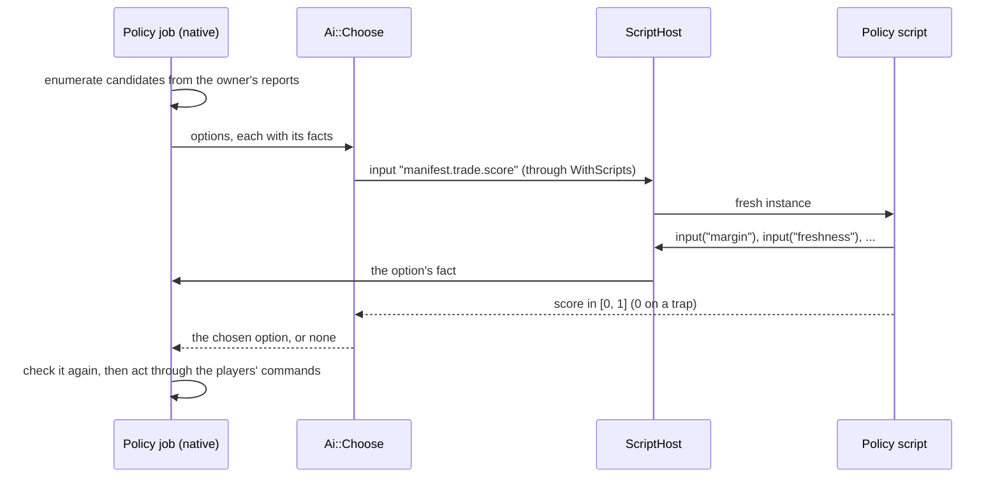

# Policy scripts: open plan

A [standing policy](glossary.md#policy-standing) trades a ship on its own: its
[job](glossary.md#job) picks a trade, flies, buys and sells ([standing policies](policies.md)). Today the job ranks trades
by one fixed native rule. This plan, [L39](delivery-order.md#l39), lets a player or a modder change
that ranking with a WebAssembly script, without giving the script any power over the economy.
Nothing here is built.

## Who owns what

Manifest's rules are native C++ linked into its own host
([D-004](decision-ledger.md#d-004)). Production, prices, orders, settlement, charges and every
check a command makes stay in native code, and Jettison has no native mod ABI that could replace
them. A [mod](glossary.md#mod) may ship scripts, but a script only answers a bounded question the
host asks, such as "how good is this trade, from 0 to 1?". It may change a preference. It may
never waive a check, create goods or credits, settle a trade or write the world.

## Where it stands

| Part | State |
| --- | --- |
| Engine script host | Built: WAMR, capabilities, fuel, the watchdog, generated bindings, `ScriptHost::WithScripts` ([Jettison scripts](../../jettison/docs/scripts.md)) |
| Engine utility AI | Built: `Ai::DecisionDefinition`, considerations, `Ai::Choose` ([Jettison AI](../../jettison/docs/ai.md#utility-ai)) |
| A script's sender | Built for one sender per host: `ScriptHost::SendCommandsTo(world, sender)` stamps a command's top-level `Sim::Controller` fields; a sender per call is [J02](../../jettison/docs/roadmap.md#j02) |
| Manifest's trade choice | Native only: `ChooseTrade` in `source/game/policy/src/Policy.cpp` keeps the trade that makes the most an hour ([choosing a trade](policies.md#choosing-a-trade)) |
| Manifest's script wiring | None. No Manifest target links `Jettison::Script` (`manifest_sdk_required` in `source/external/CMakeLists.txt`), the host makes no `ScriptHost`, and `mods/manifest` holds no `defs/scripts/` |

Manifest does not run the engine's shell (`App::Shell`), which is where the engine makes its own
script host. Manifest's host must make and wire one itself.

## The design

### The first hook: `manifest.trade.score`

The first script answers one input, `manifest.trade.score`: a score in [0, 1] for one candidate
trade. The input name is planned; nothing registers it yet. The diagram shows one choice, inside
the [step](glossary.md#step).

1. **Candidates.** Native code enumerates the trades `ChooseTrade` considers today: each source,
   item, destination and thrust from the owner's [reports](glossary.md#report-market), fuelled, and
   above the policy's `targetProfit`. It offers them in the order today's tie rule uses (a source
   the ship is docked at first, then the scenario's order), so equal scores resolve as they do now.
   A candidate never reflects market state the owner has not
   [observed](glossary.md#observation).
2. **Facts.** Each option carries a short, fixed list of facts, each normalised to [0, 1]: for
   example the estimate's margin, the rate an hour and the report's freshness (from
   `World::Report::observed`). The native callback answers only those names and refuses any
   other. Raw credits, prices and quantities are never facts: the engine's input type is a
   `double`, fit for a dimensionless score, not for money. The final names and formulas land with
   their tests.
3. **The choice.** A decision definition holds one action whose consideration reads
   `manifest.trade.score` with a linear [0, 1] curve, never inverted, so a trap's 0 cannot become
   a preference. `Ai::Choose` takes the best; the earliest of equals wins, and all zeros choose
   nothing, so the job blocks as it does today with no trade.
4. **Acting.** The job checks the chosen trade again and acts through the same commands it sends
   now (`Command::Requests::Act`, as the ship's owner). A score cannot pass a check those
   commands make, lift the lot's floor or spend the [loss allowance](glossary.md#loss-allowance).

With no script loaded, the native rule chooses, unchanged. That fallback is for an absent optional
script only. A script that loaded and then trapped scores 0; the job does not quietly fall back.

### The script's definition and grants

A policy script is an engine script definition, `defs/scripts/<name>.yaml` in a mod, with the
fields of [Jettison scripts](../../jettison/docs/scripts.md#a-script-is-a-definition). It lists
`manifest.trade.score` under `inputs`. It needs no `send:` grant and no `store`: an input call
may not send, store or load, and starts from a fresh instance, so its answer depends only on the
option's facts. `log` may be granted for diagnostics.

Three engine behaviours need Manifest's own checks at start-up:

- `ScriptHost::LoadAll` logs and skips a script that fails to load. A scenario that requires a
  scoring script must therefore check `ScriptHost::Answers("manifest.trade.score")` after loading
  and refuse to start without it.
- `WithScripts` prefers a script's answer over a native input of the same name, and input names
  have no enforced namespace. Manifest reserves the `manifest.` prefix by convention.
- `Ai::CheckDecision` checks a decision's shape, not that its inputs resolve. Manifest checks
  that every input a required decision names has a provider.

### Determinism, saves and the server

An input call runs inside the step on the [hosted world](glossary.md#hosted-world), so it must be
deterministic. Fuel is counted the same on every run, so a script out of fuel traps at the same
point in every build. The 250 ms watchdog is not deterministic: a run in which it stopped a script
is not replay evidence, and the server should report it.

The script's answer is part of the world's history, so a replay needs the same modules.
Manifest's [content identity](glossary.md#content-identity) covers the loaded definitions only
(`source/game/content/include/manifest/content/ContentIdentity.h`), not the `.wasm` bytes a
definition names. L39 must add the module bytes to it, so a world refuses content whose scripts
changed ([the identity](persistence.md#the-identity)).

Scripts run where the world runs: on the [dedicated server](server.md) when serving. A client
never runs a policy script.

### Later hooks

- **Event scripts.** A script may observe committed outcomes through engine events, outside the
  step, with `log` and perhaps `store`. Stored bytes are notes, never game state. Manifest's
  [journal and snapshots](persistence.md) carry no `Script.Store` section today, so such a script
  needs one first.
- **Player actions from scripts.** Only specific `send:<Command>` grants: post an order, cancel
  one's own order. Each is a command marked `Reflect::Attribute::Script` and validated natively,
  as a player's is. These need a sender per call under networked play
  ([J02](../../jettison/docs/roadmap.md#j02)). A handler is not a transaction: a send before a
  trap is not undone, so each command must keep the world's invariants on its own.
- **Scripts that look around.** A handler reading the world beyond its event needs snapshot reads
  ([J04](../../jettison/docs/roadmap.md#j04)). `manifest.trade.score` does not: an input reads
  only its option's facts.
- **Other rankings.** The same pattern fits other native choices (a destination for the lot
  aboard, a tender to bid on) once each offers bounded facts.

## Acceptance

| Check | What proves it |
| --- | --- |
| Bindings | A C or Rust policy script built with `jettison_add_script` against bindings this build generated, staged in the mod |
| Fallback and refusal | No script: today's choices, equal state hashes. A required script missing: start-up fails, naming it |
| Imports | A script importing an ungranted function, `send` or `store`, is refused at load |
| Traps | Out of fuel, a NaN or an out-of-bounds access scores 0 and never selects a trade |
| Ties | Equal scores choose as today's tie rule does, in every build |
| Safety | A script scoring a loss highest cannot sell below the lot's floor or overspend the account |
| Identity | A changed `.wasm` with the same definition is refused when opening a world |
| Packaging | The directory and the pack run the same scenario with the same script to equal hashes |
| Replay | If event scripts send commands: a replay consumes the recorded commands without calling handlers again |

## Open questions

- Which script scores a ship's trades: one per scenario, or one the player names in the policy
  (a field of `Manifest.Policy.Set`)? A per-player choice under networked play also asks who may
  upload a module to a server.
- Do NPC traders use the same script, or always the native rule?

## Engine gaps

- [J02](../../jettison/docs/roadmap.md#j02): a script's sender per call, and a sender nested in a
  command's fields. Needed only once scripts send commands.
- [J04](../../jettison/docs/roadmap.md#j04): snapshot reads for handlers, a script's own reasons
  (`reason.script.<script>.<name>`), the fuel a call used in the console, and reloading a changed
  module. None blocks `manifest.trade.score`; the last two make a modder's work quicker.

## Decisions and sources

[D-004](decision-ledger.md#d-004) settles native ownership and capability-limited Wasm. The design
above comes from [history: first script surface](history/host-script-boundary.md#first-script-surface-trade-preference),
[history: capabilities, failure and ABI](history/host-script-boundary.md#capabilities-failure-and-abi)
and [history: bounded policy scripts](history/standalone-mod-plan.md#6-add-bounded-policy-scripts-and-minimal-presentation),
corrected against the code on 2026-11-25: the engine's host now gives a sender, and no Manifest
code uses the script host yet.
