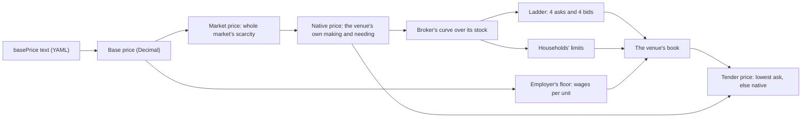
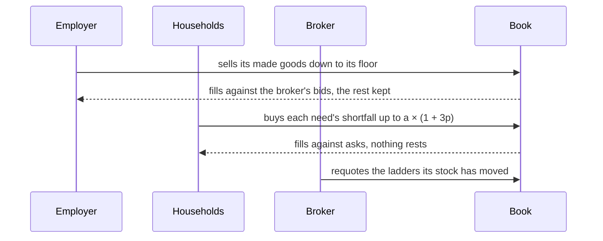

# Prices

Every trade in Manifest happens at a price, and this document says how prices are represented,
where they come from and how they move. A price is exact: a whole number of millionths of a
credit for one unit of a good. In the [hosted world](glossary.md#hosted-world) each venue's
[broker](glossary.md#broker) sets its prices from its stock, so scarcity makes a good dearer and a
glut makes it cheaper. Households, employers and governments price their own orders off the
broker's quotes. The ledger stays in whole credits throughout.

How orders match and settle is in [Orders, brokers and market observations](trading.md). The
households and employers that buy and sell are in [The regional economy](economy.md), and the
tenders that use need-priced budgets are in [Regions, governors and public projects](governance.md).
A station's docking and berth fees are a separate scheme, the
[pricing level](glossary.md#pricing-level), in [Stations](stations.md).

## Concepts

| Term | Meaning |
| --- | --- |
| [Decimal price](glossary.md#decimal-price) | A price per one of the item's authored units (a tonne, a kilolitre, a unit), held as a signed 64-bit count of microcredits. |
| [Credit](glossary.md#credit) | The currency. Every balance, reservation, gross and fee is a whole number of credits. |
| Base price | The item's authored `basePrice`: what it is worth before any market moves it. |
| Native price | A venue's reference price for a good, worked out once at load from the base price and the scenario's production and demand. |
| [Target stock](glossary.md#target-stock) | The totes the broker is seeded with for that good, at least one. At its target the broker quotes about the native price. |
| The curve | The broker's price for the next tote as a function of the totes it holds. |
| [Ladder](glossary.md#ladder) | Up to four orders a side the broker posts each turn, each priced at a point on the curve. |
| Spread | The gap between the broker's asks and bids at the same point of the curve: `brokers.spreadBps`, half each side. |
| [Pressure](glossary.md#pressure) | How short a region's households are of an essential need, 0 to 1. It raises what they bid. |

Quantities are not decimals. Totes are integers ([tote](glossary.md#tote), an eighth of a cubic
metre), and units, rates, population and physics stay doubles. A price meets a quantity only when
a gross or a budget is worked out, and that product is rounded to whole credits by the rules
below. Manifest does not promise microcredit balances or fractional-credit settlement
([D-001](decision-ledger.md#d-001)).

## How it works

The diagram shows where each price comes from, from the authored text to the orders on a book.



### The Decimal type

`Manifest::Core::Decimal` (`source/game/types/include/manifest/types/Decimal.h`) stores
millionths of a credit: `kScale` is 1,000,000, so `0.05` is raw `50000` and `5.6312` is raw
`5631200`. The range is the 64-bit range, up to `9223372036854.775807` credits a unit.

- **Parsing.** `TryParse` reads exact decimal text: an optional sign, digits and at most one point.
  It refuses empty text, exponents, `nan`, `inf`, trailing characters, values out of range and any
  nonzero digit past the sixth decimal place. Extra trailing zeros are accepted.
- **Literals.** `5.6312_dec` is parsed from its spelling at compile time, never through a binary
  floating-point literal, and fails to compile if it does not fit.
- **From a double.** `TryFromDouble` is the only way in from floating point, and it is explicit. It
  refuses non-finite and out-of-range values and rounds to the nearest microcredit, halves away
  from zero. `ToDouble` goes the other way, for ratios and display.
- **Arithmetic.** `TryAdd`, `TrySubtract` and `TryDivide` (by an integer, truncating toward zero)
  return an empty optional on overflow or division by zero. The operators `+`, `-` and `/` are for
  established invariants: on overflow they fail through Jettison's `JETTISON_VERIFY` and abort,
  never wrapping.
- **Comparison and text.** Prices compare by their raw value, exactly. `ToString` prints the stored
  value with no trailing fractional zeros (`std::format` and `<<` use it).

The hosted world's state carries prices as the raw `std::int64_t`, not as `Decimal` objects: an
order's `limit`, a `Trade::Place`'s `limit`, a report's price levels and last sale, and a company's
last price paid are each "a Core::Decimal's raw microcredits per the item's unit"
(`source/game/world/include/manifest/world/State.h`). The [development sandbox](sandbox.md) and its
marketplace use the `Decimal` type itself.

### Base prices

An item's `basePrice` is authored as text and stays text until it is used
(`ItemNode::basePrice` in `source/game/config/include/manifest/config/SimulationConfig.h`).
`data/build.sh` writes it double-quoted into the built records, so no YAML reader takes it for a
float. Content validation (`source/game/content/src/Content.cpp`) holds every item to
`Simulation::IsValidBasePrice`: exact by `TryParse`, not negative, and at most
`Decimal::Max() / 52` (`kMaxPriceMultiplier`), the most the hosted multipliers reach
([L51](history/tasks.md), 2026-11-28). They are the design's, not a fault, multiplied together: the
whole market's scarcity is clamped at 5 (`MarketPrice`), a venue that only wants a good adds 1.3
(`kLocalBias`), the [broker's curve](#the-brokers-curve) nears 4 as its stock nears 0
(`kCurveCeiling`), and an ask adds half the spread, under 2 for the `brokers.spreadBps` below 20,000
that content accepts. So an ask stays under 5 × 1.3 × 4 × 2 = 52 times its base price, and at the
shipped spread of 1,000 under 27.3: the "about 27" the bound of 30 was set for on 2026-11-25. That 30
let a spread above about 3,077 price a dear enough good to the curve's cap. The `trade` suite pins
the dearest ask at the bound: 51.991 times the base at a spread of 19,999, within 0.02% of
`Decimal::Max()` and not capped, and 27.296 times at 1,000. Households' limits go higher, a starving
region's up to 4 times the ask at the target and an optional good's its premium over that, but they
are not prices a book keeps: they never rest, they fill at the asks, and a limit past the ledger is
capped and its reservation refused. The sandbox's prices reach 5 × 1.9, inside the bound.
Zero is valid: such a good has no native price, so no broker quotes it. The shipped base prices
run from 0.05 to
50,000,000 (the habitat module). How items are authored is in [content](content.md).

### The native price

As the hosted world's trade rules are built (`MakeRules` in `source/game/trade/src/Trade.cpp`),
each venue's market row gets a native price in two steps, each quantised to a microcredit as it is
made:

1. **The market price**, `Simulation::MarketPrice`: the base price times
   `sqrt(demand / supply)`, clamped to 0.2 to 5, where supply and demand are the good's production
   and demand summed over every venue of the scenario.
2. **The venue's bias**: the market price times
   `1 + 0.3 (demand - production) / (demand + production)` for the venue's own row
   (`kLocalBias`). A venue that only makes a good prices it at 0.7 of the market, one that only
   wants it at 1.3.

The native price does not change after load. What moves prices from then on is the broker's stock.

### The broker's curve

A venue's broker prices the next tote of a good by the totes `h` it holds, against the native price
`r` and the target stock `T`:

```text
price(h) = r × 4T / (T + 3h)        for h up to 5T; flat at r / 4 beyond
```

| Stock held | 0 | T/2 | T | 2T | 3T | 5T and more |
| --- | --- | --- | --- | --- | --- | --- |
| Price, times r | 4 | 1.6 | 1 | 0.57 | 0.4 | 0.25 |

The 4 is `kCurveCeiling`. An ask is the curve's price plus half the spread, rounded up; a bid is
the curve's price less half the spread, rounded down. With `brokers.spreadBps: 1000` that is 5% each
way. `CurvePrice` works in 128-bit integers, with no `pow`, so every build gives the same bits. It
counts stock in half totes so that a rung is priced at its middle.

### The ladder

A broker does not quote one price. It posts a [ladder](glossary.md#ladder): up to `kLevels` (4)
orders a side, each a rung of `ceil(T / 8)` totes (`kRungsPerTarget`), so the four reach half the
target.

- **Asks** offer what it holds, a rung at a time, each priced at the curve at the rung's middle.
  They climb as they sell the stock down.
- **Bids** buy a rung at a time above its stock, falling as they buy it up. They stop at the
  broker's share of its funds or its warehouse's room. Each bid's escrow is reserved as any
  buy's is.

A trade therefore moves the price as it fills. A large sale walks down the bids, and buying the
same totes back walks up the asks through the same middles, so a round trip loses the spread and
cannot pump money out of a broker. There is no mint: a broker only spends its own account
(`brokers.treasury`) and holdings.

A broker requotes on the last step of every [economic turn](glossary.md#economic-turn)
(`economy.intervalSeconds`, after the regional economy, as `Trade::Register` orders it). Its funds
are its balance plus the escrow its resting bids hold, split evenly over the goods it still has to
quote, in its market's order. A good whose resting ladder is already the one its stock and share
give, none of it filled or lapsing before the next turn, keeps its orders. The others are retired
and posted afresh through the path a player's order takes: asks first, then bids on what is left,
since a new order can fill at once.

### Who else prices orders

The sequence shows one economic turn's orders at a venue, in the order the step runs them
(`Step` and `Register` in `Trade.cpp`).



- **Employers' floor.** A region's employer offers everything it has made into the broker's bids,
  down to what a unit cost in wages: `ceil(basePrice × production.wageShare)` microcredits. What
  does not sell at the floor is cancelled and kept in its warehouse for the next turn. A glut makes
  the goods wait, never sell below their cost.
- **Households' limits.** For an essential [need](glossary.md#need), households bid up to
  `a × (1 + 3p)`, rounded down, where `a` is the broker's ask when it holds its target stock and `p`
  is the need's pressure. A fed region pays about the target's ask; a starving one pays up to the
  curve's ceiling. They take the cheapest of the need's goods first, buy whole totes for the
  shortfall, and cancel whatever does not fill.
- **Optional goods.** In an interval where every need was met, households buy each
  [optional good](glossary.md#optional-good) at up to `a × (1 + premium)`, for its bucket's
  `demandShare` of its authored demand (`optionalGoods` in `data/tuning/balance.yaml`).

Pressure itself, and the households' interval, are in [the regional economy](economy.md).

### Prices for tenders

Governments price their tenders off the live market (`Trade.h`, "Prices by need").

- `TenderPrice` is the lowest ask resting on the venue's book, whoever posted it, or the native
  price when nothing is offered. It is none for a good the venue's market does not price.
- `Budget(price, units, urgency)` is the units' cost at the price, rounded up, times `1 + urgency`,
  rounded up. It is none for a negative urgency or a budget the ledger cannot hold.
- `Reliefs` lists the [relief](glossary.md#relief) tenders called for now: one for each region and
  essential need whose pressure is past `kReliefPressure` (0.25). Each is for the day's shortfall
  (a day's requirement times the pressure) in whole totes of the need's cheapest good at the
  region's first venue, budgeted at an urgency of `kReliefUrgency` (3) times the pressure.
- `MakePricer` builds the rules once and returns both functions, for a caller that asks every turn.
  The procurement issuer uses it (`source/game/procurement/src/Procurement.cpp`).

A project tender's urgency is its authored `priorityPremium`; who issues tenders and when is in
[governance](governance.md).

### From a price to credits

These rules turn a price and a quantity into whole credits (`Fee`, `Cost` and `PerTote` in
`Trade.h`). Each returns none for an amount the ledger cannot hold, and the caller refuses the
request before writing anything.

| Amount | Rule |
| --- | --- |
| A fill's gross | The maker's price times the units in the totes filled, rounded to the nearest credit. |
| A listing fee | `market.listingFeeBps` (40) basis points of the gross, rounded up, from each side, paid to the venue's account. |
| A buy's reservation | `PerTote` times the totes: a tote's cost at the limit, rounded up, plus its fee. |
| What a buy gets back | Whatever escrow is left once it fills, is cancelled or expires. |

Reserving a tote at a time, each rounded up, means the escrow always covers a fill of any split at
or below the limit. The mixed product is `price.ToDouble() × units` in doubles, checked finite
and in range before it is narrowed to an integer. Units per tote are the item's
`unitsPerCubicMetre` over 8 ([D-087](decision-ledger.md#d-087)). How the fills themselves are
chosen is in
[trading](trading.md).

### The sandbox's prices

The [development sandbox](sandbox.md) uses the same `Simulation::MarketPrice` but its own local
price (`Simulation::LocalPrice`: a bias of 0.9 against the average economy, clamped to ±0.9). Its
route settlement truncates cost and revenue to whole credits. It is not the hosted order book.

## Using it

An authored base price, per kilogram (`data/trade-items/fuels.yaml`):

```yaml
  - item:
      itemId: ItemReactionMass
      categoryId: CategoryFuels
      ageId: AgeSpace
      displayName: Reaction mass
      unitsPerCubicMetre: 900
      basePrice: 0.25
      unitType: Kilogram
```

The scenario row that sets a venue's native price and target stock: Ore makes furs and holds 21
totes of them (`data/scenarios/trading.yaml`).

```yaml
      - {itemId: ItemFurs, regionId: RegionOreHighlands, production: 40, demand: 0, stock: 21}
```

The prices the curve gives that row, from `source/game/trade/tests/TradeTests.cpp`, "Each broker
posts a ladder about its stock and requotes each turn". The native price is 58.931104, the rung 3
totes, and the first ask sits at 19.5 totes:

```cpp
CHECK(
    limits(Side::Sell) == std::vector<std::pair<std::uint64_t, std::int64_t>>{
                              {3, 65'380'169}, {3, 73'726'573}, {3, 84'515'828}, {3, 99'004'255}});
CHECK(
    limits(Side::Buy) == std::vector<std::pair<std::uint64_t, std::int64_t>>{
                             {3, 53'137'876}, {3, 48'232'842}, {3, 44'156'827}, {3, 40'716'035}});
```

A limit order from the console, its price in credits per the item's unit, parsed by `TryParse`
(`source/tools/console/tests/ManifestConsoleTests.cpp`). The principal is given only when the
console is not connected to a server:

```text
trade buy Ada VenueOreHighport ItemFurs 2 80
book VenueOreHighport ItemFurs
```

Decimal arithmetic and the explicit boundary from doubles
(`source/game/types/tests/DecimalTests.cpp`):

```cpp
CHECK(Decimal::TryParse("0.05")->Raw() == 50'000);
CHECK_FALSE(Decimal::TryParse("0.0000001").has_value());
CHECK(Decimal::TryFromDouble(0.0078125) == 0.007813_dec);
CHECK((5.631201_dec / 2).Raw() == 2'815'600);
```

A tender's budget (`TradeTests.cpp`): 10 units at 1.05 credits cost 10.5, rounded up to 11, and an
urgency of 1 doubles it.

```cpp
CHECK(Budget(1'050'000, 10.0, 1.0) == 22);
```

## Limits and open work

- A government holding goods beyond its needs would offer them below the live bid
  ([D-102](decision-ledger.md#d-102)). This is not built: no government holds a surplus yet.
- The native price is fixed at load, so only stock moves a price. Long-run shifts in production
  and demand reach prices through stock alone.
- `CurvePrice` caps a price at the largest raw value rather than failing. The base-price bound
  keeps every ask under it ([base prices](#base-prices)), and no authored price comes near it.
- Market services that sell or fix prices are open: options and futures
  ([L17](delivery-order.md#l17)), paid price reports ([L20](delivery-order.md#l20)) and forward
  contracts ([L21](delivery-order.md#l21)), in
  [the economy's open plans](economy-and-development-plan.md).

## Decisions

The decisions on prices are under [Prices](decision-ledger.md#prices) in the decision ledger. The
key ones: exact decimal prices with integer ledgers ([D-001](decision-ledger.md#d-001)), the
listing fee and pricing per authored unit ([D-083](decision-ledger.md#d-083)), a broker at each
venue ([D-084](decision-ledger.md#d-084)), whole totes ([D-087](decision-ledger.md#d-087)), and
supply and demand pricing ([D-102](decision-ledger.md#d-102)). How the curve and ladder were
settled is recorded in
[history/stage-4-trading-plan.md](history/stage-4-trading-plan.md#delivered-w19-2026-11-22).

## Source

| Where | What |
| --- | --- |
| `source/game/types/include/manifest/types/Decimal.h`, `src/Decimal.cpp` | The Decimal type; suite `types` |
| `source/game/trade/include/manifest/trade/Trade.h`, `src/Trade.cpp` | Native prices, the curve, the ladder, households' and employers' limits, `Fee`, `Cost`, `PerTote`, `Budget`, `TenderPrice`, `Reliefs`, `MakePricer`; suite `trade` |
| `source/game/sim/src/Simulation.cpp` | `BasePrice`, `IsValidBasePrice`, `MarketPrice`, the sandbox's `LocalPrice`; suite `sim` |
| `source/game/content/src/Content.cpp` | Base price validation; suite `content` |
| `source/test/FixtureTests.cpp` | `fixture_prices`: a shortage pulls a cargo in, and eight days of two traders keep every broker's stock within half and twice its target |
| `data/tuning/balance.yaml` | `market` (listing fee), `brokers` (treasury, spread), `production.wageShare`, `optionalGoods` |
