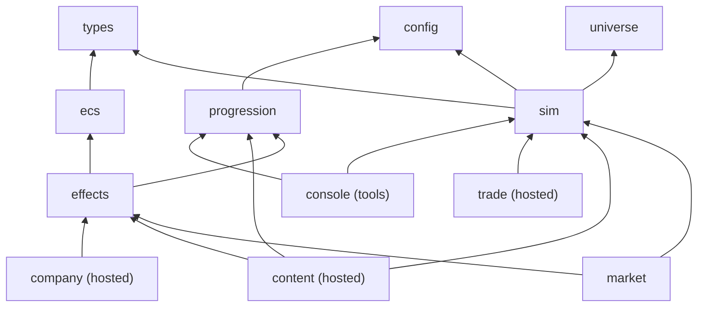
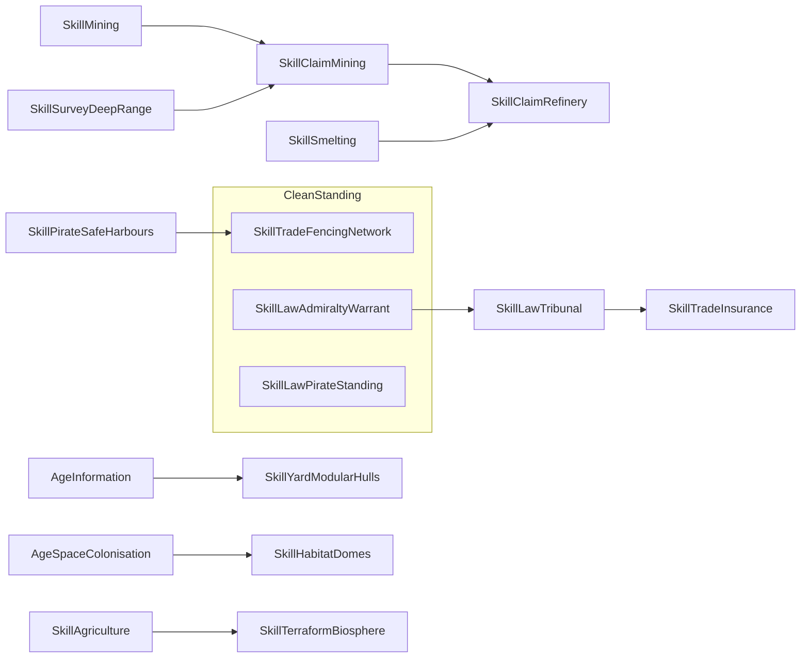
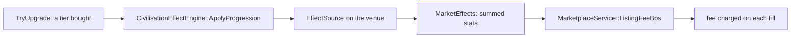

# The development sandbox

The development sandbox is a small, local economy that a developer plays from the console. It
generates a handful of worlds, moves goods between them a tick at a time, and lets the developer
buy tiers of the skill tree, whose effects land on ships, venues and lanes in a store of its own.
It predates the [hosted world](glossary.md#hosted-world), and **the hosted game does not run it**:
no player shares it, nothing in it is saved, and nothing in it reaches the hosted world.

What still uses it: the console's sandbox commands (see [Using it](#using-it)), its own test
suites, and a few pure functions and records that the hosted modules borrow (see
[What the hosted game borrows](#what-the-hosted-game-borrows)). The [sandbox](glossary.md#sandbox)
is otherwise frozen: no open task works on it.

## Concepts

| Term | Meaning |
| --- | --- |
| Civilisation | One generated world of the sandbox (`Core::Civilisation`, ids `Civ-01`, `Civ-02`, ...): a name, an [age](glossary.md#age), a population in world units, a treasury, and per-good production, demand and stockpile. Not a hosted [region](glossary.md#region). |
| Tick | One turn of the sandbox's economy (`Simulation::AdvanceTick`). It has no length in time; the hosted world runs [steps](glossary.md#step) instead. |
| [Skill node](glossary.md#skill-node) | One node of the skill tree (`Core::SkillNode`): a `Skill` bought a tier at a time, or a `Tech`, a gate that is open or shut. |
| Resource pool | The points tiers are bought with (`ProgressionManager::GetResources`). The console starts each load with 20. |
| Exclusive group | Nodes sharing an `exclusiveGroupId`: the first tier of one locks the others out for good. |
| [Effect](glossary.md#effect) | What a tier of a node is worth: a list of signed modifiers, one per stat (`Core::EffectDefinition`). A node names its effect by `targetEffectID`. |
| Domain | The kind of store an effect lands on: `Ship`, `Yard`, `Route`, `Survey`, `Market` or `Body` (`Core::EffectDomain`). |
| Origin | How a ship effect reaches a hull: a `Skill` is a system fitted into a slot of one hull; a `Technology` (from a `Tech` node) reaches every hull of the operator and spends no slot (`Core::EffectOrigin`). |
| Store | An entity of the sandbox's `EntityStore` that carries effects: a ship, a venue, a body, or one lane, survey or yard store per civilisation. |
| Sandbox venue | A marketplace opened at a planet, or at a satellite orbiting a planet, in the `EntityStore`; its id is the body's id. Not a hosted [venue](glossary.md#venue). |

## What the hosted game borrows

The sandbox's modules sit low in the module graph, so the hosted modules can and do call into a
few of them. The table says which parts are live in the hosted game and which only the sandbox
runs.

| Part | In the hosted game? | Where |
| --- | --- | --- |
| `Simulation::Generate`, `AdvanceTick`, `PlanTrade` | No | Console and `sim` tests only |
| `Simulation::IsValidBasePrice`, `BasePrice`, `MarketPrice` | Yes | Content holds every item's `basePrice` to `IsValidBasePrice`; `trade` seeds each venue's starting prices with `MarketPrice` ([prices](pricing.md)) |
| `ProgressionManager` tiers and resources | No | Console and tests only |
| `ProgressionManager::Build` (graph validation) | Yes | Content refuses a tree with an unknown prerequisite, a cycle, an unreachable tier or a rival prerequisite ([content](content.md)) |
| `EffectCatalogue::Default` | Yes | Content checks every `targetEffectID`, a hull's `fitableEffects` and an offer's skill against it |
| `ShipEffectEngine::Stats` | Yes | `company` computes a hosted ship's stats (its hold's `CargoVolume`, its `FuelCapacity`) from its hull and fitted systems ([companies](companies.md)) |
| The rest of `ShipEffectEngine`, `CivilisationEffectEngine` | No | Tests only (the `effects` and `market` suites); the console does not use them |
| `EntityStore`, its components, `MarketplaceService` | No | Tests only; the hosted world lives in Jettison's `SimWorld` ([world](world.md)) and trades through `trade` ([orders and brokers](trading.md)) |
| The skill-tree records (`data/skill-tree`) | Yes, as content | Hosted regions know skills by id ([governance](governance.md)); hosted ships fit ship systems by skill id |

The module graph shows the same split: the sandbox modules below, and the three hosted modules
and the console that reach into them. An arrow points at what a module depends on.



## How it works

### The economy model

`Core::Simulation` (`source/game/sim`) is a deterministic supply-and-demand model, small enough
to reason about. `Generate` builds the worlds from the loaded content and a seed:

1. Each world takes a name from the shuffled deck of the universe's name pools, and a suffix
   (`Prime`, `Alpha`, ...) by its index; the pools themselves are [content](content.md).
2. It takes an age, and its population and treasury scale with that age.
3. Its production deck holds only goods whose `ageId` is at or before its own age, so a Stone Age
   world makes no antibiotics.
4. It demands the rest. Goods of the essential categories (water, consumables, medicine,
   pharmaceuticals, seeds, fuels, information, writing and the like) are demanded at every age,
   weighted 2.5 times, so a world that cannot make medicine has to buy it.

Prices follow scarcity. A good's market price is its base price times
`(demand / supply) ^ 0.5`, clamped between 0.2 and 5 times the base. A world's local price moves
that by its own balance against the average world, up to 90 per cent either way
(`Simulation::LocalPrice`). The gap between two worlds' local prices is the trade.

`PlanTrade` finds, for each good, the world with the largest surplus and the world with the
largest deficit. The route moves 80 per cent of the smaller of the two, capped by the seller's
stock. Freight is a flat 8 per cent of the market price per unit moved, never a mass, a volume or a
distance; a route that cannot pay its freight is dropped. `AdvanceTick` adds production to every
stockpile, takes demand out of it (counting what went unmet), then trades the 25 best routes the
buyers can afford. These constants are code, in `source/game/sim/src/Simulation.cpp`, not
balance data.

### The skill tree

The tree is 85 nodes in eleven files under `data/skill-tree/`, 227 tiers in all. Both
[game modes](glossary.md#game-mode) select the whole tree ([D-061](decision-ledger.md#d-061)): the
items, not the tree, make Astralis small. Every file but `skills.yaml` opens with a comment saying
what its nodes are, what a tier buys and what its `requires` mean.

| File | Nodes | Shape |
| --- | --- | --- |
| `skills.yaml` | 17 crafts, `SkillMining` to `SkillFuelRefining` | `Skill`, 3 tiers, cost 1, all roots. No effect: `targetEffectID` is null. |
| `ages.yaml` | 14 age gates | `Tech`, 1 tier, chained in age order; cost rises 1 to 5, 31 for the ladder. No effect. |
| `spaceship.yaml` | 25 ship systems | `Skill`, 3 tiers, cost 1 to 3, no exclusive group. |
| `shipyards.yaml` | Drydock, outfitting line, modular hulls, refit docks | Cost 2 to 3. Modular hulls also need the Information Age gate. |
| `lanes.yaml` | Convoy, escort wing, route ward, warden patrol | Cost 2 to 3. |
| `survey.yaml` | Deep survey, mining claim, claim refinery, exclusive claim | Cost 2 to 3. Claims also need the Mining and Smelting crafts. |
| `habitats.yaml` | Domes, closed loop, atmosphere, biosphere | Cost 3 to 4. Domes need the Space Colonisation gate; the biosphere needs Agriculture. |
| `piracy.yaml` | Raider hulls, boarding parties, ransom exchange, safe harbours | Cost 2. |
| `law.yaml` | Admiralty warrant, pirate pardon, tribunal, standing among the crews | Cost 2 to 3. |
| `trade.yaml` | Docking licence, cargo insurance, fencing network | Cost 1 to 2. |
| `services.yaml` | Public medicine, education | Cost 2. They need the Pharmaceuticals and Research crafts. |

A node's fields, as `Core::SkillNode` reads them:

| Field | Meaning |
| --- | --- |
| `skillId` | The id, prefixed `Skill`; a gate's id is its age's `ageId` (`AgeInformation`), so a world in an age finds its gate by the age. |
| `nodeType` | `Skill` or `Tech`. Content refuses a `Tech` whose id names no age. |
| `maxTiers` | At least 1. |
| `requires` | Prerequisites, each a `nodeId` and a `requiredTier`. |
| `resourceCostPerTier` | At least 1. |
| `targetEffectID` | The effect a tier buys; null for the crafts and the gates. |
| `exclusiveGroupId` | The rival group; `CleanStanding` is the only one in the data. |
| `gridX`, `gridY` | Layout for a tree screen: gates on row -1, crafts on 0, ship systems on 1, yards, lanes and survey on 2, habitats on 3, piracy, law, trade and services on -2. |

`ProgressionManager::TryUpgrade` buys one tier when the node exists, is below its last tier, is
not locked out, has every prerequisite at its required tier, and the pool can pay. It refuses
otherwise and leaves the state untouched; `UpgradeBlockReason` says why in words.

The tree's value is in the links that cross its files. The diagram shows them, and the one
exclusive group: buying the warrant, the standing or the fence first locks the other two out,
because the three are one reputation spent three ways. `Validate` refuses a group member that
requires a rival, which is why the warrant and the standing are roots.



The ship systems have nine roots: the forward screen, the forward guns, the navigation computer,
the drive, the long-range mast, the cargo holds, the fuel bunkers, the stealth coating and the
crew. The rest hang on one of them: the side and rear screens on the forward screen, the rear guns
and the forward lasers on the forward guns, the rear lasers on the forward lasers, the trader AI on
the navigation computer, the jets on the drive and attitude control on the jets, the fire-control
and commercial arrays and the countermeasures on the mast, the salvage rig on the holds,
emissions control on the coating, and life support and damage control on the crew, with the
spares lockers on damage control.

### Effects

`Core::EffectCatalogue` (`source/game/effects`) holds the 54 effects the shipped tree names: 25
Ship, 4 Yard, 4 Route, 4 Survey, 11 Market and 6 Body. The tree says which effect a node buys; the
catalogue says what a tier of it is worth, beside the stat table and its units
(`source/game/types/include/manifest/types/EffectTypes.h`). Each modifier moves one
`EffectStat` by `Add` (per tier times tiers), `Multiply` (by one plus per tier times tiers) or
`Set`. The catalogue refuses a modifier of zero and a stat of another domain, and the `effects`
suite checks that the tree and the catalogue name each other exactly.

Two engines land bought tiers on the store. Each writes an `EffectSource` entity (skill, effect,
origin, tier) per effect per store, and rebuilds the store's stats as its base plus every source,
in sorted effect-id order, so the same tree gives the same numbers on every platform.

- `ShipEffectEngine` handles the Ship domain. A hull's base is its `ShipClassSpec` from
  `data/ships/hulls.yaml`. A `Skill` system needs a slot in the hull's `fitableEffects` and
  enters its `ShipSystems`; a `Technology` needs no slot. `UnfitSkill` and `UnfitEffect` take
  systems off again, and taking off one the hull never carried succeeds.
- `CivilisationEffectEngine` handles the other five domains: `MarketEffects` on the
  civilisation's venues, `BodyEffects` on its worlds, and one route, survey and yard store each
  (`LaneStoreId`, `SurveyStoreId`, `YardStoreId`). Those stores start from nothing.

Both engines' `ApplyProgression` walk the whole tree in one loop. A gate buys nothing and
succeeds; a node of the other engine's domain is skipped; the two counts, applied and skipped, add
up to the tree.

### The store and the sandbox marketplace

`Core::EntityStore` (`source/game/ecs`) wraps an EnTT registry whose
[entities](../../jettison/docs/glossary.md#entity) carry string ids (`Civ-01`, `Ship-01`,
`Order-7`), indexed by a sorted map so a walk is the same order everywhere. `NextId` never
reuses a number, even after `Clear`, so a fill log never names two orders by one id. Its
[components](../../jettison/docs/glossary.md#component)
(`source/game/ecs/include/manifest/ecs/Components.h`) are plain facts: bodies, treasuries,
stockpiles, hulls and their stats, venues, orders, quotes, fills and one effects component per
domain.

`Core::MarketplaceService` (`source/game/market`) is an order book over that store:

- **Venues.** A planet hosts one, a satellite hosts one only while it orbits a planet, and a star
  hosts none (`VenueBlockReason`). `LoadSimulation` writes the generated worlds into an empty
  store and opens a venue at each.
- **The book.** Price-time priority. Posting reserves what the order trades: a sell order the
  seller's stock, a buy order the buyer's treasury. A post crosses the book at once, so the best
  bid always sits under the best ask. The resting order (the maker) sets the fill's price.
- **Fills.** Whole units and whole credits; the fee is basis points of the gross, charged to both
  sides and rounded up. A venue keeps its last 64 fills (`marketFillLogSize`). A cancel of an
  order that is gone succeeds; a cancel of an order that has filled is refused.
- **A tick** sweeps orders past their order life (24 ticks by default; 0 means none), returns
  their goods and credits, and rebuilds the quote tables. It trades nothing.

The effects reach the book through a venue's charges. The diagram follows one bought tier from the
console to the fee a fill pays.



`RiskPremiumBps` is the venue's `MarketRiskPremium` plus its owner's `RouteRiskPremium`.
`ListingFeeBps` is the venue's base fee (40 by default) plus that risk, less one basis point per
two points of `MarketClearance`, never below zero. `InsuranceBps` is the base premium (120 by
default) plus `MarketInsurance`. `DepthUnits` caps one side of the book only when the service
sets a depth; 0 means no cap. `MarketFenceShare` prices no charge.

For example, one tier of `SkillTradeDockingLicence` writes `MarketClearance` 20 and
`MarketRiskPremium` -5 on the owner's venues. Their listing fee becomes 40 - 5 - 10 = 25 basis
points.

## Using it

The console's sandbox commands, in a session the console tests run
(`source/tools/console/tests/ManifestConsoleTests.cpp`):

```text
load                  loads the content, rebuilds the tree, sets the pool to 20, drops the worlds
generate 3 42         three worlds from seed 42 (default 8 worlds, seed 1)
list                  every civilisation: id, name, pool, age, population, goods, treasury
show Civ-01           one civilisation, by id or by name (quote names with spaces)
prices 3              the goods furthest above their base price
plan 3                the best routes, with freight and profit
tick 2                advances two ticks (at most 1000)
skills                every node's tier and cost
upgrade SkillMining   buys one tier: "Upgraded SkillMining to tier 1/3, 19 resources left."
status                content, the sandbox, its tree, the hosted world and the connection
```

The console keeps the two worlds apart: the sandbox commands never touch the world `host` starts
([console](console.md)). A failed `load` keeps the session; a successful one discards the
generated worlds and the bought tiers.

The same from C++, over the staged package (signatures from the headers named):

```cpp
#include "manifest/content/Content.h"
#include "manifest/effects/CivilisationEffects.h"
#include "manifest/ecs/EntityStore.h"
#include "manifest/market/Marketplace.h"
#include "manifest/progression/ProgressionManager.h"
#include "manifest/sim/Simulation.h"

const Jettison::Vfs::Mount package{"manifest", "build/clang-debug/mods/manifest"};
const Manifest::Content::ContentSet content =
    Manifest::Content::LoadContent({&package, 1}, "manifest");
std::string error;

Manifest::Core::GenerateOptions options;
options.civilisationCount = 8;
options.seed = 7;
Manifest::Core::Simulation simulation;
if (!simulation.Generate(
        content.ages, content.categories, content.gameMode.items, content.names, options, error))
    return;
for (const Manifest::Core::TradeRoute &route : simulation.PlanTrade(10))
{
    // route.itemId, route.sellerId, route.buyerId, route.quantity, route.profit
}
simulation.AdvanceTick(error);

Manifest::Core::ProgressionManager progression;
progression.Build(content.gameMode.skills, error);
progression.SetResources(20);
progression.TryUpgrade("SkillTradeDockingLicence", error);

// The worlds in the store, a venue at each, and the tree's effects on them.
Manifest::Core::EntityStore world;
std::size_t venues = 0;
Manifest::Core::MarketplaceService::LoadSimulation(
    world, simulation, Manifest::Core::MarketplaceOptions{}, venues, error);
Manifest::Core::MarketplaceService market;
Manifest::Core::CivilisationEffectEngine effects;
unsigned applied = 0, skipped = 0;
market.ApplyProgression(world, progression, effects, "Civ-01", applied, skipped, error);

Manifest::Core::OrderRequest order;
order.marketId = "Civ-01"; // the venue's id is its body's
order.civilisationId = "Civ-01";
order.itemId = "ItemCopper";
order.side = Manifest::Core::OrderSide::Sell;
order.quantity = 40.0;
order.limitPrice = Manifest::Core::Decimal{12};
std::string orderId;
market.PostOrder(world, order, orderId, error);
market.AdvanceTick(world, simulation.GetTick(), error);
```

`source/test/EffectsIntegrationTests.cpp` and `source/game/market/tests/MarketplaceTests.cpp`
are the fullest worked examples: a tree walked onto a hull and a civilisation, a slot refused, the
charges a venue's effects move.

## Limits and open work

- No task schedules work on the sandbox; it is kept for the console and as the home of the shared
  functions above.
- The crafts and the age gates write no effect, so buying them changes nothing but the tree itself.
- Only `AgeSublimation` opens no good: every other age has at least one item.
- Freight is a share of value, and `AdvanceTick` reads only `basePrice` of an item's five
  physical fields ([content](content.md) defines them).
- The sandbox's tiers are a free pool of points. The hosted world buys ship systems with credits
  through offers ([companies](companies.md)) and teaches skills through public projects
  ([governance](governance.md)).
- The sandbox's world is not saved; only the hosted world is ([persistence](persistence.md)).

## Decisions

The decisions are in the ledger under
[The development sandbox](decision-ledger.md#the-development-sandbox). The ones that shape this
document: [D-001](decision-ledger.md#d-001) (prices are exact decimals, effect stats stay doubles)
and [D-061](decision-ledger.md#d-061) (the two game modes, both on the
whole tree).

## Source

| Module | Key headers | Suites |
| --- | --- | --- |
| `source/game/sim` | `manifest/sim/Simulation.h` | `sim` |
| `source/game/progression` | `manifest/progression/ProgressionManager.h` | `progression` |
| `source/game/types` | `manifest/types/EffectTypes.h` (stats, domains, operators) | `types` |
| `source/game/effects` | `EffectCatalogue.h`, `ShipEffectEngine.h`, `CivilisationEffects.h` | `effects` (`source/test/EffectsIntegrationTests.cpp`) |
| `source/game/ecs` | `manifest/ecs/EntityStore.h`, `Components.h` | `ecs` |
| `source/game/market` | `manifest/market/Marketplace.h` | `market` |
| `source/game/config` | `manifest/config/SimulationConfig.h` (`SkillNode`, `ItemNode`, ...) | through `content` |
| `data/skill-tree/` | eleven files | `data` (`source/test/DataTests.cpp`) |
| `source/tools/console` | `ManifestConsole.h` (the sandbox commands) | `console` |
