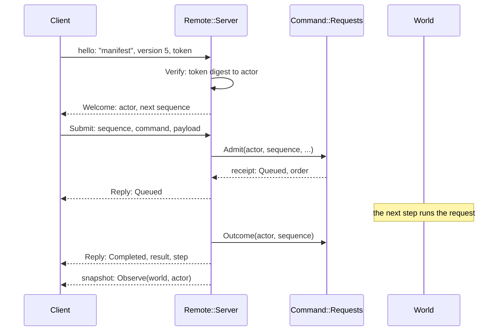
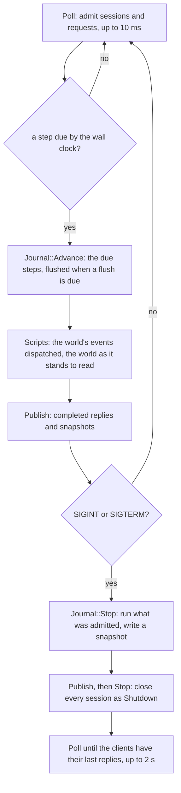

# The dedicated server and remote clients

The dedicated server runs a [hosted world](glossary.md#hosted-world) on its own, with no window or
terminal, and lets players play it over the network. `manifest --serve` steps the world against the
wall clock whether anyone is connected or not. A remote client, such as the terminal UI after
`connect`, sends the player's requests and receives what the player may see. This document covers
Manifest's protocol on top of Jettison's `net` module, the token file that admits players, and the
server's loop. The transport itself (ENet over UDP, the handshake, bounds and reasons) is
Jettison's: see [networking](../../jettison/docs/networking.md).

## Concepts

| Term | What it is |
| --- | --- |
| Server | `Remote::Server`: serves one started world to remote clients. It admits a connection by its [token](glossary.md#token), passes its requests to the world's one admission path, and sends it its own view after each step. |
| Client | `Remote::Client`: one connection to a server, for a frontend. It never holds or steps a world. It is spent once closed; to reconnect, make another. |
| [Token](glossary.md#token) | A bearer token: 64 hex characters that `manifest-token` prints once. Whoever presents it connects as the actor it was issued to. |
| Token file | The server's list of credentials: each token's digest, never the token, with the actor it names. YAML, written by `manifest-token`. |
| Server key | The server's key pair (Jettison's `Net::ServerKey`). `manifest-token key` keeps the secret half in the key file, its owner's alone, and prints the public half, which every client pins. |
| Server list | A client's pinned keys: each server's `host:port` with the public half of its key. YAML; a build ships one beside its content, and a player's own is read instead when it is there. |
| [Actor](glossary.md#actor) | Who a request acts for: a player's [principal](glossary.md#principal), or the administrator. A remote session's actor comes only from its token, never from a message. |
| [Session](glossary.md#session) | One admitted connection. A reconnection is a new session for the same actor. An actor may hold three at once. |
| [Snapshot (query)](glossary.md#snapshot-query) | `Query::Snapshot`: what one actor may see of the world at a step, as `Query::Observe` builds it. It is the body of every network snapshot the server sends. |
| Protocol | The name `manifest` and a version, `Remote::kVersion` (5 today). A client of another version is refused at the handshake. |

The identity, what a player may do and admin rights stay three separate things. The token says who
is connecting; the command's own rules decide what that actor may do; only an administrator's token
grants what only an administrator may send, such as provisioning a company.

## How it works

### The messages

Manifest defines three message kinds (`Remote::Kind` in
`source/game/remote/include/manifest/remote/Protocol.h`). Each body is encoded in Jettison's binary
archive at the protocol's version, so a change to a message's shape, or to the snapshot's, is a new
protocol version.

| Kind | Direction | Body | Sent |
| --- | --- | --- | --- |
| `Welcome` | server to client | the actor's kind and ID, and the sequence to send next | once, on admission |
| `Submit` | client to server | a [request](glossary.md#request): its sequence, command name, command version and payload | for each request |
| `Reply` | server to client | the sequence, the ledger's [receipt](glossary.md#receipt), and the actor's next sequence | at admission, then again once the request has run |

Snapshots are not a Manifest kind. The server hands each session's `Query::Snapshot` to Jettison,
which sends it on the unreliable channel with the step it was taken at. A client keeps only the
newest; an older one in flight is dropped by the transport.

A request's payload is the same command payload a local caller admits, such as `Company::Move` for
`Manifest.Company.Load`. The server does not read it: `Command::Requests::Admit` checks it, as it
does for every request (see [the hosted world](world.md)).

### A session's life

This sequence shows a player connecting, sending one request and seeing it run:



**Admission.** Jettison checks the protocol's name and version, then calls the server's verifier
with the credential. The verifier looks the token up in the token file, comparing digests in
constant time (`Remote::Resolve`). It refuses a token issued to nobody, and a token naming a
principal that is the world's own [NPC trader](glossary.md#npc-trader)
([D-097](decision-ledger.md#d-097)): both are closed as `BadCredential`. Once admitted, the session
is sent its `Welcome`, with the next sequence the [request ledger](glossary.md#request-ledger)
expects from that actor.

**Three sessions an actor.** An actor may hold three sessions at once, for a few frontends watching
one company ([D-082](decision-ledger.md#d-082)). Each is sent its own replies and the actor's
snapshot. They share the actor's sequences, so two sessions sending one sequence with different
content get `RequestConflict` for the second, and nothing runs twice. A fourth session is closed as
`ServerFull` once admitted, because Jettison's verifier can refuse only as `BadCredential`. The cap
is each actor's; the whole server admits Jettison's default of 32 sessions.

**Requests.** Between steps, `Server::Poll` takes each session's waiting messages, oldest first, and
admits each as a request of the session's actor. Admission answers at once with a `Reply`: `Queued`
with its global order, `Completed` for a sequence that already ran, or `Refused` with the reason. A
refusal consumes no sequence, so the reply's next sequence tells the client to send that sequence
again. A message that is not a `Submit`, or does not decode, closes the session as `BadMessage`. The
network never steps the world: requests wait for the next step, which runs them in admission order.

**Replies and snapshots.** After each step, `Server::Publish` sends a `Completed` reply for every
request the session queued that has now run, with its result and step. It then asks Jettison to send
snapshots. Jettison asks for a session's view at most once a second (`kSnapshotInterval`, chosen
because the economy turns hourly and journeys take minutes to days), so a snapshot may follow its
step's replies. The view is `Query::Observe` for the session's actor: a player sees their own
company and market reports, with every tender and region; the administrator sees every company and
no market (see [the hosted world](world.md)).

**Closing.** A session ends with one of Jettison's
[reasons](../../jettison/docs/networking.md#reasons). These are the ones the server chooses:

| Reason | When |
| --- | --- |
| `BadCredential` | The token is in no credential, or names an NPC's principal. |
| `ServerFull` | The actor already holds three sessions. |
| `BadMessage` | A message that is not a request, or does not decode. |
| `Revoked` | The token file no longer holds the session's token. |
| `Shutdown` | The server is stopping, or a connection arrived after it began to stop. |

Jettison adds its own: `InboundOverflow` for a session with too many messages waiting, `Closed` for
a peer gone silent, and the handshake's refusals.

### Tokens and revocation

`manifest-token` issues and revokes tokens. Issuing makes 32 random bytes with libsodium
(`Jettison::Net::GenerateToken`), prints them once as hex, and keeps only their BLAKE2b digest. Each
actor has at most one token: issuing again replaces it. A leaked token file gives away no token.

The server reads the token file at start and fails if it cannot. Before each poll it checks the
file's modification time, and reads it again when it changed. Every session whose token is gone is
closed as `Revoked`. A file that no longer reads is logged and ignored, so the last good set stays:
a token is revoked by the CLI rewriting the file, not by the file being lost. `Remote::WriteTokens`
replaces the file whole and durably, so a running server never reads half of one.

### The server's loop

`manifest --serve` (`source/apps/manifest/main.cpp`) starts the host as every mode does (see [the
host](host.md)), opens and locks the [world directory](glossary.md#world-directory), and recovers
the world from its [journal](glossary.md#journal). Only then does it start the server, so no client
sees a world before recovery. This flowchart shows the loop that follows:



The world steps at its fixed [step](glossary.md#step) against the wall clock
(`Jettison::Time::FixedStepAccumulator`), with or without clients. [Quiet
steps](glossary.md#quiet-step) are passed over at once. A clean stop admits nothing more, runs what
it admitted in one last step, answers it, and writes a snapshot, so it loses nothing. A crash loses
what ran since the last flush, 30 s by default: a `Completed` reply is not a durable acknowledgement
([D-113](decision-ledger.md#d-113)). How the journal, snapshots and backups work is in [saves, the
journal and backups](persistence.md).

The mods' scripts run in the server's session as in a client playing alone ([the host](host.md)):
after each advance the server gives them every event the world raised (`ScriptHost::Dispatch`),
with a snapshot of the world as it then stands to read (`Sim::Capture`, `ScriptHost::ReadFrom`), and
the journal writes their keys into each snapshot. A replay gives them nothing: they send no command, so
the world replays without them.

### Retries across reconnects

A client that loses its connection without hearing a request complete reconnects, as a new client,
and calls `Client::Retry` with the sequence it first sent. The ledger answers a sequence it already
ran as `Completed` with the original result, order and step, and never runs it twice. A sequence the
journal lost in a crash is free again: the welcome names the sequence after the last one the journal
kept, and the client sends what it lost again, in order. Sending a later one first is `SequenceGap`.
The `remote` suite proves this across a crash with two players on three sessions
([R08](history/stage-5-recovery-plan.md#reconnect-and-recovery-r08-2026-11-24)).

### Bounds

Every resource a client can make the server spend is bounded, here or in Jettison
([bounds](../../jettison/docs/networking.md#bounds)):

| Bound | Value | Where |
| --- | --- | --- |
| Sessions an actor | 3 | `kSessionsPerActor`, `source/game/remote/src/Server.cpp` |
| Requests an actor may have queued | 32; one more is `QueueFull` | `Command::kPendingPerActor` |
| Request payload | 4,096 bytes; more is `PayloadTooLarge` | `Command::kMaxPayloadBytes` |
| Messages waiting in a session | 256; one more closes it as `InboundOverflow` | Jettison's `maxInbound` |
| A message, either way | 192 KiB | `Remote::kMaxMessageBytes` |
| Snapshots to a session | one a second | `kSnapshotInterval` |

The longest message is a snapshot. The limit is three times the trading scenario's 63,567-byte view
at step 0 (measured 2026-11-23), which Jettison's 64 KiB default dropped ten orders later. It stays
under the 256 KiB at which an unreliable message still crosses whole. A view longer than the limit
is logged and not sent.

### Connections are sealed

Every message is sealed to keys made, connection by connection, with the server's key
([D-081](decision-ledger.md#d-081)): the token in the hello included, so no one on the path reads it
or poses as the server. How the handshake and the sealing work is Jettison's
([networking](../../jettison/docs/networking.md),
[J01](../../jettison/docs/history/neutral-sdk.md#j01-encryption)). TLS is not used, since it does not run over UDP.

The server reads its secret key at start (`Remote::ReadServerKey`) and fails, naming the file, when
the file is missing or holds no key. `manifest-token key` writes it through Jettison's durable
write, 0600 from the moment it is made, in a 0700 directory when it is the default place, and refuses to
replace a key already there unless given `--replace`.

A client pins the server's public key from its server list (`Remote::ReadServers`,
`Remote::PinnedKey`), looked up by the endpoint exactly as `connect` takes it. A server that does
not hold the pinned key is closed as `KeyMismatch` before the token is sent, and so is a client
pinning another server's key. The list is the player's `$XDG_CONFIG_HOME/manifest/servers.yaml`
when it is there, else the one the build ships beside its content
(`share/manifest/servers.yaml`, from `source/apps/manifest/servers.yaml`), which is how a test build
carries its server's key (`Host::DefaultServers`). A secret lost or leaked is a new key, and every
client given its public half.

## Using it

### Issue tokens and serve

Issue a token for the administrator and one for each player. The token goes to stdout, once; the
file keeps its digest. Without `--tokens`, the file is `$XDG_CONFIG_HOME/manifest/tokens`, its
directory made private to its owner:

```console
$ manifest-token --tokens tokens.yaml issue administrator Operator
ae8475f14e506e608a1370e388f4b372856a5e8068ab58bd0520699b45fb5c0b
$ manifest-token --tokens tokens.yaml issue principal Ada
fc13eaaa61c2c47a6af3381d3ea9b67441faaeddf22bb2a3861bc006f0e150b5
$ manifest-token --tokens tokens.yaml revoke principal Bea
principal Bea has no token
```

The file then holds only digests:

```yaml
version: 1
tokens:
  - digest: 0410fc237a9af6af85d650d831561e3c3fdcc4bc84ad4989214768272c1abb97
    kind: Administrator
    id: Operator
  - digest: 8490b9c3bb0bd18ed685d8f65ee19aa6c20c1e3b81d38fcd8abde14d09d193fe
    kind: Principal
    id: Ada
```

`manifest-token` exits 1 when the actor has no token to revoke or the file cannot be read or
written, and 2 for a bad command line. Revoking a token closes its sessions on a running server.

Make the server's key once. The public half goes to stdout, for every client to pin, and the
server names it again in its serving line at each start; the file keeps the secret, 0600. Without `--key`, the file is `$XDG_CONFIG_HOME/manifest/server-key`.
A key already there is kept, and the command exits 1, unless `--replace` is given:

```console
$ manifest-token --key server-key key
3c0f2a1e9b7d4c5a8e6f1d2b3a4c5e6f7a8b9c0d1e2f3a4b5c6d7e8f9a0b1c2d
$ manifest-token --key server-key key
server-key already holds a key: --replace makes a new one, which every client must then pin
```

Start the server. `--serve` follows the host's own options (`--content`, `--scenario`, `--overlay`;
see [the host](host.md)):

```console
$ manifest --scenario trading --serve --world world --tokens tokens.yaml --key server-key \
    --backups backups
[info] [manifest] ready, from .../share/manifest/manifest.pack, scenario trading
[info] [manifest] serving on 127.0.0.1:47720 at step 0, world 3d8facdd32ac93e5b0e26772a7c9b08f at batch 0, key 3c0f2a1e9b7d4c5a8e6f1d2b3a4c5e6f7a8b9c0d1e2f3a4b5c6d7e8f9a0b1c2d
^C
[info] [manifest] stopping at step 161, batch 1, 0.0 s dropped
```

| Option | Default | What it sets |
| --- | --- | --- |
| `--world <directory>` | `$XDG_DATA_HOME/manifest/world` | The world's directory, made or recovered, held by one server at a time |
| `--tokens <file>` | `$XDG_CONFIG_HOME/manifest/tokens` | The token file; the server fails to start without one |
| `--key <file>` | `$XDG_CONFIG_HOME/manifest/server-key` | The server's secret key; the server fails to start without one |
| `--address <ipv4>` | `127.0.0.1` | The address to listen on, dotted IPv4; `0.0.0.0` for every interface |
| `--port <n>` | `0` | The UDP port; 0 takes an ephemeral one, which the serving line names |
| `--flush-seconds <n>` | 30 | How often the journal is written: the most a crash loses |
| `--snapshot-seconds <n>` | 3,600 | How often a snapshot and its backup are written |
| `--backups <directory>` | `$XDG_DATA_HOME/manifest/backups` | Where backups go, outside the world's directory |

Each option may be given once, and an interval must be at least a second. The last three are
[persistence](persistence.md)'s. A bad command line exits 2; a start that fails, such as a token
file that cannot be read, exits 1.

### Play from the console or the terminal UI

The console's `connect <host:port> <token>` plays on a server as the token's actor, and `disconnect`
leaves it while the world goes on. It pins the key the [server list](#connections-are-sealed) gives
the endpoint, and refuses an endpoint the list does not name. A player adds a server to their own
list, `$XDG_CONFIG_HOME/manifest/servers.yaml`, with the public key its operator gave them:

```yaml
version: 1
servers:
  - endpoint: 127.0.0.1:47720
    key: 3c0f2a1e9b7d4c5a8e6f1d2b3a4c5e6f7a8b9c0d1e2f3a4b5c6d7e8f9a0b1c2d
```
 While connected, `observe`, `provision`, `cargo`, `trade`,
`cancel`, `travel`, `service`, `fit`, `policy`, `refuel`, `fees`, `found`, `tender`, `project` and
`development` go to the server, and take no principal: the actor is the
token's. `step` and `book` are refused, since the server steps its own world and the book is the
host's view. The terminal UI shows the connection in its side pane. These lines are from the
`console` suite (`source/tools/console/tests/ManifestConsoleTests.cpp`):

```text
> connect 127.0.0.1:47720 <administrator token>
Connecting to 127.0.0.1:47720.
Connected to 127.0.0.1:47720 as Operator; your next request is 1.
> provision Ada "Ada Freight"
Sent request 1 to the server.
Request 1 queued in order 1: it runs at the server's next step.
Request 1: Succeeded at step 0.
> connect 127.0.0.1:47720 <Ada's token>
Connected to 127.0.0.1:47720 as Ada; your next request is 1.
> cargo load Ship1 VenueOreHighport ItemCopper 1
Sent request 1 to the server.
Request 1 queued in order 2: it runs at the server's next step.
Request 1: InsufficientStock at step 1.
> trade buy VenueOreHighport ItemFurs 1 0.5
Sent request 2 to the server.
Request 2 queued in order 3: it runs at the server's next step.
Request 2: Succeeded at step 2.
> disconnect
Disconnected from 127.0.0.1:47720.
```

The console's commands themselves are in [the console and the terminal UI](console.md).

### Write a client in C++

A frontend makes a `Remote::Client` with the server's public key, polls until it is welcomed, then
submits payloads. This is from `source/game/remote/tests/RemoteTests.cpp`, where `Await` polls both
ends until the reply arrives:

```cpp
Client player{"127.0.0.1", port, serverKey, adaToken};
// Poll until player.Welcomed() is set, or player.Closed() gives the reason it was refused:
// KeyMismatch for a server that does not hold the key.
const std::vector<std::byte> move = Jettison::Serialise::BinaryArchive::Write(
    Company::Move{"Ship1", "VenueForgeHighport", "ItemCopper", 1},
    Jettison::Serialise::FormatVersion{Company::kVersion});
const std::uint64_t sequence = player.Submit(Company::kLoad, Company::kVersion, move).value();
// player.Poll() returns the replies: Queued at admission, then Completed once the step has run.
// player.Latest() holds the newest Query::Snapshot.
```

After a reconnect, a request whose completion never arrived is sent again under its first sequence:

```cpp
Client again{"127.0.0.1", port, serverKey, adminToken};
REQUIRE(served.Welcome(again));
REQUIRE(again.Retry(sequence, Company::kProvision, Company::kVersion, Provision("Ada")));
CHECK(
    served.Await(again, sequence, Receipt::Status::Completed).value().result == Result::Succeeded);
```

## Limits and open work

- One key a server, pinned: a new key means every client given its public half. A client with no
  entry for an endpoint does not connect; there is no trust on first use.
- Deployment hardening, capacity profiling and an unattended soak before public hosting
  ([L01](delivery-order.md#l01)).
- The terminal UI retries nothing: a player whose request was lost in a crash sends it again by hand
  ([L41](delivery-order.md#l41)).
- A request pending when its session closes is reported to a later session only when it is retried.
- A session closing while its actor reconnects in the same poll counts against the cap until the
  server hears it go, so the reconnect may meet `ServerFull` and try again.
- A real-time variant, where two sessions would both steer, wants one session per actor
  ([D-082](decision-ledger.md#d-082)).
- No deltas: a snapshot must fit `kMaxMessageBytes`, and a larger view is not sent.
- No IPv6, as Jettison's ENet has none.

## Decisions

The settled choices are in [decisions](decision-ledger.md#the-dedicated-server-and-remote-clients):
the split between Jettison's networking and Manifest's server ([D-057](decision-ledger.md#d-057)),
UDP through ENet ([D-079](decision-ledger.md#d-079)), bearer tokens
([D-080](decision-ledger.md#d-080)), every connection sealed to the server's key
([D-081](decision-ledger.md#d-081)),
and three sessions an actor ([D-082](decision-ledger.md#d-082)). How the server came to be is in the
records: the [network
contract](history/gameplay-and-server-plan.md#network-contract-n01-2026-11-20), [the dedicated
server](history/stage-4.md#n02-the-dedicated-server-and-remote-tui--2026-11-20) and [several
clients](history/stage-4.md#n03-several-clients-reconnects-and-bounds--2026-11-20).

## Source

- `source/game/remote`: the module, on `query`, `host` and `Jettison::Net`.
  - `include/manifest/remote/Protocol.h`: `kProtocol`, `kVersion`, `kMaxMessageBytes`, `Kind`,
    `Welcome`, `Submit`, `Reply`, `RegisterTypes`.
  - `include/manifest/remote/Server.h`: `Server` (`Poll`, `Publish`, `Stop`, `Stopping`,
    `PublicKey`).
  - `include/manifest/remote/Client.h`: `Client` (`Poll`, `Submit`, `Retry`, `Disconnect`,
    `Welcomed`, `Closed`, `Latest`).
  - `include/manifest/remote/Tokens.h`: `Credential`, `TokenFile`, `ReadTokens`, `WriteTokens`,
    `Resolve`.
  - `include/manifest/remote/Keys.h`: `ReadServerKey`, `WriteServerKey`, `PinnedServer`,
    `ServerList`, `ReadServers`, `PinnedKey`.
- `source/apps/manifest/main.cpp`: `--serve` and its loop; `source/apps/manifest/token.cpp`:
  `manifest-token`; `source/apps/manifest/servers.yaml`: the server list a build ships.
- Tests: the `remote` suite (`source/game/remote/tests/RemoteTests.cpp`); `cli_serve`
  (`source/apps/manifest/serve-smoke.sh`: served with no client, killed, recovered, stopped,
  restored, and its key made, refused a replacement unasked, and refused missing or holding no key);
  `cli_serve_missing_tokens`, `cli_serve_no_home`, `token_no_home`, `token_revoke_none`,
  `token_no_arguments`; the `console` suite's connect case.
