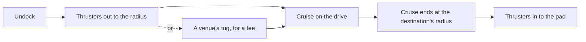
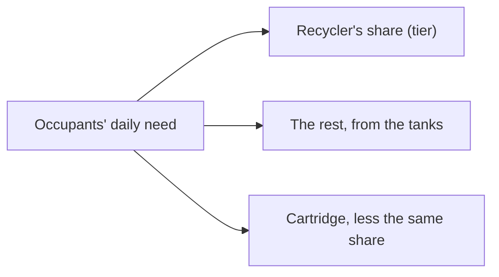

# Ships and life support: open plans

This plan holds the open work on ships themselves: the drives larger hulls will fly, the oxygen
banks on hulls other than the starter, a recycler that makes a ship's oxygen last longer, and what
the compact ship is for. It is written for a developer, a designer or a modder deciding what to
build next. What is built is documented elsewhere: hulls, cargo and upgrades in
[companies](companies.md#hulls), a ship's own life support and its resupply in
[stations](stations.md#station-life-support), and the torch, its fuels and the burn in
[travel](travel.md#the-fuel-a-leg-burns).

## Where things stand

- **Three hulls are authored** in `data/ships/hulls.yaml`: the lone-trader starter, the compact
  single-seat and the long-haul trader. Only the starter is a scenario's starter hull, and no
  command buys, sells or transfers a ship.
- **One drive class for every hull**: a clean fusion [torch](glossary.md#torch), burning
  [reaction mass](glossary.md#reaction-mass) and [fusion pellets](glossary.md#fusion-pellets) at
  the rates in `balance.yaml`'s `fuel` section, on the Manifest mode's manned and unmanned
  [cruise profiles](glossary.md#cruise-profile) (`data/game-mode/manifest.yaml`, `cruise`).
- **Only the starter has life support authored**: three 10 kg
  [oxygen tanks](glossary.md#oxygen-tank) and one scrubber [cartridge](glossary.md#cartridge).
  The world keeps each tank's oxygen apart (`World::LifeSupport::tanks`), draws them in order,
  first tank first, and refills them in order from the hold. The compact ship and the long-haul
  trader have no tanks or cartridges authored.

## Drives past the torch

Built in part by W22a (2026-11-26): the drive as a record, the hauler fusion drive, its exclusion
radius and the medium freighter. The pulse drive and what is left are [W22b](delivery-order.md#w22b).
The torch suits a skiff to a corvette. Hauling thousands of tonnes on it would burn pellets no
trade could pay for, so larger hulls fly dirtier drives that are cheaper a tonne moved but must
keep away from stations ([D-108](decision-ledger.md#d-108)).

### A drive as a record

A drive class becomes a record, `Manifest.Drive`, which a hull names. It holds:

| Field | Meaning |
| --- | --- |
| Exhaust | The exhaust speed, which sets reaction mass by the rocket equation |
| Fuels | The goods it burns and the rate of each |
| Caps | Its sustained and boost accelerations and the boost's length, manned and unmanned |
| Exclusion radius | How close to a station (or populated body) it may thrust |

Built (W22a): `data/ships/drives.yaml`, the torch's numbers moved there from `fuel` in
`balance.yaml`; a drive with no `cruise` of its own flies the mode's profiles
([D-090](decision-ledger.md#d-090)), and the hauler has its own. A hull names its drive by `driveId`.

### The three classes

| | Torch (built) | Hauler fusion | Pulse drive |
| --- | --- | --- | --- |
| Hulls | Skiff to corvette | Medium freighters, thousands of tonnes | Bulk carriers and destroyer classes, tens of thousands of tonnes |
| Exhaust | 10% of light speed | 3% | 1% |
| Fuel | Reaction mass and fusion pellets | Reaction mass, 0.111 kg a tonne-km/s, and deuterium pellets, 40 mg a tonne-km/s | Pulse units, their own reaction mass, 0.0033 a tonne-km/s |
| Acceleration | The mode's profiles | 0.3 g sustained, 0.6 g for 6 hours, manned or not | 0.5 g sustained, 2 g for 2 hours |
| Exclusion radius | A station's reach, 2 km | 1,000 km about every station | 100,000 km about every station and populated body |

The new fuels are new trade goods:

- **Deuterium pellets** (`ItemDeuteriumPellets`, about 60 credits a kg), made wherever there is
  water.
- **Pulse units** (`ItemPulseUnits`, counted by the unit, 100 kg and about 150 credits each),
  made only at polity-operated venues and sold only to a ship whose owner that
  [polity](glossary.md#polity) licenses. Carried without a licence, they are contraband. No licence
  exists in the code yet; W22 designs one.

The hauler's neutrons want shielding, which is hull mass. The pulse drive's fallout is why its
radius covers populated bodies too.

### The exclusion radius

A drive may not thrust inside its radius. Today every ship has the torch's radius, the station's
reach (`Space::CruiseTravel::kStationReach`, 2,000 m): a cruise from inside it is refused, and
`Space::ClearOf` flies the ship out on its thrusters first ([cruising](space.md#cruising)). W22
widens that to each drive's radius. The diagram shows a dirty-drive ship's journey between two
stations.

- **On thrusters.** The ship crosses the radius at its manoeuvring thrusters' acceleration, as it
  leaves a station's reach today: about 1.5 hours out of a pulse ship's 100,000 km at 15 m/s². The
  [fast-forward](glossary.md#fast-forward) passes over it.
- **By tug.** A venue may sell a tow out, a service with a fee of its own. It is designed later
  than W22's first slice.
- **Arriving.** The cruise ends at the destination's radius and the ship flies in on thrusters.
- **Emergency override.** A pulse ship's owner may light the drive inside the radius. The polity
  whose station or body it is fines the company, and each [region](glossary.md#region) the ship
  passes loses [health](glossary.md#health) and [happiness](glossary.md#happiness). It is a choice
  for a desperate or greedy player; the fine and the harm are W22's to set.

The cruise and `ClearOf` are Manifest's own code since the space extraction (`source/game/space`),
so the crossing is a Manifest change. Steering was measured against it on 2026-11-26: it holds a ship
to its thrusters' `maxSpeed`, 150 m/s, so 1,000 km would take nearly two hours each way, every step
run. So a `Space::CruiseDrive` gained a `clearance` that the cruise itself crosses on thrusters at
each end, out of physics and under the fast-forward ([cruising](space.md#cruising)), and `ClearOf`
still flies a ship out of the 2 km reach first. Only the drive's own metres burn fuel.

### The first larger hull

Built (W22a): `HullFreighterMedium`, a medium freighter of 2,500 t on the hauler fusion drive, 120 x
40 x 25 m on a destroyer pad, with a 4,000-tote hold, 400 t of reaction mass tanks, a 100 kg
deuterium magazine and four crew; every number a first guess. No company flies one in a scenario yet:
`Company::Provision` gives every company the scenario's starter hull, and only the fixture's overlay
makes the freighter that. Deuterium pellets (`ItemDeuteriumPellets`) are an item, sold at no venue
yet. Open for [W22b](delivery-order.md#w22b), with the pulse carrier:

- the larger pad classes it docks at: today `data/docks/pads/` has skiff to cruiser; the
  dreadnought and heavy-destroyer sizes are proposals ([D-058](decision-ledger.md#d-058));
- the dry dock, a resupply platform shaped like an oil rig in space, two large pads and smaller
  ones, home to some 500 crew and technicians. Its layout, what its hangars hold, and what
  resupply and repair do and cost are not designed;
- a way for a company to own it, since no command buys a ship.

W22 changes travel, the company's provisioning, the [policy](glossary.md#policy-standing)'s
estimates, and the saved ship and drive state.

**Done when** a hauler and a pulse carrier each leave and reach a station through its radius, with
the fuel and time of each shown, and an override's fine and harm are shown.

## Modular oxygen banks

Queued as [L07](delivery-order.md#l07). A ship's operating oxygen is a bank of tanks, not one
reserve, so a tank can be serviced while the others keep the occupants breathing
([D-050](decision-ledger.md#d-050)). The tanks sit outside the trade hold, and oxygen carried as
cargo is not in the bank until it is poured in ([D-045](decision-ledger.md#d-045)).

**Built** for the starter: per-tank state, drawn and refilled in order, validated against the hull
and saved ([stations](stations.md#resupply-refill-and-replace)). A partly full tank is topped up
without the others emptying first.

**Open**, for L07:

- **Exchanging a tank.** Swapping a tank rather than refilling it. The oxygen left in the removed
  tank must go somewhere, with an owner; it may not vanish or be refilled silently.
- **Banks for other hulls.** Larger hulls get proportionally more storage, but the scaling rule is
  not chosen. Do not derive it from cargo volume or copy the starter's tanks onto every hull. The
  compact ship's and the long-haul trader's banks are unauthored.
- **The tank as a thing.** Its dry mass, packed volume, access, how long a transfer takes, whether
  it is automated, and whether it can be serviced in flight. Whether the draw order stays first
  tank first.

**Done when** an authored larger bank works under the chosen rule, and an exchange keeps every
kilogram's owner through consumption, partial refills, a save and a retry, refusing an overfill
without losing the source's stock.

L07's prerequisites ([W14](delivery-order.md) and [R09](delivery-order.md)) are done; like
every later workstream, it waits until the user has played the first loop.

## Algae oxygen recycling

Queued as [L34](delivery-order.md#l34) ([D-106](decision-ledger.md#d-106)). An algae
photobioreactor turns the occupants' exhaled carbon dioxide back into oxygen, so a ship reaches
farther on the same tanks. It supplements the tanks and the cartridge; it never replaces them, since
it covers only part of the need and can fail.

- **Bought** as other ship upgrades are: an offer of a new [skill node](glossary.md#skill-node),
  fitted to the ship ([D-096](decision-ledger.md#d-096); see [upgrades](companies.md#upgrades)),
  requiring the Life Support node (`SkillShipLifeSupport` in `data/skill-tree/spaceship.yaml`).
- **Tiers.** Each supplies a share of the ship's daily oxygen requirement. The tanks are drawn that
  much more slowly and, since the algae take up the matching carbon dioxide, so is the cartridge.
- **Never more than the use.** It adds no oxygen past what the occupants breathe, and nothing while
  the ship is connected to a station's life support.

The draw it changes is `lifeSupport.oxygenKilogramsPerOccupantDay` and
`lifeSupport.cartridgeOccupantDays` in `balance.yaml`, taken by the life-support system each
step:

Two things the build must settle with the code as it is:

- The starter has slots only for `CargoHolds` and `FuelBunkers`, so it needs one for the recycler.
- The existing Life Support node's effect adds `LifeSupportDays`, a stat of the
  [sandbox](glossary.md#sandbox) that the hosted world's life support does not read.

**Open**, to settle before L34 is planned: the tiers' shares (starting points about 25%, 40% and
50%), the cost (against the cargo holds' 27,000 credits, `data/offers/offer-cargo-holds.yaml`),
any power ([L31](delivery-order.md#l31)), mass or volume it takes, and whether its culture must be
bought and replaced.

**Done when** a ship with the recycler reaches farther on the same tanks, alike through the
fast-forward and a save.

## The compact ship

`HullCompactSingle` is a small ship for one occupant on a long journey, its cabin like a modern
truck's sleeper cab ([D-044](decision-ledger.md#d-044)). It carries at most 32
[totes](glossary.md#tote) (4 m³), a defining limit: no fitting may silently make it a freighter.

**Built:** the hull (32 totes, one occupant), its dock hull
(`data/docks/hulls/hull-compact-single.yaml`, a skiff of 6 x 4 x 1.8 m) and the starter's cruise
drive. The content suite checks it fits all twenty pads of the `highport` layout.

**Open:**

- **Its purpose.** Trade is not its main use, and it is not the starter. It is not to be made a
  scout, courier or any other role without the user's decision.
- **Its price and running cost**, and whether it is especially cheap to run. No command buys a
  ship, so a price needs a way to sell one.
- **Its life support**: tanks, cartridges and how much it is first provisioned with.
- **Its fittings**, checked against the 32-tote limit.
- **Its size**, still the provisional one chosen on 2026-11-19, and its berth's approach,
  clearance and cargo access.
- **Its mass**, which a hull needs before a scenario can start a player in it.

## Decisions

- [D-044](decision-ledger.md#d-044): the compact ship and its berth.
- [D-045](decision-ledger.md#d-045) and [D-050](decision-ledger.md#d-050): life support outside the
  hold, as a modular bank.
- [D-058](decision-ledger.md#d-058): the pad classes and the dry dock.
- [D-096](decision-ledger.md#d-096): ship upgrades as offers.
- [D-106](decision-ledger.md#d-106): algae recycling.
- [D-107](decision-ledger.md#d-107) and [D-108](decision-ledger.md#d-108): fuel, the burn and the
  drive classes.

How the starter's life support and the torch came to be is in the records:
[the small-ship plan](history/small-trader-and-docking-plan.md) and
[Stage 4's W21](history/stage-4-trading-plan.md#delivered-w21-2026-11-22).

## Source

- Hulls: `data/ships/hulls.yaml`, `data/docks/hulls/`, `data/docks/drives/`, `data/docks/pads/`.
- Life support state: `World::LifeSupport` and `World::Fuel` in
  `source/game/world/include/manifest/world/State.h`; `World::Installed` in `Identities.h`.
- Draw, refill and provisioning: `source/game/company/src/Company.cpp`.
- The cruise, its reach and `ClearOf`: `source/game/space/include/manifest/space/Cruise.h`.
- Tests: the `company`, `content` (`source/game/content/tests/ContentTests.cpp`) and `data`
  (`source/test/DataTests.cpp`) suites.
