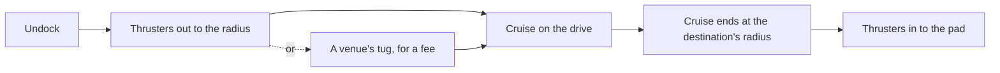
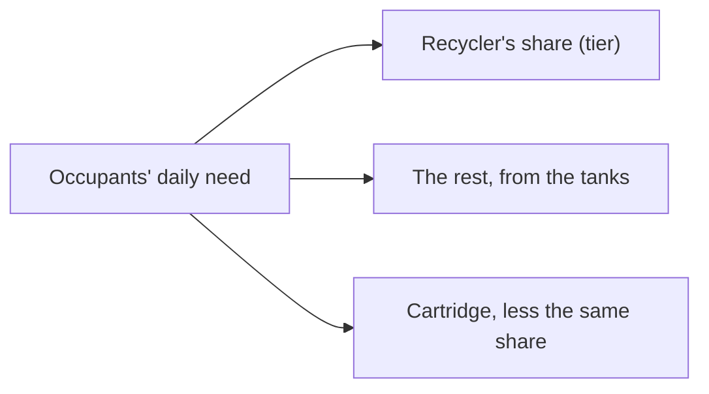

# Ships and life support: open plans

This plan holds the open work on ships themselves: the drives larger hulls will fly, the oxygen
banks on hulls other than the starter, a recycler that makes a ship's oxygen last longer, and what
the compact ship is for. It is written for a developer, a designer or a modder deciding what to
build next. What is built is documented elsewhere: hulls, cargo and upgrades in
[companies](companies.md#hulls), a ship's own life support and its resupply in
[stations](stations.md#station-life-support), and the torch, its fuels and the burn in
[travel](travel.md#the-fuel-a-leg-burns).

## Where things stand

- **The hulls are authored** in `data/ships/hulls.yaml` ([companies](companies.md#hulls)): four
  designs (the lone-trader starter, the compact single-seat, the long-haul trader and the medium
  freighter), a type for each [pad class](glossary.md#pad-class) and nine civilian types. A game
  mode selects the hulls and drives a player is shown ([content](content.md#game-modes)). Only the
  starter is a scenario's starter hull, and no command buys, sells or transfers a ship.
- **Two drive classes** in `data/ships/drives.yaml`: a clean fusion
  [torch](glossary.md#torch), burning [reaction mass](glossary.md#reaction-mass) and
  [fusion pellets](glossary.md#fusion-pellets), and the hauler fusion drive of the larger hulls,
  below.
- **Only the starter has life support authored**: three 10 kg
  [oxygen tanks](glossary.md#oxygen-tank) and one scrubber [cartridge](glossary.md#cartridge).
  The world keeps each tank's oxygen apart (`World::LifeSupport::tanks`), draws them in order,
  first tank first, and refills them in order from the hold. The compact ship and the long-haul
  trader have no tanks or cartridges authored.

## Drives past the torch

Built in part by W22a (2026-11-26): the drive as a record, the hauler fusion drive, its exclusion
radius and the medium freighter. The pulse drive and what is left are [W22b](delivery-order.md#w22b).
The torch suits a skiff to a corvette. Hauling thousands of tonnes on it would burn pellets no
trade could pay for, so larger hulls fly dirtier drives that are cheaper a tonne moved but must
keep away from stations ([D-108](decision-ledger.md#d-108)).

### A drive as a record

A drive class becomes a record, `Manifest.Drive`, which a hull names. It holds:

| Field | Meaning |
| --- | --- |
| Exhaust | The exhaust speed, which sets reaction mass by the rocket equation |
| Fuels | The goods it burns and the rate of each |
| Caps | Its sustained and boost accelerations and the boost's length, manned and unmanned |
| Exclusion radius | How close to a station (or populated body) it may thrust |

Built (W22a): `data/ships/drives.yaml`, the torch's numbers moved there from `fuel` in
`balance.yaml`; a drive with no `cruise` of its own flies the mode's profiles
([D-090](decision-ledger.md#d-090)), and the hauler has its own. A hull names its drive by `driveId`.

### The three classes

| | Torch (built) | Hauler fusion | Pulse drive |
| --- | --- | --- | --- |
| Hulls | Skiff to corvette | Medium freighters, thousands of tonnes | Bulk carriers and destroyer classes, tens of thousands of tonnes |
| Exhaust | 10% of light speed | 3% | 1% |
| Fuel | Reaction mass and fusion pellets | Reaction mass, 0.111 kg a tonne-km/s, and deuterium pellets, 40 mg a tonne-km/s | Pulse units, their own reaction mass, 0.0033 a tonne-km/s |
| Acceleration | The mode's profiles | 0.3 g sustained, 0.6 g for 6 hours, manned or not | 0.5 g sustained, 2 g for 2 hours |
| Exclusion radius | A station's reach, 2 km | 1,000 km about every station | 100,000 km about every station and populated body |

The new fuels are new trade goods:

- **Deuterium pellets** (`ItemDeuteriumPellets`, about 60 credits a kg), made wherever there is
  water.
- **Pulse units** (`ItemPulseUnits`, counted by the unit, 100 kg and 10 credits each),
  made only at polity-operated venues and sold only to a ship whose owner that
  [polity](glossary.md#polity) licenses. Carried without a licence, they are contraband. No licence
  exists in the code yet; one is [planned](#the-licence).

The hauler's neutrons want shielding, which is hull mass. The pulse drive's fallout is why its
radius covers populated bodies too.

### The exclusion radius

A drive may not thrust inside its radius. Today every ship has the torch's radius, the station's
reach (`Space::CruiseTravel::kStationReach`, 2,000 m): a cruise from inside it is refused, and
`Space::ClearOf` flies the ship out on its thrusters first ([cruising](space.md#cruising)). W22
widens that to each drive's radius. The diagram shows a dirty-drive ship's journey between two
stations.

- **On thrusters.** The ship crosses the radius at its manoeuvring thrusters' acceleration, as it
  leaves a station's reach today: about 1.5 hours out of a pulse ship's 100,000 km at 15 m/s². The
  [fast-forward](glossary.md#fast-forward) passes over it.
- **By tug.** A venue may sell a tow out, a service with a fee of its own. It is designed later
  than W22's first slice.
- **Arriving.** The cruise ends at the destination's radius and the ship flies in on thrusters.
- **Emergency override.** A pulse ship's owner may light the drive inside the radius. The polity
  whose station or body it is fines the company, and each [region](glossary.md#region) the ship
  passes loses [health](glossary.md#health) and [happiness](glossary.md#happiness). It is a choice
  for a desperate or greedy player; the fine and the harm are
  [planned](#the-emergency-override).

The cruise and `ClearOf` are Manifest's own code since the space extraction (`source/game/space`),
so the crossing is a Manifest change. Steering was measured against it on 2026-11-26: it holds a ship
to its thrusters' `maxSpeed`, 150 m/s, so 1,000 km would take nearly two hours each way, every step
run. So a `Space::CruiseDrive` gained a `clearance` that the cruise itself crosses on thrusters at
each end, out of physics and under the fast-forward ([cruising](space.md#cruising)), and `ClearOf`
still flies a ship out of the 2 km reach first. Only the drive's own metres burn fuel.

### The first larger hull

Built (W22a): `HullFreighterMedium`, a medium freighter of 2,500 t on the hauler fusion drive, 120 x
40 x 25 m on a destroyer pad, with a 4,000-tote hold, 400 t of reaction mass tanks, a 100 kg
deuterium magazine and four crew; every number a first guess. No company flies one in a scenario yet:
`Company::Provision` gives every company the scenario's starter hull, and only the fixture's overlay
makes the freighter that. Deuterium pellets (`ItemDeuteriumPellets`) are an item, sold at no venue
yet. What is left is [W22b](delivery-order.md#w22b), designed below.

### W22b: the design

Settled by the user on 2026-11-27, every recommendation below accepted
([D-117](decision-ledger.md#d-117)). Every number is a first guess, chosen for a game that plays
well and to be tuned in play. The pad classes are the eleven, shuttle to titan, in
`data/docks/pads/`; the classes above destroyer dock only at a dry dock
([D-058](decision-ledger.md#d-058)).

#### The pulse drive as a record

`DrivePulse` in `data/ships/drives.yaml` puts the table's numbers into data, with three changes to
the record:

| Field | Value | Change to the record |
| --- | --- | --- |
| `exhaustKms` | Left out | Optional: a drive without one burns no reaction mass, since pulse units are their own |
| `pelletItemId` | `ItemPulseUnits` | May name an item traded by the unit, its mass a unit from its density, pack factor and units a cubic metre; a leg's burn rounds up to whole units |
| `pelletMilligramsPerTonneKms` | 333,564 | None: 0.0033 units of 100 kg a tonne-km/s, the rocket equation at 1% of light speed |
| `curveExponent` | 0 | None: no dearer above 1 g, since acceleration is what the pulse drive sells |
| `exclusionRadius` | 100,000 km | None |
| `bodyExclusionRadius` | 100,000 km | New, optional: the height above a populated body's surface it may not thrust within |
| `override` | 10 credits a tonne; 20 health, 40 happiness | New, optional: the [override](#the-emergency-override)'s fine and harm; a drive with none may not override |
| `cruise` | 2 g for 2 hours of a trip, 0.5 g sustained, manned or not | None |

`ItemPulseUnits` joins `data/trade-items/fuels.yaml`, by the unit, eight to the cubic metre (one a
tote) at a density of 1.6 and a pack factor of 0.5, so a unit is 100 kg; it is
[licensed](#the-licence).

**Its price.** At 150 credits a unit, the first guess, the pulse drive costs 0.50 credits a
tonne-km/s, seventeen times the hauler's 0.030 and the torch's 0.028 at 1 g, and no pulse carrier
could pay for a trip. Instead: 10 credits a unit, 0.033 a tonne-km/s, level with the hauler and
cheaper than the torch above about 1.1 g.

**Refuelling the magazine.** The refueller buys one tote of pellets into a hold with none, so the
freighter's 100 kg magazine, eight totes of deuterium, gets 12.5 kg a refuel. Instead it buys the
whole totes the magazine's room takes, straight from the warehouse into the magazine as reaction mass
goes into the tanks, so a hold the policy has filled does not stop it; pellets carried as cargo stay
cargo. The starter's 12.5 kg magazine still takes one tote, no longer through its hold, so the
fixtures' pins move.

**Units and kilograms.** A magazine, a burn and a job's fuel stay in kilograms (`World::Fuel`,
`Job::pelletKilograms`); a fuel item's traded unit is converted at its kilograms a unit, from its
density, pack factor and units a cubic metre (1 for the kilogram-traded fuels, 100 for a pulse
unit). Refuelling adds the units bought times that; a burn is rounded up to whole units and then
converted; and the policy's estimate and a job's settlement price a kilogram at the unit's price
over its kilograms, so a pulse unit burnt costs 10 credits, not 1,000. A save holds kilograms, as
today.

#### The pulse carrier

`HullPulseCarrier` ("Pulse bulk carrier") is the first hull a player can fly on the pulse drive: a
design of the hauler (`HullHauler`), as the medium freighter is of the freighter.

| Field | Value |
| --- | --- |
| Dock hull | 280 x 76 x 56 m on a cruiser pad, so it docks only at a dry dock |
| `mass` | 12,000 t as built, most of it the pusher plate and its shock absorbers |
| `CargoVolume` | 160,000 totes, 20,000 m³ |
| `FuelCapacity` | Left out: no reaction mass tanks |
| `pelletMagazine` | 2,500,000 kg, 25,000 pulse units, outside the hold |
| `occupants` | 12 |
| `oxygenTanks`, `scrubberCartridges` | Six tanks of 200 kg and 30 cartridges: 100 and 75 days for the crew |
| `fitableEffects` | `CargoHolds` |
| `driveId` | `DrivePulse` |

It has its dock hull and power-law cruise drive in `data/docks/` as every hull has, and the
`manifest` mode selects it and `DrivePulse`; `astralis`, the torch's mode, selects neither. Laden to
about 25,000 t and commanded at a 10% thrust share and 0.1 g, it flies Ore to Brine in about 34
days, burning about 24,000 units (2,400 t), 240,000 credits at 10 credits a unit.

**The standing policy** flies it, and the medium freighter, which it cannot today: it asks every
journey for 1 g (`Policy.cpp`), which `travel` refuses of a drive whose sustained acceleration is
less (the hauler's 0.3 g, the pulse drive's 0.5 g). It asks instead the least of 1 g and the drive's
sustained acceleration, which flies the drive's whole profile at the thrust share it chooses. Its
estimate's fuel margin applies only to a fuel the drive burns, so a hull with no reaction mass tanks
is not taken as unfuelled. For a trade, a resale or a tender it considers only the venues with a pad
the hull fits (`Dock::Fits`), so it never sends the carrier to a highport; and `travel` refuses
`NoPadFits` (a new result) a journey to a venue with none, before any fuel is spent.

#### The licence

A [polity](glossary.md#polity) licenses a company to buy pulse units at the venues it operates.

- **Licensed goods.** An item gains `licensed`. Content refuses a market row of a licensed item at a
  venue whose operator is not a polity. `Trade::Post`, which every buy passes (a command's through
  `Place`, refuelling's through `BoughtNow`), refuses `NotAuthorised` a company's buy order of one
  unless the company holds the venue operator's licence, and any company's sell order of one: only
  the venue sells them. A standing policy never trades a licensed item, and its route estimate
  counts a venue's licensed fuel only for a company that the same check (`Trade::MayBuy`) lets buy
  it; fuel already aboard counts as ever.
- **State.** `World::Licences` on a company: the polities licensing it, by ID, in order.
- **From an AI polity.** `Manifest.Company.Apply{organisationId}`, sent by the company's
  principal, is granted at once for `licence.feeCredits` in `balance.yaml` (50,000, two cargo-hold
  upgrades), paid evenly to the treasuries of the regions the polity governs, or to no one if it
  governs none. Refused `UnknownTarget` (no such polity), `NotAuthorised` (a player directs it),
  `AlreadyLicensed` (a new result) and `InsufficientFunds`.
- **From a player's polity.** `Manifest.Company.SetLicence{organisationId, companyId, granted}`,
  sent by the polity's director, grants or revokes, free.
- **Revoked** by an AI polity when the company's ship overrides within its sphere
  ([below](#the-emergency-override)), or by a player's polity. Revoking cancels the company's
  resting buys of licensed items at the polity's venues (`Trade::CancelAt`), their escrow returned,
  so no ask fills them later. Units carried without a licence are contraband in
  name only: nothing inspects or seizes them yet.

#### The dry dock

A dry dock with pads up to a battleship's. No platform has a titan pad: a titan-class ship, a
titan or an ark, docks with no other ship, but flies to a coordinate and parks, and the dry dock
docks with it ([D-058](decision-ledger.md#d-058)). That needs a platform that flies to a parked
vehicle and docks with it, which Jettison's docks do not do, so it is a Jettison provision of its
own and not W22b's; a dry dock with dreadnought pads waits, likewise, for a hull that needs it.

- **Layout.** `data/docks/stations/drydock.yaml`, a `Dock.PlatformLayout` shaped like an oil rig
  hung in space. A 300 x 80 x 300 m central deck holds the quarters of its 500 crew and technicians
  and its storage hangars. Two piers of 640 x 20 x 200 m along ±X each carry one battleship pad
  (180 x 540 m), which takes a cruiser, a battlecruiser or a battleship. Two piers along ±Z carry
  the smaller pads: two destroyer, two frigate, four corvette, four cutter, four skiff and four
  shuttle pads, two of the shuttle pads display berths showing `HullShuttle`, the shuttles on hand.
  Every berth offers `dry-dock`. The implementer places the smaller pads; `CheckLayout` holds them
  to the piers.
- **Where.** One about each planet of the trading scenario, 80,000 km out, twice the highports'
  orbit, so its traffic keeps apart from theirs: `VenueOreYards` and `VenueBrineYards`, bodies of
  `data/systems/system-anvil.yaml`. Each is operated by the Anvil Port Authority, a polity, so it
  may sell pulse units, and serves its planet's port region (Ore Highlands, Brine Coast) as the
  highport does. The governance scenario has none until a hull there needs one.
- **Resupply** is an ordinary venue's, at the default fees by fee class: 12 life-support
  connections, and a market of reaction mass (100,000 kg a day), deuterium, pulse units (10,000 a
  day, 30,000 in stock), oxygen and cartridges. As every venue serving a region must, each trades
  every item of every essential need (`tuning.needs`; [scenarios](content.md#scenarios)). So that a
  pulse carrier has cargo, each also trades its region's bulk goods: copper, rice, lentils and
  drinking water at Ore Yards; glassware, soap and wheat at Brine Yards.
- **Repair.** Nothing damages a ship yet, so W22b builds none; the `dry-dock` feature marks the
  berths that will offer it. The 500 people are the platform's own, not ships' occupants on its
  life support.

#### A scenario's hull grants

A scenario authors `grants`, each a `grantId`, `hullId`, `venueId` and `price`. The scenario
chooses the hull and the venue; a player chooses only whether and when to claim.

- **`Manifest.Company.Claim{grantId}`**, sent by the company's principal, makes a ship of the
  grant's hull at its venue as provisioning makes the starter (one helper serves both): life
  support, tanks and magazine full, parked on the smallest free pad it fits, connected if a
  connection is free. The price is paid to no one, as an upgrade's is. Each grant once a company.
  Refused `UnknownTarget`, `AlreadyClaimed` (a new result), `NoPadFree` and `InsufficientFunds`.
- **State.** `World::Claims` on a company: the grants it has claimed, by ID, in order.
- **Content** refuses a grant whose hull has no `mass`, is not one of its scenario's game mode's
  hulls ([content](content.md#game-modes)), or fits no pad of its venue, display aside.
- **The trading scenario's two:** `GrantFreighterMedium`, the medium freighter at Ore Highport for
  400,000 credits, and `GrantPulseCarrier` at Ore Yards for 6,000,000. A company then owns two or
  more ships; travel, policies and the snapshot already work by ship. The shipyard,
  [L48](delivery-order.md#l48), may later replace grants or keep them as a scenario's rewards.

#### Where deuterium is sold

Every venue that makes reaction mass, which is water ice, makes deuterium pellets: every venue of
both scenarios and the yards, a row for the venue's region of 200 kg a day with 16 totes (200 kg)
in stock, two of the freighter's magazines. The torch's pellets stay at one station a planet.

#### The radius about populated bodies

A populated body is a planet or moon that a region of more than 0 people names. Its sphere reaches
the drive's `bodyExclusionRadius` above its surface; a station's, `exclusionRadius` about it.

- **Each end's ball**, about the body the end's station orbits: the most of the body's sphere and,
  for each station orbiting it, the station's orbit plus its `exclusionRadius`. The bodies and
  stations move, but the ball about the body holds every sphere about it, whatever their phase. A
  station orbiting the star has its own sphere only.
- **Each end's clearance**, worked out by `travel` as a journey starts: the ball's radius plus the
  station's distance from the body's centre, so any course out leaves it. At Ore Yards the ball is
  the yards' orbit plus 100,000 km, 180,000 km, more than Ore's 106,371 or the highports' 142,000,
  and the clearance 260,000 km, about 2.3 hours on thrusters from rest to rest at 15 m/s².
- **Crossed in the body's frame.** A crossing is flown relative to its end's body, as a ship
  leaving orbit keeps the planet's motion: `Space::CruiseTravel` places a crossing ship from the
  body where it is that step.
- **Carried between.** The driven course keeps the departure body's motion and gains the arrival
  body's: `Underway` places the ship at the course's point plus, by the share of the course still to
  fly, the departure body's motion since its crossing ended, and, by the share flown, the arrival
  body's motion still to come before the arrival crossing begins. At each end that is the crossing's
  own place, so the frames join without a jump, and near each end the ship moves with that end's
  body, which cannot catch it.
- **Checked, not assumed.** The blend keeps the course near its ends with the bodies, but at a low
  thrust share the pull towards the arrival body can bring a slow ship back inside a sphere while it
  still thrusts. So as a journey starts, `travel` samples the planned cruise each minute of its
  thrusting, against every sphere about each end's body where the bodies then are, each widened by a
  minute's travel at the ship's speed then. Where the drive would thrust inside one, it lengthens
  that end's crossing by the shortfall and plans again, at most `kClearanceRounds` (4) times, then
  refuses `InsideRadius` (a new result). `Policy::EstimateRoute` uses the clearances the check
  settles. Today's crossings are relative to the course's carrier, the star between planets, which
  leaves a planet's ship behind as it orbits on (about 250,000 km in the 2.3 hours); the hauler's
  1,000 km crossing and its course move to these frames too, and the W22a fixtures' pins move with
  it.
- **Two clearances.** `Space::CruiseDrive` and `Space::Cruising` split `clearance` into
  `departureClearance` and `arrivalClearance`, which `travel` writes as it writes the flown
  profile. The hauler's stay its 1,000 km. `Policy::EstimateRoute` takes both.
- **Not checked:** a course passing another populated body while the drive thrusts, which needs a
  course round bodies ([L37](delivery-order.md#l37)).

#### The emergency override

`Manifest.Travel.Travel` version 3 adds `override`, default off. With it, a drive that has an
`override` record lights within its radius: both clearances are 0, and `Space::ClearOf` still
flies the ship out of the 2 km reach first. A drive with none is refused `InvalidQuantity`. As the
journey starts, for each sphere that either end lies in:

- **The fine:** the record's 10 credits a tonne aboard, paid with the docking fee and refused
  `InsufficientFunds` with it; a station's to its venue's account, a body's evenly to its regions'
  treasuries, any remainder to the first by ID.
- **The harm:** each region on the body loses 20 [health](glossary.md#health) and 40
  [happiness](glossary.md#happiness), held at 0, and recovers as the economy's condition does.
- **Revocation:** each AI-run polity whose station or region it is revokes the company's licence.

An override clears both ends, so a pulse carrier of 25,000 t overriding from Ore Yards to Brine
Yards is fined at each: 250,000 credits a sphere, for the yards', the planet's and those of the
highports within 100,000 km of the yards, two or three of the planet's five by where they are in
their orbits. That is four or five spheres an end, 2,000,000 to 2,500,000 credits in all, to save
some 4.6 hours on thrusters. Ore's and Brine's regions fall to 80 health and 60 happiness, about
seven hours' recovery when supplied. The journey records `override` and
its `fine`, shown in the ship's view.

#### Saves, Jettison and the modules

- **Saves.** The [state inventory](world.md#the-state-inventory) gains `Licences` and `Claims` on
  a company and `Journey`'s `override` and `fine`, and the cruise's two clearances replace its
  one. A load refuses a licence from no polity, a claim of no grant of the scenario and a fine
  below 0. Formats change in place, with no migration, as for every format before player testing.
- **Jettison.** None needed for W22b: the layout's decks, piers, features and display vehicles,
  `Dock::Fits`, `Park` and `RequestBerth` are at the pin, and the cruise is Manifest's. W22b3
  proves a 280 m hull docks at a battleship pad; if it cannot, that is a Jettison item first. A
  dry dock docking with a parked titan-class ship is a later Jettison provision (above).
- **Modules.** `content` (the drive, item, grant and venue rules), `space` (the two clearances,
  crossed in the body's frame), `travel` (fuel by the unit, the clearances, the override), `company`
  (refuelling, `Apply`, `SetLicence`, `Claim`), `trade` (licensed goods in `Post`, cancelled on
  revocation), `policy` (the acceleration it asks, estimates by the unit, licensed goods), `query`
  and `console` (licences, grants, the override), and `world` (the state).

#### The steps

Each is one commit chunk, its suites and tidy passing, in this order.

| Step | What | Done when |
| --- | --- | --- |
| W22b1 | Fuel by the unit: `exhaustKms` optional, a unit-counted fuel, `ItemPulseUnits`, `DrivePulse`; the magazine refuelled by the totes it needs; deuterium at every venue | The `travel` suite pins a pulse leg's burn in whole units on a test hull, its kilograms and its price by the unit; the `company` suite refuels the freighter's 100 kg magazine at a venue selling deuterium and a pulse magazine by the unit, the hold full; and a standing policy flies the medium freighter on a trade |
| W22b2 | The radius about populated bodies and the two clearances | The `space` and `travel` suites cross a pulse ship out of a planet's ball and into another's on thrusters, in each body's frame; stepped through the whole cruise from several starting phases and thrust shares, the review's day-460 case at 20 basis points among them, the drive never thrusts inside a sphere; a journey whose check cannot clear is refused `InsideRadius`; fuel is burnt only over the drive's metres; and a save mid-crossing loads |
| W22b3 | The dry dock and the pulse carrier: `drydock.yaml`, the two yards, `HullPulseCarrier` | `content` passes the yards' markets and fits the carrier only to their battleship pads, and a fixture's standing policy flies one from Ore Yards to Brine Yards, its fuel and time shown, and passes over a better trade at a highport no pad of which fits it; `travel` refuses `NoPadFits` a journey there |
| W22b4 | The licence: `licensed`, `Licences`, `Apply`, `SetLicence` | An unlicensed buy of pulse units is refused, by command and by refuelling, a licensed one fills, a revocation cancels the company's resting buys, a revoked carrier with a depleted magazine is estimated unfuelled and loads nothing, and a player's polity grants and revokes, through a save |
| W22b5 | Hull grants: `grants`, `Claim`, `Claims` | A company claims the freighter, flies it and refuels its deuterium, and a second claim is refused, through a save |
| W22b6 | The override: `Travel` version 3, the fine, the harm and the revocation | The fixture's carrier overrides from Ore Yards to Brine Yards, fined for every sphere at each end, each fine reaching its station's account or its planet's treasuries; Ore's and Brine's regions lose health and happiness; its licences are revoked; and the snapshot shows each |

**Done when** W22b6 is: the [W22b row](delivery-order.md#w22b)'s criterion.

## Modular oxygen banks

Queued as [L07](delivery-order.md#l07). A ship's operating oxygen is a bank of tanks, not one
reserve, so a tank can be serviced while the others keep the occupants breathing
([D-050](decision-ledger.md#d-050)). The tanks sit outside the trade hold, and oxygen carried as
cargo is not in the bank until it is poured in ([D-045](decision-ledger.md#d-045)).

**Built** for the starter: per-tank state, drawn and refilled in order, validated against the hull
and saved ([stations](stations.md#resupply-refill-and-replace)). A partly full tank is topped up
without the others emptying first.

**Open**, for L07:

- **Exchanging a tank.** Swapping a tank rather than refilling it. The oxygen left in the removed
  tank must go somewhere, with an owner; it may not vanish or be refilled silently.
- **Banks for other hulls.** Larger hulls get proportionally more storage, but the scaling rule is
  not chosen. Do not derive it from cargo volume or copy the starter's tanks onto every hull. The
  compact ship's and the long-haul trader's banks are unauthored.
- **The tank as a thing.** Its dry mass, packed volume, access, how long a transfer takes, whether
  it is automated, and whether it can be serviced in flight. Whether the draw order stays first
  tank first.

**Done when** an authored larger bank works under the chosen rule, and an exchange keeps every
kilogram's owner through consumption, partial refills, a save and a retry, refusing an overfill
without losing the source's stock.

L07's prerequisites ([W14](delivery-order.md) and [R09](delivery-order.md)) are done; like
every later workstream, it waits until the user has played the first loop.

## Algae oxygen recycling

Queued as [L34](delivery-order.md#l34) ([D-106](decision-ledger.md#d-106)). An algae
photobioreactor turns the occupants' exhaled carbon dioxide back into oxygen, so a ship reaches
farther on the same tanks. It supplements the tanks and the cartridge; it never replaces them, since
it covers only part of the need and can fail.

- **Bought** as other ship upgrades are: an offer of a new [skill node](glossary.md#skill-node),
  fitted to the ship ([D-096](decision-ledger.md#d-096); see [upgrades](companies.md#upgrades)),
  requiring the Life Support node (`SkillShipLifeSupport` in `data/skill-tree/spaceship.yaml`).
- **Tiers.** Each supplies a share of the ship's daily oxygen requirement. The tanks are drawn that
  much more slowly and, since the algae take up the matching carbon dioxide, so is the cartridge.
- **Never more than the use.** It adds no oxygen past what the occupants breathe, and nothing while
  the ship is connected to a station's life support.

The draw it changes is `lifeSupport.oxygenKilogramsPerOccupantDay` and
`lifeSupport.cartridgeOccupantDays` in `balance.yaml`, taken by the life-support system each
step:

Two things the build must settle with the code as it is:

- The starter has slots only for `CargoHolds` and `FuelBunkers`, so it needs one for the recycler.
- The existing Life Support node's effect adds `LifeSupportDays`, a stat of the
  [sandbox](glossary.md#sandbox) that the hosted world's life support does not read.

**Open**, to settle before L34 is planned: the tiers' shares (starting points about 25%, 40% and
50%), the cost (against the cargo holds' 27,000 credits, `data/offers/offer-cargo-holds.yaml`),
any power ([L31](delivery-order.md#l31)), mass or volume it takes, and whether its culture must be
bought and replaced.

**Done when** a ship with the recycler reaches farther on the same tanks, alike through the
fast-forward and a save.

## The compact ship

`HullCompactSingle` is a small ship for one occupant on a long journey, its cabin like a modern
truck's sleeper cab ([D-044](decision-ledger.md#d-044)). It carries at most 32
[totes](glossary.md#tote) (4 m³), a defining limit: no fitting may silently make it a freighter.

**Built:** the hull (32 totes, one occupant), its dock hull
(`data/docks/hulls/hull-compact-single.yaml`, a skiff of 6 x 4 x 1.8 m) and the starter's cruise
drive. The content suite checks it fits all twenty pads of the `highport` layout.

**Open:**

- **Its purpose.** Trade is not its main use, and it is not the starter. It is not to be made a
  scout, courier or any other role without the user's decision.
- **Its price and running cost**, and whether it is especially cheap to run. No command buys a
  ship, so a price needs a way to sell one.
- **Its life support**: tanks, cartridges and how much it is first provisioned with.
- **Its fittings**, checked against the 32-tote limit.
- **Its size**, still the provisional one chosen on 2026-11-19, and its berth's approach,
  clearance and cargo access.
- **Its mass**, which a hull needs before a scenario can start a player in it.

## Decisions

- [D-044](decision-ledger.md#d-044): the compact ship and its berth.
- [D-045](decision-ledger.md#d-045) and [D-050](decision-ledger.md#d-050): life support outside the
  hold, as a modular bank.
- [D-058](decision-ledger.md#d-058): the pad classes and the dry dock.
- [D-096](decision-ledger.md#d-096): ship upgrades as offers.
- [D-106](decision-ledger.md#d-106): algae recycling.
- [D-107](decision-ledger.md#d-107) and [D-108](decision-ledger.md#d-108): fuel, the burn and the
  drive classes.

How the starter's life support and the torch came to be is in the records:
[the small-ship plan](history/small-trader-and-docking-plan.md) and
[Stage 4's W21](history/stage-4-trading-plan.md#delivered-w21-2026-11-22).

## Source

- Hulls: `data/ships/hulls.yaml`, `data/docks/hulls/`, `data/docks/drives/`, `data/docks/pads/`.
- Life support state: `World::LifeSupport` and `World::Fuel` in
  `source/game/world/include/manifest/world/State.h`; `World::Installed` in `Identities.h`.
- Draw, refill and provisioning: `source/game/company/src/Company.cpp`.
- The cruise, its reach and `ClearOf`: `source/game/space/include/manifest/space/Cruise.h`.
- Tests: the `company`, `content` (`source/game/content/tests/ContentTests.cpp`) and `data`
  (`source/test/DataTests.cpp`) suites.
