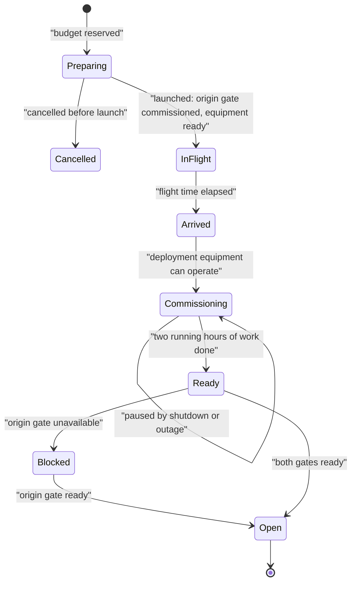
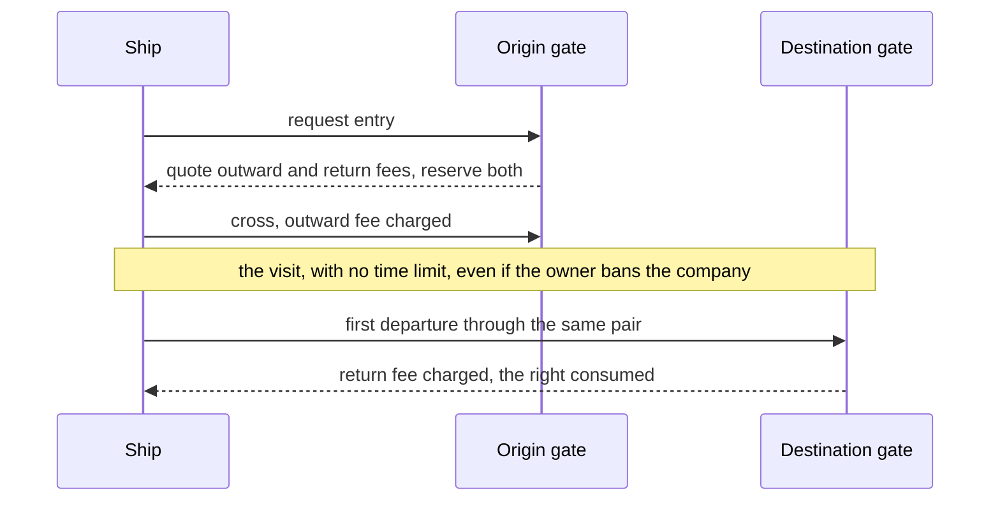

# Space: open plans

This document holds the open work on Manifest's space setting: the stargates that open new star
systems, the moongates that join the places round one planet, and the refinements waiting on the
traffic lanes, cruising and gates. What is built is in
[space: star systems, lanes, gates and cruising](space.md); read that first. The journeys a
company's ship makes on top of it are [travel](travel.md)'s.

Each section names its task in the [delivery order](delivery-order.md), which sets when it is done.
A rule marked *selected* is the user's decision; everything else is a proposal or an open question.

| Task | What it delivers |
| --- | --- |
| [L08](delivery-order.md#l08) | Several star systems in the hosted world, joined by lanes and gates, with journeys that survive a save |
| [L09](delivery-order.md#l09) | The stargate rules, and the space and engine parts they need |
| [L10](delivery-order.md#l10) | The first gate pair delivered to an unconnected system |
| [L11](delivery-order.md#l11) | Rival gate pairs into systems that already have one |
| [L12](delivery-order.md#l12) | Generated frontier systems published during live play |
| [L35](delivery-order.md#l35) | Moongates |
| [L36](delivery-order.md#l36) | Station traffic lanes (parked) |
| [L37](delivery-order.md#l37) | Cruising refinements |
| [L38](delivery-order.md#l38) | Gate refinements |

## Several systems in the hosted world (L08)

<a id="l08"></a>

L08 proves that the [hosted world](glossary.md#hosted-world) can hold several
[star systems](glossary.md#star-system) joined by [lanes](glossary.md#lane), and that a ship on a
journey between them survives a save, before any system is added while the world runs.

### What L08 already has

The `space` module has every part L08 needs, tested on its own fixture galaxy
(`source/game/space/tests/fixtures/systems/`: Halcyon, Vesper and Marrow in a line, two lanes):

| Part | Where | Tested |
| --- | --- | --- |
| A galaxy file: systems at positions in light years, lanes between jump points, a toll per light year | `Galaxy.h` (`ReadGalaxy`, `Resolve`, `CheckJumpPoints`) | `GalaxyTests.cpp` |
| Routes across several systems, by transit time or with each crossing costed | `Routes.h` (`PlotRoute`, `CrossingByCourse`) | `RoutesTests.cpp` |
| [Jumps](glossary.md#jump) along a lane, saved mid-transit and fast-forwarded | `Lanes.h` (`LaneTravel`, `EnterLane`) | `LanesTests.cpp` |
| [Gates](glossary.md#gate) that clear ships, queue them and charge a toll through the game's rule | `Gates.h` (`Gates`, `RequestTransit`, `TollRule`) | `GatesTests.cpp`, including a save with a ship cleared and one waiting |

### What L08 still needs

None of it is in the hosted world yet:

- Each scenario has one system (`data/scenarios/trading.yaml`: Anvil;
  `data/scenarios/governance.yaml`: Crucible), and neither system file has a jump point.
- Content reads no galaxy file, so `travel` never calls `LaneTravel::SetGalaxy`, and every
  `EnterLane` would be refused.
- `travel` attaches the lanes and cruising (`source/game/travel/src/Travel.cpp`, `Register`) but
  not `Gates`, so no gate entities are made and no toll rule is set.
- A journey is a cruise to a station of the ship's own system. It never plots a route or goes
  through a gate, so a venue in another system would fail with its cruise refused.

So L08 is the hosted half: a galaxy in content and its validation, a scenario of two or more
systems, the gates attached with a toll rule that charges the owner's
[account](glossary.md#account), journeys that cross a lane, and a save and a restore with a ship on
a lane and one cleared at a gate.

## Stargates (L09 to L12)

A stargate is how a new star system is opened for trade. Today a system is reachable only if
content joins it by a lane. The stargate plan makes opening one a project: a government or a
company pays to build a pair of gates, sends one across interstellar space on an unmanned carrier,
and opens the lane when both ends work. It is Manifest's long game of expansion and of monopoly:
whoever owns a gate controls who may use it.

<a id="l09"></a><a id="l10"></a><a id="l11"></a><a id="l12"></a>

The tasks build it in this order: the rules and the parts they need ([L09](delivery-order.md#l09)),
one pair to a system that exists but has no lane ([L10](delivery-order.md#l10)), rival pairs
([L11](delivery-order.md#l11)), then systems generated during play
([L12](delivery-order.md#l12)). The direction is [D-017](decision-ledger.md#d-017).

### Selected rules

| Rule | Selected |
| --- | --- |
| Who opens a system | A government or a [company](glossary.md#company) funds a stargate and ships it there physically. |
| The flight | Unmanned and automated, at a multiple of light speed. It progresses with no client connected, over server-running time. |
| Its duration | By distance, at a configurable speed. The first value to test is six server-running hours a light year. The rate and duration are fixed at launch. |
| The pair | Each connection is a fixed pair of gates. One gate does not serve several destinations; another destination needs another pair. |
| Construction | Both gates are built at an accessible origin. One is installed there; the other travels with the power, controls and equipment to deploy itself. |
| Commissioning | Two server-running hours of remote work after arrival, to test. The lane opens only when both gates are ready. |
| Initial ownership | The sponsor owns both gates: public assets for a government, company assets for a company. |
| Funding | A capped, reserved budget, paying for delivered equipment and completed services during preparation. |
| Access | The owner sets fees and may refuse anyone, rivals included. |
| The protected return | A ship that enters through a gate may always return once through the same pair, even if the owner bans it later. |
| Operating costs | Energy and supplies per crossing; no idle upkeep yet. |
| Rivals | Anyone may build an independent pair into a system that already has one, without the incumbent's permission. |

A stargate opens access, and nothing else. Building a spaceport, taking a region's government and
granting resource rights are separate operations. The gate grants no planet, settles no colony and
does not start the 72-hour exploitation term of a [concession](glossary.md#concession), which still
starts at an operational spaceport ([planetary development](planetary-development-plan.md),
[L06](delivery-order.md#l06)).

### An expedition's life

An expedition goes through these states. Each is saved, and each is shown to the players apart:
arrival is not the lane opening.



A prepared or flying gate is not a route. The lane is published only when both ends are installed,
commissioned and ready. A retry or a recovery cannot make a second gate or a second connection.

### Funding and launch

The sponsor's budget is authorised and reserved up front, capped. A government spends its region's
public funds; a company spends its own. Public financing does not move the gate to the
[governor](glossary.md#governor)'s company, and public procurement rules apply when a government
[tenders](glossary.md#tender) the supplies.

- **Preparation.** Delivered equipment and completed services are paid from the reserve. Paid
  credits are spent: they cannot be refunded or used for another project. A project that would
  exceed its budget pauses until its sponsor authorises more.
- **Launch.** It needs the origin gate commissioned, and the remote gate, carrier, FTL drive,
  power, controls, deployment equipment and consumables physically ready and assigned. Promised
  future stock is not enough. Remaining contracted services are funded before departure, so a
  launched mission needs no further payments.
- **Cancellation before launch.** It releases only uncommitted funds. Equipment stays the
  sponsor's, paid work stays paid, and awarded supply contracts keep their obligations.

Gate equipment in flight is committed property: not origin inventory that can be spent, nor a
duplicate at the destination.

### Commissioning and the one-way carrier

Remote commissioning starts when the expedition has arrived and its equipment can operate. It needs
no crew, no staffed port and no existing gate at the destination. Two server-running hours is the
first value to test, quoted before launch.

- A server shutdown or an equipment fault pauses the work; a disconnected client does not.
- Completed work is saved and resumes after a restart, without starting over or using another kit.
- Faster simulation stepping cannot complete it: it counts running time, not steps.

The carrier goes one way. Its power, controls and installation hardware become part of the remote
gate, in the sponsor's asset accounts, and its cost is part of the budget. It leaves no reusable
ship and pays out no salvage.

### Flight time

Flight time is quoted from the systems' galaxy positions, not from a route, since the expedition
goes where no lane leads yet. The proposed formula is:

```text
running duration = distance / (FTL speed × expedition pacing)
```

FTL speed is a multiple of light speed. Pacing turns fictional travel time into server-running
time; it is a quoting value, not the measured step rate or a client's playback speed. At the
selected six hours a light year, uninterrupted:

| Separation | Flight | Flight and commissioning |
| --- | --- | --- |
| 2 light years | 12 running hours | 14 running hours |
| 4 light years | 24 running hours | 26 running hours |
| 8 light years | 48 running hours | 50 running hours |

These are starting values for balance tests, not measurements. Preparation adds time, and a paused
commissioning or an unavailable origin gate delays the opening.

The launch terms are saved and frozen: origin and destination, distance, FTL multiple, pacing, the
unit convention's version and the quoted duration. A later change of settings applies to later
launches only. Invalid terms are refused: values that are not finite, an FTL multiple of one or
less, a pacing or duration of zero or less, an unknown system. Twice the distance takes twice the
time; no clamp or fixed wait replaces that. The zero-distance case must be specified, so that it
cannot open a second system at once.

### Running time

An expedition, like the exploitation term, counts server-running time: time the server is up,
observed by the host and recorded with the world. No running-time clock exists in Manifest today;
the same bridge is needed by [L06](delivery-order.md#l06).

- Shutdown consumes no flight time; disconnection does not pause it.
- Wall-clock reads stay out of deterministic systems and replay. The host records elapsed
  observations, and the world applies them as ordered events.
- Elapsed progress is saved in the same [journal](glossary.md#journal) batches as the expedition,
  under the journal's bounded crash-loss contract ([saves](persistence.md)), not counting downtime.
- When an arrival falls due, arrival and successful deployment are told apart. A blocked deployment
  is shown, and time elapsing alone cannot invent a connection.

### Connection and topology

Choosing a target, generating it, arriving, activating the lane and opening the system to trade are
separate saved states. A target may be catalogued or generated before arrival; when to generate or
reveal it is open.

Activating a connection adds to the galaxy at one controlled point in the step:

- existing systems, identifiers, route destinations and journeys survive it;
- the generated system and the lane's identity are saved before the activation is acknowledged,
  and restored before entities and transit on a restart;
- content's definitions, archives, the VFS and registries are reused: no second galaxy loader.

### Gate permits and the protected return

An operational gate's owner sets its fees and may refuse anyone. Ownership and policy changes are
saved; payment and access are checked when a crossing is applied, and refusals are visible to
[NPC traders](glossary.md#npc-trader) and route queries. A policy change cannot strand or
confiscate ships or cargo.

Entry buys the protected return. The diagram shows one visit to a destination through a pair.



- The outward and return fees are quoted and reserved together before entry. Each is charged once,
  when its crossing commits.
- Accepted terms hold through later price rises and bans. A displayed quote or a pending request is
  not permission; new permits take the current policy.
- The right belongs to that ship and that pair, with no expiry while the ship stays in the
  destination system. Its first departure closes the visit: back through the pair consumes it,
  out by another route releases the unused return fee.
- A return crossing creates no new right, so no ship can hold an unlimited pass.
- The right, the reservations, the charged fees and the outcome are saved with the ship's visit,
  through disconnection and recovery.
- The expedition carrier is not traffic and gets no return.

Fee amounts, and the detailed quote and acceptance checks, are open. Fees are whole
[credits](glossary.md#credit), on the existing ledger.

### Operating supplies, outages and closure

Each crossing consumes energy and supplies; idle upkeep is deferred. The goods, quantities and
recipes are open.

- **Reservation.** At admission the owner reserves the physical supplies the protected return will
  need, until the visit closes. They must exist, and cannot be promised to two ships. The
  passenger's reserved fee is a separate, financial commitment.
- **Shortage.** It stops new admissions; supplies reserved for returns stay reserved.
- **Outage.** A genuine fault blocks service visibly and keeps every right and fund until repair.
  Refusing by policy, or withdrawing reserved supplies, is not an outage and cannot revoke a
  return.
- **Closure.** The owner may close to new business at once, but honours accepted passages and
  returns. Dismantling waits until those end, which may be never: a visiting ship's return right
  does not expire. Closure forces no departure and confiscates nothing.

Fault criteria, repair work, compensation and recurring maintenance are open; no random breakdowns
are selected. Removing a gate from a live galaxy safely, and any salvage payout, need their own
design.

### Rival connections

A government or a company may fund its own pair into a system that already has one, without the
incumbent's permission, including a parallel pair between the same two systems
([L11](delivery-order.md#l11)).

- Each pair has its own gates, owner and access policy; no owner's gate is shared automatically.
- The rival's remote gate flies on its own expedition, under the same rules, and the incumbent's
  ban cannot stop that flight.
- The rival still needs an accessible origin and its own equipment.
- A gate does not bypass protected planets or active resource concessions, and grants no
  sovereignty or veto over building in the system. A concession's expiry lets rivals exploit the
  planet, but does not oblige a private gate's owner to carry them.

Independent pairs let a rival break a gate monopoly with capital and time. Whether that is
affordable or profitable has not been measured.

### Open questions

- Equipment recipes, quantities, credit costs and origin construction time.
- Post-launch cancellation, recall, failure and salvage; competing expeditions to one target.
- A per-system gate limit, gate-site placement, retargeting, and delivering gate equipment through
  an existing network.
- Joint ownership, selling one gate of a pair, transferring ships or gates, repair and compensation.
- When a target system is generated and revealed, and the zero-distance case.
- No random losses, combat or guaranteed exclusivity are selected.

### What the space module gives it, and the gaps

The parts are Manifest's `space` module since the space extraction; Jettison keeps only the
neutral transit parts ([Jettison's transit](../../jettison/docs/transit.md)). A gap below is
Manifest's to close unless it is a reusable engine seam, which goes to Jettison with a consumer
of its own there.

| Mechanic | What exists | The gap |
| --- | --- | --- |
| Distance | `GalaxySystem::position`, in light years (`Galaxy.h`) | None for the quote. |
| Travel where no lane leads | `PlotRoute` and `EnterLane` need a lane (`Routes.h`, `Lanes.h`) | An expedition is not a lane journey: a new running-time movement of Manifest's own. |
| Arrival over running time | A lane's transit is in simulation steps (`OnLane`) | A running-time clock and arrival events from the host (see [running time](#running-time)). |
| Owner's fees and refusals | `TollRule`'s `refuses` and `charge` are given the registry, the ship and the toll (`Gates.h`) | The rule is not told which gate or lane, so it cannot apply one owner's policy; tolls are one galaxy-wide rate a light year. |
| A fixed pair | A `JumpLane` joins two jump points, and `Resolve` lets a jump point end only one lane (`Galaxy.h`) | Making, delivering and activating the pair at once, and recovering it. |
| A lane added while running | `LaneTravel::SetGalaxy` sets the galaxy whole | Adding a lane or a system without disturbing journeys on the others. |
| Another gate in a system | `Gates::DefineStarSystem` refuses a system defined twice, and `MakeGates` makes a system's gates once, together (`Gates.h`); so does `Space::DefineStarSystem` for its frame (`StarSystemFrame.h`) | Adding a jump point and its gate to a defined system, keeping the existing ones and their saved state. |

### Acceptance

The tests each task must add. None has run.

- [ ] Two systems that exist, plus one with no lane; then a generated target added, and a rival
      pair into a system already connected.
- [ ] A government and a company fund expeditions without mixing accounts.
- [ ] Launch refused, all or nothing, for missing equipment or funds, or an uncommissioned origin
      gate.
- [ ] The budget reserved and paid without double spending; an overrun waits for an explicit
      increase; a launched mission needs no top-up.
- [ ] Cancellation before launch keeps equipment ownership and supplier obligations.
- [ ] A flight progresses with no client; different distances give the quoted durations; a
      shutdown pauses it; fast stepping does not replace elapsed time. All on an injected host
      clock.
- [ ] Commissioning: eligible work counted, pauses for shutdown and faults, a restart after
      partial work, an unavailable origin gate delaying the opening.
- [ ] Flight and commissioning do not count time or installation inputs twice; the carrier's
      equipment is incorporated once, with no duplicate gate or reusable ship.
- [ ] Replay and recovery keep equipment, funding and progress, and apply the activation once.
      A crash round arrival, deployment or publication neither duplicates a gate nor shows a
      half-connected route. Journeys under way still arrive.
- [ ] Each pair connects only its own gates and cannot be switched to an unfunded destination.
- [ ] Permits: both fees reserved and each charged once; price and ban changes before and after
      acceptance; a return after a long stay; another exit releasing the return fee; a reverse
      arrival minting no right; NPCs and players treated alike; restart at acceptance and at each
      crossing.
- [ ] Operating: physical return supplies reserved by the owner and never promised twice;
      shortage and closure refusing new entries but keeping old rights; outage and repair;
      dismantling blocked by outstanding obligations.
- [ ] Rivals: the incumbent's ban neither blocks the rival's expedition nor changes the rival's
      policy, fees or ownership; existing journeys, gate obligations and concessions survive the
      added gates and a recovery.
- [ ] Any engine seam provisioned for this has a consumer in Jettison that exercises it without
      Manifest's economy.

## Moongates (L35)

<a id="l35"></a>

A moongate works as a stargate does, for a fee, but joins only the places round one planet or moon:
its stations, its moons and other places near it, within one star system
([D-091](decision-ledger.md#d-091), selected 2026-11-20). It is the fast way locally, as the
stargate is between systems: in the Manifest game mode a cruise is limited by acceleration
([D-090](decision-ledger.md#d-090)), so a local trip takes minutes to hours.

The fixture systems' "moon gates" (`halcyon.yaml`, `vesper.yaml`) are not moongates: they are lane
ends that orbit a planet rather than the star.

Open before it is planned: the fee, which places each moongate connects, its transit time, and
whether the local transit is a new portal of Manifest's or a reusable part for Jettison. It waits
on W05 and W17, both done.

## Station traffic lanes (L36, parked)

<a id="l36"></a>

The user parked this on 2026-11-22. It would have every departure, arrival and cruise between the
stations of one orbit share lanes, as roads and Freelancer's paired trade lanes do.

**Why it is parked.** The hosted fixture `fixture_traffic` (`source/test/FixtureTests.cpp`,
"Ships flown both ways between neighbouring stations of one orbit keep clear of each other")
measured the traffic of Ore's orbit without lanes. Six starter ships flown both ways between Ore
Highport and Vale, some sent in one step and some crossing at a station, came no nearer than 198 m
hull to hull, against steering's 20 m clearance. Leaving took 52 to 70 s and coming in 87 to 98 s.

Opposite flows do not share a line on an orbit. Each cruise aims where its target will be, and the
stations move about 15° an hour, so the two ways' courses an hour apart are 5,400 km apart. Ships
going the same way fly one line 6 to 70 m apart, separated by leaving seconds after one another; a
departure passes about 800 m from an arrival; a station's pads bound how many leave at once.

**When it is taken up.** When `fixture_traffic` fails, or traffic it does not cover needs it: a
station with more pads, larger hulls, a busier orbit.

**The design, settled with the user.** Every cruise from a station flies one of several lanes each
way, kept to the right of its way. Lanes are held as pads are, and run from gate to gate.
Departures leave above the orbit's plane and arrivals come in below it. The lanes come first, the
way in's corridor after. They are Manifest's `space`, on Jettison's
[slots](../../jettison/docs/transit.md#slots-and-gated-portals) and
[portals](../../jettison/docs/transit.md#portals).

## Cruising refinements (L37)

<a id="l37"></a>

What a cruise does not do yet ([cruising](space.md#cruising) is what it does):

- **A cruise to a ship**, rather than to a body.
- **A cruise broken off part-way**, as a privateer's would be. The cruise knows where the ship is
  every step, so this is possible.
- **A curved course** that bends round a body, rather than turning at waypoints, which the ship does
  within a step.
- **A body in the way placed better.** It is placed where it will be as the ship passes, by time
  alone; a planet neither end orbits is placed half-way and widened by half its own motion.
- **Moving off.** A cruise's arrivals are spread clear of each other, but a ship that came out at
  rest is not moved if another then arrives in its place.

## Gate refinements (L38)

<a id="l38"></a>

What a gate does not do yet ([gates](space.md#gates) is what it does):

- **A waiting ship is not placed.** A trader waits where its cruise left it, spread from the others
  only as arrivals are.
- **No command gives up a clearance.** A clearance ends only by lapsing or by its ship leaving the
  gate's frame.
- **No licence or standing check.** The clearance's check would take one when the game has
  factions (decided; perhaps as an input a script answers).
- **No shortcut jump.** All travel is through gates (decided 2026-11-14). The retired space sample's
  tools jumped a ship along a lane from anywhere, past the gate and its toll; Manifest has no such
  command, and any tool added later goes through a gate.

The presentation of space (a jump's cutscene, the destination's models held while they stream in,
a body's look as data, the station dressing, thruster glow and ports) is the graphical client's:
[L15](delivery-order.md#l15), in the [roadmap](roadmap.md#the-graphical-client).

## Decisions

The settled choices are in
[decisions](decision-ledger.md#space-star-systems-lanes-gates-and-cruising): stargates
([D-017](decision-ledger.md#d-017)) and moongates ([D-091](decision-ledger.md#d-091)), with the
cruise limited by acceleration ([D-090](decision-ledger.md#d-090)) as the reason both are wanted.
How this plan came to be is in
[the 2026-11-15 planning record](history/planning-2026-11-15.md#stargate-lifecycle-and-competing-access-follow-up--2026-11-15).
