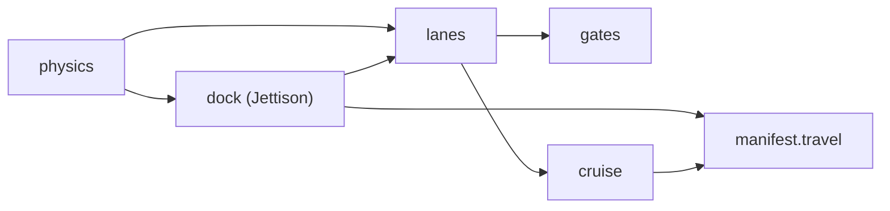
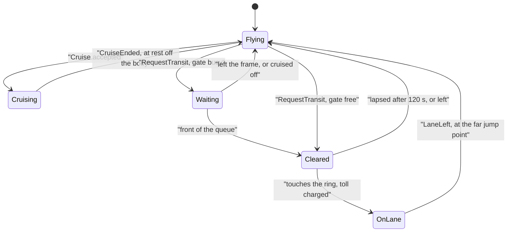

# Space: star systems, lanes, gates and cruising

<a id="space"></a>

The `space` module is Manifest's space setting. It holds the star systems and their orbiting
bodies, the galaxy of lanes between them, and the three ways a ship moves through them: a cruise
across one system, a jump along a lane to the next, and the gate that sends a ship down a lane.
It is built on neutral engine parts (frames and rails, passages, portals and slots, steering, the
docks), and the engine names none of it. It came to Manifest in Jettison's space extraction of
2026-11-23 ([Jettison's record](../../jettison/docs/history/space-extraction.md)).

This document covers what the module does and how a game uses it. The journeys a company's ship
makes, and the fuel they burn, are [travel](travel.md)'s; the open work on space is in
[space: open plans](space-plan.md).

## Concepts

| Term | What it is |
| --- | --- |
| [Star system](glossary.md#star-system) | A star, its planets and moons, its stations and its jump points, each body on a Kepler orbit about its parent. One system is one physics frame. |
| Body | One member of a system: a `Star`, `Planet`, `Moon`, `Station` or `JumpPoint` (`Space::BodyKind`). |
| Galaxy | A graph: each star system is a node at a position in light years, and each [lane](glossary.md#lane) is an edge. |
| [Lane](glossary.md#lane) | A two-way link between a jump point in one system and a jump point in another, with a transit time in simulation seconds and a toll. |
| Jump point | A body where a lane ends. Each jump point ends at most one lane, so it says where it leads. |
| [Jump](glossary.md#jump) | A ship's passage along a lane: out of its system, in none for the transit time, then out at the far jump point. |
| [Gate](glossary.md#gate) | The entity at a jump point that clears ships, one at a time, and sends a cleared ship along its lane when it flies through the ring. |
| Cruise | A ship's passage across its own system to one of its bodies, out of physics, placed each step along a course round the bodies in the way. |
| Cruise drive | How long a ship's cruises take: a power law of the distance, or a [cruise profile](glossary.md#cruise-profile) of accelerations. |

The engine terms used here are Jettison's:
[frame](../../jettison/docs/glossary.md#frame-coordinates),
[local frame](../../jettison/docs/glossary.md#local-frame),
[rails](../../jettison/docs/glossary.md#rails),
[passage](../../jettison/docs/glossary.md#passage),
[portal](../../jettison/docs/glossary.md#portal),
[slot](../../jettison/docs/glossary.md#slot),
[motion profile](../../jettison/docs/glossary.md#motion-profile),
[controller](../../jettison/docs/glossary.md#controller) and
[reason](../../jettison/docs/glossary.md#reason).
How passages, portals and slots work in general is in
[Jettison's transit](../../jettison/docs/transit.md); how a frame model's rails and gravity work is
in [Jettison's physics](../../jettison/docs/physics.md#frame-models-rails-and-gravity).

### Why a ship leaves physics to travel

A star system is too big to fly across under physics. In the trading scenario's system, Anvil
(`data/systems/system-anvil.yaml`), each station is 42,000 km from its planet, and the two planets
are tens to hundreds of millions of kilometres apart. Physics would take days of steps to fly that,
and its single-precision bodies are kilometres apart that far from a frame's origin. So a cruise
and a jump take the ship out of physics, place it on a course the simulation solves, and give
its body back at rest where it arrives
([Jettison: why travel leaves physics](../../jettison/docs/transit.md#why-travel-leaves-physics)).
A ship's frame changes only at those ends.

## How it works

The module gives a simulation world three attachable parts, each a set of components, a command
and a system: lane travel (`LaneTravel`), the gates (`Gates`) and cruising (`CruiseTravel`).
Each is given the star systems it serves as definitions at start-up; they are not world state, so a
save names systems and bodies by name, and a world it loads into must be given the same systems.

Their systems run after physics, in this order within the step. The diagram shows only the
ordering the space parts declare; [the step, in order](architecture.md#the-step-in-order) is the
whole table.



A ship moves between three states. The diagram below shows them, and the command or event that
moves it from one to the next.



### Star systems and the galaxy

A star system (`Space::StarSystem`, `StarSystem.h`) is a list of bodies, parents before children.
Each body names its parent and has orbital elements (`Orbit.h`), a spin, a radius and, if anything
orbits it, a gravitational parameter (GM). A station also names its layout, a Jettison
`Dock::PlatformLayout` ([docks](../../jettison/docs/docks.md)). An orbit is evaluated at the
simulation time, never integrated, so a body is where the clock says it is in every build and after
every save. A period left at zero is derived from the parent's GM by Kepler's third law.
`Space::Resolve` checks a system and fills in what data leaves out: one primary, listed first;
each parent named and listed before its child; unique names; eccentricities in [0, 1); no negative
radius or period. Reading a system file resolves it.

`Space::DefineStarSystem` (`StarSystemFrame.h`) makes a resolved system a physics frame, named by
the system's name (`Sim::FrameId`). Its bodies are what rails and local frames name: an entity on a
station's rails follows the station's orbit. Each body with a GM pulls as a point mass. A jump
point is turned the way it faces (`Space::JumpPointFacing`): towards the planet or moon it orbits,
so a ship coming out sees its planet, with its station in front.

The galaxy (`Space::Galaxy`, `Galaxy.h`) lists each system by name, with its system file, an
optional scene file and its position in light years, and each lane by its two ends and its transit
time. `Space::Resolve` on a galaxy checks that lane ends are in two different listed systems and
that no jump point ends two lanes. It also fills in each lane's toll: the light years between its
systems at the galaxy's `tollPerLightYear`, rounded to whole [credits](glossary.md#credit).
`Space::CheckJumpPoints` checks a system's file against the lanes that end in it. A jump point no
lane ends at is allowed: a gate that leads nowhere yet. `Space::Exits` and `Space::ExitThrough`
give the lanes out of a system.

`Frames.h` holds the position types (`SystemPosition`, `LocalPosition`) and the floating origin
for presentation (`ToRenderSpace`), after
[Jettison's coordinates](../../jettison/docs/coordinates.md).

#### Routes

A route (`Space::PlotRoute`, `Routes.h`) is the quickest way from a place in one system to a
place in another. Its graph is the galaxy's jump points. A lane joins its two ends at its transit
time, and within a system every jump point leads to every other at what crossing the system costs.
The caller gives that cost (`Space::CrossingCost`); without one, a route is the least transit
time. `Space::CrossingByCourse` builds a cost from the length of a course through the system's
waypoints, round its star, planets and moons
([Jettison: courses](../../jettison/docs/ai.md#courses)),
at a speed or by a cruise drive's time. The search is Jettison's A* (`Ai::FindPath`) with no
estimate, so Dijkstra's, and deterministic: the same galaxy, systems and time give the same route.

### Jumps

A jump carries an entity along a lane (`Lanes.h`), as one of Jettison's
[portals](../../jettison/docs/transit.md#portals). The command `Space::EnterLane`, from a sender
that commands the entity, sends it out through a jump point:

- its `Sim::InFrame` becomes no system, and a `Space::OnLane` records where it left, where it is
  going and the step it arrives in (the transit's seconds, rounded up to whole steps, at least one);
- physics removes its body, which ends every contact it had;
- it gives up its steering destination, which was in the system it left.

The refusals, each a `Space::LaneRefused` with a reason, are: a sender that does not command it,
an entity in no system of the galaxy (on a lane already, say), a cruising entity, and a jump point
no lane leaves through.

The `lanes` system brings each entity out in the step its transit ends, and raises a
`Space::LaneLeft`. A ship with a body comes out:

- at rest in the frame of the station the far jump point orbits, or else the jump point's own
  frame, so it meets and docks with the station without changing frames;
- facing the way the gate faces, with its flight controls taken against nothing, since what they
  were taken against is a system away;
- ahead of the ring, clear of its sensor by half the ring's depth (`Gates::kRingDepth`, 60 m), its
  hull and `LaneTravel::kArrivalClearance` (20 m), so the gate does not see it pass through;
- clear of every body already there and of what came out before it in the step, on rings about the
  place, each a hull's breadth and 20 m further out (Jettison's `Transit::ClearPlace`), so two
  ships through one gate a moment apart do not come out inside each other.

Physics makes the body again in the next step. Entities arrive in entity order.

### Gates

A gate (`Gates.h`) sends the ships it has cleared, as a gated portal whose clearance is a
[slot](../../jettison/docs/transit.md#slots-and-gated-portals). Each jump point's gate is an entity,
`Space::Gate`, made at the start by `Gates::MakeGates` and saved after. It is a kinematic sensor on
the jump point's rails: a cylinder of the jump point's radius and 60 m deep (`Gates::RingShape`),
turned as the jump point faces (`Space::BodyOrientation`).

Who holds a gate is state every player sees the same, so it is given by commands in the order they
apply, as a station's pad is. `Space::RequestTransit`, with its sender, clears a ship at once if the
gate is free, or puts it at the back of the queue (`Space::TransitQueued`, with its place). The
gate's clearance is the slot; the ship's `Space::Transit` is its claim. The checks, each refusal a
`Space::TransitRefused` with a reason, are:

- the sender commands the ship;
- the ship is a dynamic body off rails, not on a lane or cruising, in the gate's system and frame;
- it is not already cleared or waiting at a gate;
- a lane leaves through the gate, to a defined system;
- the hull fits the ring (its shape's radius against the jump point's);
- the game's toll rule does not refuse it.

The toll rule (`Space::TollRule`, set by `Gates::SetTollRule`) is the game's say. Its `refuses` is
asked whether the ship's owner can pay a lane's toll, and its `charge` takes it. Without a rule,
every lane is free.

Each step, after the lanes', the `gates` system, in entity order:

1. Gives up a clearance or a place whose ship has gone, is on a lane or cruising, or has left the
   gate's system or frame (`Space::TransitLapsed`).
2. Sends each gate's cleared ship that touches its ring along the lane, applying `EnterLane`, and
   charges its owner (`Space::TransitSent`, with the toll). The rule is asked again first, since
   the owner may have spent the credits; if it refuses, the ship passes through unsent. Any other
   body that began to touch a ring passes through too, saying why (`Space::GatePassed`), and is
   charged nothing.
3. Lapses each clearance unused for `Gates::kClearanceSeconds` (120 s), freeing the gate.
4. Clears the next ship in each free gate's queue (`Space::TransitCleared`, with the toll and the
   step it lapses at).

A ring is placed, not swept. A ship crossing it at under its depth a step, 60 m at 60 steps a
second or 3.6 km/s, is seen.

### Cruising

A cruise takes a ship to a body of its own system, or to another ship in it (`Cruise.h`), as one of
Jettison's [passages](../../jettison/docs/transit.md#passages). The command `Space::Cruise`, with its
sender, names the ship and the body, or a `targetShip`. An accepted cruise raises
`Space::CruiseStarted`, with its seconds and metres. The ship leaves physics and its local frame; its
body is kept in its `Space::Cruising`; it gives up its steering destination, so it comes out still.
Each step the `cruise` system, after the lanes', places it along its course.

The refusals, each a `Space::CruiseRefused` with a reason, are: a sender that does not command the
ship; a ship on a lane, in no system or in an undefined one; one already cruising; one that is not a
dynamic body with a `Space::CruiseDrive`, or is on rails (clamped to a pad); a body the system does
not have; a target ship that is the ship itself or not placed in its system (`NoSuchTarget`); a ship
within a station's reach; a ship already within reach of where it would arrive; and a course blocked
every way.

A cruise does not engage within `CruiseTravel::kStationReach` (2 km) of a station's radius, so
docking stays in physics. `Space::ClearOf` plans the flight out first: to 300 m beyond the reach on
the side of the target, round the station's sphere, for a steering destination. [Travel](travel.md)
flies a ship out this way before it cruises.

Where a cruise arrives (`CruiseTravel::ArrivalDistance`) is 1.25 times the target's radius plus
4 km from its centre, so a ship is a few kilometres off a station or a gate and clear of a planet's
air. It is also no nearer a body with gravity than where the body pulls at 1 m/s², which a ship's
flight assist can hold against. It comes out at rest, facing the target, in the target's frame, or the
station's for a jump point that keeps station by one, as a lane's arrival does. Its arrival place is
kept clear of other bodies in the same way as a lane's, it is marked `Space::CameOut`, and a
`Space::CruiseEnded` is raised.

How a course is solved, as the command is applied (`Space::SettleCruise`):

- **The target's place.** The bodies are on rails, so where the target will be on arrival is solved,
  not chased. The time and the target's place are each found from the other, in eight rounds
  (`kSolveIterations`).
- **The course.** A few legs round the stars, planets and moons in the way, 2 km clear of each
  (`kCourseClearance`, Jettison's `Ai::Waypoints`). It is plotted relative to its carrier, the nearest
  body both ends orbit (the planet between two of its stations, the star between two planets), and
  moves with it. Each turn at a waypoint is bent round on a curve of 16 points (`kBendPoints`) from
  half-way along the leg into it to half-way along the leg out, cut nearer the waypoint where it would
  come within a body's clearance, so a ship's nose turns a few degrees at a time, not all at once in a
  step.
- **The bodies in the way** are placed where they are as the ship passes nearest each, found by
  sampling the cruise as it would be flown 64 times (`kPassSamples`), closer together towards the
  ends, and widened by how far each moves to the samples beside. A body the ship sets out or arrives
  beside, and passes nearest there, is where it is then and not widened.
- **The time.** The ship's drive gives it, in whole steps, at least one; on a profile, the fewest in
  which it covers the course, so no step accelerates past its boost.

**The velocities at its ends.** A ship leaves moving as it was, relative to its carrier: its frame's
velocity and its own (`Cruising::departureVelocity`); and arrives moving as the frame it comes out in
does (`arrivalVelocity`), so it comes out at rest in that frame without a jump. On a profile, each
velocity's speed along the course at its end is the profile's to meet (Jettison's
[end speeds](../../jettison/docs/transit.md#end-speeds)), and the rest is carried off the course by a
drift (`Transit::Drift`) that is none at either end. A drive that crosses (below) leaves and arrives at
rest on its thrusters relative to the course, so its drift carries each velocity whole; any other
drifts the whole of each where its profile cannot meet the speeds (`Transit::CheckEnds`). A drive with
no profile eases out and in, at rest relative to its carrier at each end. The drift's acceleration, at
most six times the larger velocity over the cruise's time, is not in the drive's thrust, and a
journey's fuel is still priced from rest to rest ([travel](travel.md)).

**To a ship.** A cruise to a ship is plotted to where the ship would be if it held its velocity in its
frame, `CruiseTravel::kShipStandoff` (1 km) off it. Each step its course's end is aimed again at where
the ship then is, so it closes on the ship however it moves; such a cruise is never passed over by
the fast-forward. It comes out in the ship's frame, moving as the ship does in it. A target ship that
leaves the world or the system breaks the cruise off.

**Broken off.** `Space::BreakOffCruise` ends a cruise part-way, as a privateer's would be: the ship
comes out where it is, its body back, in its carrier's local frame, moving as its cruise had it over
the last step, which physics then holds to its speed limit (`PhysicsSettings::maxLinearVelocity`, 100
km/s by default). A `Space::CruiseBrokenOff` is raised; a ship not cruising is refused
`NotCruising`.

**Moving off.** A ship that came out of a cruise at rest (`Space::CameOut`) and is still within 50 m
of where it came out (`kStillThere`), steered nowhere and clamped to nothing, is made to move off when
another arrives in its place: the arrival comes out clear of it, and it is given a steering
destination `kMoveOffDistance` (250 m) further from the arrival. A ship given a destination, docked or
flown away is left to its way.

A cruise drive (`Space::CruiseDrive`) is on every ship that cruises. With no profile, a cruise of
`reference` metres takes `seconds`, rising as the distance to the `exponent` (a fourth root in
Manifest's drives). With a profile (Jettison's `Transit::MotionProfile`,
[motion profiles](../../jettison/docs/transit.md#motion-profiles)), the time is the profile's: a
boost acceleration for at most a time, half at each end, and a sustained one between. Which a
ship uses is the [game mode](glossary.md#game-mode)'s choice. The Manifest mode gives every drive
its `cruise` profile, manned or unmanned by whether the hull carries people; Astralis keeps the
power law ([D-090](decision-ledger.md#d-090)). The fuel a profile burns is [travel](travel.md)'s.

A drive with a profile may also have a `departureClearance` and an `arrivalClearance`: the metres
at the start and the end of its course it may not thrust over, which [travel](travel.md) writes for
each journey from the hull's drive class ([ships plan](ships-plan.md#the-radius-about-populated-bodies)).
The ship crosses each on its thrusters, from rest to rest at `CruiseTravel::kCrossingAcceleration`
(15 m/s², every ship's reverse thrust), each at most half the course, and the drive's profile covers
what lies between (`CruiseSeconds`, `DriveMetres`). The crossings are part of the cruise, out of
physics, so the fast-forward passes over them: steering would hold a ship to its thrusters' 150 m/s,
nearly two hours for 1,000 km, every step of it run. A clearance of 0, the torch's, crosses nothing.
The drift keeps a crossing ship moving with the station it left, and with the one it reaches, as a
ship leaving orbit keeps its station's motion.

A cruise with a crossing is checked as flown (`SettleCruise`): sampled each minute while the drive
thrusts or the ship crosses and each hour while it coasts, and sooner where a fast ship nears a
sphere, it may not thrust within any of the drive's `keepouts`, the spheres travel writes about each
end's stations and populated planet. A sample too near lengthens that end's crossing past the sphere,
and the cruise is solved again, at most `kClearanceRounds` (4) times before it is refused
`InsideRadius`. Travel settles the same cruise to price a journey; the cruise's start settles it again
from where the ship has cleared to and flies that.

Cruising works with [fast-forward](glossary.md#fast-forward): between departure and the step before
arrival, a cruise to a body has nothing to decide, so its steps are [quiet](glossary.md#quiet-step)
and the ship is placed where the last skipped step would have put it. Lanes and gates also report
their next busy step: a lane its next arrival, a gate its next lapse, or every step while a ship is at
a gate.

### What the hosted game uses today

The [hosted world](glossary.md#hosted-world) uses only part of the module. `Travel::Register`
(`source/game/travel/src/Travel.cpp`) attaches lane travel and cruising, and defines each of the
scenario's systems in physics, the lanes and the cruises. A journey crosses one system by cruising.
It gives the lanes no galaxy, so every `EnterLane` is refused, and it does not attach the gates.
The scenario systems (`SystemAnvil`, `SystemCrucible`) have no jump points.

Lanes, gates and routes are built and tested in the `space` suite, on the fixture galaxy of
Halcyon, Vesper and Marrow (`source/game/space/tests/fixtures/systems/`). Bringing them into the
game is open work ([L08](delivery-order.md#l08)).

A scenario's `systems` list also says which systems are directly connected (`connections`). That
list is not the galaxy: it decides a new player's starting market reports
([D-095](decision-ledger.md#d-095)), and a scenario's content check holds it symmetric.

## Using it

### A star system file

A system is authored under `data/systems/`, one file a system, named by its scenario ID;
`data/build.sh` writes it as a `Space.StarSystem` record to `definitions/systems/`. Its stations
are named by their venue IDs ([content](content.md)). From `data/systems/system-anvil.yaml`:

```yaml
version: 1
name: SystemAnvil
bodies:
  - name: StarAnvil
    kind: Star
    radius: 6.957e8
    gravitationalParameter: 1.32712440018e20
  - name: PlanetOre
    kind: Planet
    parent: StarAnvil
    radius: 6.371e6
    gravitationalParameter: 3.986004418e14
    orbit: {semiMajorAxis: 1.496e11, eccentricity: 0.0167}
    rotation: {period: 86164.0905, axialTilt: 0.4091}
  - name: VenueOreHighport
    kind: Station
    parent: PlanetOre
    radius: 763
    orbit: {semiMajorAxis: 4.2e7}
```

Units are metres, seconds and radians. The station's period is left out, so it is derived from
`PlanetOre`'s GM. A jump point is a body of `kind: JumpPoint` whose radius is the ring's, as
`Halcyon Gate` in `source/game/space/tests/fixtures/systems/halcyon.yaml`.

### A galaxy file

From `source/game/space/tests/fixtures/systems/galaxy.yaml`, three systems in a line. Vesper is 4
light years from Halcyon, so the first lane's toll is 2,000 credits:

```yaml
version: 1
name: Sample
tollPerLightYear: 500
systems:
  - name: Halcyon
    system: systems/halcyon.yaml
    scene: scene/orbit.yaml
    position: [0, 0, 0]
  - name: Vesper
    system: systems/vesper.yaml
    position: [2.4, 3.2, 0]
lanes:
  - a:
      system: Halcyon
      jumpPoint: Halcyon Gate
    b:
      system: Vesper
      jumpPoint: Vesper Gate
    transitSeconds: 40
```

### A drive and a cruise profile

A drive is authored per hull under `data/docks/drives/`, named by its `Manifest.Hull`; a hull
without one fails the content check. From `data/docks/drives/hull-lone-trader-starter.yaml`:

```yaml
version: 1
seconds: 40
reference: 1.0e8
exponent: 0.25
```

The Manifest game mode replaces the power law with a profile, in m/s² and seconds, from
`data/game-mode/manifest.yaml`:

```yaml
cruise:
  manned: {boostAcceleration: 19.6133, boostSeconds: 14400, sustainedAcceleration: 9.80665}
  unmanned: {boostAcceleration: 117.6798, boostSeconds: 0, sustainedAcceleration: 117.6798}
```

### Attaching lanes and gates

A game's start-up attaches physics, then the lanes, then the gates, defines each system in all
three, gives the lanes the galaxy, sets a toll rule and makes the gates. Condensed from the fixture
in `source/game/space/tests/GatesTests.cpp`, where a test component `Credits` stands in for an
owner's account:

```cpp
Jettison::Physics::PhysicsWorld &physics = Jettison::Physics::PhysicsWorld::Attach(world);
Manifest::Space::LaneTravel &lanes = Manifest::Space::LaneTravel::Attach(world, physics);
Manifest::Space::Gates &gates = Manifest::Space::Gates::Attach(world, physics, lanes);
for (const Manifest::Space::StarSystem &system : {AiTests::Halcyon(), AiTests::Vesper()})
{
	Manifest::Space::DefineStarSystem(physics, system);
	lanes.DefineStarSystem(system);
	gates.DefineStarSystem(system);
}
lanes.SetGalaxy(AiTests::Sample());
gates.SetTollRule(
    {[](const entt::registry &registry, entt::entity ship,
        std::int64_t toll) -> std::optional<Jettison::Sim::Reason>
     {
	     const auto *credits = registry.try_get<Credits>(ship);
	     if (!credits || credits->amount < toll)
		     return Jettison::Sim::Reason{
		         "reason.test.short", {Jettison::Sim::ReasonArgument::Integer(toll)}};
	     return std::nullopt;
     },
     [](entt::registry &registry, entt::entity ship, std::int64_t toll)
     { registry.get<Credits>(ship).amount -= toll; }});
gates.MakeGates(world, Jettison::Sim::FrameId("Halcyon"));
```

A pilot then asks for the gate with
`world.Apply(Manifest::Space::RequestTransit{pilot, ship, gate})`, the gate found by
`Gates::FindGate(registry, system, "Halcyon Gate")`, and flies through the ring.

### Sending a cruise

[Travel](travel.md) starts a journey's cruise once the ship is clear of the station
(`source/game/travel/src/Travel.cpp`):

```cpp
world.Apply(Space::Cruise{sender, ship, journey.venueId});
if (registry.all_of<Space::Cruising>(ship))
	journey.leg = Leg::Cruising;
else
	Fail(journey, Failure::CruiseRefused);
```

### Planning a route

From `source/game/space/tests/RoutesTests.cpp`, Halcyon (0) to Marrow (2) on the fixture galaxy,
with no crossing cost, is two jumps and 105 s of transit:

```cpp
const auto out = Manifest::Space::PlotRoute(galaxy, {0, ""}, {2, ""});
// out->jumps[0].jumpPoint == "Halcyon Gate", out->jumps[1].arrival == "Marrow Gate"
```

## Limits and open work

- Lanes, gates and routes are not in the hosted game: no galaxy, no gates, no jump points in the
  scenarios ([L08](delivery-order.md#l08)); the stargate expansion that builds on them is
  [L09](delivery-order.md#l09) to [L12](delivery-order.md#l12).
- Moongates, gates between the places round one planet: [L35](delivery-order.md#l35).
- Station traffic lanes, for cruises sharing one line between a planet's stations (parked):
  [L36](delivery-order.md#l36).
- A ship waiting at a gate is not placed; no command gives up a clearance; no licence or standing
  check: [L38](delivery-order.md#l38).
- An arrival keeps clear of bounding spheres, not shapes
  ([Jettison's transit limits](../../jettison/docs/transit.md#limits-and-open-work)).
- A cruise's drift and its ends' speeds are not priced: a journey's fuel is its profile's from rest
  to rest, more than it burns leaving or arriving moving along its course, and the drift's
  acceleration is no thrust at all. A ship broken off past physics' speed limit is held to it.
- The presentation (a jump's transition, a galaxy panel, a flight panel) is the graphical client's
  ([L15](delivery-order.md#l15), [roadmap](roadmap.md#the-graphical-client)).

All of it is in [space: open plans](space-plan.md).

## Decisions

The settled choices are in
[decisions](decision-ledger.md#space-star-systems-lanes-gates-and-cruising).
The key ones: a scenario's systems and drives as records ([D-088](decision-ledger.md#d-088)), the
cruise limited by acceleration in the Manifest mode ([D-090](decision-ledger.md#d-090)), its
refinements ([D-127](decision-ledger.md#d-127)), and, open, stargates
([D-017](decision-ledger.md#d-017)) and moongates ([D-091](decision-ledger.md#d-091)).

## Source

- Module: `source/game/space` (namespace `Manifest::Space`), below `content`, which loads the
  systems and drives, and `travel`, which attaches it. It links Jettison's `ai`, `physics`,
  `transit`, `sim`, `serialise` and `reflect`, among others (`source/game/space/CMakeLists.txt`).
- Headers in `source/game/space/include/manifest/space/`: `StarSystem.h`, `Orbit.h`, `Frames.h` and
  `StarSystemFrame.h` (systems and their frames), `Galaxy.h` and `Routes.h` (the galaxy),
  `Lanes.h`, `Gates.h` and `Cruise.h` (travel), `Types.h` (`Space::Reason`, keyed
  `reason.space.<name>`, and `RegisterTypes`, which registers the reflected `Space.*` names).
- Tests: the `space` suite (`source/game/space/tests/`, 98 cases over nine files, on the fixture
  systems), and the hosted fixtures `fixture_cruise`, `fixture_burn` and `fixture_traffic`
  (`source/test/FixtureTests.cpp`).
