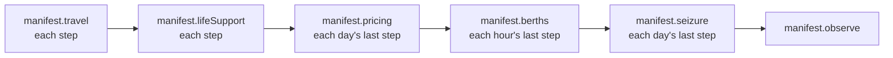
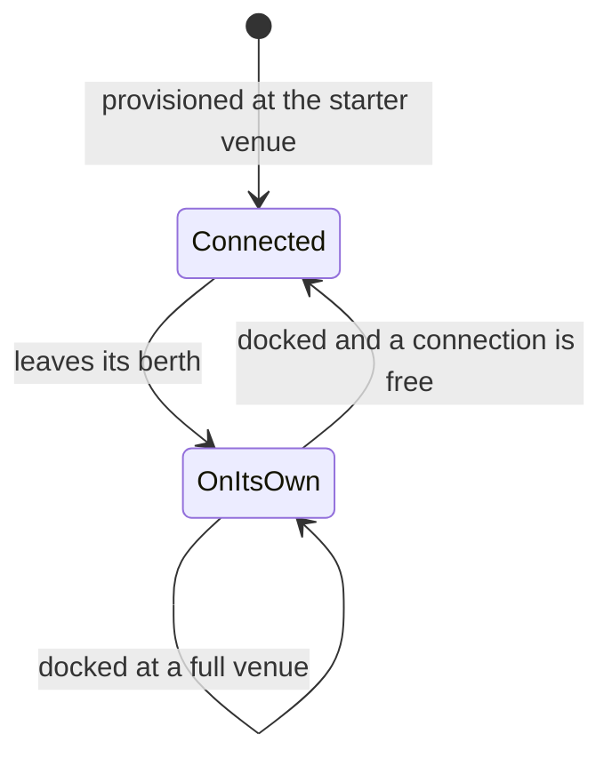
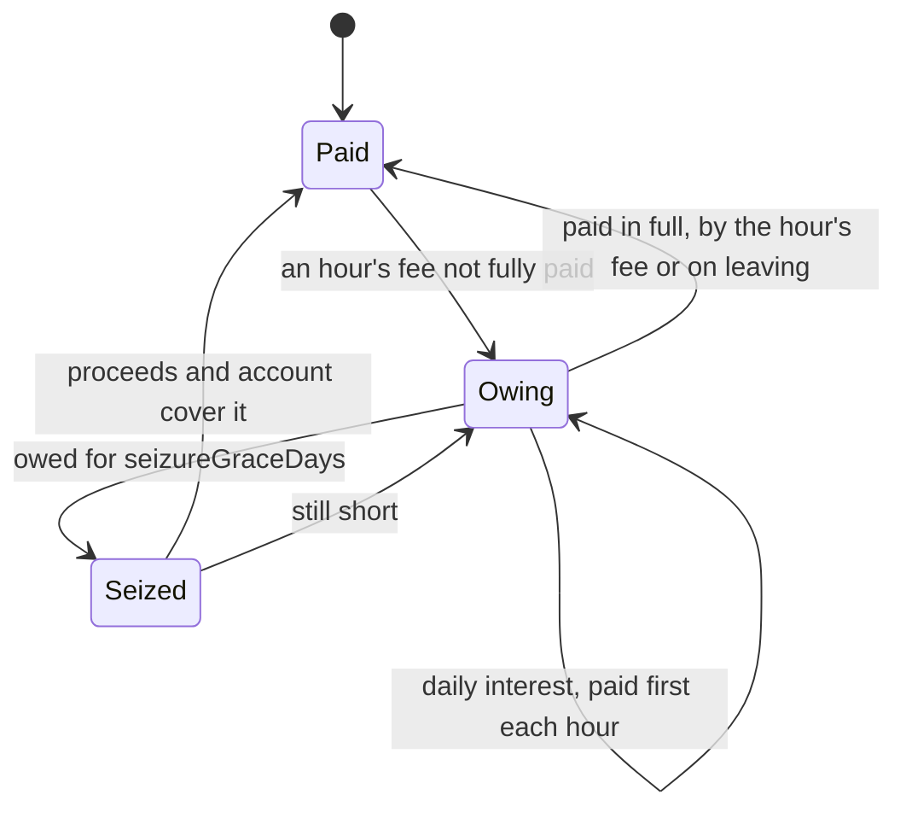

# Stations: berths, life support and charges

A [station](glossary.md#station) is where a ship docks, trades and is kept alive. This document
covers what a station does for a docked ship and what it charges for it: the
[berth](glossary.md#berth) the ship lands on, the [life support](glossary.md#life-support) the
ship draws on, docked and away, and the fees, [arrears](glossary.md#arrears) and
[seizure](glossary.md#seizure) that make holding a ship at a station cost money. These rules give
a lone trader a running cost from the first step, so a ship that sits idle, or flies too far on
its own supplies, loses credits.

The docks themselves (berth classes, the way in, the clamp, the queue) are Jettison's: see
[Jettison's docks](../../jettison/docs/docks.md). Journeys are in [travel](travel.md); the
standing jobs that pay these charges are in [policies](policies.md).

## Concepts

| Term | Meaning |
| --- | --- |
| [Venue](glossary.md#venue) | A market at a station (`Content::VenueDefinition`). Its operator is an [organisation](glossary.md#organisation); its fees and its pricing level are saved on its market entity. |
| [Berth](glossary.md#berth) and [pad class](glossary.md#pad-class) | A berth is a landing place on the station's [platform](../../jettison/docs/glossary.md#platform). Its class is a Jettison [berth class](../../jettison/docs/glossary.md#berth-class), authored in `data/docks/pads` (`skiff`, `corvette`, `frigate`, `destroyer`, `cruiser`). |
| [Fee class](glossary.md#fee-class) | The pad class a ship is charged by: the berth class its hull's [vehicle](../../jettison/docs/glossary.md#vehicle) definition names (`Content::FeeClass`), the smallest it fits, whichever berth it is given. The starter is a `skiff`. |
| [Life support](glossary.md#life-support) | Oxygen and carbon-dioxide scrubbing for a ship's occupants. A docked ship may be connected to the station's; otherwise it draws on its own. |
| Connection | One of a venue's `lifeSupportCapacity` places on its life support. A connected ship uses none of its own supplies. |
| [Oxygen tank](glossary.md#oxygen-tank) | One tank of the ship's installed oxygen bank, its capacity in kilograms (`oxygenTanks` in `data/ships/hulls.yaml`), outside the trade hold. |
| [Cartridge](glossary.md#cartridge) | One scrubber cartridge installed in the ship, holding occupant-days of scrubbing; a fresh one holds `lifeSupport.cartridgeOccupantDays`. |
| Opened tote | A [tote](glossary.md#tote) of oxygen or cartridges opened to resupply the ship. It stays in the hold, taking its tote of room, until used up, and cannot be sold or unloaded. |
| Fees | A venue's posted charges (`World::Fees`): a docking fee and an hourly berth fee for each pad class, a berth fee for each connected occupant-hour, and the yearly interest rate on arrears. |
| [Pricing level](glossary.md#pricing-level) | An AI-run venue's fees as a share of the defaults, in basis points (`World::Pricing`), moved once a day by its occupancy. |
| [Arrears](glossary.md#arrears) | What a docked ship's company could not pay of its berth fees (`World::Arrears`): owed to the venue, growing by daily interest, and holding the ship until paid. |
| [Seizure](glossary.md#seizure) | The venue selling a ship's cargo at its live bids to pay arrears that have stood too long. |

## How it works

### Where it runs in the step

Four systems run after `manifest.travel` has settled which ships are docked where. The order
below is part of the [step, in order](architecture.md#the-step-in-order), whose table is the
canonical one; each system declares its edge, so none depends on registration order.



The diagram shows the four systems in the order they run and how often each does its work. A
simulation hour and day are counted in fixed steps from the world's clock, so a day's last step is
also an hour's last step: pricing, then the berth fee, then seizure all run in it.

Each system also tells the scheduler when it next has work, so a
[fast-forward](glossary.md#fast-forward) passes over the steps between. Life support draws every
passed step's use exactly as stepping would, and wakes only when a connection would be made or
lost. Pricing wakes on each day's last step, the berth fee on each hour's last while any ship is
docked, and seizure on each day's last while any ship owes arrears.

### Station life support

A ship's `World::LifeSupport` holds the oxygen left in each tank, in its hull's order, the
occupant-days left in each cartridge, and the venue it is connected to, empty while it is on its
own.

Each step, `manifest.lifeSupport` takes the ships in entity order and does three things:

1. A ship no longer docked where it is connected lets go of the connection.
2. A docked, unconnected ship is connected while its venue has a connection free. A ship docked
   at a full venue waits on its own supplies; one freed by a departure is taken in the same step.
3. Every unconnected ship draws one step's use from its own supplies.



The state diagram shows a ship's connection over its life. On its own, the ship draws its hull's
`occupants` times the step's share of a day: `lifeSupport.oxygenKilogramsPerOccupantDay` (1 kg)
from its tanks, first to last, and the same occupant-days from its cartridges, first to last. It
never draws more than is left, so an empty tank or cartridge stays at 0. Running out has no
consequence yet. A hull with no occupants uses nothing.

Provisioning a player (`Company::Provision`, in [companies](companies.md)) gives the starter
every tank full and every cartridge fresh, once, connected at the
[starter venue](glossary.md#starter-venue). It is refused `NoServiceFree` when the starter venue
has no connection free. Nothing else restores supplies: not docking, not connecting, not a retried
command, not a load. Only Refill and Replace add to them.

### Resupply: Refill and Replace

A player resupplies a ship from its own hold, wherever the ship is, docked or in flight. The goods
are ordinary trade goods, `lifeSupport.oxygenItemId` (`ItemOxygen`, by the kilogram) and
`lifeSupport.cartridgeItemId` (`ItemCarbonScrubberCartridge`, by the piece), bought through the
[book](glossary.md#book) and loaded like any cargo. The station's own stock is never drawn on.

- **`Manifest.Company.Refill`** fills the tanks in order: from the opened oxygen tote first, then
  from whole totes opened one at a time. A tote of oxygen holds 128.25 kg (an eighth of its
  `unitsPerCubicMetre`, 1,026). What the last tote has left stays opened in the hold.
- **`Manifest.Company.Replace`** takes one whole cartridge the same way (a tote holds two) and
  installs it fresh in place of the installed cartridge with the least left. The old cartridge is
  thrown away with whatever it had.

Both take a `Company::Service{shipId}`. Each checks everything before it writes anything:

| Result | When |
| --- | --- |
| `UnknownTarget` | No such ship. |
| `NotAuthorised` | The sender's company does not own the ship. |
| `CapacityExceeded` | Refill: the tanks are full, or the hull has none. Replace: the hull has no cartridges. |
| `InsufficientStock` | No oxygen aboard, or less than one whole cartridge aboard. |

### Fees by fee class

Every venue posts its own `World::Fees`, starting at the defaults in `balance.yaml`'s
`charges`. A ship pays at its fee class, so a skiff pays a skiff's fees even on a larger berth.

| Charge | Paid when | By whom, to whom |
| --- | --- | --- |
| Docking fee | As a journey to the venue starts (`Travel::Travel`) | The ship's company to the destination venue's account. It stays paid if the journey fails. |
| Berth fee | On each simulation hour's last step, for every ship docked then | The company to the venue it is docked at: the class's `berthPerHour`, plus `berthPerOccupantHour` for each of the hull's occupants while the ship is connected to that venue's life support. |
| Arrears | First, with each hour's berth fee; in full, before the ship may leave | See [arrears and seizure](#arrears-and-seizure). |

A journey is refused `InsufficientFunds` unless the company's account holds the destination's
docking fee and the ship's arrears together. As it starts, the journey pays the docking fee to the
destination and the arrears to the venue the ship leaves.

The default class fees rise with berth area from the skiff's 100 to dock and 20 an hour to the
cruiser's 54,000 and 10,800; a connected occupant adds 2 an hour
(`charges.berthFeePerOccupantHour`).

### Setting fees: the operator's command

`Manifest.Company.SetFees` (`Company::SetFees{venueId, fees}`) posts a venue's whole
`World::Fees`. Only the [principal](glossary.md#principal) directing the venue's operator
organisation may send it. A change applies from the next charge: an hour already charged and a
docking fee already paid stay as they were. It checks before it writes:

| Result | When |
| --- | --- |
| `UnknownTarget` | No such venue. |
| `NotAuthorised` | The sender does not direct the operator, or no one does (the operator is AI-run). |
| `InvalidQuantity` | The pad classes are not exactly the venue's, each once and in name order, or a fee or rate is below 0. |
| `RateTooHigh` | The arrears rate is above the game's usury limit, `charges.maxArrearsRateBps`. |

### The AI operator's pricing level

A venue whose operator no principal directs sets its own fees by rule. On each day's last step,
`manifest.pricing` counts the station's berths, display berths aside, and those not free:

- above `charges.pricing.raiseAboveBps` (3/4) taken, its level rises by `stepBps` (10% of the
  defaults);
- below `lowerBelowBps` (1/4) taken, it falls by the same;
- it stays within `minLevelBps` to `maxLevelBps` (half to twice the defaults).

Every class fee and the occupant fee is then the default at that level, to the nearest credit,
a half rounded up. The arrears rate stays the default's. A venue a player directs keeps the fees
its director posts, and its level is left alone.

### Arrears and seizure

When the company's account cannot pay an hour's berth fee and any arrears, the account pays what
it holds and the rest is the ship's `World::Arrears`. It records what is owed, the fraction of a
credit of interest not yet added, and the step whose fee began it, kept until the debt is paid in
full.



The state diagram shows a docked ship's debt to its venue.

- **Interest.** On each day's last step, before the hour's fee, the arrears grow by a day's
  interest at the venue's `arrearsRateBps`, at most the usury limit: what is owed times the rate
  over 3,650,000 (`World::kRateYear`). Whole credits are added; the fraction carries to the next
  day, so a small debt accrues exactly. The default is `charges.arrearsRateBps`, 10% a year.
- **Held.** A ship with arrears cannot start a journey until its company can pay them and the
  docking fee, so the debt is always settled at the venue it is owed to.
- **Seizure.** On each day's last step, after the berth fees, `manifest.seizure` takes each ship
  whose arrears began `charges.seizureGraceDays` (7) days or more before, in entity order. Through
  its owner's own commands (`Company::Unload`, `Trade::Place`), it sells the cargo lot by lot in
  hold order, a tote at a time at the venue's best live bid, until the proceeds cover what is
  owed or the bids run out. Opened life-support totes are kept. The totes not sold are loaded back.
  The company's account then pays what it can of the arrears.

A ship's standing job feels the same rules: seized totes leave its [lot](glossary.md#lot) with
their shares of its cost and charges, and a job left with no lot chooses again
([policies](policies.md)).

### Charges on a job's lot

A ship running a standing [job](glossary.md#job) charges its costs to the lot aboard, so a sale's
floor covers them ([policies](policies.md) owns the floor and the estimate).

- Each hour's berth fee is added to the lot's charges.
- While a lot is aboard, `manifest.lifeSupport` adds the ship's own draw to the job, in kilograms
  and occupant-days, stepped or fast-forwarded alike. When the job next decides, docked, the draw is
  converted into the lot's charges at the company's last prices for the two goods
  (`World::Paid`, set as its buys fill), rounded up, once. An item never bought costs 0.
- A route's estimate (`Policy::EstimateRoute`) adds each leg's docking fee at the ship's fee class
  and its life support: the hull's occupants for the leg's cruise time, at the same prices. Berth
  fees are not estimated, since a job waits docked only when blocked.

### Saves and the snapshot

`LifeSupport`, the hold's opened totes, `Fees`, `Pricing`, `Arrears` and `Paid` are saved
with the [hosted world](glossary.md#hosted-world) ([world](world.md),
[persistence](persistence.md)). A load is refused for a reserve below 0 or not a number, a tank or
cartridge the hull does not have or holding more than it does, a connection to no venue, a hold
over its size with opened totes counted, and fees of other pad classes, out of order, below 0 or
above the usury limit.

A player's snapshot (`Query::ShipView`) carries each of their ships' `lifeSupport` and
`opened` totes. A venue's fees are not in the snapshot yet.

### Content

- **Venues** (`data/scenarios/*.yaml`) author `lifeSupportCapacity`, the connections a venue
  has, at least 0. A starter venue must be public and operational, with more connections than the
  scenario has NPC traders and more non-display berths the starter fits, so a player can always
  start ([content](content.md)).
- **Hulls** (`data/ships/hulls.yaml`) author `occupants`, `oxygenTanks` and
  `scrubberCartridges`. A value left out is open, not 0: the compact hull authors one occupant and
  no tanks.
- **Tuning** (`data/tuning/balance.yaml`) authors `lifeSupport` and `charges`. Content refuses
  rates not above 0, a life-support item of no such ID or in another unit, a pad class unknown,
  charged twice or left out, a fee below 0, an arrears rate above the usury limit, a usury limit
  outside 0 to 1,000,000 and a grace outside 0 to 36,500 days.

## Using it

The tuning, from `data/tuning/balance.yaml` (the class rows shortened):

```yaml
lifeSupport:
  oxygenKilogramsPerOccupantDay: 1
  cartridgeOccupantDays: 30
  # What Refill and Replace take from a ship's hold (D-094).
  oxygenItemId: ItemOxygen
  cartridgeItemId: ItemCarbonScrubberCartridge

charges:
  padClasses:
    - {padClass: skiff, dockingFee: 100, berthFeePerHour: 20}
    - {padClass: cruiser, dockingFee: 54000, berthFeePerHour: 10800}
  berthFeePerOccupantHour: 2
  arrearsRateBps: 1000
  maxArrearsRateBps: 3500
  seizureGraceDays: 7
  pricing:
    raiseAboveBps: 7500
    lowerBelowBps: 2500
    stepBps: 1000
    minLevelBps: 5000
    maxLevelBps: 20000
```

The starter's life support, from `data/ships/hulls.yaml`, and a venue's connections, from
`data/scenarios/trading.yaml`:

```yaml
  - hull:
      hullId: HullLoneTraderStarter
      occupants: 1
      oxygenTanks: [10, 10, 10]
      scrubberCartridges: 1

  - venueId: VenueOreHighport
    public: true
    operational: true
    layout: highport
    lifeSupportCapacity: 4
```

In the [console](console.md), `observe` shows a ship's life support, and `service` queues a
resupply (`source/tools/console/tests/ManifestConsoleTests.cpp`):

```text
> host trading
> provision Ada "Ada Co"
> step
> observe Ada
    life support: 30.000 kg of oxygen in 3 tanks, cartridges of 30.000 occupant-days, connected at VenueOreHighport
> service refill Ada Ship1
> step
Manifest.Company.Refill: CapacityExceeded
```

The tanks are full, so Refill is refused. The console has no command for `SetFees`; a test sends
it (`source/game/company/tests/CompanyTests.cpp`):

```cpp
World::Fees raised = defaults;
for (World::ClassFees &each : raised.classes)
	each = {each.padClass, each.docking * 5, each.berthPerHour + 30};
raised.berthPerOccupantHour = 3;
const auto set = [&hosted](const Actor &actor, std::string venueId, const World::Fees &fees)
{ return hosted.Run(actor, kSetFees, SetFees{std::move(venueId), fees}); };
```

## Limits and open work

- The station's own oxygen is not modelled: a connection draws on nothing, and stations have no
  outages.
- Running out of oxygen or scrubbing has no consequence yet.
- Exchanging a tank rather than refilling it, and authored banks for larger hulls:
  [L07](delivery-order.md#l07), in the [ships plan](ships-plan.md).
- Algae oxygen recycling, a ship upgrade that slows the draw: [L34](delivery-order.md#l34), in the
  [ships plan](ships-plan.md).
- Storage fees join a lot's charges with consignment storage, [L16](delivery-order.md#l16); tolls
  with gates, [L10](delivery-order.md#l10), and moongates, [L35](delivery-order.md#l35).
- Auctions of seized cargo: [L24](delivery-order.md#l24).
- Private-port bookings and owner access policy: [L04](delivery-order.md#l04).
- Showing and editing a venue's fees in a client: [L15](delivery-order.md#l15).
- A failed journey's docking fee is not refunded, and berth fees are not estimated.

## Decisions

The decisions are under
[Stations: berths, life support and charges](decision-ledger.md#stations-berths-life-support-and-charges)
in the ledger. The key ones:

- [D-045](decision-ledger.md#d-045) and [D-050](decision-ledger.md#d-050): life support outside the
  trade hold, as a bank of separate tanks.
- [D-046](decision-ledger.md#d-046): a connected ship pauses its own use.
- [D-047](decision-ledger.md#d-047): players start connected at a station that can take them.
- [D-094](decision-ledger.md#d-094): connections, resupply from the hold, and no consequence of
  exhaustion yet.
- [D-097](decision-ledger.md#d-097) and [D-098](decision-ledger.md#d-098): each venue's own charges,
  set by its owner.
- [D-100](decision-ledger.md#d-100): fees by fee class, the AI operator's rule, arrears and seizure,
  and transit life support charged to the lot.

How these were built is recorded in
[stage 4's W06](history/stage-4-trading-plan.md#delivered-w06-2026-11-20) and
[W18](history/stage-4-trading-plan.md#delivered-w18-2026-11-21) records.

## Source

| Where | What |
| --- | --- |
| `source/game/company/include/manifest/company/Company.h` | `Service`, `SetFees`, `Provision`; `kLifeSupportSystem`, `kPricingSystem`, `kBerthSystem` |
| `source/game/company/src/Company.cpp` | Connections and draw (`Breathe`), `Refilled`, `Replaced`, `FeesSet`, `Price`, `Berth`, `Accrue` |
| `source/game/travel/src/Travel.cpp` | The docking fee and arrears paid as a journey starts |
| `source/game/policy/include/manifest/policy/Policy.h`, `src/Policy.cpp` | `kSeizureSystem` (`Seize`), `EstimateRoute`, the lot's life-support charge |
| `source/game/world/include/manifest/world/State.h` | `LifeSupport`, `ClassFees`, `Fees`, `Pricing`, `Arrears`, `Paid`, `kRateYear` |
| `source/game/content/include/manifest/content/Definitions.h`, `Content.h` | `LifeSupportTuning`, `ChargesTuning`, `PricingTuning`, `VenueDefinition::lifeSupportCapacity`, `FeeClass` |
| `data/tuning/balance.yaml`, `data/ships/hulls.yaml`, `data/trade-items/life-support.yaml`, `data/docks/pads` | Rates, charges, hull supplies, the two goods, the pad classes |

Suites: `company` (connections, draw, Refill and Replace, fees, pricing, arrears, saves),
`travel` (a journey letting go and connecting, the docking fee, the step's order), `policy`
(transit life support charged to a lot, seizure), `content` (malformed tuning), `query` and
`console` (the view and the commands), and `fixture_alone` (an NPC and a player trading alone).
