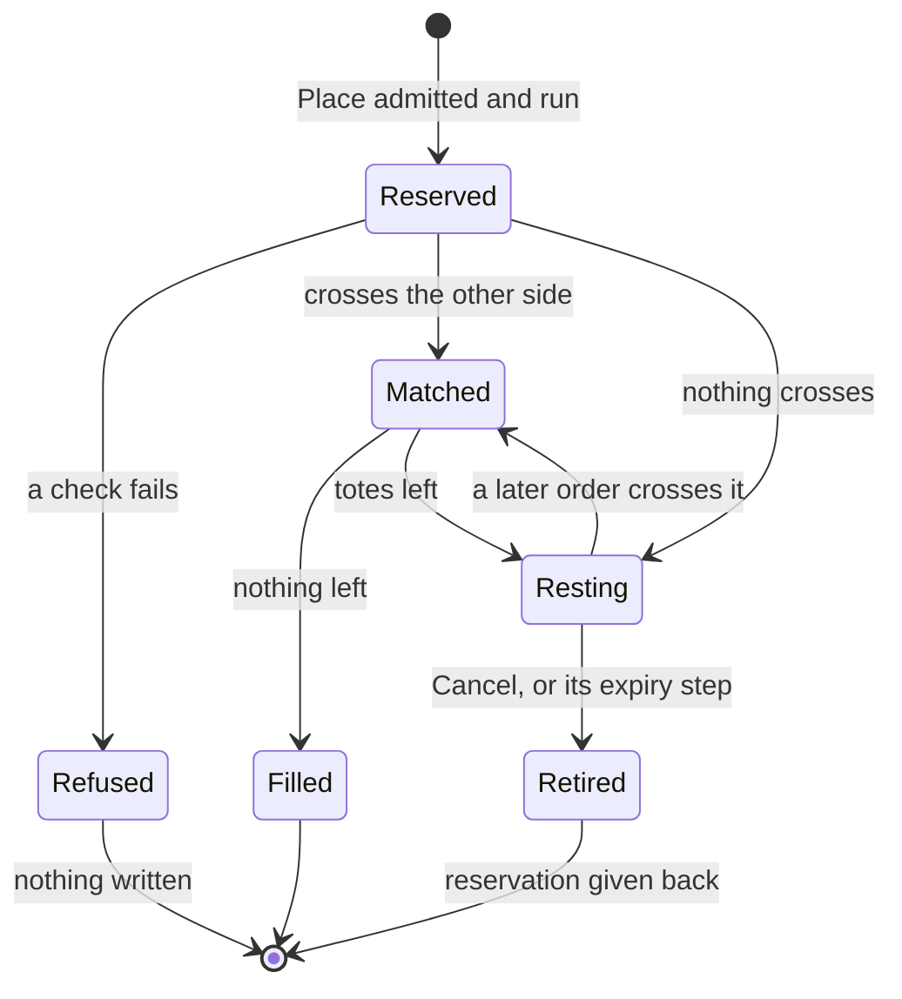
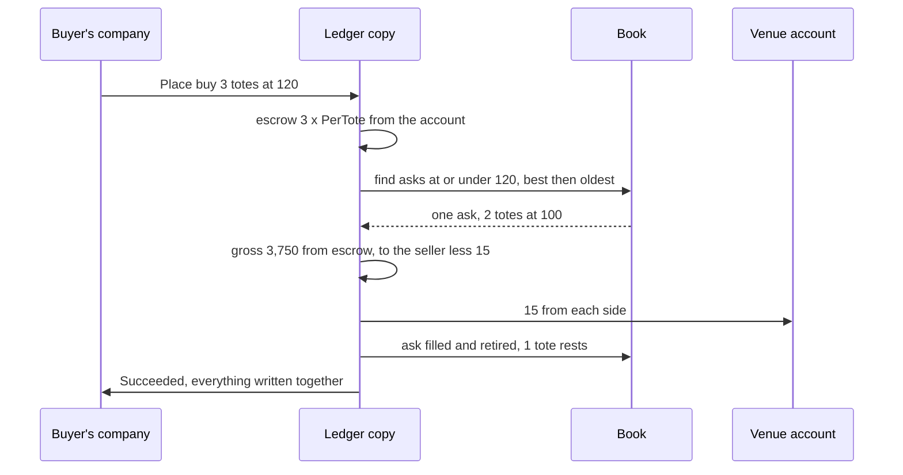
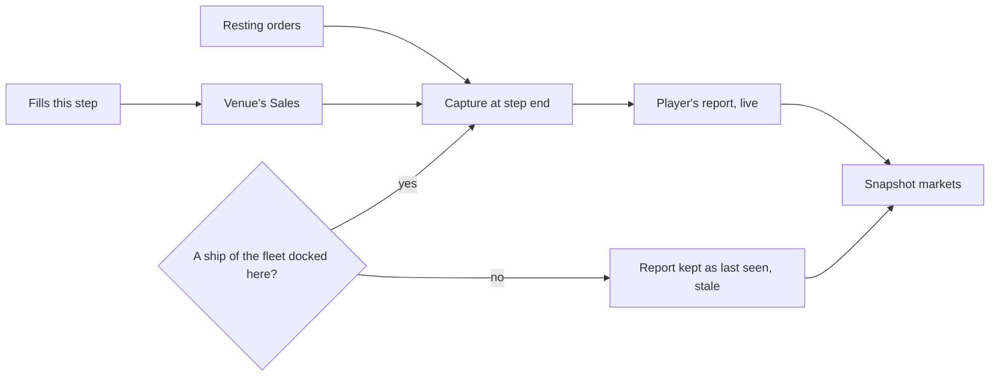

# Orders, brokers and market observations

Goods change hands in Manifest through an order book at each [venue](glossary.md#venue). A
player's company posts limit [orders](glossary.md#order) to buy or sell whole
[totes](glossary.md#tote) of a good at a price. Each venue's [broker](glossary.md#broker) quotes
the other side from its own finite stock and treasury. Every match settles at once, in
[credits](glossary.md#credit) on the owners' [accounts](glossary.md#account), with nothing minted.
Players do not see every book: they know a market only through their fleet's
[observations](glossary.md#observation), live while a ship is docked there and stale once it
leaves.

This document covers the order book, matching and settlement, expiry, the brokers, and the market
reports a player holds. How prices are set, the broker's curve and ladder, and the rounding rules
are in [Prices](pricing.md). The households and employers that also trade are in
[The regional economy](economy.md). Moving goods between a holding and a ship is in
[Companies, ships and cargo](companies.md).

## Concepts

| Term | Meaning |
| --- | --- |
| [Order](glossary.md#order) | A limit order, `World::Order` on its own entity, `Order<n>` by ID: owner, venue, item, side, limit price, totes placed and remaining, a buy's escrow, its fee, sequence, expiry and the request that placed it. |
| [Book](glossary.md#book) | The resting orders at one venue for one item, two sides. Each side holds at most `kMaxRestingOrders` (64). |
| [Fill](glossary.md#fill) | One match of an incoming order against one resting order, at the resting order's price. |
| Holding | An owner's goods at a venue's warehouse, `available` and `reserved` totes. A sell order's remaining totes are reserved. |
| Escrow | The credits a buy order has taken from its owner's account to pay for what it may still fill. |
| [Broker](glossary.md#broker) | A venue's native trading [principal](glossary.md#principal), owned by the venue's operator, with its own `Stock` and `BrokerAccount`. |
| Venue account | The `VenueAccount` that receives both sides' listing fees: the venue's one balance of fee income. |
| Market | A venue's `Market` entity, holding its `Sales` (and, for [stations](stations.md), its fees). |
| [Report](glossary.md#report-market) | What a player last saw of one venue's market: each good's best four prices a side, recent sales and the last sale, with the step it was observed at. |
| [Sales window](glossary.md#sales-window) | The span a report's sales volume covers: `market.salesWindowSeconds` before the observation. |
| Starting report | A report a new player is given at spawn, of nearby venues, stale from the first. |

## How it works

### Placing an order

`Manifest.Trade.Place` carries a venue, an item, a side, a count of totes and a limit
(`Trade::Place` in `Trade.h`). The limit is a [Decimal price](glossary.md#decimal-price)'s raw
microcredits per the item's authored unit. The command is a principal's: it acts for the company
that principal directs, and it is admitted and run as any [request](glossary.md#request) is
([The hosted world](world.md)). A company may trade at any venue the scenario has, with no ship
there; a ship only matters for moving the goods afterwards.

The command plans everything on copies of the accounts, holdings and orders it touches, and writes
them only when every check has held. An expected refusal therefore leaves the world as it was, and
the [receipt](glossary.md#receipt) names why. The checks, in order:

| Result | Refused when |
| --- | --- |
| `NotAuthorised` | the principal directs no company |
| `UnknownTarget` | the venue or item is not the scenario's |
| `InvalidQuantity` | totes are 0 or above a warehouse's limit (`kMaxWarehouseTotes`); or a credit a fill pays would overflow its account |
| `InvalidPrice` | the limit is not above 0, the reservation cannot be held, or a fill would cost more than its escrow |
| `InsufficientStock` | a sell's totes are more than the company has available at the venue |
| `InsufficientFunds` | a buy's reservation is more than the company's balance |
| `CapacityExceeded` | the warehouse there could not hold the buy with every resting buy of the company's filled |
| `BookFull` | a remainder would rest on a side that already holds 64 orders |

Too little on the other side is not a refusal. The order fills what it can and the rest rests,
an ordinary partial fill. A buy that fills completely rests nothing, so even a full book accepts it.
The receipt does not carry the fill: what filled is the order's totes less its remaining, read from
the order whose `request` is the command's sequence, and no order at all means it filled whole.

The diagram follows one order from placement to leaving the book.



### Reserving

A sell moves its totes from the holding's `available` to `reserved`. A reserved tote cannot be
loaded onto a ship, and a save whose reserved totes do not equal its owner's sell orders there is
refused.

A buy takes its whole reservation from the account into the order's escrow: for each tote, a
tote's cost at the limit rounded up, plus the listing fee on that (`PerTote`). Each fill's gross is
rounded to the nearest credit at a price at or under the limit, so the escrow always covers what is
left, however the book splits the order. What remains goes back when the order leaves the book. The
rounding rules themselves are in [Prices](pricing.md#from-a-price-to-credits).

### Matching and settlement

The incoming order meets the resting orders on the other side that cross it: asks at or under a
buy's limit, bids at or over a sell's. They fill best price first, then oldest first within a
price, by the order's `sequence`, the `n` of its ID; the IDs' string order plays no part. The
resting order sets the price. An order whose `expiresStep` has come no longer matches, even before
the sweep retires it.

Each fill:

1. takes the gross and the buyer's fee from the buy's escrow;
2. credits the seller the gross less the seller's fee;
3. credits both fees to the venue account;
4. moves the totes from the seller's reserved holding to the buyer's available one.

A fee is `market.listingFeeBps` of the gross, rounded up. Each order keeps the fee it was placed at
(`feeBps`), which its escrow was reserved at. One pass settles at most `kMaxFills` (64) fills. With
at most 64 orders on a side, a pass can always settle every maker it crosses, so no remainder rests
crossed ([D-085](decision-ledger.md#d-085)).

An account reached twice in a pass, by a self-trade or a broker trading at its own venue, is one
copy in the plan, so overflow checks hold for it. After the pass commits, its traded totes and last
price are recorded in the venue's `Sales`. Each company buy that filled sets that company's last
paid price for the item (`World::Paid`), which charges life support drawn in transit
([Stations](stations.md)). An order left with totes is then issued its ID and rests.

The sequence shows a buy that partly fills against a resting sell.



### Cancelling and expiry

`Manifest.Trade.Cancel` names an order by ID. The book must hold it (`UnknownTarget`), and it must
be the sender's company's (`NotAuthorised`): a broker's or another company's order cannot be
cancelled. The order leaves the book, its reserved totes go back to available and its escrow to
the account.

A resting order lives `market.orderLifeSeconds`, one simulation day, converted to steps; 0 means no
expiry ([D-085](decision-ledger.md#d-085)). Start-up refuses an order life that is not a whole
number of the world's steps. The `manifest.expiry` system runs first each [step](glossary.md#step)
after the commands. It retires, in placement order, every order whose `expiresStep` has come,
refunding each. Its refunds were escrowed, so one that cannot be paid is an invariant breach and
throws. A refund from an expiry is therefore spendable only from the next step's commands, and an
order cancelled earlier in the same step is already gone. Where the sweep sits among the other
systems is [the step, in order](architecture.md#the-step-in-order).

Only limit orders exist. There is no market order and no immediate-or-cancel order type; the
[standing policies](policies.md) get the same effect by placing a buy and cancelling what rests.

### Who trades on the book

Four kinds of owner place orders, all through the same reservation and matching path:

| Owner | Orders | Rest between steps? |
| --- | --- | --- |
| Company | a player's or an [NPC trader](glossary.md#npc-trader)'s `Place` | yes, until filled, cancelled or expired |
| Broker | its ladder, each [economic turn](glossary.md#economic-turn) | yes, until a requote replaces them |
| Employer | a region's made goods, down to a floor | no: what does not fill is cancelled at once |
| Household | a region's needs and optional goods | no: what does not fill is cancelled at once |

The employers' and households' rules are in [The regional economy](economy.md) and their prices in
[Prices](pricing.md#who-else-prices-orders). A ship's refuelling buys through `Trade::MakeBuyer`.
It walks the asks resting now, best first, buys as many totes as its budget reserves at the dearest
ask it takes, and rests nothing ([Travel and fuel](travel.md#refuelling)).

### Brokers

Each venue has one broker, by the venue's ID ([D-084](decision-ledger.md#d-084)). The initial state
seeds its `Stock` from the scenario's market `stock` for the venue, in totes, and its
`BrokerAccount` with `brokers.treasury` credits. Its stock and funds change only by what it buys
and sells. There is no hidden mint, so a broker that has spent its treasury stops bidding.

The `manifest.brokers` system requotes every broker on the last step of each economic turn, when
`(s + 1) % N == 0` for step `s` and a turn of `N` steps. It goes venue by venue in the scenario's
order, after `manifest.economy`, so the quotes see the turn's production and purchases. The host
also quotes once as the initial state opens (`Trade::Quote`). For each good of its market, a broker
posts up to `kLevels` (4) asks and 4 bids, priced on its stock's curve about the good's native
price with `brokers.spreadBps` between the sides ([D-102](decision-ledger.md#d-102)). Its asks
offer only what it holds. Its bids spend only an equal share of its funds over the goods still to
quote, within its warehouse's room. A ladder its stock has not moved keeps its orders; the rest are
retired and posted afresh, so orders never pile up. The ladder's prices and sizes are in
[Prices](pricing.md#the-ladder).

### Market observations

The server holds the real books. A player's knowledge of them is separate saved state: the
`Reports` on their principal, one report per venue they have seen. A venue with no report is
unknown to them, which is different from a known market with no quotes or no sales.

**Coverage.** A venue is covered for a player while a ship of their company is docked there
(`Ship::dockedAt`). Being in flight, nearby or waiting for a berth is not docked. Coverage follows
the fleet, not the player's client connection, so it continues while they are disconnected.

**Observation.** The `manifest.observe` system runs after `manifest.travel`, at the end of the
step. For each covered venue it captures one report (`Trade::Capture`), observed at the step the
clock reaches as the step ends, and gives it to every principal whose fleet covers it. A report no
ship covers stays exactly as it was. So when the last ship leaves, its player keeps the report from
the step before it left, and the departure step's trades stay unseen. Another ship of the fleet
still docked keeps it live.

**What a report holds.** For each good of the venue's market, in the market's order:

- each side's best `World::kReportLevels` (4) prices still matching after the observed step, best
  first, with the totes resting at each: a broker's ladder;
- the totes sold over the sales window, each fill counted once for buyer and seller together,
  whoever traded;
- the last sale's step and price, however long ago, 0 for never sold.

The window is `market.salesWindowSeconds` (an hour), a whole number of steps, ending at the
observation; it is shorter for a market younger than that. A stale report keeps its own window,
volume and last sale; nothing ages trades out of it.

**Starting reports.** Provisioning a player ([Companies](companies.md#provisioning-a-player)) calls
`Trade::Seed` once ([D-095](decision-ledger.md#d-095)). The new player gets a `Starting` report of
every other venue in the [starter venue](glossary.md#starter-venue)'s system and every venue of a
system directly connected to it, either way. All are observed at the clock's step as the command
runs. A neighbour's neighbour stays unknown. The starter venue itself becomes live at that step's
end, since the new ship is docked there. A starting report grants no feed and is stale from the
first; nothing seeds it again.

**What the player sees.** A player's [snapshot](glossary.md#snapshot-query) carries their reports
as `markets` (`Query::MarketView`). Each is `live` when it came from a docked ship and was observed
at the snapshot's own step; otherwise its age is the steps since `observed`. The Administrator's
snapshot carries none, having no fleet. The same boundary binds the standing policies and NPC
traders: they plan from their owner's reports and nothing else ([Standing policies](policies.md)).

The flowchart shows how one step's trades reach a player's report.



**Fast-forward.** Observation never wakes the world. When the host passes over quiet steps
([fast-forward](glossary.md#fast-forward)), observation captures each covered venue once, at the
last step passed over: the report that step's own observation would have made.

### Saves

Orders, holdings, broker stocks, accounts, `Sales` and `Reports` are all saved state. A load
refuses, among others:

- an order with no owner, venue or item, a limit or sequence of 0, a fee outside 0 to 10,000 basis
  points, or remaining totes of 0 or above its totes;
- a buy holding less than a credit of escrow for each remaining tote, or a sell holding any;
- reserved totes that do not equal their owner's sell orders at that venue;
- sales or reports out of order, a report of a venue the world does not hold, or a report side of
  more than four prices, out of order, or with a price or totes not above 0.

The full list of a load's checks is in [The hosted world](world.md#what-a-load-refuses).

## Using it

### From the console

On the trading scenario, a new player buys at the ask their live report shows, then rests a low
bid and cancels it. The console sends `Place` and `Cancel` through admission; the price is exact
decimal text per the item's unit (from `source/tools/console/tests/ManifestConsoleTests.cpp`):

```text
host trading
provision Ada "Ada Co"
step
observe Ada                                  # Ore live, Brine a stale starting report
book VenueOreHighport ItemFurs               # the host's view of the book: the broker's ladder
trade buy Ada VenueOreHighport ItemFurs 2 <ask from the report>
step                                         # Manifest.Trade.Place: Succeeded
trade buy Ada VenueBrineHighport ItemFurs 1 1
step                                         # a bid under the market rests as Order<n>
cancel Ada Order<n>
step                                         # Manifest.Trade.Cancel: Succeeded
```

`observe` prints each report as live, or stale with its age, for example
`VenueBrineHighport: stale starting report, observed 0.0 simulation minutes ago`, and each good as
`ItemFurs: bid 103.971304 (2 totes, 4 prices), ask ..., 0 totes sold, never sold`. `book` is the
host's development view of every resting order and is refused when connected to a server. The
whole command set is in [The console](console.md#the-commands).

### From C++

A test admits a `Place` as the principal's next request and steps the world (after
`source/game/trade/tests/TradeTests.cpp`, whose `Hosted::Place` does this):

```cpp
const std::uint64_t sequence = requests.NextSequence(actor);
const std::vector<std::byte> bytes = BinaryArchive::Write(
    Manifest::Trade::Place{"VenueOreHighport", "ItemFurs", Side::Buy, 3, 120'000'000},
    FormatVersion{Manifest::Trade::kVersion});
requests.Admit(
    world, actor, sequence, std::string{Manifest::Trade::kPlace}, Manifest::Trade::kVersion, bytes);
world.Step();
const Result result = requests.Outcome(actor, sequence)->result;
```

The suite's first case is a worked fill. A tote of furs is 18.75 furs (150 a cubic metre over 8).
Bea rests 2 totes at 100 credits. Ada bids 120 for 3: 2,250 a tote and a fee of 9, so 6,777 in
escrow. Two totes fill at Bea's 100: a gross of 3,750 and a fee of 15 from each side to the venue.
Bea is credited 3,735 and Ada's escrow falls by 3,765. One tote rests with 3,012 in escrow, which
Ada's cancel gives back. Credits and totes are conserved throughout.

### Tuning

The book's values are in `data/tuning/balance.yaml`:

```yaml
market:
  listingFeeBps: 40          # from each side of a fill (D-083)
  orderLifeSeconds: 86400    # a resting order's life: one simulation day (D-085)
  salesWindowSeconds: 3600   # a report's sales volume covers the hour before it

brokers:
  treasury: 1000000          # each broker's starting account, in credits (D-084)
  spreadBps: 1000            # its asks and bids 10% apart about the native price
```

A scenario's system names its direct connections for starting reports as
`connections: [{systemId: ...}]`, each way. Validation refuses one to a system the scenario lacks,
to itself, or named twice. The shipped scenarios each have one system, so their starting reports
are the other venues of that system ([Content](content.md)).

## Limits and open work

- No market or immediate-or-cancel orders; the acceptance scenarios have not needed them.
- A tote is too coarse for the densest goods: gold never trades until cases land
  ([L32](delivery-order.md#l32)).
- Each covered venue's report is rebuilt from the book every step, a marked shortcut in
  `Observe` until a profile shows it matters.
- Ship transfers do not exist, so the rule that reports stay with the player, not the ship, has
  nothing to test yet.
- Direct connections for starting reports are authored until gates and topology discovery replace
  them ([Space: open plans](space-plan.md)).
- Open market services on the book: consignment listings ([L16](delivery-order.md#l16)), warehouse
  receipts ([L19](delivery-order.md#l19)), paid price reports ([L20](delivery-order.md#l20)),
  forward contracts ([L21](delivery-order.md#l21)), escrow between players
  ([L25](delivery-order.md#l25)) and options and futures ([L17](delivery-order.md#l17)); see
  [The economy: open plans](economy-and-development-plan.md).
- Policy scripts that read reports ([L39](delivery-order.md#l39)).

## Decisions

The decisions are under
[Orders, brokers and market observations](decision-ledger.md#orders-brokers-and-market-observations)
in the ledger. The key ones:

- [D-083](decision-ledger.md#d-083): orders priced per authored unit, a fill's gross the price
  times the units; its whole-IBC count superseded by D-087.
- [D-084](decision-ledger.md#d-084): one broker a venue with its own account and stock, requoting
  each turn, no mint; its fixed quote superseded by D-102.
- [D-085](decision-ledger.md#d-085): a day's order life, 64 fills a pass, 64 resting orders a side.
- [D-087](decision-ledger.md#d-087): goods counted in totes.
- [D-095](decision-ledger.md#d-095): starting reports and direct connections; no reports for the
  Administrator.
- [D-102](decision-ledger.md#d-102): the broker's curve and ladder.

How the book was built is in the records:
[order and settlement contract](history/stage-4-trading-plan.md#order-and-settlement-contract),
[W03](history/stage-4-trading-plan.md#delivered-w03-2026-11-20),
[W07](history/stage-4-trading-plan.md#delivered-w07-2026-11-20),
[W15](history/stage-4-trading-plan.md#delivered-w15-2026-11-20),
[L28](history/stage-4-trading-plan.md#delivered-l28-2026-11-21) and the
[market information plan](history/market-information-plan.md).

## Source

| Part | Where |
| --- | --- |
| Commands, systems, money rules, `Capture`, `Seed`, `StartingVenues`, `MakeBuyer`, `Quote` | `source/game/trade/include/manifest/trade/Trade.h`, `source/game/trade/src/Trade.cpp` |
| `Order`, `Side`, `Holding`, `Stock`, `Broker`, `Sales`, `Report`, `Reports`, `Line`, `Level`, `Paid` | `source/game/world/include/manifest/world/State.h` |
| A load's checks | `source/game/world/src/State.cpp`, `source/game/world/src/Identities.cpp` |
| `MarketView`, `OrderView` | `source/game/query/include/manifest/query/Query.h` |
| Console `trade`, `cancel`, `book`, `observe` | `source/tools/console/ManifestConsole.cpp` |
| Tests | ctest `trade` (`TradeTests.cpp`: matching, refusals, limits, brokers, expiry, reports, saves), `query`, `console`, `fixture` (`source/test/FixtureTests.cpp`) |

The module also raises `Trade::Consumed` as whole totes leave the world (households, projects, life
support, reaction mass): an event for presentation and the goods ledger, not state.
