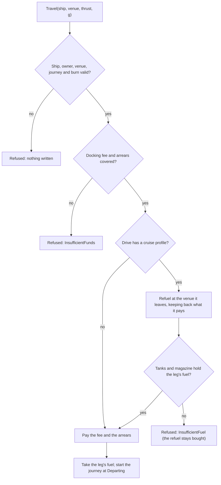
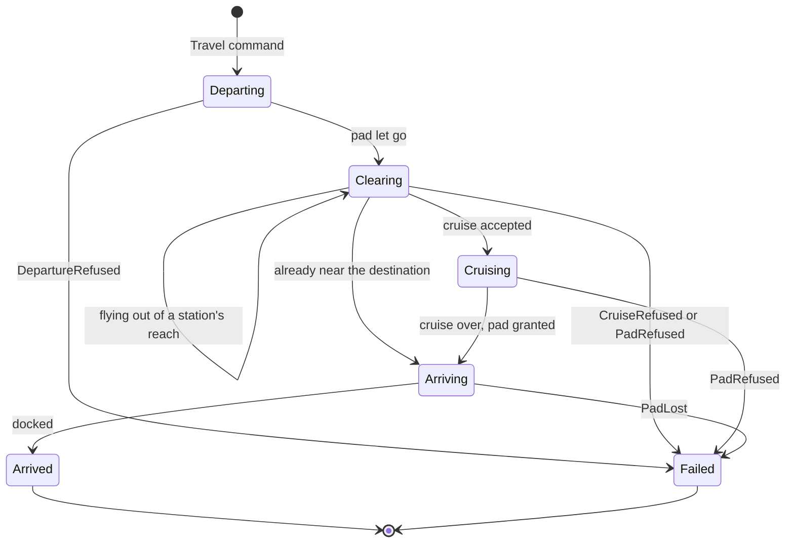

# Travel and fuel

A Manifest ship trades by flying its cargo from one [venue](glossary.md#venue) to another. The
`travel` module turns one player command, `Manifest.Travel.Travel`, into a whole journey: the ship
leaves its pad, flies out of the station's reach, cruises across the star system and docks at the
destination. On the way its drive burns two goods that the ship must buy and carry: reaction mass
and fusion pellets. How hard a journey burns is the player's choice. A hard burn arrives sooner and
costs more fuel; a gentle one saves fuel and takes longer. This document covers the journey, the
burn, the fuel and refuelling.

The engine does the flying. Jettison's docks clamp and release ships
([docks](../../jettison/docs/docks.md)), its steering flies a ship out of a station's reach, and
Manifest's `space` module cruises it ([cruising](space.md#cruising)). `travel` sequences those
parts and owns the rules a game adds: who may send a ship, what the journey costs and what it burns.

## Concepts

| Term | Meaning |
| --- | --- |
| Journey | A ship's trip to one venue (`World::Journey`, saved on the ship's entity): the venue, the leg it has reached, why it failed if it did, and the [step](glossary.md#step) it started. One journey at a time; a new one replaces an ended one. |
| Leg | How far a journey has got: `Departing`, `Clearing`, `Cruising`, `Arriving`, then `Arrived` or `Failed` (`World::Leg`). |
| Burn | The two choices a journey flies at: its thrust share and its acceleration. |
| Thrust share | The share of the cruise's time the engines thrust, half at each end, the ship [coasting](glossary.md#coast) between (`thrustBps`, 1 to 10,000 basis points). 100% thrusts to the midpoint, turns, and thrusts to a stop. |
| Acceleration | How hard the engines thrust, in thousandths of standard gravity (`accelerationMilliG`), from 0.1 g to the most the ship's [cruise profile](glossary.md#cruise-profile) sustains. |
| [Torch](glossary.md#torch) | The clean fusion drive every hull flies today: an exhaust of 10% of light speed, burning reaction mass and pellets. It may thrust anywhere outside a station's reach. |
| [Reaction mass](glossary.md#reaction-mass) | `ItemReactionMass`, purified water ice, the mass the torch throws out behind it. Cheap and made at every station. Held in the ship's tanks. |
| [Fusion pellets](glossary.md#fusion-pellets) | `ItemFusionPellets`, deuterium and helium-3, the torch's energy. Dear and refined at one station a planet, so a cargo worth carrying. Held in the drive's magazine. |
| Tanks and magazine | Fuel storage apart from the cargo hold (`World::Fuel`, in kilograms). The tanks hold the hull's `FuelCapacity` in tonnes; the magazine holds its `pelletMagazine` in kilograms. Provisioning fills both once. |
| Refuelling | A purchase of fuel at the venue a journey leaves, made automatically unless the ship's owner turns it off (`World::Refuel`, set by `Manifest.Company.SetRefuel`). |

A ship's speed and fuel do not depend on its hull's thrust stats. A game mode chooses how its
cruises are timed ([D-090](decision-ledger.md#d-090)):

- **A cruise profile.** The Manifest mode gives two in `data/game-mode/manifest.yaml`. A *manned*
  hull (one whose `occupants` is above 0 or left open) may boost at 2 g for at most 4 hours of the
  trip, 2 at each end, and sustain 1 g between. An *unmanned* hull holds 12 g throughout. Content
  gives each hull's drive the profile that fits it. Ore to Brine, about 396 million km, then takes
  days.
- **The power law.** Astralis gives no profile, so its drives keep the time-compressed cruise of
  `data/docks/drives/` ([D-088](decision-ledger.md#d-088)), a few minutes a cruise. A ship with no
  profile burns no fuel.

## How it works

### Putting ships in space

`Travel::Register` composes the world's movement. It attaches Jettison's physics, the spatial
index, steering and the docks, and Manifest's lanes and cruising, in the order the step's table
gives ([the step, in order](architecture.md#the-step-in-order)). It defines the content's pad
classes, dock hulls, station layouts and star systems in them. Then it registers the `Travel`
command and the `manifest.travel` system, which runs after the docks' and the cruise's systems.
`OpenStations` builds each venue's station to its layout on its body's rails, once, in the initial
state.

`Register` returns a `Fleet`, the world's handle on its ships in space:

- `FreePad` finds the smallest free pad of a venue's station that the hull fits, the lowest
  numbered of those. The starter gets a skiff pad.
- `Park` makes a new ship a dynamic body of its hull's mass, gives it its hull's cruise drive and
  clamps it to the pad, docked. [Company provisioning](companies.md) parks every new ship this way.
- `Refuel` buys a ship's fuel as a journey leaves. `company` supplies the rule
  (`Fleet::SetRefueller`), since buying goes through the market and the company's warehouse.

Every engine command `travel` sends goes as the ship's company: a player
[controller](../../jettison/docs/glossary.md#controller) whose slot is the n of `Company<n>`
(`ControllerOf`). A company ID is never handed out twice, so a slot is never reused.

### Starting a journey

`Manifest.Travel.Travel` is a principal's command (version 2) with four fields:

| Field | Meaning | Default |
| --- | --- | --- |
| `shipId` | The ship to send, which the sender's company must own | |
| `venueId` | The venue to fly to | |
| `thrustBps` | The thrust share, in basis points, 1 to 10,000 | 10,000 (100%) |
| `accelerationMilliG` | The acceleration, in thousandths of g, at least 100 | 1,000 (1 g) |

The command checks everything before it writes, then pays, burns and starts the journey in the
step it runs in. This diagram shows the order.



The refusals, each a `Command::Result`:

| Result | When |
| --- | --- |
| `UnknownTarget` | The world has no such ship, or the venue has no station |
| `NotAuthorised` | The ship belongs to another principal's company |
| `Travelling` | The ship's journey is still under way |
| `AlreadyThere` | The ship is docked at that venue |
| `InvalidQuantity` | A thrust of 0 or above 10,000, an acceleration below 0.1 g or above the ship's profile's sustained acceleration, or a venue account that cannot hold what it is paid |
| `InsufficientFunds` | The company's [account](glossary.md#account) lacks the destination's docking fee and the ship's [arrears](glossary.md#arrears) together |
| `InsufficientFuel` | The tanks or the magazine, after refuelling, hold less than the leg burns |
| `InsideRadius` | Its drive would still thrust within a sphere it keeps from once the course is settled |
| `NoCourse` | The settled course comes within a body however it is planned again |

As the journey starts, the company pays the destination's docking fee for the ship's
[fee class](glossary.md#fee-class) to the destination venue's account. It pays any arrears to the
venue the ship is leaving, and the arrears are cleared ([stations](stations.md) owns fees and
arrears). A version-1 command is refused as a command of no registered version is.

### The burn

`Travel::Profile` turns the burn into the motion profile the cruise flies, on the hull's own
profile:

- At the profile's sustained acceleration, the ship flies the profile itself, its boost kept. A
  manned hull at 1 g still boosts at 2 g for its 4 hours.
- Below it, the ship flies that acceleration throughout, with no boost.
- A thrust below 100% becomes the profile's `thrustShare`, and the ship coasts in the middle
  ([motion profiles](../../jettison/docs/transit.md#motion-profiles)).

Neither choice is ever entered or shown in seconds. A share means the same at any distance, which
seconds would not ([D-107](decision-ledger.md#d-107)). The journey writes the flown profile to the
ship's `Space::CruiseDrive`, so the cruise uses it.

A thrust share trades time for fuel. A share f reaches s = √(f / (2 − f)) of full thrust's top
speed. The fuel falls in proportion to s, and the cruise takes (1 + s²) / 2s times as long. At 50%,
s is about 0.58: about 58% of the fuel, for a cruise about 15% longer.

### The fuel a leg burns

`Travel::Burned` prices a leg as it starts. It takes the profile, the tonnes aboard and the
straight-line distance from the ship to the destination's station now. Jettison's
`Transit::Thrust` gives each end's seconds at the boost and at the sustained acceleration. Each
phase changes the ship's speed by its acceleration times its seconds, at both ends. For each tonne
aboard and each km/s of that change, the phase burns, at the rates of the hull's drive class
(`Manifest.Drive`, `data/ships/drives.yaml`):

- **reaction mass**, by the rocket equation to first order: 1,000 / `exhaustKms` kilograms, about
  0.033 kg at the torch's 29,979 km/s;
- **pellets**, the drive's `pelletItemId`, `pelletMilligramsPerTonneKms` milligrams (the torch's
  16.5), times a factor of 1 up to 1 g and the acceleration in g to the power `curveExponent` (2)
  above it. A drive with no `exhaustKms` burns no reaction mass, its pellets their own (the pulse
  drive's). A pellet item traded by the unit, rather than the kilogram, is burnt in whole units:
  the burn is rounded up to them, at the unit's kilograms from the item's density, pack factor and
  units a cubic metre (`Content::KilogramsPerUnit`; 100 kg a pulse unit).

Only the metres the drive itself thrusts over burn: a drive with a clearance crosses it on its
thrusters at each end, and those metres burn nothing (`Space::DriveMetres`,
[cruising](space.md#cruising)). A drive that crosses is priced on the course its cruise settles as
flown (`Space::SettleCruise`), its length less the two crossings, rather than the straight line;
any other on the straight line to the destination's station now.

**The radius about populated bodies.** As a journey starts, travel works out what its drive keeps
from at each end (`Travel::ExclusionOf`): the end's body is the planet its station orbits. A drive
with a `bodyExclusionRadius` (the pulse drive's 100,000 km) keeps a sphere that far above each
end's populated planet and one of its `exclusionRadius` about each station orbiting it, and crosses
the ball holding them all, the most of the planet's sphere and each such station's farthest orbit
plus its radius, plus its station's own orbit: 184,000 km at each highport of the trading system.
Any other drive keeps its `exclusionRadius` about each of those stations and crosses that radius
less a station's reach (the hauler's 998 km). The journey saves the fuel it paid
(`World::Journey::paid`). The cruise's start settles the course again from where the ship has
cleared to, on the mass admission weighed, and settles the difference in whole units: more is burnt
from what is aboard, its job's share with it, and less is returned; a ship whose fuel is short of
more and a gram fails `CruiseRefused`. Each total is rounded up to the gram. The pellets' curve makes a hard burn a decision, not a
default: at 2 g the pellets cost four times as much for each km/s
([D-108](decision-ledger.md#d-108)).

`Travel::TonnesAboard` weighs everything the ship carries as the leg starts:

| Part | Mass |
| --- | --- |
| Hull | Its `mass` in `data/ships/hulls.yaml` |
| Occupants | `fuel.occupantKilograms` each, with their effects |
| Fuel | The reaction mass and pellets in the tanks and magazine |
| Tanks | `fuel.tankTonnesPerTonne` tonnes for each tonne of reaction mass the tanks hold, full or not |
| Cargo | Each tote at its item's density and pack factor; an opened tote by the units left in it |

The fuel's mass counts at the start, not as it burns down. That first-order approximation is within
about 10% at the torch's largest speed changes.

The `travel` suite pins the arithmetic on the starter: 27 t with two totes of copper, 396 million
km at 1 g with no boost, burns about 3,549 kg of reaction mass and 1.76 kg of pellets. The starter's
tanks hold 4 t, so with its hold full of copper (about 177 t) it cannot fly that leg at full
thrust, and its policy picks a share its tanks reach.

### Refuelling

A ship whose drive has a profile refuels before the fuel check, at the venue it leaves, unless its
owner has turned refuelling off. `company` registers the rule (`Refuelled` in
`source/game/company/src/Company.cpp`). It spends only what the company's account holds beyond
the docking fee and arrears the journey still pays:

1. It buys, at the venue's asks through its [book](glossary.md#book), the whole totes of reaction
   mass the tanks have room for (112.5 kg a tote), straight into the tanks.
2. It buys the whole totes of pellets the magazine's room needs, less the pellets already in the
   hold, as far as the hold has room for them, where the venue offers them: the starter's 12.5 kg
   magazine takes one tote, and the medium freighter's 100 kg magazine of deuterium up to eight.
3. It fills the magazine from the pellets in the hold, opening a tote at a time. A pellet item
   traded by the unit, as pulse units are, goes in by whole units of its kilograms.

Pellets stay a cargo: a ship can carry totes of them to sell, and the magazine draws on the hold
only as it needs. What a refuel buys stays bought even when the journey is then refused for its
fuel. With refuelling off, nothing refuels the ship.

### Flying the journey

Each step, `manifest.travel` moves every journey under way one transition on, in entity order. It
reads the engine's state as the step's movement left it and applies the next engine command. The
engine acts on that command from the next step. This diagram shows the legs and the failures.



| Leg | What `manifest.travel` does |
| --- | --- |
| `Departing` | Sends `Dock::ReleaseBerth`. Once the pad lets go it clears `Ship::dockedAt`; once the docks have let the ship leave, the leg is `Clearing`. A pad that will not release fails `DepartureRefused`, the ship still docked. |
| `Clearing` | A ship within any station's reach gets a flight out from `Space::ClearOf`, through steering. Beyond reach it settles a crossing drive's fuel against the course from there, then sends `Space::Cruise` to the venue (`CruiseRefused` if either is refused). A ship already near the destination asks for a pad at once. |
| `Cruising` | Waits for the cruise to end, then sends `Dock::RequestBerth`. A ship granted a pad or a place in the queue moves to `Arriving`; one with no pad its hull fits fails `PadRefused`. |
| `Arriving` | Waits in the queue or as the station flies it in. On `Docked` it sets `Ship::dockedAt` to the venue and the journey is `Arrived`. A pad or queue place lost first fails `PadLost`. |

A failed journey leaves its ship where it is, cargo aboard. Load and unload need the ship docked at
the venue, so a ship in transit or queued cannot trade. The player sends a new `Travel` to try
again.

The journey is the only saved record of the trip. The engine commands it sends are derived, not
recorded as requests, so a replay or a restored save sends them again from the same state and
nothing twice. The system tells the scheduler when it next has work: the step before a cruise
arrives, never while a ship waits on the docks, and the next step otherwise. So a
[fast-forward](glossary.md#fast-forward) passes over a days-long cruise as
[quiet steps](glossary.md#quiet-step).

A ship's job also records the fuel its journeys burn while its lot is aboard
(`World::Job::reactionMassKilograms`, `pelletKilograms`). Its [standing policy](policies.md)
charges that fuel to the lot when the ship docks, at the company's last prices, and chooses each
trade's burn ([D-107](decision-ledger.md#d-107)).

## Using it

From the console ([the console](console.md)), a journey at 50% thrust and 0.5 g. The thrust is a
whole percent and the acceleration is in tenths of g. Both are optional, at 100 and 1 by default.
Connected to a server, the principal is left out.

```
travel Ada Ship1 VenueBrineHighport 50 0.5
step 2m
observe Ada
```

The snapshot shows the ship's journey as it goes, for example
`Ship1 HullLoneTraderStarter, undocked, Cruising to VenueBrineHighport`
(`source/tools/console/tests/ManifestConsoleTests.cpp`). Refuelling is on until the console's
`refuel <principal> <ship> off` turns it off.

In C++, a test sends the command through the request ledger as a player would
(`source/game/travel/tests/TravelTests.cpp`):

```cpp
// Ada's Ship1 to Brine's highport at 50% thrust and 1 g.
hosted.Run(
    kAda, Travel::kTravel, Travel::kVersion,
    Travel::Travel{"Ship1", "VenueBrineHighport", 5000, 1000});

// Turning refuelling off for the ship.
hosted.Run(kAda, Company::kSetRefuel, Company::kVersion, Company::SetRefuel{"Ship1", false});
```

Each drive's rates are its record in `data/ships/drives.yaml`, which a hull names by `driveId`:

```yaml
  - drive:
      driveId: DriveTorch
      exhaustKms: 29979
      pelletItemId: ItemFusionPellets
      pelletMilligramsPerTonneKms: 16.5
      curveExponent: 2
      exclusionRadius: 2000
```

What every drive shares is tuning, in `data/tuning/balance.yaml`:

```yaml
fuel:
  tankTonnesPerTonne: 0.25
  occupantKilograms: 100
  reactionMassItemId: ItemReactionMass
  thrustSharesBps: [10000, 5000, 2500, 1000]
  legAllowanceSeconds: 1800
```

`thrustSharesBps` and `legAllowanceSeconds` are the standing policy's: the shares it prices each
trade at, and the time it allows each leg for leaving and docking. Content refuses a fuel item that
is not traded by the kilogram, rates that are not above 0, an exclusion radius inside a station's
reach, and a hull whose `driveId` names no drive.

The Manifest mode's cruise profiles, in `data/game-mode/manifest.yaml` (accelerations in m/s²):

```yaml
cruise:
  manned: {boostAcceleration: 19.6133, boostSeconds: 14400, sustainedAcceleration: 9.80665}
  unmanned: {boostAcceleration: 117.6798, boostSeconds: 0, sustainedAcceleration: 117.6798}
```

A hull's fuel storage, in `data/ships/hulls.yaml`: `FuelCapacity` among its `baseStats`, in tonnes
(the starter's 4), and `pelletMagazine`, in kilograms (the starter's 12.5, a tote). The
`FuelBunkers` effect adds tank capacity a tier, bought with `OfferFuelBunkers`
([companies](companies.md)).

## Limits and open work

- No hull flies the pulse drive until the pulse carrier ([W22b](delivery-order.md#w22b),
  [ships plan](ships-plan.md)); the travel suite flies the starter on it through an overlay.
- A torch's leg is priced on the straight line to the destination's station as it starts, not on
  the cruise's course round bodies to where the station will be; a policy's estimate prices every
  drive so (a `shortcut:` in `Policy.cpp`).
- A course passing another populated body while the drive thrusts is not checked, which needs a
  course round bodies ([L37](delivery-order.md#l37)).
- A journey stays in its star system; each scenario has one. Journeys between systems wait for
  stargates ([L08](delivery-order.md#l08), [space plan](space-plan.md)) and local hops for
  moongates ([L35](delivery-order.md#l35)).
- Cruising itself is refined in [L37](delivery-order.md#l37); station traffic lanes are parked as
  [L36](delivery-order.md#l36).
- The console and the TUI have no refuelling switch, and the TUI has no travel panel: it sends the
  console's line. The graphical client's thrust slider and acceleration control are part of
  [L15](delivery-order.md#l15) ([roadmap](roadmap.md#the-graphical-client)).

## Decisions

The settled choices are in [decisions](decision-ledger.md#travel-and-fuel). The key ones:
[D-086](decision-ledger.md#d-086) (one command starts a journey the host drives),
[D-088](decision-ledger.md#d-088) (star systems and each hull's drive),
[D-090](decision-ledger.md#d-090) (the cruise limited by acceleration),
[D-107](decision-ledger.md#d-107) (the burn as a choice) and
[D-108](decision-ledger.md#d-108) (the torch and its two fuels). How it was built is in the
[Stage 4 record](history/stage-4-trading-plan.md#delivered-w05-2026-11-20), with W17 and W21 after
it.

## Source

- Module: `source/game/travel` (namespace `Manifest::Travel`), below `company`. It depends on
  `content`, `world` and `command`, Jettison's `dock`, `sim`, `transit`, `physics`, `ai` and
  `spatial`, and Manifest's `space`.
- Header: `source/game/travel/include/manifest/travel/Travel.h` (the command, `Profile`, `Burned`,
  `TonnesAboard`, `Fleet`, `Register`, `OpenStations`).
- State: `World::Journey`, `World::Leg`, `World::Failure`, `World::Fuel` and `World::Refuel` in
  `source/game/world/include/manifest/world/State.h`; `Content::FuelTuning`,
  `Content::DriveDefinition` and `Content::CruiseModel` in `source/game/content/include/manifest/content/Definitions.h`.
- Refuelling and `SetRefuel`: `source/game/company/src/Company.cpp`.
- Tests: the `travel` suite (`source/game/travel/tests/TravelTests.cpp`); `fixture_cruise` and
  `fixture_burn` (`source/test/FixtureTests.cpp`) for a cruise fast-forwarded and a policy's burns
  on the manned profile; `policy` for the lot's fuel charge.
