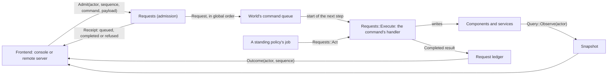
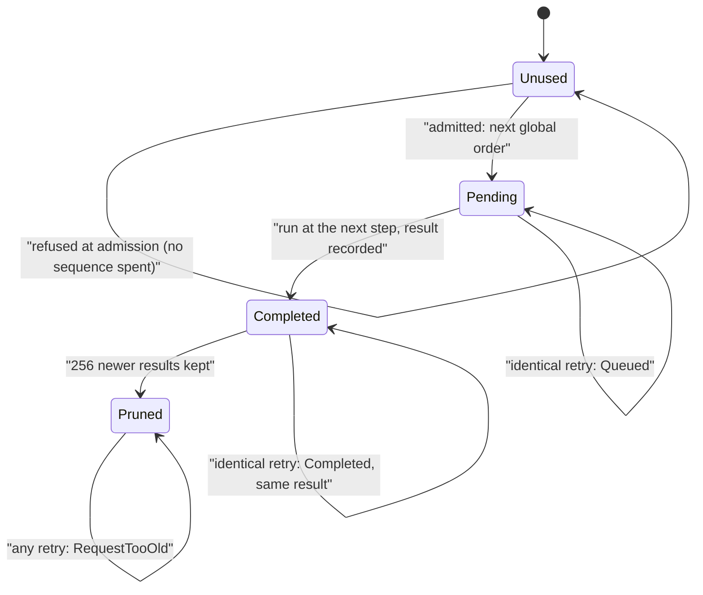

# The hosted world: state, commands and queries

The [hosted world](glossary.md#hosted-world) is the one authoritative copy of a Manifest game: a
single Jettison `SimWorld` that the [host](host.md) starts and steps. Every company, ship, order,
region and account lives in it as an [entity](../../jettison/docs/glossary.md#entity) with
[components](../../jettison/docs/glossary.md#component), and nothing else holds game state. This
document covers the three modules that frame it:

- `world` defines the state: the entities' kinds and names, the components, the initial state a
  scenario seeds, and the rules a save must keep to load.
- `command` is the one way in. A player's intention is a [request](glossary.md#request), admitted
  in order, run at the next [step](glossary.md#step) and answered with a structured result.
- `query` is the one way out. A [snapshot](glossary.md#snapshot-query) copies what one actor may
  see, at a completed step.

The [development sandbox](sandbox.md) is a separate simulation; no hosted command reads or writes
it.

The picture below shows the path a request takes, and how what it changed comes back to the player.



## Concepts

**Kind and identity.** Every hosted entity carries an `Identity`: its `World::Kind` and a text
ID, given when it is created and never changed. The kind is part of the name, so a company and an
organisation both called `Shared` are two entities, and a region's public and household accounts
both carry the region's ID. The `Identities` [world service](../../jettison/docs/glossary.md#world-service)
looks an entity up by kind and ID, and issues new IDs.

**Accounts.** An [account](glossary.md#account) is an entity of its own, of an account kind, named
by its owner's ID; its `Account` component holds a balance in whole
[credits](glossary.md#credit). Money moves between accounts, never inside an owner's component.
`World::AccountOf` gives an owner kind's account kind (a `Broker`'s is a `BrokerAccount`).

**Principal and actor.** A [principal](glossary.md#principal) is a player's control identity in the
world: a `Principal` entity with a display name, and `npc` set for one the world runs
([D-097](decision-ledger.md#d-097)). Credentials and connections are not world state. An
[actor](glossary.md#actor) is who sends a request, as the trusted caller resolved it: a principal
by its ID, or the `Administrator`, the host itself. An actor is never read from a payload.

**Request, admission and receipt.** A [request](glossary.md#request) names a command and its
version, carries its payload as canonical binary bytes, and is numbered by its actor's own
sequence. [Admission](glossary.md#admission) checks it, gives it the next global order and queues
it; the [receipt](glossary.md#receipt) says it was queued, already completed, or refused and why.

**Request ledger.** The [request ledger](glossary.md#request-ledger) is the `Requests` service's
saved record of every actor's progress: the next sequence, the pending requests, and the last 256
completed ones with their results. It is what makes a retry safe.

**Snapshot.** A [snapshot](glossary.md#snapshot-query) is a value copy of what one actor may see:
their own company, their own market reports, every tender and every region. Nothing in it points
back into the world.

## How it works

### Registering a world

The host builds the world in a fixed order, because registration order is the save's order
(`source/game/host/src/Start.cpp`):

1. `World::RegisterWorld` registers the 32 hosted components and adds `Manifest.Identities`.
2. `Command::RegisterRequests` registers `Command::Request` as the world's one queued command
   type and adds `Manifest.Requests`.
3. `Travel::Register`, `Company::RegisterCommands`, `Trade::Register`, `Policy::Register` and
   `Procurement::Register` register their systems, their commands' handlers on `Requests`, and the
   rules `Identities` holds a load to.
4. For a new world, `World::CreateInitialState` seeds the scenario, then the travel, trade and
   policy modules open the stations, post the brokers' first quotes and provision the NPC traders.

Each module's rules and lookup tables are rebuilt from the content at every start, not saved. That
is why the journal recovers a world only under the exact content and command versions it was saved
with ([D-111](decision-ledger.md#d-111), [persistence](persistence.md)); a plain `SimWorld::Load`
compares neither.

### Kinds and their IDs

The 21 kinds, and where each ID comes from:

| Kind | ID | Made by |
| --- | --- | --- |
| `Principal` | the principal's own ID | provisioning ([companies](companies.md)), or a scenario's NPC trader ([policies](policies.md)) |
| `Company`, `CompanyAccount` | issued `Company<n>` | provisioning |
| `Organisation` | the scenario's, or issued `Organisation<n>` | the scenario, or founding a homeworld ([governance](governance.md)) |
| `Region`, `PublicAccount`, `HouseholdAccount`, `Household`, `Employer`, `EmployerAccount` | the region's ID | the scenario |
| `Ship` | issued `Ship<n>` | provisioning |
| `Broker`, `BrokerAccount`, `VenueAccount`, `Market` | the venue's ID | the scenario |
| `Order` | issued `Order<n>` | placing an order ([trading](trading.md)) |
| `Project` | `<region>:<project>` (`World::ProjectId`) | the scenario, or queueing a project |
| `Tender`, `TenderAccount`, `BondAccount` | the tender's ID, from the tender counter | publishing a tender ([governance](governance.md)) |
| `Bid` | `<tender>/<company>` (`World::BidId`) | bidding |

`Identities::Issue` counts each issued kind up from 1, skips an ID the kind already holds, and never
hands one out twice: the counters are saved, so a load carries on from them. The number is spent
when it is issued, so a handler checks everything that could refuse the action first. An exhausted
counter is not a refusal: the handler throws, which stops the step. `Identities::Create` is the
only way to make a named entity, and `Destroy` the only way to remove one (a filled or expired
order is removed so). The lookup itself is not saved; every load rebuilds it from the loaded
`Identity` components and refuses two entities of one kind and ID, or an empty ID.

### The state inventory

Every authoritative value is in a registered component or a world service. The components, by the
entity that carries them (`source/game/world/include/manifest/world/State.h`):

| On | Components | Holds | Explained in |
| --- | --- | --- | --- |
| every hosted entity | `Identity` | its kind and ID | this document |
| a principal | `Principal`, `Reports` | the display name and `npc`; the player's market reports, by venue | [trading](trading.md) |
| a company | `Company`, `Stock`, `Paid`, `Licences`, `Claims` | its principal and name; its goods at each venue, available and reserved; the last price it paid for each item; the polities licensing it; the grants it has claimed | [companies](companies.md) |
| an organisation | `Organisation` | its kind and name, and the principal who directs it (empty for the AI's) | [governance](governance.md) |
| a region | `Region`, `Knowledge`, `Facilities`, `Development` | planet, civilisation, governor, population, health, happiness; skills and recipes; facilities; a player governor's development policy | [governance](governance.md), [economy](economy.md) |
| an account | `Account` | whole credits | this document |
| a ship | `Ship`, `Journey`, `Cargo`, `LifeSupport`, `Fuel`, `Refuel`, `Systems`, `Arrears`, `Policy`, `Job` | hull and dock; journey leg, the fuel it paid and an override's fine; lots and opened totes; tanks, cartridges and connection; fuel; the refuel choice; systems bought; berth debt; standing policy and job | [companies](companies.md), [travel](travel.md), [stations](stations.md), [policies](policies.md) |
| a broker | `Broker`, `Stock` | the venue's operator; the broker's goods | [trading](trading.md) |
| an employer, a household | `Stock`, `Production`, `Pantry` | goods; batches under way and the tax carry; opened totes, unmet needs and pressure | [economy](economy.md) |
| a market | `Sales`, `Fees`, `Pricing` | recent fills and last sales; posted charges; the fee level | [trading](trading.md), [stations](stations.md) |
| an order | `Order` | its terms, what remains, its escrow, its expiry and the request that placed it | [trading](trading.md) |
| a project, a tender, a bid | `Project`, `Stock`, `Tender`, `Bid` | phase, work and queue place, and delivered inputs; terms, closes, award and deliveries; a sealed total and revision | [governance](governance.md) |

Goods are counted in whole [totes](glossary.md#tote) and money in whole credits; a price is a
[decimal price](glossary.md#decimal-price) saved as its raw microcredits, never as a `double`.
`Travel::Register` attaches 18 engine components after these, a ship's place in space (transforms,
bodies, docking, lanes and cruise; see [travel](travel.md)). The world's three services, in the
order they are added, are `Manifest.Identities` (the ID counters), `Manifest.Requests` (the
request ledger) and Jettison's `physics`. The host suite pins both lists
(`source/game/host/tests/HostTests.cpp`).

Some things are deliberately not state: the token file, the server's sessions and unsent replies,
the pause and time compression, the event queue, the frontends' own state and every wall-clock
time. Timing lives in the clock's step and in steps written into state (an order's expiry, a
tender's closes, a job's retry), so no system keeps a timer of its own.

### The initial state

`World::CreateInitialState` seeds a new world from the selected [scenario](content.md), in its
authored order, so the same content always makes the same world (the `world` suite compares two
worlds' [state hashes](../../jettison/docs/glossary.md#state-hash)):

1. Each organisation, directed by no player.
2. Each region, with its `Knowledge` and `Facilities`, its public and household accounts at their
   authored funds, its `Household` (an empty `Stock` and `Pantry`), its `Employer` (`Stock`,
   `Production`) and employer account, and its projects. The first project is `Tendering`, the
   rest `Queued` behind it ([D-110](decision-ledger.md#d-110)).
3. Each venue: a [broker](glossary.md#broker) holding the venue's authored stock, the broker's
   account at `brokers.treasury` in `data/tuning/balance.yaml`, the venue's empty account, and the
   `Market` with its `Sales`, its `Fees` from the tuning's `charges` and its `Pricing` level.

It throws `std::invalid_argument` for a content set with no scenario selected, or a world that
already holds any of these entities. No player exists yet: players arrive by provisioning.

### What a load refuses

A save is the world's own (`SimWorld::Save`); how the engine checks and commits one whole is in
[Jettison's persistence](../../jettison/docs/persistence.md#the-worlds-save). On top of that,
`Identities::Load` holds the loaded entities to Manifest's rules before anything is committed. A
save that breaks one fails as a `FormatError` and leaves the running world as it was. Each
component type has a `World::Broken` check for its own rules (sorted, none twice, no empty
holding, finite and not below 0), and the cross-entity rules include:

- every sell order's remaining totes are exactly what its owner reserves at that venue, and the
  reverse;
- an order's owner, the owner's account and the venue's account exist;
- arrears are owed only by a docked ship, and a ship's life support is connected only to a venue
  the world holds;
- a region works at most one project at a time, and each project has its `Stock` and its region;
- an open tender's account holds its budget, an awarded one's holds its total less what it has paid,
  and its bond is in its `BondAccount`; a bid is on an open tender, within its budget;
- a market report is of a venue the world holds.

The rules that need content are given to `Identities` by the modules that own them, at
registration:

| Setter | Given by | Then a load also checks |
| --- | --- | --- |
| `SetHolds` | `company` | each ship's cargo fits its hull and systems |
| `SetFuelTanks` | `company` | each ship's fuel fits its tanks |
| `SetLifeSupport` | `company` | each tank and cartridge holds no more than its hull's |
| `SetCharges` | `company` | every market has `Fees` for every pad class, within the usury limit |
| `SetTotes` | `trade` | an opened tote holds no more than one tote of its item; the tax carry is below one credit's gross |
| `SetProjects` | `procurement` | each project is one the content defines, worked within its steps, holding only what it needs |

Without a setter, as in a test world with no company commands, a load checks that component's own
rules alone.

### Admission

`Requests::Admit` is the only way a request reaches the world. A frontend calls it with the actor
it has resolved, the actor's sequence, the command's name and version and the payload bytes. The
console resolves the actor from its command line and the [server](server.md) from the session's
[token](glossary.md#token). Admission checks, in this order:

1. The actor: an ID of 1 to 256 bytes (`kMaxActorIdBytes`) and, for a principal, one the world
   has. Otherwise `NotAuthorised`.
2. A sequence the actor has already used is answered from the ledger, before any handler is asked.
   Below the retained range it is `RequestTooOld`. Otherwise an identical request (same command,
   version and bytes) gets its original receipt, `Queued` with its order or `Completed` with its
   result and step, and a different one is `RequestConflict`.
3. The command: registered at exactly this version (`UnsupportedCommand`), sendable by this
   actor's kind (`NotAuthorised`), a payload of at most 4,096 bytes (`PayloadTooLarge`) that
   decodes as the command's type (`MalformedPayload`).
4. The sequence: exactly the actor's next (`SequenceGap`), with room left to count
   (`SequenceExhausted`).
5. Room: at most 32 pending requests for the actor and 1,024 in the world's queue (`QueueFull`).

A refusal consumes no sequence and writes nothing. A request that passes gets the next global order
and is pushed onto the world's command queue as a `Command::Request`. It runs at the start of the
next step. Admission promises nothing about the outcome: a request admitted now may still be
rejected when it runs, because earlier requests in the same step can spend the money or take the
pad it needed.

The limits are constants in `source/game/command/include/manifest/command/Request.h`, and a save
is held to them:

| Constant | Value | Bounds |
| --- | --- | --- |
| `kRetainedResults` | 256 | completed results kept per actor |
| `kPendingPerActor` | 32 | an actor's requests admitted and not yet run |
| `kQueueCapacity` | 1,024 | requests queued on the world |
| `kMaxPayloadBytes` | 4,096 | one request's payload |
| `kMaxActorIdBytes` | 256 | an actor's ID, so a journal batch of the most requests stays readable |

### Running a request

`SimWorld::Step` first applies the queued commands in queue order, which is admission's global
order, then runs the systems ([the step, in order](architecture.md#the-step-in-order)). Each
request goes to `Requests::Execute`, which moves it from the actor's pending list to their
completed list and calls the command's handler with the actor. The handler checks the world as it is
now, not as it was at admission: ownership, docking, funds, stock and capacity. Its `Result` is
recorded with the step it ran at, which is the clock's step before the step advances it.

While a handler runs, `Requests::Running()` and `RunningOrder()` give its request's sequence and
global order, so an order can record the request that placed it and a bid the order it was accepted
at.

`Command::Result` lists every outcome. `Succeeded` and the admission codes above belong to this
module; the rest are the commands' own (`InsufficientFunds`, `NotDocked`, `BookFull`,
`Governed`, ...), and each feature document lists its command's codes. A rejection is an expected
answer, not an error, and the frontend owns its wording.

### Retries and the ledger

An actor numbers their requests 1, 2, 3, ..., and a frontend that does not know where it is asks:
`Requests::NextSequence(actor)` is advertised when a remote client connects and with every reply.
Retrying a sequence is always safe: it never runs twice. Sessions of one actor share the sequence,
so two frontends that clash get `RequestConflict` ([D-082](decision-ledger.md#d-082)).

The life of one sequence is shown below. Every sequence below the actor's `next` was admitted;
those from `floor` are completed and then pending; those below `floor` were pruned.



A request with the same sequence but another command or payload is `RequestConflict` while it is
pending or completed. Pruning is by count, never by time, and `floor` is saved, so a pruned
sequence is still too old after a restart. A rejected request still spends its sequence.

`Requests::Outcome(actor, sequence)` returns a completed request's result while it is retained.
It is the sender's alone, as a snapshot is.

A receipt is not a durable acknowledgement. A server's crash loses what ran since its journal's last
flush, and those sequences are then free again ([D-113](decision-ledger.md#d-113),
[saves and the journal](persistence.md)).

### Acting for the world's own agents

A standing policy's job trades for its ship's owner, a player's or an NPC's, through the same
commands a player sends ([D-097](decision-ledger.md#d-097)). It calls `Requests::Act`, which checks
the command, version, actor and payload and runs the handler at once. There is no admission,
sequence, ledger entry or queue, and nothing is recorded, because the state that made the job act
makes it act again in a replay, as Jettison's `SimWorld::Apply` does
([commands](../../jettison/docs/simulation.md#commands-controllers-and-the-helm)). `Running()` is 0
while it runs. NPC traders are provisioned the same way, with the `Administrator` acting.

### Saves and replay

The ledger is saved as one `Command::RequestLedger`: the last global order and each actor's
`next`, `floor`, completed and pending requests. A save loads only if the world's queue holds
exactly every actor's pending requests, in admission's order, each one a payload its command can
read. A pending request the queue lacked would answer its retry as queued for ever.

With recording on, the world keeps every request it ran with its step
([replay](../../jettison/docs/simulation.md#saving-hashing-and-replay)). Fed back to a world
loaded from the same start, `Execute` rebuilds each actor's ledger as it runs them, without
admission, and skips one already completed. A request no admission could have made (out of
sequence, or not the one pending) throws `std::logic_error` and stops the step. The journal
([persistence](persistence.md)) is built on this: it writes the requests of each run of steps, and
a restart replays them over the last snapshot.

### Transaction boundaries

Jettison leaves a world part-way through a step when a command or a system throws, and only a load
recovers it ([a step](../../jettison/docs/simulation.md#a-step)). So every expected failure is a
`Result` decided before the first write, and a throw means an invariant broke:

| Unit | Plans before writing | On an expected failure |
| --- | --- | --- |
| one admitted command | everything it will write: reservations, its whole matching pass, fees, refunds, counters | refused with no business write; only the clock and the ledger's outcome change |
| the expiry sweep, once a step | every refund of the step's expiries | none expected: the refunds are already escrowed |
| one broker's requote | cancelling its orders, their refunds, its new orders and their matching | it posts what it can fund |
| one travel transition | the journey's next leg and the engine command that leads to it | the journey records the refusal and waits or fails, the cargo kept |

Each command's rules are in its feature document: [trading](trading.md) for matching and
settlement, [travel](travel.md) for journeys.

### Queries

`Query::Observe(world, identities, actor)` copies out a `Snapshot`. It is called between steps,
never from a handler, so it reads only completed state, and observing changes nothing (the `query`
suite checks the state hash). What each actor sees:

| Part | A principal | The `Administrator` |
| --- | --- | --- |
| `step` | the steps completed | the same |
| `companies` | their own company, none before provisioning: credits, holdings, ships (dock, cargo, journey, life support, hold, systems, policy, job, fuel), resting orders oldest first, sealed bids | every company |
| `markets` | their own [reports](glossary.md#report-market), each `live` only if observed by a docked ship at this step | none: it has no fleet |
| `tenders` | every tender, open or kept closed | the same |
| `regions` | every region with its governor and condition; the treasury, queue and development policy only of a region they direct | every region in full |

A principal the world does not have sees no company and no market, but still the public tenders
and regions. Market visibility follows the fleet-observation rule in [trading](trading.md): a venue
the player has no report of is unknown to them, and no other company's stock, credits or orders
are ever in a snapshot. The [server](server.md) sends each session its actor's snapshot after each
step; frontends own all wording.

## Using it

### From the console

The console's hosted commands go through the same admission. This session is the console suite's
(`source/tools/console/tests/ManifestConsoleTests.cpp`), with output shortened; see
[the console](console.md) for every command.

```text
> host trading
> provision Ada "Ada Co"
Queued Host's request 1 in order 1: it runs at the next step.
> step
... Manifest.Company.Provision: Succeeded at step 0
> observe Ada
... Company1 'Ada Co': 25000 credits
... Ship1 HullLoneTraderStarter, docked at VenueOreHighport
> cargo load Ada Ship1 VenueOreHighport ItemCopper 3
Queued Ada's request 1 in order 2: it runs at the next step.
> step
... InsufficientStock at step 1
> cargo load Bea Ship1 VenueOreHighport ItemCopper 3
Refused: NotAuthorised.
```

The load is admitted and then rejected by the command's own rules (Ada's company holds no copper
there). Bea's is refused at admission: the world has no principal `Bea`, so nothing is queued.

### Registering a command and admitting it

A module registers each command once, with its payload type, version and the one actor kind that
may send it. This is the command suite's test command
(`source/game/command/tests/CommandTests.cpp`):

```cpp
requests.Register<Grant>(
    "Test.Grant", grantVersion, ActorKind::Principal,
    [this](SimWorld &target, const Actor &actor, const Grant &grant)
    { return ApplyGrant(target, actor, grant, identities); });

const std::vector<std::byte> payload =
    BinaryArchive::Write(Grant{"RegionA", amount}, FormatVersion{kGrantVersion});
const Receipt receipt =
    requests.Admit(world, actor, sequence, "Test.Grant", kGrantVersion, payload);
```

The payload type is registered with Reflect, and its version is the binary archive's
[format version](../../jettison/docs/glossary.md#format-version). A handler returns a `Result` and,
for anything but `Succeeded`, has written nothing.

### Observing

From `source/game/query/tests/QueryTests.cpp`:

```cpp
const Snapshot adas = Manifest::Query::Observe(world, identities, kAda);
REQUIRE(adas.companies.size() == 1);
CHECK(adas.companies[0].companyId == "Company1");
```

### The registered commands

`Requests::Commands()` lists them in name order; a world's identity file records the list
([D-111](decision-ledger.md#d-111)). The hosted build registers 22:

| Command | Version | Sent by | Explained in |
| --- | --- | --- | --- |
| `Manifest.Company.Provision` | 1 | `Administrator` | [companies](companies.md) |
| `Manifest.Company.Load`, `Unload`, `Refill`, `Replace`, `Upgrade`, `SetRefuel` | 1 | principal | [companies](companies.md), [stations](stations.md) |
| `Manifest.Company.SetFees` | 1 | principal | [stations](stations.md) |
| `Manifest.Company.Found` | 1 | principal | [governance](governance.md) |
| `Manifest.Trade.Place`, `Cancel` | 1 | principal | [trading](trading.md) |
| `Manifest.Travel.Travel` | 2 | principal | [travel](travel.md) |
| `Manifest.Policy.Set` | 2 | principal | [policies](policies.md) |
| `Manifest.Procurement.Queue`, `SetDevelopment`, `CancelProject`, `Publish`, `Cancel`, `Bid`, `Withdraw`, `Deliver`, `Abandon` | 1 | principal | [governance](governance.md) |

## Limits and open work

- One world per host: a request carries no world ID, and none is needed until a host runs more
  than one world.
- Snapshots are whole, sent after each step; deltas wait until a measurement shows they are needed.
- A receipt is not durable: see [saves and the journal](persistence.md), and moving saves off the
  step's thread, [L40](delivery-order.md#l40).
- A command's version is fixed for a world's life until player testing: the journal refuses to
  recover a world under a build with another version ([D-111](decision-ledger.md#d-111)).

## Decisions

The decisions are under [the hosted world](decision-ledger.md#the-hosted-world-state-commands-and-queries)
in the decision ledger. The key ones: [D-082](decision-ledger.md#d-082) (sessions share an actor's
sequences), [D-089](decision-ledger.md#d-089) (a new player gets a company and a ship, no region),
[D-097](decision-ledger.md#d-097) (jobs act through the players' commands),
[D-111](decision-ledger.md#d-111) (a world loads only under its own content and command versions)
and [D-113](decision-ledger.md#d-113) (what a crash may lose). How the boundary was designed is in
[the Stage 3 record](history/stage-3-authority-plan.md).

## Source

| Module | Key headers | Suite |
| --- | --- | --- |
| `source/game/world` | `World.h` (`RegisterWorld`, `CreateInitialState`), `State.h` (kinds and components), `Identities.h` | `world` |
| `source/game/command` | `Request.h` (`Result`, `Actor`, `Request`, the limits), `Requests.h` (`Requests`, `Receipt`) | `command` |
| `source/game/query` | `Query.h` (`Observe`, `Snapshot` and its views) | `query` |

The host's inventory test (`source/game/host/tests/HostTests.cpp`) pins the component and service
lists, and the fixtures in `source/test/FixtureTests.cpp` drive whole scenarios through admission.
